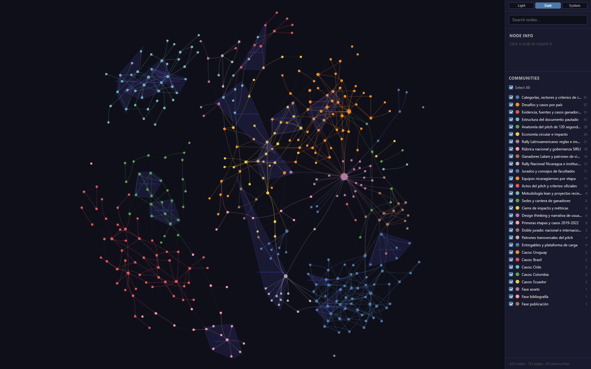
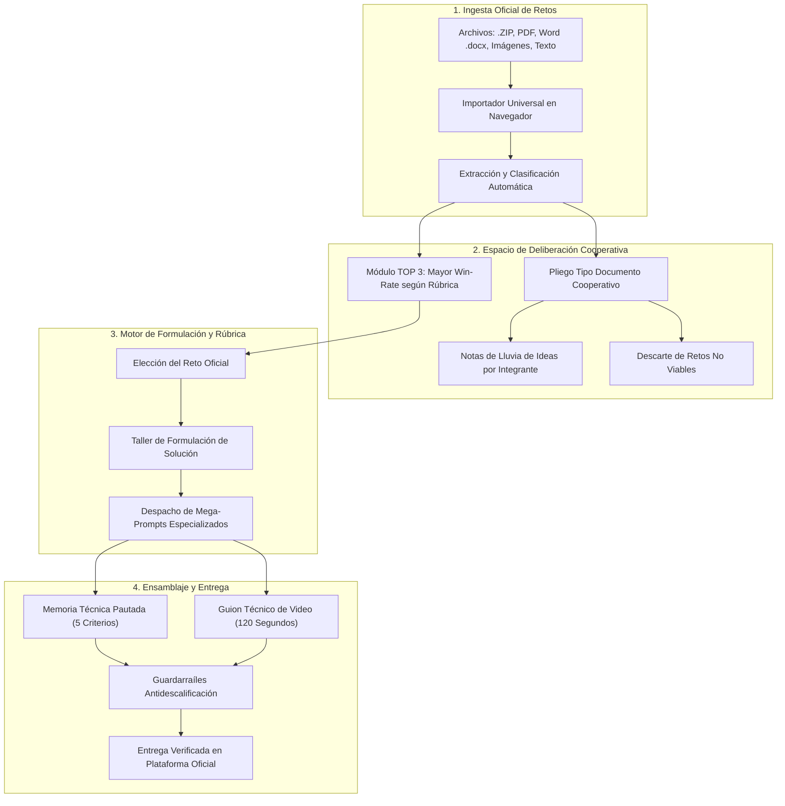

# Rally Studio · Workbench de Innovación

[](#)
[](#)
[](#cerebro-de-conocimiento-en-qué-se-basa-el-sistema)
[](#)
[](docs/EQUIPO_AGENTES.md)

> **Workbench interactivo secuencial para guiar, estructurar y optimizar el desempeño metodológico de equipos universitarios en maratones de innovación de 24 y 28 horas continuas (Rally Latinoamericano de Innovación y Rally Nacional Nicaragua Innova).**

---

<p align="center">
  
</p>
<p align="center"><em>Figura 1: Rally Studio — Workbench de Innovación: Sistema de dirección táctica, deliberación colaborativa y calibración de rúbricas para certámenes oficiales.</em></p>

---

## Índice
- [Instalación, uso y despliegue](#instalación-uso-y-despliegue)
- [¿Qué es Rally Studio?](#qué-es-rally-studio)
- [Cerebro de Conocimiento: En qué se basa el sistema](#cerebro-de-conocimiento-en-qué-se-basa-el-sistema)
- [Informe de sustento de la investigación](#informe-de-sustento-de-la-investigación)
- [¿Cómo funciona Rally Studio? (Arquitectura y Flujo)](#cómo-funciona-rally-studio-arquitectura-y-flujo)
- [Módulos Principales del Workbench](#módulos-principales-del-workbench)
- [Calibración Matemática de Rúbricas Oficiales](#calibración-matemática-de-rúbricas-oficiales)
- [Resiliencia en Redes Universitarias Hostiles](#resiliencia-en-redes-universitarias-hostiles)
- [Instalación y Uso Rápido (Windows)](#instalación-y-uso-rápido-windows)
- [IA Gratis Local (Opcional, Recomendado)](#ia-gratis-local-opcional-recomendado)
- [Equipo de Agentes Especialistas (orquestación)](#equipo-de-agentes-especialistas-orquestación)

---

## Instalación, uso y despliegue

**Guía completa: [`docs/INSTALACION_Y_DESPLIEGUE.md`](docs/INSTALACION_Y_DESPLIEGUE.md)**
**Manual de las IAs (OpenCode, Antigravity, MCPs, configuración): [`docs/MANUAL_IA.md`](docs/MANUAL_IA.md)**

| Quiero… | Atajo |
|---|---|
| Configurar OpenCode o Antigravity paso a paso | [`docs/MANUAL_IA.md`](docs/MANUAL_IA.md) |
| Compartir el proyecto en vivo con el equipo | `python scripts/crear_proyecto.py --project mi-grupo --name "Ana"` y repartir un enlace por persona ([§9.1](docs/INSTALACION_Y_DESPLIEGUE.md#91-compartir-el-proyecto-con-el-equipo)) |
| Instalar y correr en mi PC (completo) | `pip install -r requirements.txt` → doble clic en **`Iniciar Rally.bat`** → <http://localhost:8000/dashboard/> |
| Conectar IA gratis | Instala OpenCode (`npm i -g opencode-ai` + `opencode auth login`) o usa un endpoint OpenAI-compatible ([`AUTO_IA.md`](AUTO_IA.md)) |
| Ver cómo el sistema monta un equipo de agentes especialistas | [`docs/EQUIPO_AGENTES.md`](docs/EQUIPO_AGENTES.md) |
| Publicar la interfaz en GitHub Pages | Activar **Settings → Pages → Source: GitHub Actions** (workflow `.github/workflows/pages.yml` incluido) |
| Desplegar el sistema completo (con IA) en un servidor | [`docs/INSTALACION_Y_DESPLIEGUE.md` §9](docs/INSTALACION_Y_DESPLIEGUE.md) |
| Subir esto a GitHub | [`docs/INSTALACION_Y_DESPLIEGUE.md` §10](docs/INSTALACION_Y_DESPLIEGUE.md) |

> **Dos modos:** en local tienes todo (telemetría, OCR, IA automática, colaboración en vivo con invitaciones).
> En GitHub Pages solo la interfaz (los datos se guardan en tu navegador).

---

## ¿Qué es Rally Studio?

Rally Studio es una herramienta de ingeniería metodológica desarrollada desde la experiencia de competidores y ganadores de la **Universidad Nacional de Ingeniería (UNI)**. 

En un certamen de 28 horas continuas, la causa principal de derrota no es la falta de creatividad, sino la **fatiga cognitiva**, la pérdida de tiempo estructurando documentos pautados a última hora, la incongruencia entre el presupuesto y el video pitch (120 s), y el desconocimiento de las rúbricas evaluadoras.

Rally Studio sustituye la improvisación por un **flujo estricto guiado** que lleva al equipo paso a paso desde el análisis de las bases hasta la entrega final verificada.

---

## Equipo de Agentes Especialistas (orquestación)

> **Rally Studio no es un asistente: es un equipo.** Un **director** despacha
> especialistas que trabajan **a la vez** sobre los mismos contratos de
> producción — y una **guardia técnica de GPU/CPU/RAM** garantiza que los
> procesos pesados (Blender, ffmpeg, TTS, grabación) no choquen por recursos.

- **Cada pieza se justifica sola**: existe una *toma* del video (contrato YAML)
  que la pide **y** un criterio de la **rúbrica** que sostiene. Nada se produce
  "porque sí"; nada de cubos hechos "sensor".
- **Guionista y modeler se hablan por contrato**, no por memoria: la lista de
  tomas (`shots/*.yaml` → `shotlist.csv`) dice qué pieza entra en cámara, en
  qué acto y por cuántos segundos; la lista de materiales (`budget/bom.csv`)
  da componentes reales, dimensiones en mm y precios con URL.
- **Ficha técnica obligatoria antes de modelar**: materiales elegidos y
  justificados antes de la geometría, espacio real para cables y tornillos,
  diseño pensado para la cámara, validación física mínima y techo global de
  horas 3D.
- **Guardia de recursos con PID, prioridad y timeout**: creación y robo
  atómicos, auto-limpieza de huérfanos, bloqueo de llamadas directas a
  binarios pesados. La PC no se congela.
- **Tablero en vivo del equipo**: `python scripts/orchestrate.py status`.

Detalle completo, roles y comandos: **[`docs/EQUIPO_AGENTES.md`](docs/EQUIPO_AGENTES.md)**.

---

## Cerebro de Conocimiento: En qué se basa el sistema

<p align="center">
  
</p>
<p align="center"><em>Figura 2: Cerebro de Conocimiento Real (Graphify) — Captura del visualizador interactivo (graph.html) mostrando los 420 nodos, 732 aristas y 29 comunidades (criterios de rúbricas, banco de ganadores 2014–2026 y patrones técnicos).</em></p>

El motor analítico de Rally Studio opera sobre un grafo de conocimiento estructurado con **Graphify** (`graphify-out/`), compilando **420 nodos, 732 aristas y 29 comunidades de conocimiento**.

### ¿Qué es Graphify en este sistema?
Es el cerebro de datos relacionales del sistema. En lugar de procesar documentos como texto plano, Graphify convierte investigaciones, reportes de jurados, memorias oficiales y bases históricas en una red de entidades interconectadas. Permite consultar al instante:
- **God Nodes (Nodos de Máxima Influencia):** Los conceptos centrales que más pesan en la deliberación (`Rally Latinoamericano de Innovación`, `Nicaragua`, `Rally Nacional de Innovación Nicaragua Innova`, `Jurado Nacional del Rally`, `Área Innovación`).
- **Conexiones Semánticas Ocultas:** Relaciones entre la narrativa del pitch de 120 segundos y la asignación de puntajes por segundo de exposición.

### Qué entra al cerebro y qué no

El cerebro aprende **solo conocimiento de dominio**. No lee el motor (`scripts/`, `dashboard/`, `site/`), ni las instrucciones de instalación, ni los pautados de ediciones anteriores. Eso es deliberado: el equipo no necesita que la IA sepa programar el sistema, necesita que sepa ganar el certamen.

El detalle del corpus y de cómo reconstruirlo está en [`brain/README.md`](brain/README.md).

### Investigaciones en las que se basa el Grafo:
Graphify fue construido a partir del procesamiento y auditoría de las 16 fuentes del corpus (`brain/corpus/`):
1. **Auditoría Histórica de Proyectos Campeones (`knowledge/winners_latam.md` y `brain/corpus/analisis_nicaragua.pdf`):** Análisis de más de 50 iniciativas premiadas entre 2014 y 2026 (LexoStop, MT Soluciones, Güegüense Pinolero, STEM Synergy, Mentes Volcánicas). Se extrajo el principio de **Hibridación Ciberfísica** (hardware tangible COTS + software) con 30% más probabilidad de podio.
2. **Ingeniería Inversa de Rúbricas Oficiales (`rubrica_oficial_latam.jpeg`, `knowledge/rubric_matrices.md` y `knowledge/rubric_latam.md`):** Mapeo de los 5 criterios continentales (100 puntos) y las 3 categorías nacionales (CNU/Comisión Creativa), transcritos desde la imagen oficial.
3. **Análisis de Dispersión y Sesgo de Evaluación (`knowledge/rally_analysis.txt`):** Identificación del patrón de **doble codificación**: cómo satisfacer simultáneamente el filtro del jurado nacional (anclaje territorial y políticas públicas) y el del jurado internacional (escalabilidad regional y novedad).
4. **Documentos Pautados de Referencia (`knowledge/pautado_nacional_ref.docx` y `knowledge/pautado_latam_ref.docx`):** desglose de conteo de caracteres, prefactibilidad económica y coherencia de costos.
5. **Reporte de Investigación Profunda (`chatgptdeep-research-report.md`):** Estudio de cronometría audiovisual (fórmula PAS-V en 4 actos de 120 segundos) y errores frecuentes de descalificación en la plataforma SIRLI.
6. **Banco de retos y claims verificables (`research/`):** los 5 desafíos priorizados con su puntaje, y las estadísticas con fuente, año y URL.

- **Visualizador interactivo del grafo:** [`graphify-out/graph.html`](graphify-out/graph.html)
- **Informe de auditoría de nodos y comunidades:** [`graphify-out/GRAPH_REPORT.md`](graphify-out/GRAPH_REPORT.md)
- **Base relacional JSON:** [`graphify-out/graph.json`](graphify-out/graph.json)

### Informe de sustento de la investigación

Si quieres saber **en qué se basa el sistema, qué encontramos y por qué gana quien gana**, lee el informe completo:

**[`docs/INFORME_INVESTIGACION.md`](docs/INFORME_INVESTIGACION.md)** · [versión PDF](docs/INFORME_INVESTIGACION.pdf)

La versión PDF está maquetada con los tokens de marca e incluye doce figuras vectoriales: escala del Rally Nacional, podios de Nicaragua en el Rally Latinoamericano, rúbricas, pautado, guion PAS-V, presupuesto, evolución del naming y de la complejidad técnica, clusters temáticos, podios por universidad, cambio de capacidades con intervalos de confianza y el índice de preparación competitiva.

Analiza **evento por evento, categoría por categoría, equipo por equipo y video por video**: las cuatro ediciones del Rally Nacional, las trece del Rally Latinoamericano, los veintisiete ganadores nacionales, los diez podios internacionales y el catálogo audiovisual. Incluye un modelo cuantitativo propio (IPC) con pruebas estadísticas, intervalos de confianza y análisis de sensibilidad; las rúbricas de ambos certámenes; la anatomía del video de 120 segundos; y las diez reglas que sostienen el patrón de victoria.

> Lectura recomendada antes de usar cualquier cifra del repositorio en un pautado o en un video.

---

## ¿Cómo funciona Rally Studio? (Arquitectura y Flujo)

El workbench canaliza las 28 horas de competencia a través de una secuencia de fases interdependientes:

```
+---------------------------------------------------------------------------------------+
|                                FLUJO TÁCTICO RALLY STUDIO                             |
+---------------------------------------------------------------------------------------+
|  01. CERTAMEN        --> Configuración de reglas (Latam 28h vs Nacional 24h).          |
|  02. EQUIPO          --> Conformación multidisciplinaria y asignación de roles.       |
|  03. RETOS (COMITÉ)  --> Importador multiformato + Deliberación cooperativa + TOP 3.  |
|  04. TALLER SOLUCIÓN --> Formulación del WOW Factor y tesis arquitectónica.           |
|  05. DESPACHO IA     --> Generador de mega-prompts técnicos de ingeniería y canvas.   |
|  06. PAUTADO OFICIAL --> Redacción asistida de la memoria técnica de 5 secciones.     |
|  07. PRESUPUESTO     --> Tabla económica sustentada y cuadratura de costos.           |
|  08. GUION PITCH     --> Cronometría estricta de 120 segundos para YouTube.          |
|  09. CHECKLIST       --> Guardarraíles antidescalificación antes de la subida a SIRLI.|
+---------------------------------------------------------------------------------------+
```



---

## Módulos Principales del Workbench

### 1. Importador Multiformato & Espacio Cooperativo
- **Carga universal:** Acepta comunicados oficiales en `.zip` (carpetas de fotos/documentos), `.pdf` (vía PDF.js), `.docx` (vía Mammoth.js), imágenes (`.png, .jpg`) y texto plano sin requerir backend ni conexión externa.
- **Vista Dual de Trabajo:**
  - **Modo Documento Cooperativo:** Permite leer todos los retos en formato continuo, registrar lluvia de ideas por integrante del equipo y descartar opciones inviables con 1 click.
  - **Modo Tarjetas Tácticas:** Vista condensada con indicadores de win-rate y accesos rápidos a análisis estratégico.
- **Importar visible y lista editable:** el botón de importación queda siempre a la vista y la lista cargada muestra cada reto con su acción de borrado. Importar con la lista ya cargada **suma** por defecto; reemplazar es una decisión explícita.
- **Ranking TOP 3 en Radar:** Algoritmo que clasifica los 3 retos con mayor probabilidad de victoria evaluando viabilidad técnica, potencial de novedad y alineación con ODS. Si no hay precedente histórico, el puntaje se calcula con los criterios reales del reto y se marca como `criterios`; no se inventa un win-rate plano.

### 1.1 Guardas de ingesta de retos

El parser vive en `dashboard/challenge_parser.js`, separado de `app.js` para poder probarlo sin DOM (`tests/test_challenges_parse.py`).

- **Un informe no es un catálogo:** solo abre reto un encabezado `RETO n:` / `DESAFÍO n:`, o una lista numerada cuyo título sea plausible. Encabezados de sección («3 El reporte nacional», «La lógica común», «Anexos 17.1…») se rechazan.
- **IDs sanos:** IDs repetidos se renumeran y al reemplazar la lista se renumera desde `01`.
- **Sin duplicados:** al sumar retos se descarta el título ya existente y se continúa la numeración.
- **Purga en cascada:** borrar un reto elimina sus votos, sus ideas de deliberación y la selección activa que lo apuntaba, para no dejar referencias huérfanas.

### 2. Taller de Solución y WOW Factor
Formulación de la tesis de impacto, diferenciación de la competencia y anclaje a las necesidades reales del certamen.

### 3. Despacho Multi-IA Especializado
Generador de mega-prompts pre-configurados (con rol, contexto del reto, restricciones de caracteres y formato oficial de salida) para consultar cualquier modelo de lenguaje sin perder tiempo redactando prompts desde cero.

### 4. Guardarraíles Antidescalificación
Checklist crítico que valida antes del cierre:
- Duración del video menor o igual a 120 segundos exactos.
- Privacidad del video en YouTube (Público u Oculto, **nunca Privado**).
- Nomenclatura del archivo PDF según el estándar exigido por el comité.
- Coherencia matemática: los costos mencionados en el video deben cuadrar al centavo con la tabla de presupuesto.

### 5. Super Agentes (Herramientas del topbar)
El cuadrito **Herramientas** del topbar abre seis agentes especializados: Revisor de Guión, Analizador de Presupuesto, Analizador de Pautado, Analizador de Canvas, Analizador de Documentos y Guía de Editor de Video.

- **Checks locales primero, sin IA:** cada panel valida al instante contra la rúbrica activa (duración y actos del guion, rango y filas del presupuesto, topes y datos repetidos del pautado, los 9 bloques del canvas, naming de assets). Funcionan incluso con el servicio apagado.
- **Tres acciones por agente:** generar un prompt con todo el contexto del proyecto para llevarlo a cualquier IA; pegar la respuesta externa para contrastarla; o analizar el contenido actual con la IA local del servicio (`/api/ai`).
- **La rúbrica va compilada y citada:** `dashboard/super_agents_rubrics.js` destila `knowledge/` y `.agents/rules/` con la referencia de cada regla; no inventa límites.
- **Nunca sobrescribe:** veredictos, problemas y ajustes viven en el panel. Un ajuste se copia al portapapeles y salta a su pestaña; pegar y guardar es decisión del humano.
- **Salida honesta:** si el servicio no tiene proveedor, está apagado o devuelve texto sin JSON, el panel lo dice tal cual y muestra la respuesta cruda etiquetada.

---

## Calibración Matemática de Rúbricas Oficiales

Rally Studio adapta su interfaz según el certamen activo seleccionado en la Fase 01:

| Certamen | Duración | Categorías | Foco de Evaluación |
|---|:---:|---|---|
| **Rally Latinoamericano de Innovación** | **28 Horas** | 1. Innovación<br>2. Impacto Social | Escalabilidad internacional, originalidad tecnológica y rigor técnico-financiero (100 pts). |
| **Rally Nacional Nicaragua Innova** | **24 Horas** | 1. Innovación Tecnológica<br>2. Innovación Social<br>3. Procesos y Organización | Articulación territorial, viabilidad local con actores institucionales e impacto comunitario. |

---

## Resiliencia en Redes Universitarias Hostiles

El sistema está diseñado bajo el principio de **cero fricción en entornos de red universitarios**:
- **Sincronización por secciones:** el tablero guarda en el servidor local solo lo que cambió, con versión y autor. Dos personas no se pisan: un conflicto muestra ambas versiones y nunca se fusiona solo.
- **Invitaciones de un solo uso:** el operador crea el proyecto y reparte un enlace por persona (48 h por defecto). Cada miembro entra sin instalar nada; el acceso se revoca desde `dashboard/admin.html` (pega allí el token de operador que imprime el CLI) y se corta en ≤1 s.
- **Persistencia en LocalStorage:** el progreso se conserva intacto ante cierres accidentales de pestaña o reinicios del equipo, y sigue editable sin red.
- **Exportación e Importación JSON:** posibilidad de descargar el estado completo del proyecto en un archivo ligero (`.json`) para transferirlo por memoria USB o compartirlo entre integrantes sin depender de internet.
- **Diseño Sobrio y Profesional:** cero distracciones, sin emojis, tipografía optimizada para lectura en ambientes oscuros y largas jornadas de trabajo continuo.

### Compartir el proyecto en tres pasos

```powershell
# 1. El operador crea el proyecto e imprime el token y un enlace por persona
python scripts/crear_proyecto.py --project mi-grupo --name "Ana"

# 2. Reparte un join_url por integrante (un solo uso, vence en 48 h)
# 3. Administra el grupo en:
#    http://localhost:8000/dashboard/admin.html  (pega el token de operador)
```

**Blindaje:** sin sesión válida no se lee ni se escribe; `state.json`, `members.db`,
`sections.db` y el buzón no se sirven como archivos estáticos; las subidas exigen
sesión; la revocación corta el acceso en ≤1 s y la cola offline de un revocado
nunca se sube; un proyecto vacío no devuelve datos de otro.

**Límite:** si el wifi del campus aísla clientes (AP isolation), los equipos no se
ven entre sí y el modo local no funciona. El modo nube está diseñado en
[`docs/superpowers/specs/2026-10-19-colaboracion-en-vivo-design.md`](docs/superpowers/specs/2026-10-19-colaboracion-en-vivo-design.md),
pero todavía no está implementado.

---

## Instalación y Uso Rápido (Windows)

Requisitos: **Python 3.10+** y, para el puente de IA automático, **OpenCode** (`npm i -g opencode-ai`) o cualquier endpoint OpenAI-compatible. La interfaz funciona sin servidor, pero la colaboración en vivo y la IA requieren el servicio local.

```powershell
pip install -r requirements.txt

# Doble clic en "Iniciar Rally.bat", o:
powershell -ExecutionPolicy Bypass -File .\iniciar_rally.ps1
```

El lanzador arranca el servicio local desacoplado (sobrevive al cierre de la consola), guarda su registro en `%TEMP%\rally_service.log` y abre el panel en <http://localhost:8000/dashboard/>.

| Escenario | Comando |
|---|---|
| Arranque normal (puerto 8000) | `.\iniciar_rally.ps1` |
| Segunda sesión de pruebas | `.\iniciar_rally.ps1 -Puerto 8080` |
| Sin tocar nada de IA | `.\iniciar_rally.ps1 -SinIA` |

## IA Gratis Local (Opcional, Recomendado)

El OCR por IA visual, el botón **Pulir** y el copiloto automático necesitan un endpoint de IA. La vía recomendada y gratuita es **[FreeLLMAPI](https://github.com/tashfeenahmed/freellmapi)**: ~34 proveedores gratis (Gemini, Groq, Cerebras, Mistral, OpenRouter, Cloudflare, Cohere, NVIDIA...) detrás de **un solo endpoint OpenAI-compatible** con routing y failover.

Rally Studio trae el instalador automatizado:

```powershell
# App portable (sin admin, queda en %LOCALAPPDATA%\Programs\FreeLLMAPI)
powershell -ExecutionPolicy Bypass -File .\scripts\setup_ia_gratis.ps1

# O el instalador oficial con asistente
powershell -ExecutionPolicy Bypass -File .\scripts\setup_ia_gratis.ps1 -Modo instalador
```

El script baja la última Release de GitHub, **verifica el sha256 publicado** contra el archivo descargado y deja la app lista.

Después:

1. Abre FreeLLMAPI y copia tu **unified key** (`freellm-...`).
2. Guárdala en `scripts\freellmapi.key` (una línea; está en `.gitignore`, nunca se sube).
3. Ejecuta `.\Iniciar Rally.bat`: el lanzador detecta la IA, la arranca si está apagada y exporta por ti `RALLY_AI_URL=http://127.0.0.1:31415/v1` y `RALLY_AI_KEY`.

Verificación: `http://localhost:8000/api/ai/status` debe reportar el endpoint activo, y al re-escanear una imagen el OCR debe responder `source:"ai"` con los retos ya jerarquizados.

**Sin FreeLLMAPI no se rompe nada:** el OCR cae a EasyOCR local (red de seguridad), el copiloto usa la CLI de OpenCode si está instalada y, si no, quedan los chips de chats web gratis. El detalle completo del puente, la cascada de OCR y las variables de entorno está en [`AUTO_IA.md`](AUTO_IA.md).
