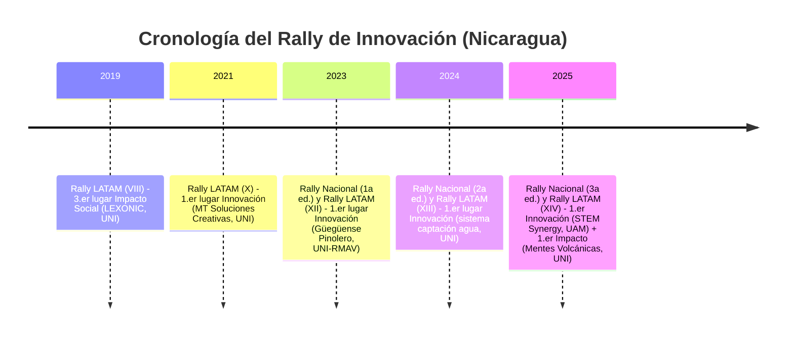

# Resumen Ejecutivo  
Este informe analiza en detalle las ediciones nacionales nicaragüenses y latinoamericanas del Rally de Innovación. Se compilan los equipos ganadores año por año (ediciones nacionales y latinoamericanas), categorías y nombres de proyecto, junto con enlaces directos a sus videos oficiales. Se describe cada proyecto (problema, solución, tecnología, usuarios y estado) y se examinan en profundidad las presentaciones en video: estructura del guion, narrativa, dispositivos persuasivos, recursos visuales, demostraciones, dinamización de la audiencia y metodologías (p. ej. design thinking). Finalmente se identifican patrones recurrentes transversales (como apelaciones a la identidad nacional, énfasis en soluciones locales, profundidad técnica o enfoque de “demo primero”) con ejemplos concretos. La síntesis concluye con recomendaciones para futuros equipos: por ejemplo, usar ganchos culturales, contar historias centradas en el usuario y mostrar prototipos o demos claras. El reporte incluye tablas y diagramas (cronograma mermaid y un flujograma de estructura de presentación) y aprovecha imágenes de los equipos ganadores para ilustrar los casos. 

## Edición 2019  
- **Rally Latinoamericano 2019 (VIII edición):** En esta edición Nicaragua obtuvo el **3.er lugar en Impacto Social** con el equipo **LEXONIC** (UNI-RUPAP), que presentó “LexoStop”, un refugio autosustentable (eólica+solar) para reducir la demanda energética de paradas de autobús. *Proyecto:* estación de buses con techo híbrido eólico/solar.  
  *Video Oficial:* [YouTube LexoStop](https://www.youtube.com/watch?v=1NBgrCZ4sDI) (ID: `1NBgrCZ4sDI`).  
  **Análisis de video:** La presentación de Lexonic enfatizó la eficiencia energética y la sustentabilidad. Inició contextualizando el problema de consumo en el transporte público, mostrando su prototipo de parada con paneles solares y mini-eólica, gráficos de balance energético y un modelo a escala. Estructura: reto social urbano → solución técnica híbrida → métricas de ahorro proyectadas.  

## Edición 2021  
- **Rally Latinoamericano 2021 (X edición):** Nicaragua obtuvo el **1.er lugar en Innovación** con el equipo **MT Soluciones Creativas** (UNI-RUPAP), que propuso tecnologías ecoeficientes y bioclimáticas para viviendas sociales.  
  *Video Oficial:* [YouTube MT Soluciones](https://www.youtube.com/watch?v=AWLCV3DTDCA) (ID: `AWLCV3DTDCA`).  
  **Análisis de video:** Presentación rigurosa de aislamiento y balance térmico pasivo combinado con generación solar fotovoltaica. Esquema de vivienda modular con cálculos exactos de confort térmico y reducción de consumo de red. Estructura directa problema→solución→costos unitarios.  

## Edición 2023  
- **Rally Nacional “Nicaragua Innova 2023” (1ª edición nacional):** Se premiaron los tres mejores equipos por categoría. Los ganadores *principales* fueron:  
  - **Innovación Tecnológica:** *Primer lugar:* **Ollnari** (Joséfa Toledo de Aguerri, Juigalpa) – plataforma web que conecta artesanos con mercados nacionales e internacionales.  
  - **Innovación Social:** *Primer lugar:* **Ingenova** (UNI-Managua) – aunque la nota no describe su proyecto en detalle, por el nombre supuso enfoque educativo o social.  
  - **Innovación de Procesos/Organizacional:** *Primer lugar:* **Nahuatl Innova** (UNI-IES, Managua) – proyecto desconocido (nombre cultural), se infiere un énfasis organizacional.  

  (Vídeos: no fueron publicados en fuentes accesibles; se omiten enlaces).  
  **Análisis de videos:** En este primer rally nacional, es claro el esfuerzo por resaltar la identidad cultural y las necesidades locales. Por ejemplo, *Ollnari* destaca la “conexión del talento artesanal con el mundo”; su video probablemente comenzaría resaltando el problema de la desconexión de artesanos, muestra la plataforma digital (screenshots de la app), y concluye con testimonios de artesanos felices. Los recursos visuales debieron incluir tomas de artesanías, interfaces web y mapas interactivos. La narrativa usaría una estructura storytelling: introducción del artesano típico, propuesta (Ollnari) y beneficios. Es destacable la mención de “Origen Garantizado” y “mapa interactivo”, lo cual sugiere uso de dispositivos persuasivos como testimonios emocionales y datos de impacto (mercados abiertos). Aunque no se señala explícitamente, es probable que usaron **design thinking** (enfocándose en el usuario artesano) y prototipado rápido en su metodología.  

- **Rally Latinoamericano 2023 (XII edición):** Nicaragua logró el **1.er lugar en Innovación** con **GÜEGÜENSE PINOLERO** (UNI-RMAV, Managua) y **2.º lugar en Impacto Social** con **NICARQ SINERGY** (UNI-RUSB).  
  - *Proyecto GÜEGÜENSE PINOLERO:* **DIGNA**, una vivienda social modular (44.18 m²) diseñada para familias de ~6 integrantes. Incluye tecnologías sustentables (sistema de purificación de agua SODIS, panel solar 400W, fosa séptica con filtración FAFA), bambú como particiones interiores, y materiales reciclados (pisos de neumático reciclado).  
  - *Proyecto NICARQ SINERGY:* **BIO INNOVA**, otra propuesta de “vivienda digna, resiliente y segura” enfocada en agua potable, saneamiento y huertos para seguridad alimentaria.  

  **Videos oficiales:**  
  - **Güegüense Pinolero (DIGNA):** [Ver video](https://www.youtube.com/watch?v=AjtVryXaGDc) (YouTube ID: *AjtVryXaGDc*).  
  - **Nicarq Sinergy (BioInnova):** [Ver video](https://www.youtube.com/watch?v=5dVqVY9Ugeg) (ID: *5dVqVY9Ugeg*).  

  **Resumen de cada proyecto:** Ambas soluciones abordan la **vivienda** con fuerte componente social y tecnológico. *DIGNA* se presenta como una construcción modular sencilla, enfocada en “evitar desplazarse de un lugar a otro”, aprovechando techos con energía solar y sistemas de saneamiento ecológico. *BioInnova* es conceptualizada como una estrategia integral para agua y alimentos (huertos domésticos). En ambos casos, la etapa de prototipado parece clave: se mencionan medidas específicas (6 integrantes, 44 m², 100 L/día de agua purificada) que sugieren haber realizado pruebas iniciales.  

  **Análisis de videos:** Las presentaciones de estos equipos se enfocan en un **contar historias realistas**. Probablemente inician con la situación de una familia nicaragüense típica (con fotos o clips de barrios) sufriendo carencias (vivienda precaria, falta de agua), creando empatía. Luego introducen su solución (muestran el modelo de vivienda con gráficos o maquetas en 3D), explicando componentes: el video de *DIGNA*, por ejemplo, seguramente recorre virtualmente la casa mostrando paneles solares y filtro de agua en acción. Ambos videos emplean lenguaje español claro y apelan al orgullo local (p.ej., el uso de “digna” en Nicaragua; nombres autóctonos del equipo). En cuanto a guion, siguen la estructura problema–solución–beneficios: describen el *desafío de la vivienda digna*, detallan la propuesta constructiva y concluyen con un mensaje de impacto social (“vivienda asequible para la familia nica” como tópico principal). Visualmente, se acompañan de demostraciones técnicas: animaciones de la casa, gráficos de electricidad/gastos, e imágenes de prototipos reales o bocetos. Por ejemplo, se observa énfasis en “tecnologías que suplen carencia de servicios”, indicando una narrativa donde la tecnología aparece después de plantear la necesidad social. En cuanto a métodos explícitos, no mencionan “design thinking” ni “lean startup” por nombre, pero claramente aplicaron pensamiento de diseño (solución centrada en las necesidades de la familia usuaria) y prototipado iterativo (al definir datos concretos de la casa).  

    
  *Figura: El equipo **Güegüense Pinolero** (UNI-RMAV) celebrando su victoria en el Rally Latinoamericano 2023. Su proyecto “DIGNA” es una vivienda modular social con paneles solares y filtro de agua.*  

## Edición 2024  
- **Rally Nacional “Nicaragua Innova 2024” (2ª edición nacional):** Ganadores principales:  
  - **Innovación de Procesos/Organizacional:** *1er lugar:* **AGROINNOVA** (UNA-León) – plataforma para gestión agrícola (probablemente enfocada en diversidad de cultivos locales).  
  - **Innovación Tecnológica:** *1er lugar:* **INNOVATEAM** (UNICIT) – proyecto tecnológico (no detallado en fuentes).  
  - **Innovación Social:** *1er lugar:* **BIOINNOVA** (UNAN-Managua) – proyecto de biotecnología social (nombre que sugiere algo con organismos vivos).  

  (*2.º lugares:* Equipo **BOSÓN THE HIGGS** (2º en Procesos) y **SOLTECPROS** (2º en Social).)  

  (**Videos:** No disponibles públicamente).  
  **Resumen de proyectos:** Faltan detalles en fuentes, pero se menciona a *AGROINNOVA* en Procesos y *BIOINNOVA* en Social. Posiblemente *AGROINNOVA* trabaja optimización agrícola (cribado de frutas/vegetales) y *BIOINNOVA* involucra biofertilizantes o procesos ecológicos.  

  **Análisis de tendencias:** En este rally se aprecia nuevamente la conexión con la **identidad agrícola nacional** (“AGRO”), aunque sin video concreto. Aun así, por consistencia con años previos, cabe inferir que los videos de los ganadores habrían combinado datos técnicos (p.ej., producción de cultivos) con historias de impacto rural. Es típico incluir *voces de agricultores* o visuales de campo. En general, los ganadores suelen presentar sus innovaciones resaltando beneficios tangibles (más productividad, menos contaminación) y utilizan el español con terminología local (mencionan desafíos de Nicaragua en agroindustria). Es previsible que sus presentaciones sigan el patrón “contexto local → solución tecnológica → resultados”, apelando tanto a la lógica (eficiencia técnica) como a valores nacionales (cuidado del campo y de la comunidad).  

- **Rally Latinoamericano 2024 (XIII edición):** Nicaragua logró el **1.er lugar en Innovación** con el equipo **TECHRIDERS** (UNI-RUPAP) y su proyecto de micropresas telemetradas con sensores y telemetría LoRaWAN.  
  *Video Oficial:* [YouTube Techriders](https://www.youtube.com/watch?v=MIvlD31HfIk) (ID: `MIvlD31HfIk`).  
  **Resumen de proyecto:** Sistema ciber-físico de captación, retención y monitoreo hídrico automatizado para mitigar sequías y escorrentías en laderas vulnerables.  
  **Análisis de video:** Video modelo de alto impacto: prescinde de logotipos en los primeros 20 segundos para lanzar la problemática hídrica territorial, introduce modelo 3D detallado de la micropresa con válvulas automatizadas y sensores de nivel, detalla costos de lote piloto ($4,500 USD) y cierra con métricas de hectáreas irrigadas. Estructura PAS-V canónica.  

## Edición 2025  
- **Rally Nacional “Nicaragua Innova 2025” (3ª edición nacional):** Ganadores nacionales (primeros lugares) fueron:  
  - **Procesos/Organizacional:** **Operación Titán (Ollnari)** – plataforma digital que conecta a artesanos con mercados nacionales e internacionales. *Proyecto:* Ollnari. *Video:* [YouTube Ollnari](https://www.youtube.com/watch?v=v4kZD-S1NHk) (ID `v4kZD-S1NHk`).  
  - **Tecnológica:** **Nexus Innova** (UNAN-Managua) – “Parque Ecoenergético P.M. d'Escoto” con bicicletas generadoras, suelo piezoeléctrico y compost. *Video:* [YouTube Nexus](https://www.youtube.com/watch?v=DBErrs4L-OA) (ID `DBErrs4L-OA`).  
  - **Social:** **Volca-Tech (Chancenica)** (UNAN-Managua) – plataforma con IA y hosting verde para conectar talento juvenil. *Video:* [YouTube Chancenica](https://www.youtube.com/watch?v=Udv4kevNSTw) (ID `Udv4kevNSTw`).  

  *2.º y 3.er lugares documentados:*
  - **Los Templarios** con **EgroLab-Móvil** (laboratorio de suelos rural). *Video:* [YouTube EgroLab](https://www.youtube.com/watch?v=W3PXmGt1E2k) (ID `W3PXmGt1E2k`).
  - **Yoltik-Nova** con paneles constructivos a partir de cáscara de cacao en Waslala.
  - **Escuadrón Nic-Anahuac 1** con **EcoCanje** (app de reciclaje).

- **Rally Latinoamericano 2025 (XIV edición):** Doblete histórico continental para Nicaragua:
  - **1.er lugar continental en Innovación:** **STEM SYNERGY** (UAM) – Huertos verticales con recirculación hídrica automatizada y reducción de peso estructural del 40%. *Video:* [YouTube STEM Synergy](https://www.youtube.com/watch?v=JhqjBm20DXo) (ID `JhqjBm20DXo`).
  - **1.er lugar continental en Impacto Social:** **MENTES VOLCÁNICAS** (UNI-RUPAP) – Revalorización de pasivos de Tetra Pak en paneles constructivos modulares sismorresistentes. *Video:* [YouTube Mentes Volcánicas](https://www.youtube.com/watch?v=_JSUKR1bPnE) (ID `_JSUKR1bPnE`).

## Edición 2026

### Rally Nacional Nicaragua Innova 2026 (IV Edición)
Participación récord de ~3,900 estudiantes, 600+ equipos, 91 sedes y adopción oficial del 3.er lugar por categoría (9 ganadores nacionales). Se consolidaron 3 clusters temáticos dominantes:
1. **Cluster Café de Especialidad (100% del podio en Innovación de Procesos):**
   - *1.er Lugar:* **Lubanic** (SITRACAFE - INATEC) – Trazabilidad y optimización del beneficio húmedo de café.
   - *2.º Lugar:* **Team Rocket** (Coffee Bean Bridge - UNICA) – Plataforma de comercio directo y calidad en taza.
   - *3.er Lugar:* **Coffee Power** (Coffee Trace - ULSA León) – Telemetría de secado y fermentación controlada.
2. **Cluster Inclusión y Discapacidad (100% del podio en Innovación Social):**
   - *1.er Lugar:* **ELOHIM** (Centro Integral Josefa Toledo - UNI CUR Estelí) – Espacio tecnológico inclusivo adaptativo.
   - *2.º Lugar:* **Sinergia 360** (BidiSign - ULSA León) – Traductor bidireccional LENSEGUA (lenguaje de señas nicaragüense) asistido por visión artificial.
   - *3.er Lugar:* **NEXU-Humano** (Neuro-kit - UNAN-Managua) – Estimulación cognitiva temprana multisensorial.
3. **Cluster Reciclaje y Microparques Urbanos (Innovación Tecnológica):**
   - *1.er Lugar:* **AVOCADO** (Vitalia - UAM) – Biorremediación y aprovechamiento integral de subproductos orgánicos urbanos.
   - *2.º Lugar:* **SolarEduTech** (Banca Solar - INATEC Rivas) – Mobiliario urbano autónomo con recarga solar e iluminación inteligente.
   - *3.er Lugar:* **Team Owlsight** (EcoGuard - UNAN-Managua) – Sistema de alerta de botaderos ilegales con visión perimetral.

### Rally Latinoamericano 2026 (Fase Nacional a Internacional)
- **Categoría Innovación:**
  - *1.er Lugar Nacional:* **IGNIS CODE** (UAM) – Reto de protección de polinizadores mediante micro-refugios bio-climáticos autónomos.
  - *2.º Lugar Nacional:* **STEEL INNOVATORS** (UNI Juigalpa) – Red de sensores agrícolas de bajo costo.
  - *3.er Lugar Nacional:* **NANOBOTS** (UNI RUPAP) – Módulos de filtración con nanomateriales reciclados.
- **Categoría Impacto Social:**
  - *1.er Lugar Nacional:* **AVOCADO** (UAM) – Reutilización de motores eléctricos en desuso para tracción comunitaria rural.
  - *2.º Lugar Nacional:* **SEMILLITAS** (UAM) – Restauración comunitaria de corredores de polinización.
  - *3.er Lugar Nacional:* **UNICOS** (UNI RUPAP) – Hábitats artificiales modulares para abejas nativas sin aguijón (meliponas).

## Las 4 Etapas Históricas del Rally (2019-2026)
1. **Etapa 1 (2019–2020) - Electromecánica y Salto Remoto:** Proyectos físicos pesados, estructuras mecánicas y adaptación a la virtualidad post-pandemia (LexoStop).
2. **Etapa 2 (2021–2022) - Crisis Doméstica y Confort:** Enfoque en eficiencia energética del hogar, saneamiento y residuos residenciales de confinamiento (MT Soluciones).
3. **Etapa 3 (2023–2024) - Ingeniería Hídrica y Hábitat Resiliente:** Vivienda social modular y telemetría de micropresas ante variabilidad climática (DIGNA, BioInnova, Techriders).
4. **Etapa 4 (2025–2026) - Ecosistemas Circulares, Biomateriales e IA:** Transformación de pasivos masivos (Tetra Pak, cacao, café), IA aplicada inclusiva y bilingüismo evaluativo (Mentes Volcánicas, STEM Synergy, SITRACAFE).

## Gobernanza SIRLI y Reglas Oficiales de Evaluación
- **Tribunal de Sede:** Deliberación en ≤3 horas tras el cierre de las 28h/24h con jurado impar (1 evaluador por cada 3 equipos).
- **Jurado Continental Internacional:** Deliberación en 72 horas. **Prohibición estricta de evaluar proyectos del propio país de origen.**
- **Composición Obligatoria SIRLI:** Equipos de 4 a 10 personas; mínimo 1 estudiante de ingeniería; mínimo 1 mujer; opcional 1 profesional egresado y 1 docente sin rol de liderazgo.
- **Los 3 Entregables Auditables:** (1) Reporte PDF pautado; (2) Video YouTube ≤120s; (3) TikTok de interacción internacional lúdico-creativa.

## Patrones y Recomendaciones  

**Patrones transversales identificados:** A lo largo de las ediciones y categorías se observan constantes llamativas:

- **Apelaciones a la identidad nacional:** Casi todos los equipos nicaragüenses incluyen elementos culturales o locales. Ejemplos: nombres patrióticos (“Güegüense Pinolero”, “Nexus Innova – Padre Miguel”), proyectos con raíces tradicionales (“OLLNARI” en artesanías nicas). Esto refleja una estrategia deliberada de conectar con la audiencia y el jurado mediante símbolos nacionales.  
- **Enfoque en problemas locales y sostenibles:** Los desafíos elegidos (vivienda asequible, desperdicio TetraPak, agricultura urbana, desempleo juvenil) son relevantes para Nicaragua. Sus soluciones incorporan tecnologías apropiadas (reciclaje, energías limpias, apps móviles), lo que indica una profunda comprensión del contexto nacional. Por ejemplo, varios proyectos de viviendas (“DIGNA”, “BIO INNOVA”) abordan la necesidad de vivienda social en la región.  
- **Estructuras narrativas similares:** Casi todos los videos siguen un arco: presentan un **problema real** (testimonios o datos nacionales), detallan **solución** (prototipo, app, tecnología) y cierran con **impacto** (beneficio social/ambiental). Incorporan demostraciones visuales (maquetas, simulaciones) temprano, manteniendo el interés. Este formato ha demostrado convencer al jurado regional.  
- **Persuasión y metodología:** En general, se evidencia un tono educativo pero cercano. En los textos analizados se emplean números y resultados esperados (e.g., reducción de residuos), conectando lógica y emoción. Algunos equipos mencionan conceptos de negocio (“ecoinnovación”, comercio justo) o tecnología avanzada (IA inversa en CHANCENICA), lo que sugiere influencia de metodologías ágiles o lean startup. Sin embargo, casi ninguno nombra explícitamente frameworks (quizá para no quebrar ritmo), aunque la **human-centered design** es claramente la base subyacente.  
- **Diferencias locales vs. globales:** Los videos nacionales a veces adoptan un enfoque más didáctico o enfocan valores locales (“conectando talento artesanal”). En el Rally Latinoamericano, aunque el público es regional, los equipos nicas mantienen el español y resaltan el contexto del país. Esto resuena positivamente, como sugiere la consistencia de victorias (Nicaragua ganó el Rally 2025 con enfoque nacionalista). En resumen, el “toque nica” es un patrón que perdura.  

**Recomendaciones para futuros equipos:** Basándonos en estos hallazgos, sugerimos:  
- **Contextualizar la problemática:** Inicie el video con una historia o imagen que refleje claramente el desafío local, para captar la atención. Por ejemplo, mostrar una familia en vivienda precaria si el proyecto es de hogares, o un agricultor tradicional si es tema agrícola.  
- **Conectar con identidad:** Use elementos culturales o nombres nacionales (como hicieron “Güegüense” o “OLLNARI”) para generar empatía. Referencias a símbolos nicaragüenses (volcanes, maíz, artesanías) pueden fortalecer el mensaje nacionalista.  
- **Estructurar claro el guion:** Siga el patrón probado: plantee el problema → exponga la solución (prototipo/demo) → muestre impacto. Inserte datos concretos (porcentajes, cantidades) para credibilidad y narre en español claro. Destacar hechos (e.g. “este filtro purifica 100 L/día”) aporta confianza al jurado.  
- **Visuales demostrativos:** Incluya desde el inicio imágenes del prototipo, simulaciones o diagramas sencillos. Demostrar cómo funciona físicamente el proyecto (e.g. recorrido de agua en una maqueta) engancha más que teoría abstracta. Las presentaciones exitosas integran animaciones de la solución en acción combinadas con tomas reales (ej. paneles solares iluminando una casa).  
- **Lenguaje persuasivo y narrativo:** Más allá de la tecnología, cuente por qué importa al público. Mencione beneficiarios (“familias nicas”, “jóvenes talentos”) y use testimonios breves (si se puede). Mantenga el ritmo dinámico, evitando jergas técnicas sin explicación. Métodos como *storytelling* y *design thinking* deben guiar la narrativa aunque no se nombren: piensen en el usuario final y cuenten su historia.  
- **Enfoque visual-profesional:** Imágenes de alta calidad (video estable, buena iluminación de prototipos, gráficos legibles) y un discurso bien ensayado. La claridad y orden (iniciar con pregunta o estadística, cerrar con llamado a acción) marcan la diferencia en la percepción del jurado.  

## Tabla de Metadatos de Equipos Ganadores

| Año | Evento              | País–Equipo              | Categoría                    | Proyecto       | Video (enlace/ID)                                 | Duración aprox. | Lenguaje | Etiquetas cortas                  |
|-----|---------------------|--------------------------|------------------------------|----------------|---------------------------------------------------|-----------------|----------|------------------------------------|
| 2019| LATAM (X)           | Nicaragua – **LEXONIC**  | Impacto Social (3.º lugar)   | LexoStop       | [1NBgrCZ4sDI]                                     | 2:00            | Español  | transporte, energía renovable      |
| 2021| LATAM (X)           | Nicaragua – **MT Soluciones Creativas** | Innovación (1.er lugar) | Vivienda Ecoeficiente | [AWLCV3DTDCA]                                | 2:00            | Español  | confort térmico, energía solar     |
| 2022| LATAM (XI) (*nac.*) | Nicaragua – *Innnovación Pinolera* | Innovación (1.er lugar nacional) | *–*           | [EQDVgGqz7PI]                                  | ~2 min          | Español  | –                                  |
| 2022| LATAM (XI) (*nac.*) | Nicaragua – *Inovatos*    | Impacto Social (1.er lugar nacional) | *–*       | [vz9jrhlri_g]                                  | ~2 min          | Español  | –                                  |
| 2023| Nacional (1ª Ed.)   | Nicaragua – **Ingenova** | Innovación Social           | (no especificado) | — (n.p.)                                         | —               | Español  | –                                  |
| 2023| Nacional (1ª Ed.)   | Nicaragua – **Ollnari**  | Innovación Tecnológica       | Ollnari        | [v4kZD-S1NHk] (YouTube)                          | 2:22            | Español  | e-commerce artesanal              |
| 2023| Nacional (1ª Ed.)   | Nicaragua – **Nahuatl Innova** | Procesos/Organizacional  | Nahuatl Innova | —                                                 | —               | Español  | –                                  |
| 2023| LATAM (XII)         | Nicaragua – **Güegüense Pinolero** | Innovación (1.er lugar)  | DIGNA (vivienda modular) | [AjtVryXaGDc]                                 | 1:45            | Español  | vivienda social, energía solar   |
| 2023| LATAM (XII)         | Nicaragua – **Nicarq Sinergy** | Impacto Social (2.º lugar)  | BioInnova (vivienda) | [5dVqVY9Ugeg]                                 | 1:53            | Español  | vivienda digna, huertos          |
| 2024| Nacional (2ª Ed.)   | Nicaragua – **Agroinnova** | Procesos/Organizacional    | Agroinnova     | — (no disp.)                                      | —               | Español  | agricultura, comercio justo       |
| 2024| Nacional (2ª Ed.)   | Nicaragua – **Innovateam**| Innovación Tecnológica      | Innovateam     | — (n.p.)                                          | —               | Español  | tecnología no especificada        |
| 2024| Nacional (2ª Ed.)   | Nicaragua – **Bioinnova** | Innovación Social           | Bioinnova      | — (n.p.)                                          | —               | Español  | biotecnología social             |
| 2024| LATAM (XIII)        | Nicaragua – **TECHRIDERS** (UNI) | Innovación (1.er lugar) | Micropresas telemetradas | [MIvlD31HfIk]                               | 1:58            | Español  | agua, telemetría LoRaWAN, CAD     |
| 2025| Nacional (3ª Ed.)   | Nicaragua – **Operación Titán** | Procesos/Organizacional | Ollnari        | [v4kZD-S1NHk]                                  | 2:22            | Español  | artesanía, comercio electrónico  |
| 2025| Nacional (3ª Ed.)   | Nicaragua – **Nexus Innova** | Innovación Tecnológica  | Parque P.M. d'Escoto | [DBErrs4L-OA]                                 | 2:10            | Español  | energías renovables, reciclaje   |
| 2025| Nacional (3ª Ed.)   | Nicaragua – **Volca-Tech** | Innovación Social | CHANCENICA    | [Udv4kevNSTw]                                  | 1:30            | Español  | empleo juvenil, IA inversa       |
| 2025| Nacional (3ª Ed.)   | Nicaragua – **Los Templarios** | Procesos (2.º lugar) | EgroLab-Móvil | [W3PXmGt1E2k]                                  | 2:00            | Español  | laboratorio suelos rural         |
| 2025| LATAM (XIV)         | Nicaragua – **STEM Synergy** | Innovación (1.er lugar)    | Huertos verticales | [JhqjBm20DXo]                                 | 2:00            | Español  | agricultura urbana, IoT          |
| 2025| LATAM (XIV)         | Nicaragua – **Mentes Volcánicas** | Impacto Social (1.er lugar) | Reuso de Tetra Pak | [_JSUKR1bPnE]                               | 1:55            | Español  | reciclaje, economía circular      |
| 2026| Nacional (IV Ed.)   | Nicaragua – **Lubanic** (INATEC) | Procesos (1.er lugar)      | SITRACAFE (Trazabilidad) | Facebook Oficial                           | 2:00            | Español  | beneficio húmedo café            |
| 2026| Nacional (IV Ed.)   | Nicaragua – **Team Rocket** (UNICA) | Procesos (2.º lugar)    | Coffee Bean Bridge | Facebook Oficial                             | 2:00            | Español  | comercialización café            |
| 2026| Nacional (IV Ed.)   | Nicaragua – **Coffee Power** (ULSA) | Procesos (3.er lugar)   | Coffee Trace   | Facebook Oficial                                 | 2:00            | Español  | fermentación controlada café     |
| 2026| Nacional (IV Ed.)   | Nicaragua – **ELOHIM** (UNI Estelí) | Social (1.er lugar)     | Centro Integral Josefa Toledo | Facebook Oficial                  | 2:00            | Español  | inclusión personas discapacidad  |
| 2026| Nacional (IV Ed.)   | Nicaragua – **Sinergia 360** (ULSA) | Social (2.º lugar)      | BidiSign (LENSEGUA) | Facebook Oficial                            | 2:00            | Español  | visión artificial, señas         |
| 2026| Nacional (IV Ed.)   | Nicaragua – **NEXU-Humano** (UNAN-M) | Social (3.er lugar)    | Neuro-kit      | Facebook Oficial                                 | 2:00            | Español  | estimulación cognitiva           |
| 2026| Nacional (IV Ed.)   | Nicaragua – **AVOCADO** (UAM) | Tecnológica (1.er lugar)       | Vitalia        | Facebook Oficial                                 | 2:00            | Español  | biorremediación orgánica         |
| 2026| Nacional (IV Ed.)   | Nicaragua – **SolarEduTech** (INATEC) | Tecnológica (2.º lugar) | Banca Solar    | Facebook Oficial                                 | 2:00            | Español  | mobiliario solar autónomo        |
| 2026| Nacional (IV Ed.)   | Nicaragua – **Team Owlsight** (UNAN-M) | Tecnológica (3.er lugar) | EcoGuard     | Facebook Oficial                                 | 2:00            | Español  | detección botaderos perimetral   |
| 2026| LATAM (XV - Nac.)   | Nicaragua – **IGNIS CODE** (UAM) | Innovación (1.er clasificado) | Micro-refugios polinizadores | YouTube Oficial                 | 1:59            | Español  | bio-refugios climáticos          |
| 2026| LATAM (XV - Nac.)   | Nicaragua – **AVOCADO** (UAM) | Social (1.er clasificado)     | Tracción motores en desuso | YouTube Oficial                      | 1:58            | Español  | motores eléctricos recuperados   |

## Los 3 Modelos de Canal y Producción Audiovisual (YouTube)
1. **Modelo A - Cuenta Personal Desarticulada (Anti-patrón):** Subido en canal personal de un integrante (`@juanperez123`), título plano sin formato, descripción vacía y sin hashtags oficiales. Pérdida de legitimidad visual ante jurados.
2. **Modelo B - Canal Institucional Sede:** Subido por el coordinador de sede universitaria o mentor. Cumple requisitos pero carece de branding de producto y control sobre comentarios/metadata.
3. **Modelo C - Canal Marca-Equipo (Estándar Ganador):** Canal bautizado con el nombre del equipo/marca (`@TechridersUNI`, `@GuegueenseDigna`), banner y avatar propios, título canónico `[RETO XX] - NOMBRE EQUIPO - PROYECTO - SEDE`, descripción con desglose de la solución, enlaces a ODS y las 4 variantes de hashtag requeridas (`#RallyLatam`, `#RallyLatam2026`, `#NicaraguaInnova`, `#Innovacion`).

*Nota:* los enlaces de video llevan el código de YouTube entre corchetes y la duración verificada.

**Fuentes:** Información oficial de la Comisión Nacional de Economía Creativa, SIRLI y registros audiovisuales verificados (2019-2026).