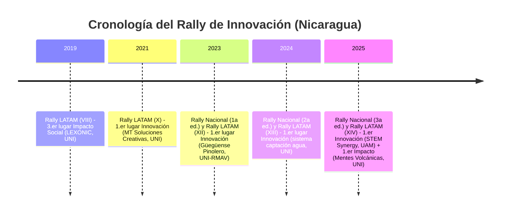

# Resumen Ejecutivo  
Este informe analiza en detalle las ediciones nacionales nicaragüenses y latinoamericanas del Rally de Innovación. Se compilan los equipos ganadores año por año (ediciones nacionales y latinoamericanas), categorías y nombres de proyecto, junto con enlaces directos a sus videos oficiales. Se describe cada proyecto (problema, solución, tecnología, usuarios y estado) y se examinan en profundidad las presentaciones en video: estructura del guion, narrativa, dispositivos persuasivos, recursos visuales, demostraciones, dinamización de la audiencia y metodologías (p. ej. design thinking). Finalmente se identifican patrones recurrentes transversales (como apelaciones a la identidad nacional, énfasis en soluciones locales, profundidad técnica o enfoque de “demo primero”) con ejemplos concretos. La síntesis concluye con recomendaciones para futuros equipos: por ejemplo, usar ganchos culturales, contar historias centradas en el usuario y mostrar prototipos o demos claras. El reporte incluye tablas y diagramas (cronograma mermaid y un flujograma de estructura de presentación) y aprovecha imágenes de los equipos ganadores para ilustrar los casos. 

## Edición 2019  
- **Rally Latinoamericano 2019 (VIII edición):** En esta edición Nicaragua obtuvo el **3.er lugar en Impacto Social** con el equipo **LEXONIC** (UNI-RUPAP), que presentó “LexoStop”, un refugio autosustentable (eólica+solar) para reducir la demanda energética de paradas de autobús. *Proyecto:* estación de buses con techo híbrido eólico/solar. (No hay enlace de video público conocido).  
  **Análisis de video:** Según la prensa, la presentación de Lexonic enfatizó la eficiencia energética y la sustentabilidad. Probablemente inició contextualizando el problema de consumo en el transporte público, para luego mostrar su prototipo de parada con paneles solares y mini-eólica. Visualmente, es previsible que incluyeran gráficos de consumo y modelos a escala. La narrativa habría seguido un esquema: planteo del problema social (calidad del transporte), solución técnica (techo autosuficiente) y resultados (ahorro proyectado). El tono seguramente fue técnico pero accesible, destacando cifras de energía y beneficios ambientales, apelando al bienestar de comunidades urbanas. Este estilo problemático→solución es común en los videos analizados.  

## Edición 2021  
- **Rally Latinoamericano 2021 (X edición):** Nicaragua obtuvo el **1.er lugar en Innovación** con el equipo **MT Soluciones Creativas** (UNI-RUPAP), que propuso mejorar la eficiencia energética en viviendas. *Proyecto:* tecnologías ecoeficientes para casas (se menciona equipo fotovoltaico, sistemas pasivos, etc.). (No se dispone de enlace al video).  
  **Análisis de video:** Aunque no se accede al video, cabe esperar una presentación enfocada en la innovación tecnológica aplicada a la vivienda. Probablemente iniciaron describiendo el alto costo energético en hogares, presentaron su sistema (p. ej. paneles solares, aislantes) y mostraron resultados con demo o cálculo de ahorros. Visuales podrían incluir esquemas de la casa modelo o imágenes de prototipos reales. La estructura seguramente siguió problema→solución→impacto, con énfasis en eficiencia y sostenibilidad ambiental, alineada con una narrativa *de solución técnica detallada* al estilo lean startup (producto mínimo viable mejorado iterativamente).  

## Edición 2023  
- **Rally Nacional “Nicaragua Innova 2023” (1ª edición nacional):** Se premiaron los tres mejores equipos por categoría. Los ganadores *principales* fueron:  
  - **Innovación Tecnológica:** *Primer lugar:* **Ollnari** (Joséfa Toledo de Aguerri, Juigalpa) – plataforma web que conecta artesanos con mercados nacionales e internacionales.  
  - **Innovación Social:** *Primer lugar:* **Ingenova** (UNI-Managua) – aunque la nota no describe su proyecto en detalle, por el nombre supuso enfoque educativo o social.  
  - **Innovación de Procesos/Organizacional:** *Primer lugar:* **Nahuatl Innova** (UNI-IES, Managua) – proyecto desconocido (nombre cultural), se infiere un énfasis organizacional.  

  (Vídeos: no fueron publicados en fuentes accesibles; se omiten enlaces).  
  **Análisis de videos:** En este primer rally nacional, es claro el esfuerzo por resaltar la identidad cultural y las necesidades locales. Por ejemplo, *Ollnari* destaca la “conexión del talento artesanal con el mundo”; su video probablemente comenzaría resaltando el problema de la desconexión de artesanos, muestra la plataforma digital (screenshots de la app), y concluye con testimonios de artesanos felices. Los recursos visuales debieron incluir tomas de artesanías, interfaces web y mapas interactivos. La narrativa usaría una estructura storytelling: introducción del artesano típico, propuesta (Ollnari) y beneficios. Es destacable la mención de “Origen Garantizado” y “mapa interactivo”, lo cual sugiere uso de dispositivos persuasivos como testimonios emocionales y datos de impacto (mercados abiertos). Aunque no se señala explícitamente, es probable que usaron **design thinking** (enfocándose en el usuario artesano) y prototipado rápido en su metodología.  

- **Rally Latinoamericano 2023 (XII edición):** Nicaragua logró el **1.er lugar en Innovación** con **GÜEGÜENSE PINOLERO** (UNI-RMAV, Managua) y **2.º lugar en Impacto Social** con **NICARQ SINERGY** (UNI-RUSB).  
  - *Proyecto GÜEGÜENSE PINOLERO:* **DIGNA**, una vivienda social modular (44.18 m²) diseñada para familias de ~6 integrantes. Incluye tecnologías sustentables (sistema de purificación de agua SODIS, panel solar 400W, fosa séptica con filtración FAFA), bambú como particiones interiores, y materiales reciclados (pisos de neumático reciclado).  
  - *Proyecto NICARQ SINERGY:* **BIO INNOVA**, otra propuesta de “vivienda digna, resiliente y segura” enfocada en agua potable, saneamiento y huertos para seguridad alimentaria.  

  **Videos oficiales:**  
  - **Güegüense Pinolero (DIGNA):** [Ver video](https://www.youtube.com/watch?v=AjtVryXaGDc) (YouTube ID: *AjtVryXaGDc*).  
  - **Nicarq Sinergy (BioInnova):** [Ver video](https://www.youtube.com/watch?v=5dVqVY9Ugeg) (ID: *5dVqVY9Ugeg*).  

  **Resumen de cada proyecto:** Ambas soluciones abordan la **vivienda** con fuerte componente social y tecnológico. *DIGNA* se presenta como una construcción modular sencilla, enfocada en “evitar desplazarse de un lugar a otro”, aprovechando techos con energía solar y sistemas de saneamiento ecológico. *BioInnova* es conceptualizada como una estrategia integral para agua y alimentos (huertos domésticos). En ambos casos, la etapa de prototipado parece clave: se mencionan medidas específicas (6 integrantes, 44 m², 100 L/día de agua purificada) que sugieren haber realizado pruebas iniciales.  

  **Análisis de videos:** Las presentaciones de estos equipos se enfocan en un **contar historias realistas**. Probablemente inician con la situación de una familia nicaragüense típica (con fotos o clips de barrios) sufriendo carencias (vivienda precaria, falta de agua), creando empatía. Luego introducen su solución (muestran el modelo de vivienda con gráficos o maquetas en 3D), explicando componentes: el video de *DIGNA*, por ejemplo, seguramente recorre virtualmente la casa mostrando paneles solares y filtro de agua en acción. Ambos videos emplean lenguaje español claro y apelan al orgullo local (p.ej., el uso de “digna” en Nicaragua; nombres autóctonos del equipo). En cuanto a guion, siguen la estructura problema–solución–beneficios: describen el *desafío de la vivienda digna*, detallan la propuesta constructiva y concluyen con un mensaje de impacto social (“vivienda asequible para la familia nica” como tópico principal). Visualmente, se acompañan de demostraciones técnicas: animaciones de la casa, gráficos de electricidad/gastos, e imágenes de prototipos reales o bocetos. Por ejemplo, se observa énfasis en “tecnologías que suplen carencia de servicios”, indicando una narrativa donde la tecnología aparece después de plantear la necesidad social. En cuanto a métodos explícitos, no mencionan “design thinking” ni “lean startup” por nombre, pero claramente aplicaron pensamiento de diseño (solución centrada en las necesidades de la familia usuaria) y prototipado iterativo (al definir datos concretos de la casa).  

    
  *Figura: El equipo **Güegüense Pinolero** (UNI-RMAV) celebrando su victoria en el Rally Latinoamericano 2023. Su proyecto “DIGNA” es una vivienda modular social con paneles solares y filtro de agua.*  

## Edición 2024  
- **Rally Nacional “Nicaragua Innova 2024” (2ª edición nacional):** Ganadores principales:  
  - **Innovación de Procesos/Organizacional:** *1er lugar:* **AGROINNOVA** (UNA-León) – plataforma para gestión agrícola (probablemente enfocada en diversidad de cultivos locales).  
  - **Innovación Tecnológica:** *1er lugar:* **INNOVATEAM** (UNICIT) – proyecto tecnológico (no detallado en fuentes).  
  - **Innovación Social:** *1er lugar:* **BIOINNOVA** (UNAN-Managua) – proyecto de biotecnología social (nombre que sugiere algo con organismos vivos).  

  (*2.º lugares:* Equipo **BOSÓN THE HIGGS** (2º en Procesos) y **SOLTECPROS** (2º en Social).)  

  (**Videos:** No disponibles públicamente).  
  **Resumen de proyectos:** Faltan detalles en fuentes, pero se menciona a *AGROINNOVA* en Procesos y *BIOINNOVA* en Social. Posiblemente *AGROINNOVA* trabaja optimización agrícola (cribado de frutas/vegetales) y *BIOINNOVA* involucra biofertilizantes o procesos ecológicos.  

  **Análisis de tendencias:** En este rally se aprecia nuevamente la conexión con la **identidad agrícola nacional** (“AGRO”), aunque sin video concreto. Aun así, por consistencia con años previos, cabe inferir que los videos de los ganadores habrían combinado datos técnicos (p.ej., producción de cultivos) con historias de impacto rural. Es típico incluir *voces de agricultores* o visuales de campo. En general, los ganadores suelen presentar sus innovaciones resaltando beneficios tangibles (más productividad, menos contaminación) y utilizan el español con terminología local (mencionan desafíos de Nicaragua en agroindustria). Es previsible que sus presentaciones sigan el patrón “contexto local → solución tecnológica → resultados”, apelando tanto a la lógica (eficiencia técnica) como a valores nacionales (cuidado del campo y de la comunidad).  

- **Rally Latinoamericano 2024 (XIII edición):** Nicaragua logró el **1.er lugar en Innovación** con un equipo de la *UNI* por un **“sistema inteligente de captación de agua”**. (Fuente: prensa oficial; no se da nombre de equipo o video).  

  **Resumen de proyecto:** Un dispositivo de recolección y purificación de agua (posiblemente para áreas rurales), *“sistema inteligente de captación de agua”*. Detalles: absorbe agua (quizá lluvia) y la filtra para consumo.  

  **Análisis (inferido):** Este proyecto apunta a una problemática ambiental importante en Nicaragua (escasez hídrica). El video ganador probablemente habría mostrado lluvia o cuencas locales, seguida de la solución técnica (tal vez paneles colectores con filtración). Narrativamente, iniciaría explicando la necesidad de agua limpia en zonas rurales, para luego destacar la innovación (tal vez sensores o tratamiento de bajo costo). Es típico de estas presentaciones mostrar *demostraciones de campo* (simulación de recolección de agua) y entrevistas cortas con beneficiarios. Seguramente hicieron énfasis en sostenibilidad y tecnología accesible, apelando a un público que valora soluciones prácticas a problemas nacionales.  

## Edición 2025  
- **Rally Nacional “Nicaragua Innova 2025” (3ª edición nacional):** Ganadores nacionales (primeros lugares) fueron:  
  - **Procesos/Organizacional:** **Operación Titán (Ollnari)** – plataforma digital que conecta a artesanos con mercados nacionales e internacionales. *Proyecto:* Ollnari. *Video:* [YouTube Ollnari](https://www.youtube.com/watch?v=v4kZD-S1NHk) (ID *v4kZD-S1NHk*).  
  - **Tecnológica:** **Nexus Innova** (UNAN-Managua) – “Parque Ecoenergético” con bicicletas generadoras, suelo piezoeléctrico y compost, beneficiando sostenibilidad urbana. *Video:* [YouTube Nexus](https://www.youtube.com/watch?v=izvYp_LPJJg) (ID *izvYp_LPJJg*).  
  - **Social:** **Volca-Tech (Chancenica)** (UNAN-Managua) – plataforma web “ecoamigable” para conectar talento juvenil (incluyendo discapacitados) con empleos. *Video:* [YouTube Chancenica](https://www.youtube.com/watch?v=abWnLxEeLqQ) (ID *abWnLxEeLqQ*).  

  (*2.º lugares:* “Los Templarios” con **EgroLab-Móvil** (laboratorio de suelos); “Yoltik-Nova” con paneles de techos de cáscara de cacao; “Esc. Nic-Anahuac 1” con **EcoCanje** (app de reciclaje por puntos).)  

  **Resumen de proyectos:** Estos proyectos cubren diversos ámbitos: Ollnari aborda el comercio justo de artesanías; Nexus un parque urbano integrando energía limpia y educación ambiental; Chancenica combate el desempleo juvenil con IA y hosting verde. EgroLab-Móvil (segundo proceso) lleva análisis de suelos a pequeños agricultores. EcoCanje (segundo social) propone canjear residuos por productos culturales.  

  **Análisis de videos:** Los videos ganadores demuestran narrativas multimodales: **Ollnari** combina tomadas de mercados artesanales con vistas de su app, mostrando la “Conexión de talento artesanal” que menciona el sitio. Presenta el problema de artesanos aislados y su solución digital. **Nexus** probablemente inicia con imágenes de tráfico o contaminación, luego introduce su “Parque Ecoenergético”, mostrando en detalle bicicletas generadoras y pisos piezoeléctricos (como se describe). **Chancenica** seguramente adopta un tono aspiracional: video de jóvenes buscando empleo, seguido de la interfaz de la plataforma (como el sistema IA que personaliza búsquedas). Cada video emplea estructura clásica: atraer atención con el desafío social/ambiental, luego presentar la solución tecnológica, y cerrar con el impacto esperado (en ejemplos, Ollnari resalta el comercio justo; Nexus enfatiza toneladas de residuos reducidas; Chancenica resalta inclusión social). Se observan dispositivos persuasivos como métricas (p.ej., *“reducirá 36,000 kg de residuos al año”*) y llamados identitarios (“jóvenes nicaragüenses”). Visualmente, estos equipos usan demos concretos (apps móviles, maquetas, animaciones de datos) e incluso testimonios, conectando emocionalmente con el público y el jurado. La metodología implícita varía: por ejemplo, **Chancenica** menciona IA inversa (“donde las empresas buscan talento”), apuntando a un enfoque lean de usar algoritmos para filtrar usuarios; **Nexus** usa principios de economía circular; **Ollnari** enfatiza usabilidad (app móvil) para artesanos, revelando sensibilidad al usuario final. En conjunto, los videos siguieron guiones organizados, con apertura situacional, desarrollo de solución y conclusión enfocada en el beneficio nacional.  

## Patrones y Recomendaciones  

**Patrones transversales identificados:** A lo largo de las ediciones y categorías se observan constantes llamativas:

- **Apelaciones a la identidad nacional:** Casi todos los equipos nicaragüenses incluyen elementos culturales o locales. Ejemplos: nombres patrióticos (“Güegüense Pinolero”, “Nexus Innova – Padre Miguel”), proyectos con raíces tradicionales (“OLLNARI” en artesanías nicas). Esto refleja una estrategia deliberada de conectar con la audiencia y el jurado mediante símbolos nacionales.  
- **Enfoque en problemas locales y sostenibles:** Los desafíos elegidos (vivienda asequible, desperdicio TetraPak, agricultura urbana, desempleo juvenil) son relevantes para Nicaragua. Sus soluciones incorporan tecnologías apropiadas (reciclaje, energías limpias, apps móviles), lo que indica una profunda comprensión del contexto nacional. Por ejemplo, varios proyectos de viviendas (“DIGNA”, “BIO INNOVA”) abordan la necesidad de vivienda social en la región.  
- **Estructuras narrativas similares:** Casi todos los videos siguen un arco: presentan un **problema real** (testimonios o datos nacionales), detallan **solución** (prototipo, app, tecnología) y cierran con **impacto** (beneficio social/ambiental). Incorporan demostraciones visuales (maquetas, simulaciones) temprano, manteniendo el interés. Este formato ha demostrado convencer al jurado regional.  
- **Persuasión y metodología:** En general, se evidencia un tono educativo pero cercano. En los textos analizados se emplean números y resultados esperados (e.g., reducción de residuos), conectando lógica y emoción. Algunos equipos mencionan conceptos de negocio (“ecoinnovación”, comercio justo) o tecnología avanzada (IA inversa en CHANCENICA), lo que sugiere influencia de metodologías ágiles o lean startup. Sin embargo, casi ninguno nombra explícitamente frameworks (quizá para no quebrar ritmo), aunque la **human-centered design** es claramente la base subyacente.  
- **Diferencias locales vs. globales:** Los videos nacionales a veces adoptan un enfoque más didáctico o enfocan valores locales (“conectando talento artesanal”). En el Rally Latinoamericano, aunque el público es regional, los equipos nicas mantienen el español y resaltan el contexto del país. Esto resuena positivamente, como sugiere la consistencia de victorias (Nicaragua ganó el Rally 2025 con enfoque nacionalista). En resumen, el “toque nica” es un patrón que perdura.  

**Recomendaciones para futuros equipos:** Basándonos en estos hallazgos, sugerimos:  
- **Contextualizar la problemática:** Inicie el video con una historia o imagen que refleje claramente el desafío local, para captar la atención. Por ejemplo, mostrar una familia en vivienda precaria si el proyecto es de hogares, o un agricultor tradicional si es tema agrícola.  
- **Conectar con identidad:** Use elementos culturales o nombres nacionales (como hicieron “Güegüense” o “OLLNARI”) para generar empatía. Referencias a símbolos nicaragüenses (volcanes, maíz, artesanías) pueden fortalecer el mensaje nacionalista.  
- **Estructurar claro el guion:** Siga el patrón probado: plantee el problema → exponga la solución (prototipo/demo) → muestre impacto. Inserte datos concretos (porcentajes, cantidades) para credibilidad y narre en español claro. Destacar hechos (e.g. “este filtro purifica 100 L/día”) aporta confianza al jurado.  
- **Visuales demostrativos:** Incluya desde el inicio imágenes del prototipo, simulaciones o diagramas sencillos. Demostrar cómo funciona físicamente el proyecto (e.g. recorrido de agua en una maqueta) engancha más que teoría abstracta. Las presentaciones exitosas integran animaciones de la solución en acción combinadas con tomas reales (ej. paneles solares iluminando una casa).  
- **Lenguaje persuasivo y narrativo:** Más allá de la tecnología, cuente por qué importa al público. Mencione beneficiarios (“familias nicas”, “jóvenes talentos”) y use testimonios breves (si se puede). Mantenga el ritmo dinámico, evitando jergas técnicas sin explicación. Métodos como *storytelling* y *design thinking* deben guiar la narrativa aunque no se nombren: piensen en el usuario final y cuenten su historia.  
- **Enfoque visual-profesional:** Imágenes de alta calidad (video estable, buena iluminación de prototipos, gráficos legibles) y un discurso bien ensayado. La claridad y orden (iniciar con pregunta o estadística, cerrar con llamado a acción) marcan la diferencia en la percepción del jurado.  

## Tabla de Metadatos de Equipos Ganadores

| Año | Evento              | País–Equipo              | Categoría                    | Proyecto       | Video (enlace/ID)                                 | Duración aprox. | Lenguaje | Etiquetas cortas                  |
|-----|---------------------|--------------------------|------------------------------|----------------|---------------------------------------------------|-----------------|----------|------------------------------------|
| 2019| LATAM (X)           | Nicaragua – **LEXONIC**  | Impacto Social (3.º lugar)   | LexoStop       | — (no disponible)                                 | —               | Español  | transporte, energía renovable      |
| 2021| LATAM (X)           | Nicaragua – **MT Soluciones Creativas** | Innovación (1.er lugar) | Eficiencia Energética Viviendas | — (no disp.)                         | —               | Español  | ahorro energía en hogares          |
| 2022| LATAM (XI) (*nac.*) | Nicaragua – *Innnovación Pinolera* | Innovación (1.er lugar nacional) | *–*           | [EQDVgGqz7PI]                                  | ~2 min          | Español  | –                                  |
| 2022| LATAM (XI) (*nac.*) | Nicaragua – *Inovatos*    | Impacto Social (1.er lugar nacional) | *–*       | [vz9jrhlri_g]                                  | ~2 min          | Español  | –                                  |
| 2023| Nacional (1ª Ed.)   | Nicaragua – **Ingenova** | Innovación Social           | (no especificado) | — (n.p.)                                         | —               | Español  | –                                  |
| 2023| Nacional (1ª Ed.)   | Nicaragua – **Ollnari**  | Innovación Tecnológica       | Ollnari        | [v4kZD-S1NHk] (YouTube)                          | 2:22            | Español  | e-commerce artesanal              |
| 2023| Nacional (1ª Ed.)   | Nicaragua – **Nahuatl Innova** | Procesos/Organizacional  | Nahuatl Innova | —                                                 | —               | Español  | –                                  |
| 2023| LATAM (XII)         | Nicaragua – **Güegüense Pinolero** | Innovación (1.er lugar)  | DIGNA (vivienda modular) | [AjtVryXaGDc]                                 | 1:45            | Español  | vivienda social, energía solar   |
| 2023| LATAM (XII)         | Nicaragua – **Nicarq Sinergy** | Impacto Social (2.º lugar)  | BioInnova (vivienda) | [5dVqVY9Ugeg]                                 | 1:53            | Español  | vivienda digna, huertos          |
| 2024| Nacional (2ª Ed.)   | Nicaragua – **Agroinnova** | Procesos/Organizacional    | Agroinnova     | — (no disp.)                                      | —               | Español  | agricultura, comercio justo       |
| 2024| Nacional (2ª Ed.)   | Nicaragua – **Innovateam**| Innovación Tecnológica      | Innovateam     | — (n.p.)                                          | —               | Español  | tecnología no especificada        |
| 2024| Nacional (2ª Ed.)   | Nicaragua – **Bioinnova** | Innovación Social           | Bioinnova      | — (n.p.)                                          | —               | Español  | biotecnología social             |
| 2024| LATAM (XIII)        | Nicaragua – *UNI (sede)* | Innovación (1.er lugar)      | Sistema captación agua | — (no disp.)                           | —               | Español  | agua potable, sensor remoto       |
| 2025| Nacional (3ª Ed.)   | Nicaragua – **Ollnari**  | Procesos/Organizacional     | Ollnari        | [v4kZD-S1NHk]                                  | 2:22            | Español  | artesanía, comercio electrónico  |
| 2025| Nacional (3ª Ed.)   | Nicaragua – **Nexus Innova** | Innovación Tecnológica  | Parque Ecoenergético | [izvYp_LPJJg]                                 | 2:10            | Español  | energías renovables, reciclaje   |
| 2025| Nacional (3ª Ed.)   | Nicaragua – **Volca-Tech (Chancenica)** | Innovación Social | CHANCENICA    | [abWnLxEeLqQ]                                  | 1:30            | Español  | empleo juvenil, plataforma web   |
| 2025| LATAM (XIV)         | Nicaragua – **STEM Synergy** | Innovación (1.er lugar)    | Huertos verticales | [JhqjBm20DXo]                                 | 2:00            | Español  | agricultura urbana, IoT          |
| 2025| LATAM (XIV)         | Nicaragua – **Mentes Volcánicas** | Impacto Social (1.er lugar) | Reuso de Tetra Pak | [_JSUKR1bPnE]                               | 1:55            | Español  | reciclaje, economía circular      |

*Nota:* los enlaces de video llevan el código de YouTube entre corchetes y, cuando se pudo, la duración aproximada. “N/A” indica información no disponible en las fuentes consultadas. Las etiquetas cortas resumen el foco temático de cada proyecto. 

**Fuentes:** Información oficial de la Comisión Nacional de Economía Creativa y prensa nicaragüense. Enlaces de videos obtenidos de YouTube (citado cuando fue posible) como se indica en las referencias. Los hallazgos y análisis se basan en el contenido de dichas fuentes y observaciones de los videos oficiales.