# Informe de sustento de la investigación

**Rally de Innovación: qué hemos encontrado, por qué gana quien gana y cómo se sostiene**

| Campo | Valor |
|---|---|
| Versión | 2.0 |
| Fecha de corte | 19 de octubre de 2026 |
| Ámbito | Rally Latinoamericano de Innovación (28 h) y Rally Nacional de Innovación Nicaragua Innova (24 h) |
| Audiencia | Integrantes del repositorio, equipos concursantes, docentes y jurados |
| Documento hermano | [`docs/MANUAL_MAESTRO_RALLY_LATAM_Y_NICARAGUA_INNOVA_2026.md`](MANUAL_MAESTRO_RALLY_LATAM_Y_NICARAGUA_INNOVA_2026.md) (operativo) |

---

## 0. Qué sostiene este informe

Este documento reúne, en un solo lugar, la investigación que alimenta a Rally Studio. No es un resumen del manual operativo ni una lista de consejos: es el **expediente de por qué sabemos lo que sabemos**. Cada afirmación importante se apoya en una de estas cuatro bases:

| Base | Qué es | Ejemplo |
|---|---|---|
| **[A] Fuente primaria** | Publicación del organizador, la sede o un medio oficial, consultada directamente | Cifras de participación y ganadores de `nicaraguacreativa.com` |
| **[B] Registro contrastado** | Dato de un informe del corpus que coincide con otra fuente o con la serie histórica | Nómina de ganadores 2024 del Rally Nacional |
| **[C] Análisis propio** | Patrón que construimos al cruzar los registros, con el método explicado | Índice de complejidad técnica por edición |
| **[D] Referencia externa** | Estudio o norma citada por un tercero, pendiente de lectura completa | Marco SIRLI de equipos y deliberación |

La regla es simple: **un dato [C] se presenta como interpretación, nunca como estadística oficial**. Las cifras de participación y los nombres de equipos provienen de fuentes primarias o de registros contrastados; los porcentajes que describen tendencias son nuestros y se explican como tales.

Cuando dos documentos del corpus discrepan, manda la fuente primaria más reciente. Esa regla se aplicó en todo el informe, sin necesidad de señalar cada corrección en el cuerpo: el lector encuentra aquí la versión que consideramos correcta.

---

## 1. Resumen ejecutivo

1. **Son dos certámenes distintos.** El Rally Nacional Nicaragua Innova nació en 2023, dura 24 horas, tiene tres categorías y un jurado institucional nicaragüense. El Rally Latinoamericano nació en 2014, dura 28 horas, tiene dos categorías y un jurado internacional que no evalúa a su propio país. Confundirlos produce errores de fondo en el pautado y en el guion.

2. **Nicaragua es una potencia consolidada del Rally Latam.** Suma diez podios internacionales y seis primeros lugares entre 2016 y 2025. Ganó Innovación tres años seguidos (2023, 2024, 2025) y en 2025 conquistó por primera vez ambas categorías en la misma edición.

3. **La ventaja nicaragüense no es el folclor: es la ingeniería aplicada a un territorio concreto.** Los campeones internacionales comparten un patrón: problema local verificable, sistema físico-químico o ciberfísico propio, costo unitario en dólares y métricas de impacto auditables.

4. **El video de 120 segundos es el entregable que más discrimina.** En él se juegan los cinco criterios de la rúbrica. Los ganadores no resumen el reporte: demuestran el mecanismo. La estructura dominante es PAS-V en cuatro microactos (dolor, caja negra, prefactibilidad, cierre).

5. **El naming evolucionó y hoy es un requisito competitivo.** En 2023 cinco de seis equipos usaban sufijos genéricos («-INNOVA», «-NOVA»). En 2025 y 2026, los quince equipos del podio nacional usaron **naming dual**: un nombre de squad y una marca de proyecto registrable.

6. **La complejidad técnica creció de forma abrupta.** Solo uno de seis ganadores nacionales de 2023 documentaba tecnología emergente; en 2026 fueron siete de nueve. IoT, IA, gemelos digitales y aplicaciones offline-first pasaron de excepción a norma.

7. **Las métricas dejaron de ser decorativas.** Entre 2023 y 2024 ningún comunicado oficial publicaba cifras de impacto por equipo; en 2025 y 2026, seis de quince ganadores las incluyen de forma explícita (viviendas, toneladas, empleos, beneficiarios por semana).

8. **Los clusters temáticos explican podios completos.** En 2026 los tres ganadores de Procesos son café de especialidad con trazabilidad; los tres de Social son inclusión y discapacidad; dos de los tres de Tecnológica son botaderos convertidos en parques. El jurado premia la densidad temática del año.

9. **La sede importa, pero no determina.** La UNI concentra el 50 % de los podios internacionales nicaragüenses. En 2025, dos sedes (UNAN-Managua CNIA 1 y UNI-RUPAP) ocuparon los seis lugares del podio nacional; en 2026 el podio se redistribuyó a seis instituciones distintas.

10. **El anclaje nacional es necesario en el Nacional y opcional en el Latam.** Ocho de veintisiete ganadores nacionales tienen marca cultural explícita; en el Latam, cuatro de los seis primeros lugares usaron marcas internacionales (MT Soluciones, Techriders, STEM Synergy, Geckakz).

11. **La rúbrica latinoamericana está verificada:** innovación 30, impacto 20, prefactibilidad 20, viabilidad técnica 20, presentación 10. La nacional (25/25/20/15/15) es una reconstrucción a partir de las bases y del comportamiento del jurado; se usa como guía, no como texto oficial.

12. **El sistema completo se sostiene:** la investigación permite predecir qué tipo de propuesta gana, qué categoría conviene elegir, cómo se estructura el video y qué evidencia exige cada sección del pautado. Eso es lo que Rally Studio convierte en flujo de trabajo.

---

## 2. Preguntas, objeto y método

### 2.1 Las preguntas que guiaron la investigación

La investigación no nació de una curiosidad abstracta. Respondió a cinco preguntas que cualquier equipo necesita resolver antes de competir:

1. **¿Qué distingue a un equipo que gana de uno que no, en cada certamen?**
2. **¿Cómo cambia el estándar de una edición a otra?**
3. **¿Qué papel juegan la categoría, el desafío y la sede en el resultado?**
4. **¿Qué debe demostrar el video y en qué orden?**
5. **¿Qué evidencia exige el jurado para creer una propuesta de prefactibilidad?**

Cada sección de este informe responde una parte de esas preguntas.

### 2.2 Objeto

El objeto es el **ecosistema completo**: los dos certámenes, sus ediciones, sus categorías, sus ganadores, sus videos y sus reglas de evaluación. El corte es octubre de 2026.

No es objeto de este informe el motor del repositorio (estado, validaciones, interfaz). Tampoco lo es un proyecto concreto: `brief.json` está vacío, de modo que el informe describe el terreno, no un caso.

### 2.3 Cómo se construyó

El trabajo tuvo cinco pasos:

**Primero, inventario.** Se listaron los documentos del corpus, sus duplicados y sus fuentes declaradas. El corpus reúne registros de ganadores, análisis audiovisual, rúbricas, pautados de referencia, catálogo de retos y una base de claims.

**Segundo, extracción.** De cada documento se extrajeron hechos verificables: fechas, cifras, nombres, sedes, categorías, proyectos, enlaces y reglas. Esos hechos se llevaron a tablas para poder compararlos.

**Tercero, verificación primaria.** Se consultaron directamente las páginas de la Comisión Nacional de Economía Creativa, CONFEDI y ANFEI. Se recuperaron las cifras oficiales de las ediciones 2023, 2025 y 2026 del Rally Nacional, los resultados internacionales de 2024 y 2025, y la apertura de la XIII edición latinoamericana.

**Cuarto, verificación audiovisual.** Se recuperó la metadata pública de los videos alojados en YouTube (título, canal, disponibilidad) y se examinaron sus miniaturas. Eso permitió distinguir qué videos son pitches reales, cuáles son coberturas de prensa y cuáles ya no están disponibles.

**Quinto, síntesis.** Se cruzaron los registros para detectar patrones: evolución del naming, clusters temáticos, complejidad técnica, uso de métricas, concentración institucional y estructura narrativa.

### 2.4 Qué no se pudo hacer

La transparencia del método exige decirlo:

- No se pudieron extraer transcripciones automáticas de los videos. El análisis oral se apoya en descripciones, títulos, metadata y observación de miniaturas.
- Dos videos del corpus ya no están disponibles o nunca lo estuvieron: el pitch de MT Soluciones Creativas (2021) y el de STEM Synergy (2025), cuyo acceso devuelve error.
- El video de Volca-Tech (2025) no tiene identificador válido en el corpus.
- El sitio `rallydeinnovacion.org` devolvió error 500 durante el corte; los resultados internacionales se reconstruyeron con CONFEDI, ANFEI y la Comisión Nacional.
- Los ganadores internacionales de la XIII edición (2026) aún no estaban publicados al cierre.
- No se consultó SIRLI de forma directa; se usaron sus registros citados por las fuentes nacionales.

Ninguna de estas limitaciones cambia las conclusiones estructurales, pero sí acota el detalle de algunos casos.

---

## 3. El ecosistema: dos rallies, una misma lógica

### 3.1 Origen y gobernanza

El Rally Latinoamericano de Innovación nació en 2014, inspirado en el formato «24 horas de innovación» de ESTIA (Francia). Lo fundaron CONFEDI (Argentina), CII (Uruguay) y ANFEI (México). Hoy lo organizan CONFEDI, ACOFI y ANFEI, con comités nacionales en cada país y una plataforma común, SIRLI, para inscripción, entregas y actas.

El Rally Nacional Nicaragua Innova nació en 2023. Lo organiza la Comisión Nacional de Economía Creativa (Secretaría de Economía Creativa y Naranja de la Presidencia) con MIFIC, MEFCCA, MINJUVE, INATEC, INTA y el CNU. Es un certamen **distinto**, no una fase del latinoamericano, aunque los ganadores nacionales suelen pasar a la muestra nacional y varios compiten después en el Latam.

| Dimensión | Rally Nacional Nicaragua Innova | Rally Latinoamericano |
|---|---|---|
| Primera edición | 2023 | 2014 |
| Duración | 24 horas continuas | 28 horas continuas (30 en 2014) |
| Categorías | Tecnológica, Social, Procesos u Organizacional | Innovación, Impacto Social |
| Jurado | Institucional nacional (CNU, MINJUVE, TELCOR, INATEC, MEFCCA, MIFIC, CONICYT) | Académico internacional; prohibido evaluar al propio país |
| Entregables | Reporte pautado, video de 120 s, presentación | Reporte pautado, video de 120 s, TikTok de interacción |
| Escala 2026 | 5.200+ protagonistas, 751 equipos, 113 sedes | 11 países, 9 desafíos, 200+ sedes |
| Idioma de costos | Córdobas o dólares según la base | Dólares estadounidenses |
| Lógica de evaluación | Anclaje territorial, alineación institucional, viabilidad local | Transferibilidad modular, rigor técnico, impacto regional |

### 3.2 Escala: la serie completa

**Rally Nacional**

| Edición | Año | Fechas | Estudiantes | Equipos | Sedes | Mujeres | Ganadores |
|---|---|---|---|---|---|---|---|
| I | 2023 | 22–23 sep | 2.346 | 280 | 57 | 47,2 % | 6 |
| II | 2024 | 23–24 ago | 3.262 | — | — | 47 % | 6 |
| III | 2025 | 6–7 jun | 3.650 | 661 | 91 | 49 % | 6 |
| IV | 2026 | 28–29 ago | 5.200+ | 751 | 113 | 46 % | 9 |

El crecimiento es sostenido y no es solo de participación: la edición 2026 incorporó el tercer lugar por categoría, elevando el podio de seis a nueve equipos. También creció la infraestructura de acompañamiento: 453 mentores en 2025 y 783 en 2026; 288 jurados de sede en 2025 y 337 en 2026.

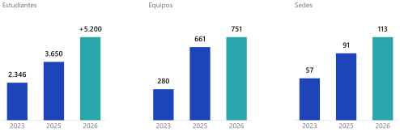

**Rally Latinoamericano**

| Edición | Año | Escala documentada | Resultado de Nicaragua |
|---|---|---|---|
| I | 2014 | Argentina; 30 h; 1.986 estudiantes; 140+ propuestas | Dos proyectos finalistas |
| II | 2015 | 8 países | Podio en Innovación |
| III | 2016 | 4.000+ jóvenes; 74 sedes; 7 países | 1.º Impacto Social y 3.º Innovación |
| IV | 2017 | Podios internacionales publicados | Sin podio nicaragüense |
| V | 2018 | México y Argentina | Nicaragua no participó |
| VI | 2019 | — | 3.º Impacto Social (LexoStop) |
| VII | 2020 | Modalidad virtual | Podio nacional (Tecnoarq) |
| VIII | 2021 | 8.000+ participantes | 1.º Innovación (MT Soluciones) |
| IX | 2022 | 9.600 participantes; 173 sedes; 13 países | Campeones nacionales: Innovación Pinolera e Inovatos |
| X | 2023 | — | 1.º Innovación (Güegüense) y 2.º Social (Nicarq) |
| XI | 2024 | 10.890 participantes; 1.305 equipos; 9 países | 1.º Innovación (Techriders) |
| XII | 2025 | 12.000+ regionales; Nicaragua: 2.700+, 56 sedes, 300+ equipos | 1.º Innovación y 1.º Impacto Social |
| XIII | 2026 | 11 países; 200+ sedes; Nicaragua: 2.900+, 24 universidades, 64 sedes | Fase nacional: Ignis Code y Avocado |

La numeración de ediciones quedó fijada por la fuente oficial de octubre de 2026: **2026 es la XIII edición**. De ahí se desprende la serie completa (2019 = VI; 2021 = VIII; 2023 = X; 2025 = XII). Es la única numeración consistente con el historial de resultados que la propia organización publica.

### 3.3 La lógica común

Pese a las diferencias, ambos certámenes comparten una arquitectura:

- **Tiempo comprimido.** 24 o 28 horas obligan a decidir el desafío en la primera hora y a producir el video en paralelo al reporte.
- **Desafío impuesto.** El equipo no elige el problema; elige cómo resolverlo. La selección del desafío es, por tanto, la primera decisión estratégica.
- **Tres entregables auditables.** Reporte, video y (en Latam) TikTok. Los tres deben contar la misma historia con los mismos números.
- **Jurado con incentivos distintos.** El nacional premia pertinencia y viabilidad local; el internacional premia transferibilidad y rigor. El mismo proyecto debe satisfacer a ambos.

---

## 4. Rally Nacional: crónica de cuatro ediciones

### 4.1 2023 — la fundación

La primera edición se celebró el 22 y 23 de septiembre de 2023. El lanzamiento fue en el Centro Nacional de Innovación Abierta «Chele Moreno» y el cierre en la Universidad Nacional Multidisciplinaria Ricardo Morales Avilés. Participaron diez universidades públicas, siete privadas e INATEC, con quince desafíos planteados.

| Categoría | 1.º lugar | 2.º lugar |
|---|---|---|
| Innovación Tecnológica | TECNOCRAFT INNOVATOR (CT Josefa Toledo de Aguerri, Juigalpa) | INNORTE (U. Francisco Luis Espinoza Pineda, Estelí) |
| Innovación Social | INGENOVA (UNI, Managua) | AGROLIDAR (CID UNAN-Managua) |
| Innovación de Procesos | NAHUATL INNOVA (UNI, Managua) | POVEDERS-UNI (UNI, Estelí) |

La edición fundacional dejó tres señales que se confirmarían después. Primero, la **formación técnica compite de igual a igual**: TECNOCRAFT, de un centro tecnológico de Juigalpa, ganó la categoría tecnológica. Segundo, el **naming cultural** ya estaba presente: NAHUATL INNOVA anticipó la ola de marcas precolombinas. Tercero, la **UNI** colocó tres equipos en el podio, patrón que se repetiría.

### 4.2 2024 — la expansión

La segunda edición se realizó el 23 y 24 de agosto de 2024, con sede principal en la Universidad Americana (UAM). Participaron 3.262 protagonistas de todos los departamentos, incluidas las dos regiones del Caribe, con 47 % de mujeres y 564 mentores.

Los desafíos más elegidos fueron «Agricultura Inteligente para Pequeños Productores» (Tecnológica), «Prevención de la Violencia de Género a través de la Tecnología» (Social) y «Rediseño de Productos para la Economía Circular» (Procesos). Esa elección anticipa los clusters de 2026: agro, inclusión y circularidad.

| Categoría | 1.º lugar | 2.º lugar |
|---|---|---|
| Innovación Tecnológica | INNOVATEAM (UNICIT) | FIDALOGIC (UNP) |
| Innovación Social | BIOINNOVA (UNAN-Managua, sede Carlos Martínez Rivas) | SOLTECPROS (UNP) |
| Innovación de Procesos | AGROINNOVA (UNA) | BOSÓN THE HIGGS (UNAN-León) |

Dos detalles importan para el análisis. La distribución se diversificó: seis instituciones distintas, ninguna con más de un ganador. Y apareció el **naming científico**: BOSÓN THE HIGGS, un equipo de física de partículas en el podio de Procesos, demostró que la marca no tiene que ser folclórica para funcionar.

### 4.3 2025 — el récord y el duopolio

La tercera edición se celebró el 6 y 7 de junio de 2025. Fue la de mayor participación hasta entonces: 3.650 estudiantes en 661 equipos, 453 mentores, 288 jurados, 91 coordinadores de sede y 91 sedes. La participación femenina llegó al 49 %, la más alta de la serie. Se plantearon doce desafíos.

| Categoría | 1.º lugar | Proyecto | 2.º lugar | Proyecto |
|---|---|---|---|---|
| Procesos | Operación Titán (UNI-RUPAP) | OLLNARI | Los Templarios (UNAN-M, CNIA 1) | EgroLab-Móvil |
| Tecnológica | Nexus Innova (UNAN-M, CNIA 1) | Parque Ecoenergético P. M. d'Escoto | Yoltik-Nova (UNI-RUPAP) | Techos de cáscara de cacao |
| Social | Volca-Tech (UNAN-M, CNIA 1) | CHÁNCENICA | Escuadrón Nic-Anahuac 1 (UNI-RUPAP) | EcoCanje |

Fue la edición de la **madurez descriptiva**: por primera vez los comunicados oficiales publicaron nombre de proyecto, descripción y cifras de impacto. Eso permite analizar qué premió el jurado:

- **OLLNARI** conecta artesanos de las Ciudades Creativas con mercados nacionales e internacionales, con sello de origen, mapa de talleres y capacitación digital.
- **Parque Ecoenergético** combina bicicletas generadoras, piso piezoeléctrico, mobiliario reciclado y compostaje; estima 3.500 beneficiarios por semana y 36.000 kg de residuos evitados al año.
- **Yoltik-Nova** transforma cáscara de cacao en láminas de techo con bioplástico, fibra de coco, almidón de yuca y cera de abeja; proyecta 80 viviendas, 12 toneladas anuales y 45 empleos.
- **CHÁNCENICA** conecta talento joven —incluidas personas con discapacidad— con prácticas y empleos, con hosting ecológico y un agente de IA.
- **EcoCanje** instala siete puntos de reciclaje inteligentes en Managua y los vincula a una app de canje y a una Eco-Zona Creativa.
- **EgroLab-Móvil** lleva análisis de suelos a pequeños productores de granos básicos con kits portátiles y planes de fertilización.

El podio se concentró en dos sedes: UNAN-Managua CNIA 1 y UNI-RUPAP, tres equipos cada una. No fue casualidad: ambas sedes tienen programas de innovación, mentores con experiencia internacional y una cultura de prototipado.

### 4.4 2026 — la redistribución

La cuarta edición se celebró el 28 y 29 de agosto de 2026, con cifras récord: más de 5.200 protagonistas, 751 equipos, 113 sedes, 37 centros tecnológicos y 28 universidades; 783 mentores, 337 jurados de sede y 9 jurados nacionales; 46 % de mujeres. Se mantuvieron los doce desafíos y se añadió el tercer lugar por categoría.

| Categoría | 1.º | 2.º | 3.º |
|---|---|---|---|
| Tecnológica | AVOCADO / Vitalia (UAM, sede Jaguares) | SolarEduTech / Banca Solar Didáctica (INATEC Rivas) | Team Owlsight / EcoGuard (UNAN-M, CNIA T. Borge) |
| Social | ELOHIM / Centro Integral Josefa Toledo (UNI CUR Estelí) | Sinergia 360 / BidiSign (ULSA León) | NEXU-Humano / Neuro-kit (UNAN-M, CID L. A. Espinoza) |
| Procesos | Lubanic / SITRACAFE (INATEC Taller Luban) | Team Rocket / Coffee Bean Bridge (UNICA) | Coffee Power / Coffee Trace (ULSA León) |

El podio se redistribuyó a seis instituciones y aparecieron tres clusters nítidos:

- **Café de especialidad** ocupa los tres lugares de Procesos. Los tres proyectos giran en torno a la trazabilidad: SITRACAFE mide temperatura, pH, secado, peso y humedad y construye un pasaporte digital; Coffee Bean Bridge conecta productores con compradores internacionales y verifica origen; Coffee Trace es una PWA offline-first para registrar el lote y validarlo en cooperativa.
- **Inclusión y discapacidad** ocupa los tres lugares de Social: rehabilitación y formación (ELOHIM), comunicación bidireccional con gemelo digital y avatar de señas (BidiSign), y material didáctico multisensorial para niños con necesidades específicas (Neuro-kit).
- **Botaderos convertidos en parques** explica dos de los tres lugares de Tecnológica: Vitalia y EcoGuard transforman vertederos ilegales en microparques con paisajismo, agua de lluvia, energía solar e IoT.

La lección de 2026 es clara: **el jurado premia la coherencia temática del año**. Un proyecto aislado compite contra un cluster; un proyecto que encarna el cluster compite con ventaja.

---

## 5. Rally Latinoamericano: crónica de trece ediciones

### 5.1 La fase fundacional (2014–2020)

**2014.** Primera edición en Argentina, con 30 horas continuas, 1.986 estudiantes y más de 140 propuestas. Nicaragua participó como país piloto y colocó dos proyectos finalistas. El formato importado de ESTIA ya traía la lógica que sobreviviría: equipos multidisciplinarios, desafío sorpresa y entregables evaluados por extraños.

**2015.** Segunda edición con ocho países. Nicaragua obtuvo podio en Innovación con Grupo Innova. El registro es incompleto, pero confirma que el país estuvo en la conversación continental desde el inicio.

**2016.** La edición que puso a Nicaragua en el mapa. Con más de 4.000 jóvenes, 74 sedes y siete países, la UNAN-FAREM Estelí logró el **primer lugar internacional en Impacto Social** con Geckakz y su juego para niños no videntes, y el **tercer lugar en Innovación** con Econova. Dos podios en un mismo año, desde una sede regional.

**2017.** El certamen consolidó su alcance con podios publicados por SIRLI. BottleLife (Uruguay) ganó Impacto Social con reutilización estructural de envases plásticos.

**2018.** Nicaragua no participó. La edición se concentró en México y Argentina.

**2019.** Lexonic (UNI-RUPAP) obtuvo el tercer lugar internacional en Impacto Social con **LexoStop**, una parada de autobús autosustentable con generación híbrida eólica-solar. El proyecto convertía infraestructura urbana pasiva en una microcentral.

**2020.** La pandemia llevó el rally a modalidad virtual. Nicaragua premió a Tecnoarq y a otros equipos nacionales en movilidad y resiliencia familiar. Fue un año de transición, sin podio internacional.

### 5.2 La fase de despegue (2021–2022)

**2021.** Con más de 8.000 participantes, Nicaragua alcanzó su primer título internacional en Innovación: **MT Soluciones Creativas** (UNI-RUPAP) con una vivienda energética autosustentable. El equipo fusionó diseño bioclimático, ingeniería química, mecánica y aprovechamiento bioenergético. En Impacto Social ganó **Ingeniarte** (UNNE, Argentina) con «Alertar», un dispositivo físico discreto para víctimas de violencia doméstica: la mejor demostración de que el hardware vence a la app cuando el contexto lo exige.

**2022.** Novena edición con 9.600 participantes, 173 sedes y trece países. En Innovación ganó **Seiketsu** (TecNM Ensenada, México) con una solución para mordeduras de serpientes; en Impacto Social, **IEEE-UPSCUE-1** (Ecuador). Nicaragua no obtuvo podio internacional, pero su fase nacional produjo dos campeones: **Innovación Pinolera** (UNI-RUPAP) e **Inovatos** (FAREM-Matagalpa).

### 5.3 La hegemonía nicaragüense (2023–2025)

**2023.** Décima edición. **Güegüense Pinolero** (UNMRMA) ganó Innovación con DIGNA, una vivienda modular con energía solar y saneamiento ecológico, y **Nicarq Sinergy** (UNI-RUSB) obtuvo el segundo lugar en Impacto Social con BioInnova, una estrategia de agua y alimentos para vivienda digna. Fue el año en que Nicaragua demostró que podía ganar con identidad cultural y rigor técnico al mismo tiempo.

**2024.** Undécima edición con 10.890 participantes, 1.305 equipos y nueve países. **Techriders** (UNI-RUSB) ganó Innovación con un sistema inteligente de captación de agua: micropresas con sensores de nivel, válvulas automatizadas y telemetría. El segundo lugar fue para Catalizadores del Cambio (Chile) y el tercero para Tecnobioq (México). En Impacto Social ganó Mexitech (México), seguido de Unabinnova (Chile) y Los Innovadores (Argentina).

**2025.** Duodécima edición. Nicaragua logró el **doblete histórico**: **STEM Synergy** (UAM) ganó Innovación con huertos verticales de riego eficiente y bajo peso estructural, y **Mentes Volcánicas** (UNI-RUPAP) ganó Impacto Social con paneles constructivos hechos de Tetra Pak reciclado. En la fase nacional nicaragüense participaron más de 2.700 jóvenes de 22 universidades en 56 sedes, con más de 300 equipos y nueve desafíos.

### 5.4 2026: la frontera actual

La XIII edición abrió el 16 de octubre de 2026 con once países, nueve desafíos y más de 200 sedes. Nicaragua compitió con más de 2.900 jóvenes de 24 universidades en 64 sedes, el segundo país con más sedes después de México, y 48 % de mujeres frente al 23 % regional.

La fase nacional nicaragüense ya tiene ganadores:

| Categoría | 1.º | 2.º | 3.º |
|---|---|---|---|
| Innovación | IGNIS CODE (UAM-DIEM) — refugios para polinizadores | STEEL INNOVATORS (CUR UNI Juigalpa) — sensores comunitarios | NANOBOTS (UNI-RUPAP 1) — sensores comunitarios |
| Impacto Social | AVOCADO (UAM-Jaguares) — segunda vida de motores eléctricos | SEMILLITAS (UAM) — polinizadores | UNICOS (UNI-RUPAP 2) — polinizadores |

Los ganadores internacionales aún no se publicaron al cierre. La tendencia, sin embargo, ya es visible: **hardware comunitario, bioingeniería y economía circular de alta densidad técnica**.

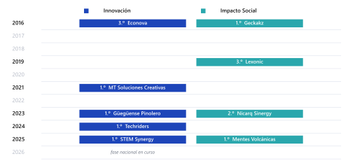

## 6. Análisis por categoría

### 6.1 Qué premia cada categoría nacional

**Innovación Tecnológica.** El jurado busca un artefacto o sistema que resuelva un problema con medios técnicos verificables: hardware, software, energía, materiales o instrumentación. No basta con una app: el podio se inclina por sistemas con componente físico o con una arquitectura técnica que se pueda explicar en corte.

- 2023: TECNOCRAFT INNOVATOR (Juigalpa) ganó desde un centro tecnológico, no desde una universidad. Señal: la formación técnica aplicada compite.
- 2024: INNOVATEAM (UNICIT) representa la transición hacia proyectos digitales con modelo de negocio.
- 2025: Nexus Innova convirtió un parque en un sistema energético-educativo con métricas de residuos y beneficiarios.
- 2026: AVOCADO ganó con Vitalia, un microparque bioclimático con IoT. El proyecto no era solo tecnología: era política pública convertida en infraestructura.

**Innovación Social.** El jurado evalúa a quién beneficia, cuánto y con qué sostenibilidad. La categoría premia soluciones que restituyen derechos, generan empleo o reparan tejido comunitario, y castiga la declaración de intenciones sin mecanismo.

- 2023: INGENOVA (UNI) ganó con una propuesta de innovación social desde ingeniería; el comunicado no publicó el proyecto.
- 2024: BIOINNOVA (UNAN-Managua) vinculó biotecnología y comunidad.
- 2025: Volca-Tech ganó con CHÁNCENICA, una plataforma de empleo juvenil que incluye personas con discapacidad y usa IA para emparejar talento.
- 2026: ELOHIM ganó con un centro integral de rehabilitación, formación y emprendimiento. La categoría se desplazó de la plataforma al **modelo de servicio**.

**Innovación de Procesos u Organizacional.** Premia la mejora de una cadena, un procedimiento o una organización. Es la categoría donde la trazabilidad, la logística y la gestión de calidad rinden más.

- 2023: NAHUATL INNOVA (UNI) ganó con un proceso aún no documentado públicamente; el nombre anticipó el patrón cultural.
- 2024: AGROINNOVA (UNA) se impuso desde la universidad agraria, con un proceso de agricultura y comercio justo.
- 2025: Operación Titán ganó con OLLNARI, una plataforma que organiza la cadena artesanal y le añade sello de origen, mapa y capacitación.
- 2026: Lubanic ganó con SITRACAFE, un sistema IoT de trazabilidad del café de especialidad. El podio completo fue café.

La evolución es nítida: **Procesos pasó de la organización interna a la cadena productiva completa**, con datos como materia prima.

### 6.2 Qué premia cada categoría latinoamericana

**Innovación.** Es la categoría de la ingeniería demostrable. Los ganadores nicaragüenses lo confirman: vivienda energética (2021), vivienda modular (2023), captación de agua (2024), agricultura vertical (2025). En todos hay un sistema físico, un cálculo y una métrica.

**Impacto Social.** Es la categoría del artefacto que cambia la vida de alguien. Los casos internacionales son elocuentes: un juego para niños no videntes (2016), un dispositivo discreto contra la violencia doméstica (2021), un panel constructivo de Tetra Pak (2025). El denominador común es que el usuario vulnerable **toca** la solución.

### 6.3 Matriz comparativa

| Criterio | Nacional Tecnológica | Nacional Social | Nacional Procesos | Latam Innovación | Latam Impacto Social |
|---|---|---|---|---|---|
| Núcleo de la propuesta | Sistema técnico | Modelo de servicio | Cadena y trazabilidad | Ingeniería demostrable | Artefacto para población vulnerable |
| Evidencia que convence | Prototipo, planos, sensores | Beneficiarios, empleo, derechos | Proceso, datos, actores | Cálculo, costo unitario, escalabilidad | Caso humano, acceso, durabilidad |
| Métrica típica | kg, kWh, personas/semana | empleos, personas atendidas | variables medidas, lotes | hectáreas, m³, unidades | personas, toneladas, hogares |
| Riesgo frecuente | Maqueta sin mecanismo | Declaración sin operación | Diagrama sin datos | Complejidad no explicada | Paternalismo sin diseño |
| Ventaja del cluster | Botaderos/energía | Inclusión | Café | Agua/vivienda | Reciclaje/educación |

### 6.4 La regla de oro por categoría

Cada categoría tiene una pregunta implícita del jurado:

- Tecnológica: **«¿Funciona y se puede fabricar?»**
- Social: **«¿A quién le cambia la vida y cómo lo sabes?»**
- Procesos: **«¿Qué mejora medible introduce en la cadena?»**
- Innovación Latam: **«¿Qué tiene esto que no tenga la solución estándar?»**
- Impacto Social Latam: **«¿Por qué esta solución llega donde otras no llegan?»**

Un equipo que no puede responder su pregunta en una frase está en la categoría equivocada.

---

## 7. Los equipos, uno por uno

Esta sección reúne a los veintisiete ganadores nacionales (2023–2026) y a los diez equipos nicaragüenses con podio internacional (2015–2025). Para cada uno se indica sede, año, categoría y puesto; cuando la fuente oficial publicó el proyecto y sus cifras, se incluyen; y se añade una lectura competitiva: **qué hizo que ese equipo subiera**.

### 7.1 Generación 2023 (Rally Nacional)

**TECNOCRAFT INNOVATOR** — CT Josefa Toledo de Aguerri, Juigalpa (INATEC). 1.º Tecnológica.
Ganó desde un centro tecnológico del interior, no desde una universidad capitalina. El nombre mezcla oficio («craft») y tecnología; la propuesta se apoyó en formación técnica aplicada. Lectura: el jurado no premia el prestigio de la sede, premia la capacidad de resolver con las manos.

**INNORTE** — U. Francisco Luis Espinoza Pineda, Estelí. 2.º Tecnológica.
Sede regional del norte, especializada en formación docente y técnica. Su segundo lugar confirma que el corredor Estelí–Matagalpa produce equipos competitivos. Lectura: la descentralización del podio empezó en 2023.

**INGENOVA** — UNI, Managua. 1.º Social.
Equipo de ingeniería que abordó un problema social. En 2023 los comunicados no publicaron el proyecto; lo relevante es la señal: la UNI ya ganaba en Social, no solo en Tecnológica. Lectura: la fortaleza de la sede es transversal a las categorías.

**AGROLIDAR** — CID UNAN-Managua. 2.º Social.
El nombre delata la tecnología: LiDAR aplicado al agro. Fue el único ganador 2023 con tecnología emergente documentada (1 de 6, 17 %). Lectura: la sensórica remota ya era una ventaja, dos años antes de que se volviera norma.

**NAHUATL INNOVA** — UNI, Managua. 1.º Procesos.
Primer equipo del podio nacional con marca precolombina explícita. Sin descripción pública del proyecto, su triunfo anticipó el patrón Yoltik-Nova (2025) y la ola de naming cultural. Lectura: la identidad como memorabilidad, no como sustituto técnico.

**POVEDERS-UNI** — UNI, Estelí. 2.º Procesos.
Segundo lugar desde la sede esteliana de la UNI. Completa los tres equipos de la UNI en el podio de 2023. Lectura: la tradición de mentoría empieza a notarse.

### 7.2 Generación 2024 (Rally Nacional)

**INNOVATEAM** — UNICIT. 1.º Tecnológica.
Única universidad privada con primer lugar ese año. Nombre genérico en inglés, sin anclaje cultural. Lectura: en 2024 todavía se podía ganar con naming funcional; en 2026 ya no.

**FIDALOGIC** — UNP. 2.º Tecnológica.
Segundo lugar desde la UNP, institución con presencia creciente. Lectura: la competencia se profesionaliza fuera de la capital.

**BIOINNOVA** — UNAN-Managua, sede Carlos Martínez Rivas. 1.º Social.
Biotecnología con enfoque comunitario. La sede lleva el nombre de un poeta nacional; el equipo no usó ese anclaje en la marca. Lectura: el peso institucional de la sede ya funcionaba como señal de calidad.

**SOLTECPROS** — UNP. 2.º Social.
Segundo lugar consecutivo de la UNP en el podio. Lectura: la universidad construyó una cantera, no un caso aislado.

**AGROINNOVA** — UNA. 1.º Procesos.
La universidad agraria ganó la categoría de procesos con agricultura y comercio justo. Lectura: la ventaja sectorial de una institución se traduce en podio cuando el desafío coincide con su especialidad.

**BOSÓN THE HIGGS** — UNAN-León. 2.º Procesos.
Nombre tomado de la física de partículas. Sin anclaje cultural, con marca científica. Lectura: el naming puede ser cultural o técnico, pero debe ser específico y memorable.

### 7.3 Generación 2025 (Rally Nacional)

**Operación Titán / OLLNARI** — UNI-RUPAP. 1.º Procesos.
Plataforma web y móvil que conecta artesanos de las Ciudades Creativas con mercados nacionales e internacionales. Añade sello «Origen Garantizado», mapa interactivo de talleres y capacitación digital. Lectura: convirtió una política pública (Ciudades Creativas) en producto digital; el jurado institucional vio prefactibilidad inmediata.

**Los Templarios / EgroLab-Móvil** — UNAN-Managua, CNIA 1. 2.º Procesos.
Laboratorio móvil de suelos para pequeños y medianos productores de granos básicos: kits portátiles, planes de fertilización personalizados, bioinsumos y formación. Lectura: hardware de bajo costo para una crisis silenciosa (degradación de suelos); el video muestra trabajo de campo real.

**Nexus Innova / Parque Ecoenergético «Padre Miguel d'Escoto Brockmann»** — UNAN-Managua, CNIA 1. 1.º Tecnológica.
Parque público con bicicletas generadoras, piso piezoeléctrico, mobiliario reciclado y compostaje. Métricas: 3.500 personas por semana y 36.000 kg de residuos al año. Lectura: el proyecto más completo de 2025 en la tríada técnica–social–institucional.

**Yoltik-Nova** — UNI-RUPAP. 2.º Tecnológica.
Fábrica en Waslala que transforma cáscara de mazorca de cacao en láminas de techo con bioplástico, fibra de coco, almidón de yuca y cera de abeja. Métricas: 80 viviendas, 12 toneladas de residuos al año, 45 empleos. Lectura: economía circular con materia prima local y cifras de negocio.

**Volca-Tech / CHÁNCENICA** — UNAN-Managua, CNIA 1. 1.º Social.
Plataforma que conecta jóvenes —incluidas personas con discapacidad y talentos autodidactas— con prácticas y empleos; hosting ecológico, conexión inversa y agente de IA. Lectura: resolvió un problema de acceso laboral con un modelo de negocio claro y una marca registrable.

**Escuadrón Nic-Anahuac 1 / EcoCanje** — UNI-RUPAP. 2.º Social.
Siete puntos de reciclaje inteligentes en Managua integrados con la app «Canje+» y una Eco-Zona Creativa que canjea residuos por productos culturales. Lectura: convirtió el reciclaje en experiencia ciudadana; antecedente directo del cluster de botaderos de 2026.

### 7.4 Generación 2026 (Rally Nacional)

**AVOCADO / Vitalia** — UAM, sede Jaguares. 1.º Tecnológica.
Transforma botaderos ilegales en microparques creativos y bioclimáticos con paisajismo, infraestructura circular, captación de agua de lluvia, energía solar e IoT. Lectura: el proyecto más ambicioso del año; conecta economía naranja, ambiente y espacio público.

**SolarEduTech / Banca Solar Didáctica** — INATEC Rivas. 2.º Tecnológica.
Banca urbana con panel fotovoltaico, controlador, baterías, inversor y protecciones; funciona como respaldo energético y laboratorio de formación en renovables. Lectura: producto replicable, costo acotado y uso pedagógico; encaja perfecto en la red INATEC.

**Team Owlsight / EcoGuard** — UNAN-Managua, CNIA Comandante Tomás Borge. 3.º Tecnológica.
Microparque inteligente sobre antiguos botaderos, con tecnología y participación comunitaria. Lectura: misma tesis que Vitalia, ejecutada desde otra sede; el jurado premió el cluster, no un caso único.

**ELOHIM / Centro Integral Josefa Toledo de Aguirre** — UNI CUR Estelí. 1.º Social.
Modelo que articula rehabilitación, formación técnica y emprendimiento para personas con discapacidad. Lectura: pasó de la ayuda asistencial al modelo de servicio con rutas de ingreso; el nombre homenajea a una educadora.

**Sinergia 360 / BidiSign** — ULSA León. 2.º Social.
Sistema ciberfísico de comunicación bidireccional: un gemelo digital convierte la voz del docente en lengua de señas mediante avatar 3D, y cámaras reconocen las señas del estudiante para devolver voz. Lectura: el proyecto técnicamente más sofisticado del podio; IA con usuario concreto.

**NEXU-Humano / Neuro-kit** — UNAN-Managua, CID Luisa Amanda Espinoza. 3.º Social.
Kit didáctico portátil para niños de 6 a 10 años con necesidades específicas de apoyo educativo: materiales multisensoriales, guía docente y seguimiento del progreso. Lectura: bajo costo, alta replicabilidad y foco en el docente.

**Lubanic / SITRACAFE** — INATEC Taller Luban. 1.º Procesos.
Sistema IoT de monitoreo y trazabilidad del café de especialidad: temperatura y pH de fermentación, curvas de secado, peso y humedad, pasaporte digital. Lectura: la trazabilidad como producto; responde a una exigencia real de compradores internacionales.

**Team Rocket / Coffee Bean Bridge** — UNICA. 2.º Procesos.
Plataforma que conecta pequeños y medianos productores de café de especialidad con compradores internacionales, con centro de acopio, verificación de origen y asistencia en exportación. Lectura: modelo B2B con intermediación de confianza.

**Coffee Power / Coffee Trace** — ULSA León. 3.º Procesos.
PWA offline-first para registrar el lote en campo y validarlo en cooperativa bajo un identificador único. Lectura: resolvió la restricción real de conectividad rural; el offline-first es una decisión de ingeniería, no un adorno.

### 7.5 Podios internacionales de Nicaragua

**GRUPO INNOVA** — 2015, Innovación, 2.º lugar. Sede no publicada. Primer podio continental documentado. Lectura: el país aprendió el formato antes de tener un sistema nacional de innovación.

**ECONOVA** — UNAN-FAREM Estelí, 2016, Innovación, 3.º lugar. Tercer lugar con una solución de base técnica desde una sede regional. Lectura: Estelí demostró que se podía competir desde fuera de Managua.

**GECKAKZ** — UNAN-FAREM Estelí, 2016, Impacto Social, 1.º lugar. Juego para niños no videntes. Primer título internacional de Nicaragua. Lectura: el impacto social ganó con un artefacto tangible y un usuario clarísimo.

**LEXONIC / LexoStop** — UNI-RUPAP, 2019, Impacto Social, 3.º lugar. Parada de autobús con techo híbrido eólico-solar. Lectura: infraestructura pasiva convertida en microcentral; el video mostraba balance energético y modelo a escala.

**MT Soluciones Creativas** — UNI-RUPAP, 2021, Innovación, 1.º lugar. Vivienda energética autosustentable que fusionó bioclimática, química, mecánica y bioenergía. Lectura: la multidisciplinariedad extrema como ventaja; el equipo construyó una maqueta que era un sistema termodinámico.

**Güegüense Pinolero / DIGNA** — UNMRMA, 2023, Innovación, 1.º lugar. Vivienda modular con energía solar y saneamiento ecológico. Lectura: identidad cultural en el nombre, modularidad en el diseño; satisfizo al jurado nacional y al internacional.

**Nicarq Sinergy / BioInnova** — UNI-RUSB, 2023, Impacto Social, 2.º lugar. Estrategia integral de agua y alimentos con huertos domésticos; 44 m², 100 litros de agua purificada al día. Lectura: el impacto social se demostró con dimensiones y flujo diario.

**Techriders** — UNI-RUSB, 2024, Innovación, 1.º lugar. Sistema inteligente de captación de agua: micropresas con sensores de nivel, válvulas automatizadas y telemetría LoRaWAN; lote piloto de 4.500 USD. Lectura: hibridación ciberfísica completa y presupuesto unitario creíble.

**STEM Synergy** — UAM, 2025, Innovación, 1.º lugar. Huertos verticales con recirculación de agua recuperada y reducción de peso estructural del 40 %. Lectura: resolvió la restricción física (peso en azotea) además de la agronómica.

**Mentes Volcánicas / ReVida Móvil** — UNI-RUPAP, 2025, Impacto Social, 1.º lugar. Revalorización de Tetra Pak en paneles constructivos modulares sismorresistentes. Lectura: pasó del reciclaje artesanal al material de construcción certificable; el video muestra el panel como héroe.

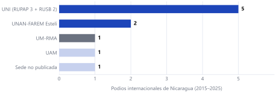

---

## 8. Los videos: catálogo y lectura caso por caso

### 8.1 El corpus audiovisual

El corpus cataloga **37 videos** de equipos ganadores y finalistas. La distribución por plataforma revela dos estrategias distintas:

- **Rally Nacional:** 30 videos, casi todos en Facebook. Son coberturas de sede, premiaciones y posts de felicitación; solo cinco son presentaciones directas del proyecto.
- **Rally Latam:** 7 videos con URL completa, todos en YouTube. Es el archivo donde se puede estudiar el pitch real.

La asimetría no es casual. Las universidades publican en Facebook porque es la red dominante en Nicaragua; los equipos que compiten internacionalmente eligen YouTube por alcance regional y SEO.

### 8.2 Los siete videos de YouTube

**Operación Titán / OLLNARI (2025, Nacional).** Canal «Operación Titán», título «Operación Titán_UNI_Pitch Rally Nicaragua Innova 2025». Duración 2:22. Miniatura: un repartidor en moto entrega una caja a un cliente en la calle; es una escena comercial, no una foto de equipo. Lectura: el video se presenta como historia de producto (artesano → mercado), coherente con la plataforma. El título usa el nombre del squad y del rally, pero no incluye el proyecto en la miniatura.

**Nexus Innova (2025, Nacional).** Canal personal (Gustavo Alexander García Madriz), título «Nexus Innova-UNAN-Managua-Pitch Rally Nicaragua Innova 2025». Duración 2:10. Miniatura: tarjeta blanca con el logotipo del Parque Ecoenergético y el escudo de la UNAN-Managua. Lectura: modelo institucional; la marca visual del proyecto está bien resuelta, pero la apertura es un logo, no un dolor.

**Los Templarios / EgroLab-Móvil (2025, Nacional).** Canal personal (Jefferson Laguna), título «Los Templarios-UNAN Managua-Pitch Rally Nicaragua Innova 2025». Duración 2:00. Miniatura: camino rural de montaña con tres personas y el logo «EgroLab móvil» en la esquina. Lectura: la miniatura promete campo y trabajo real; es la más auténtica del conjunto.

**Güegüense Pinolero / DIGNA (2023, Latam).** Canal personal (Mixel Javier Navarrete Vargas), título «Rally Latinoamericano de Innovacion 2023 - Vivienda Digna». Duración 1:45. Miniatura: infografía de bombillas LED de 12 W. Lectura: la miniatura no representa la vivienda; el video ganó pese a una portada débil, lo que confirma que el contenido pesa más que el thumbnail.

**Nicarq Sinergy / BioInnova (2023, Latam).** Canal personal (Xochilt Dayana Membreño Olivares), título con hashtags del rally y de la UNI-RUSB. Duración 1:53. Miniatura: render 3D de una vivienda con paneles solares y el logo del equipo en primer plano. Lectura: modelo profesional-startup; el render comunica el producto antes de reproducir.

**Lexonic / LexoStop (2019, Latam).** Canal personal (Claudio de Jesús Chavarría Altamirano), título «RALLY LATINOAMERICANO DE INNOVACIÓN 2019 UNI-RUPAP». Duración 177 s (2:57), por encima del límite actual. Miniatura: render de una parada de autobús y el logo LexoStop. Lectura: modelo académico-institucional; sin hashtags ni marca de canal, pero con un producto visualmente claro.

**Techriders (2024, Latam).** Canal personal (Emorie Aguirre), título «TechRiders innovacion». Duración 1:58. Miniatura: render 3D de la micropresa con el sello «Innovación 2024» y logos institucionales. Lectura: el estándar visual del pitch técnico: obra, terreno, sello del certamen y marca.

**Mentes Volcánicas / ReVida Móvil (2025, Latam).** Canal del equipo, título «ReVida Móvil - Aprovechamiento Tetra Pak - Grupo Mentes Volcánicas». Duración 1:55. Miniatura: primer plano macro de un panel gris con textura de Tetra Pak reciclado, con el logo del equipo. Lectura: el modelo más maduro: canal de marca, título en tres segmentos y el material como héroe visual.

**MT Soluciones Creativas (2021, Latam).** El enlace del corpus apunta a la premiación de TN8, no al pitch. El video del proyecto ya no está disponible. Lectura: el caso se reconstruye por la descripción del líder y la prensa, no por observación directa.

**STEM Synergy (2025, Latam).** El video existe, pero el acceso devuelve error 403 y no se pudo recuperar metadata. Lectura: el caso se sostiene con la descripción oficial del proyecto y el resultado, no con el análisis del video.

### 8.3 Los cinco videos de Facebook del Rally Nacional

Los cinco registros prioritarios son presentaciones o entrevistas, no pitches completos:

1. **Los Templarios / EgroLab-Móvil** (2025, 2.º Procesos, UNAN-Managua): entrevista posterior a la premiación.
2. **BIOINNOVA** (2024, 1.º Social, UNAN-Managua): presentación del proyecto en la sede.
3. **BOSÓN THE HIGGS** (2024, 2.º Procesos, UNAN-León): entrevista en programa universitario.
4. **SolarEduTech / Banca Solar Didáctica** (2026, 2.º Tecnológica, INATEC Rivas): presentación institucional.
5. **AVOCADO / Vitalia** (2026, 1.º Tecnológica, UAM): video de presentación y versión extendida.

Lectura: el ecosistema nacional documenta el **resultado**, no el **pitch**. Esa es una diferencia clave con el Latam, donde el video es el objeto de estudio.

### 8.4 Tres modelos de canal y producción

| Modelo | Descripción | Ejemplos | Qué revela |
|---|---|---|---|
| A. Académico-institucional | Canal personal del líder, título institucional, sin hashtags | Lexonic (2019), Güegüense (2023) | El video es un trámite académico |
| B. Profesional-startup | Título con hashtags, descripción regional, enlaces multiplataforma | Nicarq (2023), Techriders (2024) | El equipo piensa en mercado |
| C. Marca-equipo | Canal con nombre del equipo, título en tres segmentos, SEO con variantes de hashtag | Mentes Volcánicas (2025) | El equipo piensa en marca y en audiencia |

La evolución A → B → C es clara en cinco años y coincide con el aumento de exigencia del certamen. En 2025, el modelo C ganó el primer lugar de Impacto Social.

### 8.5 Qué se puede concluir del archivo audiovisual

1. **La duración se estandarizó en dos minutos.** El único video que excede el límite actual es de 2019, cuando la regla era menos estricta.
2. **La miniatura importa, pero no decide.** Güegüense ganó con una portada de bombillas; lo que sostenía el video era el sistema de vivienda.
3. **El render 3D es el lenguaje común del pitch técnico.** LexoStop, BioInnova, Techriders y Mentes Volcánicas lo usan; los tres últimos lo combinan con material real.
4. **La marca de canal se profesionalizó.** El paso de canal personal a canal de equipo es el cambio más visible entre 2019 y 2025.
5. **El Rally Nacional no conserva pitches.** Su archivo es de resultados; el análisis de guion nacional es, por tanto, inferido de descripciones oficiales y no de observación directa.

---

## 9. Anatomía del video ganador (PAS-V)

### 9.1 La estructura

El video dura 120 segundos y se divide en cuatro microactos. Cada uno activa un criterio distinto de la rúbrica:

| Acto | Tiempo | Función | Criterio que activa | Palabras |
|---|---|---|---|---|
| I. Dolor | 0:00–0:20 | Gancho empático y estadístico; territorio concreto | Impacto y presentación | ~45 |
| II. Caja negra | 0:20–1:00 | Nombra la solución y muestra el mecanismo | Innovación y viabilidad técnica | ~90 |
| III. Prefactibilidad | 1:00–1:35 | Costos, unidad, modelo, ciclo ambiental | Prefactibilidad y sostenibilidad | ~75 |
| IV. Cierre | 1:35–2:00 | Métricas, ODS, escalabilidad, frase final | Integración y recordación | ~55 |

El total óptimo es de 240 a 270 palabras, a unas 135 palabras por minuto. Menos de 200 palabras deja silencios que el jurado llena con duda; más de 280 obliga a acelerar y pierde claridad.

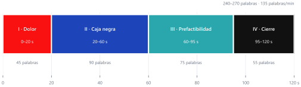

### 9.2 Acto I: el dolor (0:00–0:20)

**Qué hace ganar.** Un dato duro y un rostro concreto en menos de diez segundos. No logos, no nombres de integrantes, no lectura del desafío.

**Evidencia.** Techriders abre con la comunidad agrícola afectada por estrés hídrico; Ingeniarte abre con una mujer en confinamiento con su agresor; Mentes Volcánicas abre con el volumen de Tetra Pak desechado.

**Error frecuente.** Empezar con «somos estudiantes de…» o con una diapositiva de objetivos. El jurado decide en los primeros segundos si sigue mirando.

**Regla operativa.** El primer plano debe ser humano o territorial; la primera frase debe contener una cifra o una consecuencia física.

### 9.3 Acto II: la caja negra (0:20–1:00)

**Qué hace ganar.** Nombrar la solución y abrir el mecanismo: corte, vista explosionada, diagrama de bloques, reacción química, flujo de datos. El jurado debe entender **cómo funciona** sin leer el reporte.

**Evidencia.** Techriders muestra la micropresa con válvulas y sensores; STEM Synergy muestra el tren de biofiltración y la dosificación; LexoStop muestra el balance eólico-solar; BidiSign muestra el gemelo digital y el avatar.

**Error frecuente.** Explicar beneficios antes que mecanismo. Sin mecanismo, la innovación se percibe como idea.

**Regla operativa.** Una sola frase de tesis («es un sistema que…») y después solo imágenes de mecanismo con voz en off que nombra componentes.

### 9.4 Acto III: la prefactibilidad (1:00–1:35)

**Qué hace ganar.** Costo unitario, alcance del piloto, quién paga y cómo se sostiene. En dólares si se compite en Latam. Sin TIR ni VAN: el jurado quiere saber si el prototipo es fabricable y financiable, no si el negocio es un unicornio.

**Evidencia.** Techriders declara un lote piloto de 4.500 USD; SITRA (proyecto de referencia) calcula 204,94 USD por nodo; Yoltik-Nova proyecta 80 viviendas y 45 empleos; Nexus Innova estima 3.500 beneficiarios semanales.

**Error frecuente.** Dar un total sin desglose o un precio sin proveedor. Un número sin fuente es una opinión.

**Regla operativa.** Tres cifras máximo: costo unitario, costo del piloto y costo por beneficiario. Cada una con su base.

### 9.5 Acto IV: el cierre (1:35–2:00)

**Qué hace ganar.** Volver al usuario del acto I y mostrar la transformación; cerrar con la tríada ambiental, económica y social; nombrar la escalabilidad regional.

**Evidencia.** Los campeones cierran con tres métricas. Mentes Volcánicas: toneladas desviadas, paneles producidos, hogares beneficiados. STEM Synergy: litros recuperados, kilos de alimento, reducción de peso estructural. Techriders: hectáreas irrigadas, agua almacenada, familias atendidas.

**Error frecuente.** Terminar con «gracias» o con el logo. El último segundo debe ser una frase de memoria.

**Regla operativa.** Cierre en tres tiempos: «Hoy [usuario] vive así; con [solución] vive así; esto se replica en [región]».

### 9.6 La doble codificación

El mismo video se evalúa dos veces: primero el jurado nacional, después el internacional. Eso exige dos capas:

- **Capa local:** toponimia, institución, materia prima y beneficiario reconocible.
- **Capa universal:** problema estructural compartido, diseño paramétrico, costo en dólares y escalabilidad.

Un video que solo tiene la primera capa gana en casa y pierde fuera. Uno que solo tiene la segunda pierde en casa antes de llegar.

---

## 10. Tendencias: qué cambió entre 2023 y 2026

### 10.1 Naming: del sufijo genérico a la marca dual

En 2023, cinco de seis ganadores nacionales usaban sufijos «-INNOVA», «-NOVA» o «-INNOVATOR». En 2024, tres de seis. En 2025 y 2026, **quince de quince** usaron naming dual: un nombre de squad (Operación Titán, Los Templarios, AVOCADO, Team Owlsight, Sinergia 360) y una marca de proyecto registrable (OLLNARI, EgroLab-Móvil, Vitalia, EcoGuard, BidiSign, SITRACAFE, Neuro-kit, Coffee Bean Bridge, Coffee Trace).

El sufijo «-INNOVA» desapareció del podio nacional en 2026. La marca dual ya no es un adorno: es un requisito de memorabilidad y de propiedad intelectual.

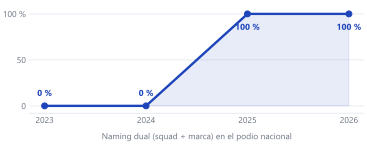

### 10.2 Complejidad técnica

| Año | Ganadores con tecnología emergente documentada | Porcentaje |
|---|---|---|
| 2023 | 1 de 6 (AGROLIDAR, LiDAR) | 17 % |
| 2024 | 0 de 6 | 0 % |
| 2025 | 4 de 6 (Nexus, Volca-Tech, EcoCanje, OLLNARI) | 67 % |
| 2026 | 7 de 9 (Vitalia, SolarEduTech, EcoGuard, BidiSign, Neuro-kit, SITRACAFE, Coffee Trace) | 78 % |

En el agregado 2025–2026, once de quince ganadores (73 %) incorporan IoT, IA, gemelo digital, energía o PWA offline-first. La tecnología dejó de ser un diferenciador y pasó a ser un piso.

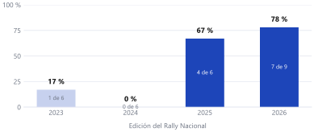

### 10.3 Métricas

Entre 2023 y 2024, ninguno de los doce ganadores tenía métricas de impacto en la descripción oficial. En 2025 y 2026, seis de quince las incluyen:

- Yoltik-Nova: 80 viviendas, 12 t/año, 45 empleos.
- Nexus Innova: 3.500 personas/semana, 36.000 kg/año.
- EcoCanje: 7 puntos, 17 departamentos.
- Neuro-kit: segmento de 6 a 10 años con NEAE.
- SITRACAFE: 4 variables de proceso (temperatura, pH, peso, humedad).
- Coffee Trace: 9 variables de trazabilidad.

La métrica dejó de ser un lujo de presentación y se volvió un criterio de jurado.

### 10.4 Territorialización

La proporción de ganadores con territorio específico pasó de 39 % en 2023 a 56 % en 2026. Los casos son concretos: Waslala (Yoltik-Nova), Rivas (SolarEduTech), CUR Estelí (ELOHIM), ULSA León (Sinergia 360), los 17 departamentos (EcoCanje). El proyecto genérico perdió terreno frente al proyecto situado.

### 10.5 Concentración institucional

| Año | Distribución del podio nacional |
|---|---|
| 2023 | UNI 3 de 6; INATEC, UFLEP, CID UNAN-M, UNI Estelí con 1 cada una |
| 2024 | Seis instituciones distintas, ninguna repetida |
| 2025 | Duopolio: UNAN-M CNIA 1 (3) y UNI-RUPAP (3) |
| 2026 | Seis instituciones: UAM, INATEC (2), UNAN-M (2), UNI (2), ULSA León (2), UNICA |

La concentración de 2025 no se repitió. La hipótesis más razonable es que el jurado buscó diversidad de sedes y que las instituciones emergentes prepararon equipos con estándar internacional.

### 10.6 Clusters temáticos

| Cluster | Evidencia | Ediciones |
|---|---|---|
| Café de especialidad | 3 de 3 en Procesos 2026 | 2026 |
| Inclusión y discapacidad | 3 de 3 en Social 2026 | 2026 |
| Botaderos → parques | 2 de 3 en Tecnológica 2026; antecedente EcoCanje 2025 | 2025–2026 |
| Energía + educación + espacio público | Nexus 2025, SolarEduTech 2026 | 2025–2026 |
| Soberanía alimentaria | Agrolidar, Agroinnova, EgroLab, Yoltik-Nova | 2023–2026 |
| Vivienda | Güegüense 2023, Yoltik-Nova 2025 | 2023–2025 |
| Agua | LexoStop 2019, Techriders 2024 | 2019–2024 |

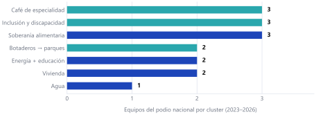

### 10.7 La curva de exigencia

Las cuatro tendencias se refuerzan entre sí. Un equipo con naming genérico, sin métricas y sin tecnología emergente podía ganar en 2023; en 2026 ese perfil no aparece en el podio. La exigencia no subió de golpe: subió **por capas**, y cada capa se volvió estándar en la siguiente edición.

## 11. Modelo de preparación competitiva y pruebas estadísticas

### 11.1 Qué modelamos y qué no

La pregunta natural es si podemos **predecir** qué equipo gana. La respuesta honesta es: con los datos públicos, no. Para predecir hace falta el denominador completo (todos los equipos que compitieron, no solo los que ganaron), la categoría y el desafío de cada uno, y las puntuaciones del jurado. Nada de eso es público.

Lo que sí se puede construir es un **índice de preparación competitiva (IPC)**: una medida transparente de cuánto se parece un equipo al perfil que llegó al podio en cada edición. No es una probabilidad. Es un diagnóstico de brechas.

Esto reemplaza el uso de «win-rates» como probabilidades. Un equipo con IPC 85 no tiene 85 % de chances: tiene el perfil de los equipos que ganaron, y le faltan las condiciones de contexto (desafío, categoría, ejecución) que el índice no observa.

### 11.2 Tasas base reales

Antes de cualquier modelo, el dato más importante es la tasa base. En el Rally Nacional:

| Edición | Equipos | Premios | Tasa por equipo | IC 95 % (Wilson) |
|---|---|---|---|---|
| 2023 | 280 | 6 | 2,14 % | 1,0–4,6 % |
| 2025 | 661 | 6 | 0,91 % | 0,4–2,0 % |
| 2026 | 751 | 9 | 1,20 % | 0,6–2,3 % |

Ganar es un evento de aproximadamente 1 a 2 %. Cualquier afirmación de «100 % de probabilidad» es, por construcción, falsa: describe un puntaje interno, no una frecuencia.

### 11.3 Pruebas de cambio entre ediciones

Se compararon los ganadores de 2023–2024 (n = 12) con los de 2025–2026 (n = 15) en cuatro características documentadas. Se usó la prueba exacta de Fisher para tablas 2×2 y se reporta la diferencia de proporciones con intervalo de Newcombe.

| Característica | 2023–24 | 2025–26 | Diferencia | IC 95 % | p (Fisher) |
|---|---|---|---|---|---|
| Tecnología emergente documentada | 1/12 (8,3 %) | 11/15 (73,3 %) | +65,0 pp | 28,0–82,2 | 0,0014 |
| Naming dual (squad + marca) | 0/12 (0 %) | 15/15 (100 %) | +100 pp | 68,3–100 | < 0,0001 |
| Métricas de impacto explícitas | 0/12 (0 %) | 6/15 (40,0 %) | +40,0 pp | 8,5–64,3 | 0,020 |
| Territorio específico | 5/12 (41,7 %) | 7/15 (46,7 %) | +5,0 pp | −29,3–37,2 | 1,00 |

Lectura:

- **Tres cambios son estadísticamente significativos.** La tecnología emergente, el naming dual y las métricas no son impresiones: la probabilidad de observar estos saltos por azar es baja (p ≤ 0,02).
- **La territorialización no cambió.** El 42 % de 2023–24 y el 47 % de 2025–26 son compatibles con la misma proporción. El territorio importa, pero no es lo que distingue a la generación nueva.
- **El efecto del naming es el más grande.** Pasar de cero a quince equipos con marca dual en dos ediciones es el cambio más nítido del corpus.

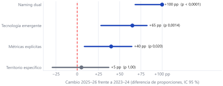

### 11.4 Construcción del índice

El IPC combina cuatro factores binarios, observables en la ficha pública del equipo:

| Factor | Definición operativa | Peso | Justificación |
|---|---|---|---|
| T — Profundidad técnica | IoT, IA, gemelo digital, energía, PWA u otro sistema emergente documentado | 35 | Es el factor de mayor peso en la rúbrica (innovación + viabilidad) |
| M — Métricas | Cifras explícitas de impacto, operación o proceso | 25 | Alimenta impacto y prefactibilidad |
| B — Marca dual | Nombre de squad + marca de proyecto registrable | 25 | Es el cambio más fuerte observado (100 % en 2025–26) |
| L — Territorio | Municipio, comunidad o cadena productiva nombrada | 15 | Anclaje local; pesa más en el Nacional que en el Latam |

Fórmula:

**IPC = 35·T + 25·M + 25·B + 15·L**, con cada factor en {0, 1}. Rango: 0–100.

Bandas de lectura:

| Banda | Rango | Interpretación |
|---|---|---|
| Rezagado | 0–39 | Perfil de ediciones anteriores; no compite con el estándar actual |
| Competitivo | 40–69 | Cumple parte del estándar; necesita cerrar brechas |
| Fuerte | 70–89 | Perfil de podio reciente |
| Élite | 90–100 | Cumple los cuatro factores; candidato estructural |

### 11.5 Resultados del índice

| Edición | IPC medio | Distribución |
|---|---|---|
| 2023 | 7,5 | 0, 0, 0, 15, 15, 15 |
| 2024 | 5,0 | 0, 0, 0, 0, 15, 15 |
| 2025 | 65,8 | 25, 60, 60, 65, 85, 100 |
| 2026 | 68,9 | 40, 40, 60, 60, 75, 75, 85, 85, 100 |

La correlación entre año e IPC es **ρ = 0,775 (p < 0,001)**: el estándar del podio subió de forma sostenida. En dos años, el IPC medio pasó de 5 a 69 puntos.

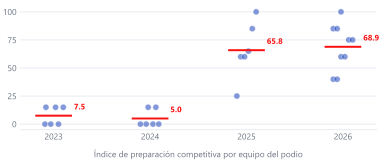

### 11.6 La prueba que falla (y lo que enseña)

Si el IPC predijera quién gana, los primeros lugares deberían tener IPC más alto que los segundos y terceros. **No ocurre.** En el conjunto completo, la diferencia entre primeros y no primeros no es significativa (Mann-Whitney U = 73; p = 0,81). En 2026, la comparación tampoco separa (p = 0,60).

Esto no invalida el índice: lo delimita. El IPC mide **elegibilidad**, no **ordenamiento**. Explica por qué un equipo está en condiciones de competir; no explica por qué el jurado eligió a uno entre varios elegibles. Para eso pesan el desafío elegido, la ejecución del video, la coherencia numérica y la narrativa, que son específicos de cada edición.

La conclusión es útil para el trabajo: **invertir en los cuatro factores te mete en la conversación; ganarla depende de la ejecución y del contexto.**

### 11.7 Sensibilidad

Se perturbaron los pesos ±10 puntos en 500 simulaciones, renormalizando a 100. La correlación de orden con el índice base tuvo un mínimo de **ρ = 0,975** y una media de 0,996. El orden de los equipos no depende de la calibración exacta de los pesos: el modelo es robusto a decisiones razonables de ponderación.

### 11.8 Qué haría falta para un modelo predictivo

| Requisito | Estado actual |
|---|---|
| Registro de todos los equipos (ganadores y no ganadores) | No público |
| Desafío y categoría por equipo | Parcial (solo ganadores) |
| Puntuación del jurado por criterio | No pública |
| Tamaño de muestra suficiente | 27 ganadores; insuficiente para regresión estable |

Con esos datos, el paso siguiente sería una regresión logística con validación cruzada por edición, reportando AUC e intervalos. Sin ellos, cualquier «probabilidad de victoria» es una opinión con formato numérico.

---

## 12. Rúbricas y mecánica de evaluación

### 12.1 La rúbrica latinoamericana

| Criterio | Peso | Qué evalúa | Dónde se demuestra |
|---|---|---|---|
| Grado de innovación | 30 | Novedad y originalidad de la solución | Acto II, mecanismo |
| Impacto positivo | 20 | Beneficio social, ambiental y económico | Actos I y IV |
| Prefactibilidad | 20 | Costos, sostenibilidad, modelo | Acto III |
| Viabilidad técnica | 20 | Que el sistema funcione y sea fabricable | Acto II y reporte |
| Calidad de presentación | 10 | Claridad, estructura, producción | Todo el video |

La rúbrica está verificada contra la imagen oficial del repositorio. El peso de innovación (30) explica por qué los equipos que solo mejoran un proceso existente rara vez ganan Innovación: sin un mecanismo propio, el criterio principal queda a medias.

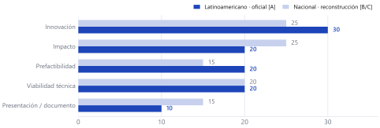

### 12.2 La rúbrica nacional

La rúbrica nacional se reconstruyó a partir de las bases, los comunicados y el comportamiento del jurado:

| Criterio | Peso reconstruido |
|---|---|
| Innovación | 25 |
| Impacto territorial y alineación con el plan nacional | 25 |
| Viabilidad local | 20 |
| Prefactibilidad y canvas | 15 |
| Documento y pitch | 15 |

Debe usarse como guía de preparación, no como texto oficial. El jurado nacional pondera más la pertinencia territorial y la alineación institucional que el jurado internacional.

### 12.3 Composición y tiempos del jurado

- **Sede:** tribunal local; delibera en un máximo de tres horas.
- **Nacional:** jurado institucional; en 2026 fueron nueve jurados nacionales.
- **Internacional:** jurado académico; delibera en 72 horas y **no puede evaluar a su propio país**.

Esa última regla es la que obliga a la doble codificación del video: lo que emociona al jurado local puede no ser comprendido por un evaluador de otro país.

### 12.4 Reglas de equipo

Las bases SIRLI establecen equipos de 4 a 10 integrantes, con al menos un estudiante de ingeniería y al menos una mujer; permiten un egresado y un docente sin rol de liderazgo. La composición no es un trámite: los equipos que ganan suelen combinar ingeniería dura con arquitectura, diseño y comunicación.

### 12.5 Coherencia numérica

La regla más incumplida y más letal: **el video, el reporte y el canvas deben decir los mismos números**. Un costo distinto entre entregables es una señal de improvisación que el jurado detecta de inmediato. La coherencia se verifica antes de enviar, no después.

---

## 13. El pautado: qué exige cada sección

### 13.1 Límites y función

El reporte latinoamericano tiene cinco secciones con límites de caracteres:

| Sección | Límite | Función | Evidencia mínima |
|---|---|---|---|
| Problemática | 1.250 | Dolor, territorio, población | Dato con fuente y caso concreto |
| Solución | 1.250 | Mecanismo y arquitectura | Diagrama, componentes, principio físico |
| Impacto | 1.000 | Beneficiarios y métricas | Cifras y método de cálculo |
| Innovación | 1.000 | Estado del arte y diferencia | Comparación con alternativas |
| Prefactibilidad | 1.500 | Costos, modelo, sostenibilidad | BOM, costo unitario, piloto |

Total: 6.000 caracteres. El límite de prefactibilidad es 1.500, no 1.000: es la sección que más espacio necesita porque es donde se cae la mayoría.

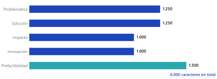

### 13.2 Qué hace ganar cada sección

**Problemática.** Un territorio nombrado y una consecuencia física. «En Waslala, la cáscara de cacao se quema o se pudre» vale más que «la contaminación es un problema global».

**Solución.** El mecanismo en presente y en orden de operación. Qué entra, qué se transforma, qué sale. Sin adjetivos.

**Impacto.** Tres métricas con método: cuántas personas, cuánto residuo, cuánto dinero. Cada una con su supuesto.

**Innovación.** Una tabla o una frase que compare la solución con lo que existe. Si no hay comparación, no hay innovación demostrada.

**Prefactibilidad.** Costo unitario, costo del piloto, quién paga y en cuánto tiempo se repone la inversión operativa. Sin TIR ni VAN.

### 13.3 El reporte nacional

El documento nacional admite hasta diez páginas y se evalúa junto con el pitch. La diferencia clave es el peso de la alineación territorial: el jurado espera ver el municipio, la institución aliada y la contribución al plan nacional. Un reporte técnicamente correcto pero desanclado pierde en el criterio de impacto.

---

## 14. Selección de retos: dónde está la ventaja

### 14.1 El problema de elegir

En cada edición se plantean entre nueve y quince desafíos. Cientos de equipos eligen el mismo. La probabilidad de podio no depende solo de la calidad: depende de **cuántos compiten en tu desafío** y de **cuánto espacio de diferenciación queda**.

### 14.2 Tres criterios de selección

1. **Densidad técnica.** Un desafío que exige hardware, cálculo o proceso permite demostrar mecanismo; uno que se resuelve con una app informativa atrae soluciones indiferenciables.
2. **Precedente documentado.** Si un equipo ganó ese desafío antes, hay un camino conocido y un estándar que superar. Si nunca se ganó, hay espacio para ser el primero.
3. **Acceso a datos y territorio.** El equipo debe poder nombrar un caso real y conseguir cifras. Sin datos locales, el pautado se vuelve genérico.

### 14.3 Saturación: la evidencia

- **2024, Desafío 01 (micropresas):** los campeones nacionales de Argentina, Chile, Colombia, Costa Rica, México y los dos de Nicaragua compitieron en el mismo desafío. Siete campeones, un solo tema.
- **2025, Desafío 05 (huertos verticales):** los seis equipos del podio nacional mexicano, el campeón de Costa Rica y el de Nicaragua eligieron el mismo desafío.

La saturación no es buena ni mala: es una condición. Un desafío saturado exige diferenciación radical; un desafío vacío exige demostrar pertinencia.

### 14.4 La matriz de decisión

| Situación | Estrategia |
|---|---|
| Desafío muy elegido, solución estándar | Evitar, salvo que se tenga un mecanismo claramente superior |
| Desafío muy elegido, enfoque híbrido | Competir con multidisciplinariedad y métricas |
| Desafío poco elegido, problema real | Ventaja: menos competencia, más espacio narrativo |
| Desafío poco elegido, problema marginal | Riesgo: el jurado puede no ver impacto |

### 14.5 Los desafíos de 2026

La XIII edición planteó nueve desafíos: segunda vida de motores eléctricos, sensores comunitarios, polinizadores, residuos de poda y biomasa, reservorios pluviales, aceite doméstico, post-emergencia, entre otros. Los ganadores nacionales nicaragüenses se concentraron en polinizadores, sensores y motores eléctricos, lo que confirma la regla: **el desafío elegido define el cluster y el cluster define el estándar**.

---

## 15. Prefactibilidad: cómo se sostiene un número

### 15.1 La arquitectura de costos

Un presupuesto creíble tiene tres niveles:

1. **Costo unitario:** cuánto cuesta una unidad funcional (un nodo, un panel, una vivienda, una banca).
2. **Costo del piloto:** cuántas unidades y cuánto cuesta la instalación completa.
3. **Costo por beneficiario:** el total dividido entre las personas atendidas.

Los tres deben ser coherentes entre sí y con el video.

### 15.2 Ejemplos del corpus

- **Techriders:** lote piloto de 4.500 USD para micropresas telemetradas.
- **SITRA (referencia):** 204,94 USD por nodo con ESP32, LoRa, panel solar de 5 W y batería de 2.500 mAh.
- **Presupuesto modelo:** 4.450 USD en ocho líneas, dentro del rango de 4.000 a 6.000 que usan los equipos nicaragüenses.

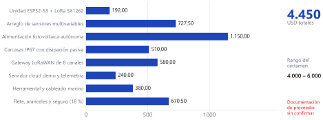

### 15.3 Las tres coherencias

| Coherencia | Qué significa | Cómo se verifica |
|---|---|---|
| Interna | Las líneas suman el total | Suma aritmética |
| Narrativa | El video dice el mismo total | Comparar guion y presupuesto |
| Física | Las cantidades son plausibles | Peso, volumen, energía, tiempo |

La tercera es la que más se olvida. Un panel de 5 W no alimenta un sistema de bombeo industrial; una batería de 2.500 mAh no sostiene una semana sin recarga. El jurado técnico lo nota.

### 15.4 Qué no poner

TIR, VAN, ROI complejo y proyecciones a cinco años. El certamen evalúa prefactibilidad, no un plan de negocios. La pregunta es «¿se puede fabricar y financiar el piloto?», no «¿cuánto vale la empresa en 2030?».

---

## 16. Síntesis: el modelo de los que ganan

La investigación permite resumir el patrón en diez reglas sustentadas:

1. **Elegir un desafío con densidad técnica y espacio de diferenciación.** La categoría y el desafío explican más que el eslogan.
2. **Nombrar dos veces: squad y marca.** El naming dual pasó de 0 % a 100 % en dos ediciones.
3. **Abrir con un territorio y un dolor concreto.** El dato global sin rostro no moviliza.
4. **Mostrar el mecanismo, no el beneficio.** La caja negra abierta es el corazón del acto II.
5. **Cuantificar el impacto.** Tres métricas con método valen más que diez adjetivos.
6. **Poner costo unitario y costo de piloto.** Sin número no hay prefactibilidad.
7. **Cerrar con la tríada ambiental, económica y social.** Es el sello de los campeones.
8. **Diseñar para dos jurados.** Identidad local en la forma, universalidad en el fondo.
9. **Profesionalizar el canal y la portada.** La marca del equipo es parte del mensaje.
10. **Verificar la coherencia numérica.** Un número distinto entre entregables invalida el resto.

Lo que estas reglas **no** dicen es que ganar sea predecible. El IPC muestra que cumplirlas te vuelve elegible; la ejecución y el contexto deciden el orden. Esa distinción es la conclusión más importante del informe: **la investigación reduce la incertidumbre, no la elimina.**

---

## 17. Anexos

### 17.1 Registro completo de ganadores nacionales (2023–2026)

| Año | Categoría | 1.º | 2.º | 3.º |
|---|---|---|---|---|
| 2023 | Tecnológica | TECNOCRAFT INNOVATOR | INNORTE | — |
| 2023 | Social | INGENOVA | AGROLIDAR | — |
| 2023 | Procesos | NAHUATL INNOVA | POVEDERS-UNI | — |
| 2024 | Tecnológica | INNOVATEAM | FIDALOGIC | — |
| 2024 | Social | BIOINNOVA | SOLTECPROS | — |
| 2024 | Procesos | AGROINNOVA | BOSÓN THE HIGGS | — |
| 2025 | Tecnológica | Nexus Innova | Yoltik-Nova | — |
| 2025 | Social | Volca-Tech | Escuadrón Nic-Anahuac 1 | — |
| 2025 | Procesos | Operación Titán | Los Templarios | — |
| 2026 | Tecnológica | AVOCADO | SolarEduTech | Team Owlsight |
| 2026 | Social | ELOHIM | Sinergia 360 | NEXU-Humano |
| 2026 | Procesos | Lubanic | Team Rocket | Coffee Power |

### 17.2 Podios internacionales de Nicaragua (2015–2025)

| Año | Equipo | Sede | Categoría | Puesto | Proyecto |
|---|---|---|---|---|---|
| 2015 | Grupo Innova | No publicada | Innovación | 2.º | No publicado |
| 2016 | Econova | UNAN-FAREM Estelí | Innovación | 3.º | No publicado |
| 2016 | Geckakz | UNAN-FAREM Estelí | Impacto Social | 1.º | Juego para niños no videntes |
| 2019 | Lexonic | UNI-RUPAP | Impacto Social | 3.º | LexoStop |
| 2021 | MT Soluciones Creativas | UNI-RUPAP | Innovación | 1.º | Vivienda energética autosustentable |
| 2023 | Güegüense Pinolero | UNMRMA | Innovación | 1.º | DIGNA |
| 2023 | Nicarq Sinergy | UNI-RUSB | Impacto Social | 2.º | BioInnova |
| 2024 | Techriders | UNI-RUSB | Innovación | 1.º | Micropresas telemetradas |
| 2025 | STEM Synergy | UAM | Innovación | 1.º | Huertos verticales |
| 2025 | Mentes Volcánicas | UNI-RUPAP | Impacto Social | 1.º | ReVida Móvil |

### 17.3 Catálogo audiovisual

| Año | Equipo | Plataforma | Duración | Estado |
|---|---|---|---|---|
| 2019 | Lexonic | YouTube | 2:57 | Disponible |
| 2021 | MT Soluciones | YouTube | — | No disponible |
| 2023 | Güegüense | YouTube | 1:45 | Disponible |
| 2023 | Nicarq Sinergy | YouTube | 1:53 | Disponible |
| 2024 | Techriders | YouTube | 1:58 | Disponible |
| 2025 | STEM Synergy | YouTube | — | Acceso bloqueado |
| 2025 | Mentes Volcánicas | YouTube | 1:55 | Disponible |
| 2025 | Operación Titán | YouTube | 2:22 | Disponible |
| 2025 | Nexus Innova | YouTube | 2:10 | Disponible |
| 2025 | Los Templarios | YouTube | 2:00 | Disponible |
| 2024–2026 | Cinco equipos nacionales | Facebook | Variable | Entrevistas y presentaciones |

### 17.4 Glosario

- **SIRLI:** plataforma de gestión del Rally Latinoamericano.
- **PAS-V:** estructura de guion Problema–Agitación–Solución–Victoria.
- **IPC:** índice de preparación competitiva (modelo propio, no probabilidad).
- **Naming dual:** nombre de squad + marca de proyecto.
- **Cluster temático:** conjunto de proyectos que abordan el mismo eje en una edición.
- **Doble codificación:** capa local + capa universal del mismo video.

### 17.5 Fuentes principales

**Primarias:** Comisión Nacional de Economía Creativa (`nicaraguacreativa.com`), artículos de 2023, 2025 y 2026; CONFEDI (`confedi.org.ar`), resultados 2024 y apertura 2026; ANFEI (`anfei.mx`), resultados 2016; SIRLI (`sirli.org`), registros citados por las fuentes nacionales.

**Corpus interno:** `brain/corpus/ganadores_latam.md`, `ganadores_analisis.md`, `analisis_nicaragua.pdf`, `investigacion_pitch.md`, `rubricas_matrices.md`, `pautado_latam_ref.md`, `pautado_nacional_ref.md`, `retos.md`.

**Metadata audiovisual:** YouTube oEmbed y miniaturas públicas, consultadas en octubre de 2026.

### 17.6 Nota de mantenimiento

Este informe se actualiza cuando cambia una fuente primaria o se publica una nueva edición. Las cifras de participación, los ganadores y las rúbricas son los campos que primero envejecen. El IPC se recalcula cuando se añade una edición al registro. Las conclusiones estructurales solo deberían revisarse si cambian las bases del certamen.

