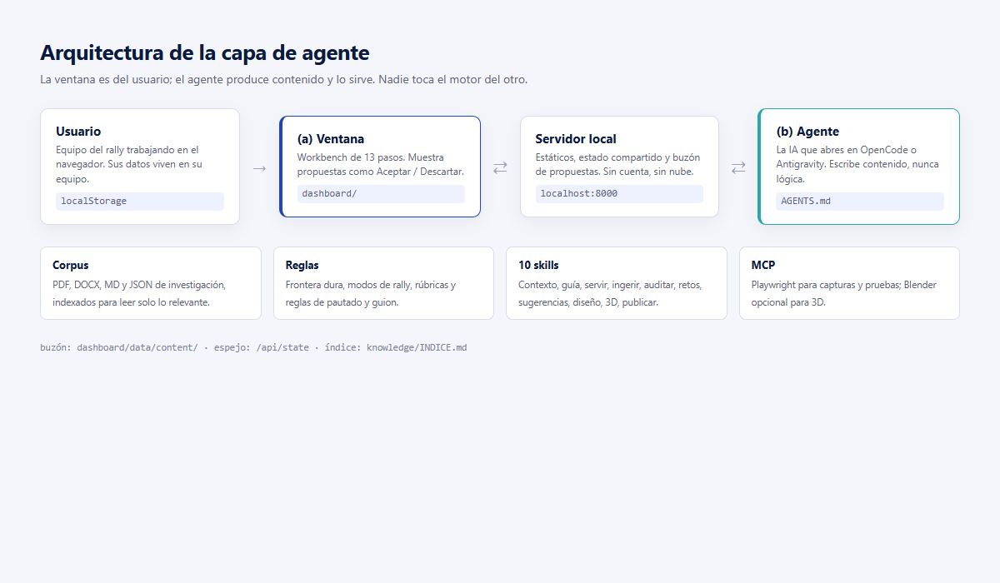
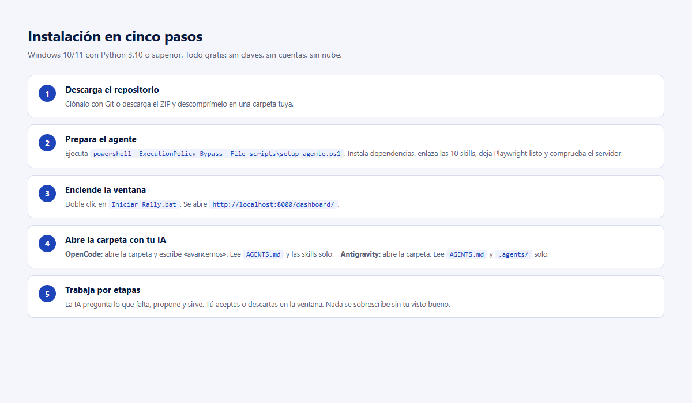
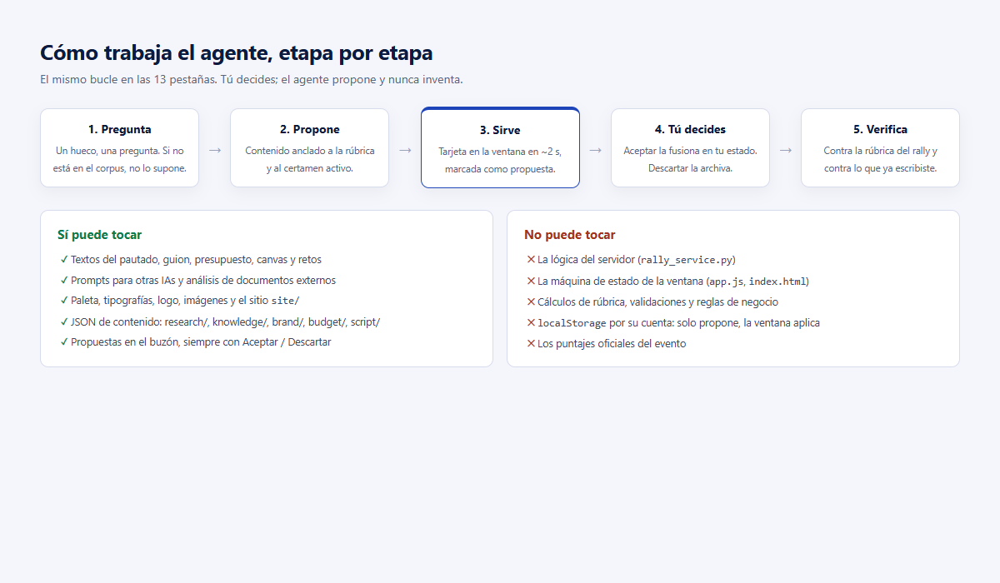
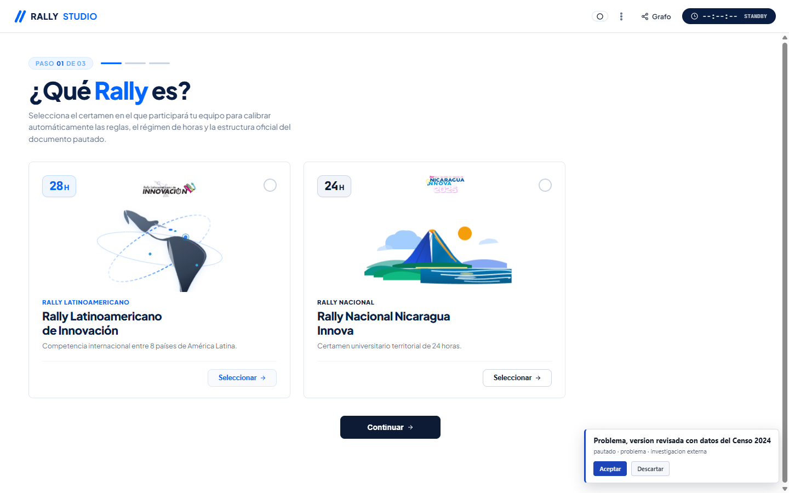

# Manual de las IAs — Rally Studio

> Cómo instalar, configurar y trabajar con las IAs que construyen y operan el sistema,
> sin pagar claves de API y sin que nadie tenga que inyectar contexto a mano.



---

## 1. Qué es esto

Rally Studio tiene dos mitades y cada una tiene su IA:

| Mitad | Qué es | Quién la usa |
|---|---|---|
| **(a) La ventana** | El workbench de 13 pasos que ve el equipo: `dashboard/` | El equipo del rally, en el navegador |
| **(b) El agente** | La IA que abres en tu consola: propone, redacta y sirve contenido | Tú, mientras construyes el proyecto |

El objetivo de esta capa es que **(b) sepa todo sin que se lo expliques**: qué certamen, qué
rúbrica, qué hay en el corpus, qué puede editar y qué no, y cómo entregar contenido a (a).

La regla que sostiene todo:

> **(b) produce contenido y presentación. Nunca programa el motor.**

Si una tarea de contenido exige tocar `scripts/rally_service.py`, `dashboard/app.js` o
`dashboard/index.html`, el agente debe parar, decírtelo y pedir permiso.

### Lo que NO necesitas

- Ni claves de API pagadas.
- Ni cuentas en la nube para el sistema.
- Ni pegar PDFs en un chat: el corpus ya está en la carpeta y el agente lo indexa solo.

---

## 2. Requisitos

| Pieza | Versión | Para qué | Obligatorio |
|---|---|---|---|
| Windows 10/11, macOS o Linux | — | El sistema es local | Sí |
| Python | 3.10 o superior | Servidor, OCR, documentos, scripts | Sí |
| Navegador | Chrome, Edge o Firefox actuales | La ventana | Sí |
| Git | Cualquiera reciente | Clonar y actualizar | Recomendado |
| OpenCode o Antigravity | Última | La IA que abre la carpeta | Sí (una de las dos) |
| Node.js | 18 o superior | Solo para instalar OpenCode y MCP | Solo si usas OpenCode |

En Windows, al instalar Python marca **Add Python to PATH**.

Comprueba que todo responde:

```powershell
python --version
node --version
```

---

## 3. Instalación en cinco pasos



### 3.1 Traer el proyecto

```powershell
git clone https://github.com/WalterSolorzano/rally-studio.git
cd rally-studio
```

O descarga el ZIP y descomprímelo en una carpeta tuya. Evita rutas con permisos raros
(`C:\Program Files`); una carpeta como `C:\rally-studio` funciona siempre.

### 3.2 Preparar el agente

```powershell
powershell -ExecutionPolicy Bypass -File scripts\setup_agente.ps1
```

El instalador hace seis cosas y es **idempotente** (puedes correrlo mil veces):

1. Comprueba que Python sea 3.10 o superior.
2. Instala `requirements.txt`.
3. Refleja cada skill de `skills/` en `.opencode\skills\` y `.agents\skills\`
   (con junctions en Windows: editas una vez y ambas IAs ven el cambio).
4. Añade el MCP de Playwright a `opencode.json` sin borrar los que ya tengas.
5. Arranca el servidor en un puerto libre y comprueba `/health`.
6. Imprime un resumen con lo que quedó listo.

Banderas útiles:

| Bandera | Efecto |
|---|---|
| `-SinDependencias` | No instala `pip`; solo enlaza skills y verifica |
| `-SinVerificarServidor` | No arranca el servidor al final |

En macOS o Linux el instalador no aplica: el equivalente está en
[`INSTALACION_AGENTE.md`](INSTALACION_AGENTE.md).

### 3.3 Encender la ventana

```powershell
.\"Iniciar Rally.bat"
```

Se abre `http://localhost:8000/dashboard/`. Si el 8000 está ocupado, el servidor prueba
8080, 8001 y 8008, y lo imprime en consola.

### 3.4 Abrir la carpeta con la IA

- **OpenCode:** abre la carpeta del proyecto y escribe `avancemos`.
- **Antigravity:** abre la carpeta y escribe `avancemos`.

No hay que explicarle nada más. Lee `AGENTS.md`, el índice del corpus y las skills por su
cuenta.

### 3.5 Verificar que todo está en su sitio

```powershell
# El servidor responde
curl http://localhost:8000/health

# Hay 10 skills
dir skills

# El índice del corpus existe
dir knowledge\INDICE.md
```

En OpenCode, pídele: **«lista tus skills»**. Debe nombrar las diez.

---

## 4. Elegir la IA de programación

### 4.1 OpenCode (recomendada)

Es la opción con menos fricción: descubre las skills de `.opencode/skills/` sola, lee
`AGENTS.md` como contrato y el MCP se configura por proyecto en `opencode.json`.

**Instalar:**

```powershell
npm install -g opencode-ai
```

En macOS/Linux también sirve:

```bash
curl -fsSL https://opencode.ai/install | bash
```

**Primera sesión:**

```powershell
cd C:\ruta\a\rally-studio
opencode
```

Dentro, escribe `avancemos`. El agente debería:

1. Leer `brief.json` (está en blanco la primera vez).
2. Leer `AGENTS.md`.
3. Consultar `knowledge/INDICE.md`.
4. Preguntarte el certamen antes de producir nada.

**Qué lee OpenCode en este repo:**

| Archivo | Papel |
|---|---|
| `AGENTS.md` | Identidad, frontera y las 13 etapas |
| `.opencode/skills/<nombre>/SKILL.md` | Procedimientos (10) |
| `opencode.json` | MCP de Playwright |
| `knowledge/INDICE.md` | Mapa del corpus |
| `brief.json` | Estado del proyecto |

**Modelos:** usa el que ya tengas en tu plan. El repo no exige ninguno. Si tu proveedor
ofrece capa gratuita, sirve igual: el agente solo necesita leer y escribir archivos.

### 4.2 Antigravity

Antigravity lee el mismo `AGENTS.md`, más reglas modulares en `.agents/rules/` y skills en
`.agents/skills/`. El instalador ya dejó ambas carpetas listas.

**Primera sesión:**

1. Abre Antigravity.
2. `File → Open Folder` y elige la carpeta del proyecto.
3. Escribe `avancemos`.

**Tres límites que conviene conocer:**

| Límite | Valor | Consecuencia |
|---|---|---|
| Tamaño por archivo de regla | 24 000 bytes | Si te pasas, se trunca |
| Presupuesto de reglas siempre activas | ~20 000 tokens | Las más grandes pasan a punteros |
| Configuración de MCP | Global (`~/.gemini/…`) | No se comparte con OpenCode |

Por eso las reglas están partidas por tema y con `trigger: model_decision`: Antigravity
inyecta solo la ruta y la descripción, y abre el archivo cuando la tarea lo toca.

**MCP en Antigravity:** se configura en su archivo global, no en el repo. Si quieres
Playwright también ahí, copia el bloque de `opencode.json` a la configuración global de
Antigravity. La guía exacta está en [`INSTALACION_AGENTE.md`](INSTALACION_AGENTE.md).

### 4.3 Otras herramientas

Claude Code, Cursor, Windsurf y similares leen `AGENTS.md` (o `CLAUDE.md`) y aceptan skills
en formato abierto. Lo importante es que la herramienta tenga:

- acceso de lectura/escritura a la carpeta;
- capacidad de ejecutar comandos (`python scripts/servir_propuesta.py`);
- acceso HTTP a `localhost:8000`.

Con eso, el resto lo pone el repo.

### 4.4 Comparación rápida

| Criterio | OpenCode | Antigravity |
|---|---|---|
| Lee `AGENTS.md` | Sí | Sí |
| Skills del repo | `.opencode/skills/` | `.agents/skills/` |
| Reglas por tema | No (todo en `AGENTS.md`) | `.agents/rules/*.md` |
| MCP por proyecto | Sí (`opencode.json`) | No (global) |
| Costo | Tu plan o capa gratuita | Tu cuenta de Google |
| Recomendada para | Trabajo largo de contenido | Sesiones rápidas y exploración |

---

## 5. Cómo hablarle al agente

El agente no adivina. Estas son las instrucciones que mejor funcionan.

### 5.1 Los primeros cinco mensajes

```
1. avancemos
2. (responde lo que pregunte: certamen, equipo, ciudad)
3. el reto que elegimos es ...
4. nuestra solución es ...
5. revisa el pautado contra la rúbrica
```

### 5.2 Qué pedir

| Quiero | Cómo pedirlo |
|---|---|
| Empezar | «avancemos» |
| Ver qué falta | «¿qué me falta en esta pestaña?» |
| Analizar un documento | «te traje la investigación: está en `investigacion.pdf`» |
| Mejorar un texto | «reescribe el problema con estos datos y muéstramelo como propuesta» |
| Revisar antes de entregar | «audita el pautado contra la rúbrica de Latam» |
| Diseño | «propón dos direcciones de paleta y tipografía para el equipo» |
| Delegar a otra IA | «arma el prompt para que otra IA haga el guion» |

### 5.3 Qué NO pedirle

- «cámbiame los puntajes de la rúbrica» → se negará: la rúbrica la fija el jurado.
- «inventa una estadística que suene bien» → se negará: cada cifra necesita fuente.
- «toca `app.js` para que esto se vea» → pedirá permiso: es motor, no contenido.
- «hazlo todo de una vez» → funciona mejor por etapas.

### 5.4 La frase que lo mantiene en su carril

> «Recuerda la frontera: contenido sí, motor no. Si necesitas tocar el motor, párate y
> dime por qué.»

---

## 6. El flujo de 13 etapas



| # | Pestaña | Al terminarla debe existir | Si falta, el agente pregunta |
|---|---|---|---|
| 00 | `certamen` | `rally_type`: nacional (24 h) o latam (28 h) | qué certamen |
| 01 | `team` | nombre de squad, universidad, ciudad, logo | identidad del equipo |
| 02 | `challenges` | reto elegido y su título | qué reto eligió |
| 03 | `solution` | solución descrita y aprobada | cómo resuelve el reto |
| 04 | `impact` | ODS y eje del plan nacional (Nacional) | a quién impacta |
| 05 | `multi_ai` | prompts de despacho | qué pieza delegar |
| 06 | `pautado` | 5 secciones dentro de los límites | datos que falten |
| 07 | `budget` | filas con costo unitario y URL | proveedor, precio, enlace |
| 08 | `resources` | logos, imágenes, videos | qué material tiene |
| 09 | `canvas` | modelo de negocio coherente | socios, costos, ingresos |
| 10 | `script` | guion de 4 actos, ≤ 120 s | tono, narrador, cierre |
| 11 | `webdemo` | prototipo web | qué se muestra |
| 12 | `timeline` | checklist verificado | qué queda pendiente |

En cada etapa el agente hace tres cosas: **pregunta**, **propone** y **verifica** contra la
rúbrica del certamen activo.

---

## 7. El buzón: Aceptar y Descartar



Cuando el agente sirve contenido, aparece una tarjeta abajo a la derecha:

- **Aceptar** fusiona el contenido en tu estado y lo pinta en la pestaña.
- **Descartar** archiva la propuesta sin tocar nada.

Nada se sobrescribe sin que tú pulses el botón.

### 7.1 Servir a mano

El agente usa este comando; tú puedes usarlo igual:

```powershell
python scripts/servir_propuesta.py `
  --tab pautado --slot problema --kind text `
  --title "Problema, versión revisada" `
  --source "investigación externa" `
  --payload propuesta.json
```

`propuesta.json` para texto:

```json
{ "text": "En la comarca de ... " }
```

Para presupuesto:

```json
{
  "items": [
    { "element": "Sensor de humedad", "category": "Hardware", "units": 2, "unit_cost": 18.5, "url": "https://..." }
  ]
}
```

La tabla del presupuesto lee `element`. El puente también acepta `concept` y escribe ambos.

### 7.2 Pestañas y ranuras

| Pestaña | Ranuras |
|---|---|
| `pautado` | `problema`, `solucion`, `impacto`, `innovacion`, `prefactibilidad` |
| `budget` | `costos` |
| `script` | `acto1`, `acto2`, `acto3`, `acto4` |
| Las demás | `main` |

Una propuesta = una ranura. Para cambiar cinco secciones se sirven cinco propuestas.

### 7.3 Qué pasa al aceptar

1. El puente lee la propuesta completa.
2. Pide al servidor que la mueva a `dashboard/data/applied/`.
3. Fusiona el contenido en `localStorage`.
4. Avisa a la ventana por `BroadcastChannel` para que se repinte.
5. Sube el estado al espejo `/api/state`.

Si tienes dos navegadores abiertos, ambos ven el mismo estado.

### 7.4 Cuándo no hay buzón

- En GitHub Pages (sitio estático) el buzón no existe: el puente muestra
  «Buzón local apagado — sin propuestas en vivo».
- Si el servidor se cae, la ventana sigue funcionando con lo que tengas guardado.

---

## 8. IA gratis para el producto (opcional)

Esta parte es para los botones «Generar con IA» de la ventana. **No es necesaria para que
el agente programe**: (b) usa la IA de tu consola.

Orden de preferencia:

### 8.1 OpenCode CLI (gratis, sin claves)

Si ya instalaste OpenCode, el servidor lo detecta solo:

```powershell
opencode models
```

La ventana lo usa con `opencode run`. Cero configuración.

### 8.2 FreeLLMAPI (un endpoint compatible con OpenAI)

```powershell
powershell -ExecutionPolicy Bypass -File scripts\setup_ia_gratis.ps1
```

Instala una app portable, guarda la clave unificada en `scripts\freellmapi.key`
(ignorada por git) e inicia el servicio con `Iniciar Rally.bat`.

### 8.3 Chips de chat web (copiar y pegar)

Si no hay ninguna de las dos, la ventana ofrece botones para abrir ChatGPT, Claude, Gemini
u OpenCode Web con el prompt ya escrito. Pegas la respuesta y sigues.

### 8.4 Lo que no hace falta

- Claves de OpenAI, Anthropic o Google.
- Tarjetas de crédito.
- Cuentas nuevas.

---

## 9. MCPs: qué son y cuáles hacen falta

Un MCP es una herramienta extra que la IA puede llamar (navegador, Blender, base de datos).

### 9.1 Playwright (incluido)

Sirve para que el agente abra la ventana, haga clic y tome capturas. Ya viene configurado:

```json
{
  "$schema": "https://opencode.ai/config.json",
  "mcp": {
    "playwright": {
      "type": "local",
      "command": ["npx", "-y", "@playwright/mcp"],
      "enabled": true
    }
  }
}
```

Comprobación: pídele «abre http://localhost:8000/dashboard/ y hazme una captura».

### 9.2 Blender (opcional)

Solo si vas a generar modelos 3D. Requiere Blender 3.0 o superior y un complemento que se
instala a mano. **Advertencia:** ejecuta código sin guardas; úsalo con el proyecto bajo Git.

La skill `modelo-3d-blender` explica el procedimiento y las reglas (una GPU a la vez, render
de baja resolución primero).

### 9.3 Añadir otro MCP

Edita `opencode.json` y añade una entrada en `mcp`. El instalador nunca borra lo que ya
tengas. Reinicia la sesión de OpenCode para que lo vea.

---

## 10. Dependencias

### 10.1 Base

```powershell
pip install -r requirements.txt
```

Incluye `python-docx`, `openpyxl`, `requests`, `pillow`, `playwright`, `psutil`,
`soundfile` y `pdfplumber`.

### 10.2 Pruebas

```powershell
pip install -r requirements-dev.txt
python -m pytest tests/ -q
```

Debe dar **66 pruebas verdes**.

### 10.3 Pesadas y opcionales

| Paquete | Peso | Cuándo |
|---|---|---|
| `easyocr` | ~2 GB (PyTorch) | OCR local sin IA |
| `chatterbox-tts` | GPU ≥ 4 GB | Voz de alta calidad |
| `kokoro` | Sin GPU | Voz ligera |
| `ffmpeg` | Instalación de sistema | Exportar video |

El instalador avisa y no las baja por su cuenta.

---

## 11. Mantenimiento

| Tarea | Comando |
|---|---|
| Regenerar el índice del corpus | `python scripts/gen_indice.py` |
| Reenlazar skills tras añadir una | `powershell -File scripts\setup_agente.ps1 -SinDependencias -SinVerificarServidor` |
| Correr las pruebas | `python -m pytest tests/ -q` |
| Ver el estado que ve el agente | `curl http://localhost:8000/api/state` |
| Ver el buzón | `curl http://localhost:8000/api/content/manifest` |
| Vaciar propuestas aceptadas | borrar `dashboard/data/applied/` |

Los directorios `content/`, `applied/`, `discarded/` y `state.json` están fuera de Git y de
GitHub Pages a propósito: son datos del equipo.

---

## 12. Problemas frecuentes

| Síntoma | Causa | Arreglo |
|---|---|---|
| `python` no se reconoce | No está en PATH | Reinstala marcando *Add Python to PATH* |
| «Puerto 8000 ocupado» | Otra instancia viva | Usa `-Puerto 8080` o mata el proceso |
| Las skills no aparecen en OpenCode | No corriste el instalador | `setup_agente.ps1 -SinDependencias` |
| Antigravity ignora una regla | Falta `trigger:` o pasa de 24 KB | Revisa el frontmatter y el tamaño |
| El dock no aparece | Servidor apagado o estás en Pages | Enciende el servidor; en Pages es normal |
| Acepto y no cambia nada | Pestaña sin campo destino | La tarjeta lo avisa; usa otra pestaña |
| El agente dice que el proyecto está vacío | `brief.json` en blanco | Responde sus preguntas; se irá llenando |
| `ExecutionPolicy` bloquea el script | Política de PowerShell | Usa `-ExecutionPolicy Bypass` |
| La IA quiere editar `app.js` | Tarea de motor, no de contenido | Dile que pare y pida permiso |

---

## 13. Seguridad y privacidad

- El servidor escucha en tu equipo. **No lo expongas a Internet sin autenticación.**
- El estado del proyecto y el buzón no se publican en GitHub Pages.
- `applied/` y `discarded/` están en `.gitignore`.
- El agente no envía tu corpus a ningún lado: lee archivos locales.
- Si usas un endpoint de IA en la nube, lo que mandes sale de tu equipo. Con OpenCode CLI
  local, no.

---

## 14. Checklist de la primera sesión

- [ ] `python --version` responde 3.10+
- [ ] `setup_agente.ps1` terminó sin errores
- [ ] `Iniciar Rally.bat` abre la ventana
- [ ] `curl http://localhost:8000/health` responde `ok`
- [ ] OpenCode o Antigravity abren la carpeta
- [ ] El agente lista sus 10 skills
- [ ] «avancemos» produce preguntas, no contenido inventado
- [ ] Una propuesta de prueba aparece y se puede aceptar
- [ ] `python -m pytest tests/ -q` da 66 verdes

---

## 15. Glosario

| Término | Significado |
|---|---|
| **(a)** | La ventana: el workbench de 13 pestañas |
| **(b)** | El agente: la IA que abre la carpeta |
| **Motor** | Servidor, máquina de estado, cálculos y validaciones |
| **Corpus** | PDFs, DOCX, MD y JSON de investigación |
| **Buzón** | Carpeta donde el agente deja propuestas |
| **Servir** | Dejar una propuesta para que la ventana la muestre |
| **Espejo** | Copia del estado en el servidor (`/api/state`) |
| **Skill** | Procedimiento reutilizable que la IA carga cuando hace falta |
| **MCP** | Herramienta externa que la IA puede invocar |
| **Ruling** | Decisión tomada durante la construcción, registrada con su costo |

---

## Documentos relacionados

- [`INSTALACION_Y_DESPLIEGUE.md`](INSTALACION_Y_DESPLIEGUE.md) — el sistema completo.
- [`INSTALACION_AGENTE.md`](INSTALACION_AGENTE.md) — detalles técnicos de skills y MCP.
- [`DESCARGA.md`](DESCARGA.md) — qué trae el paquete y cómo empezar.
- [`../AGENTS.md`](../AGENTS.md) — el contrato que lee la IA.
- [`../knowledge/INDICE.md`](../knowledge/INDICE.md) — el mapa del corpus.
