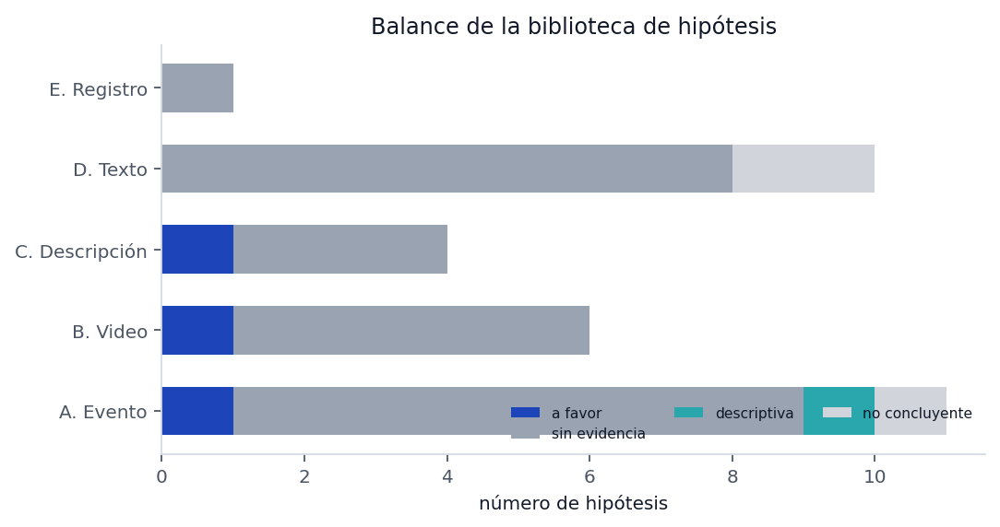
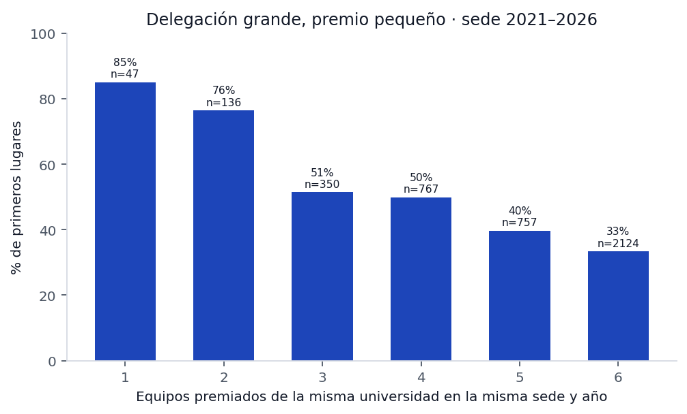
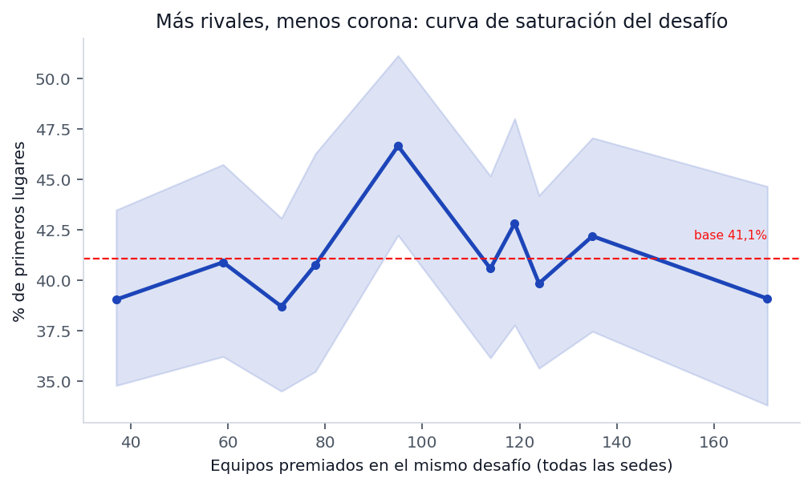
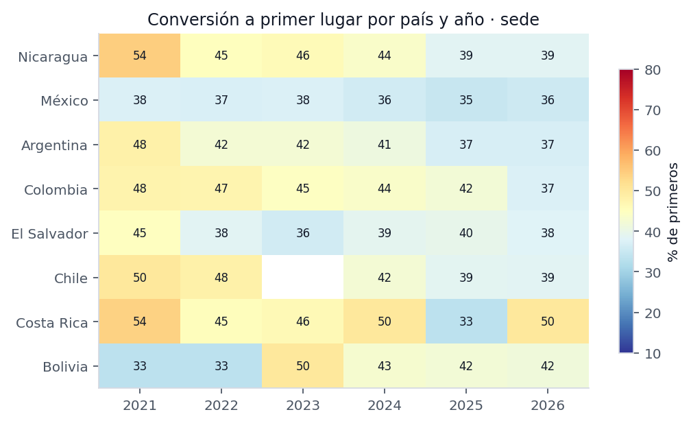
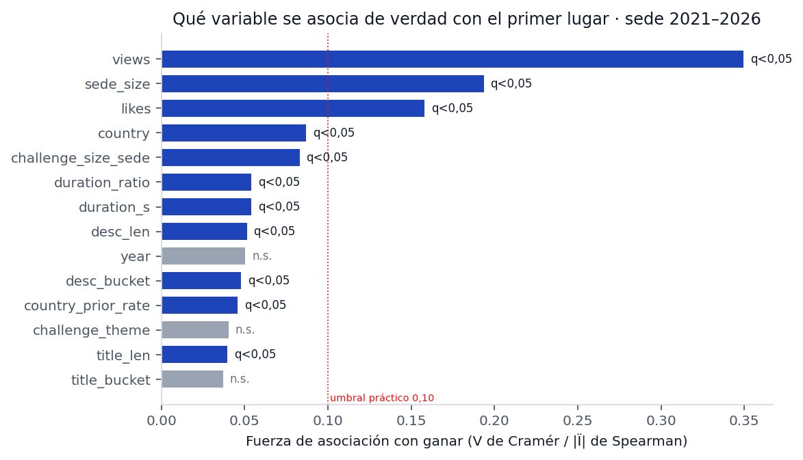

# Investigación profunda SIRLI — qué compone a un ganador

**Generado automáticamente** por `scripts/sirli_sistemico.py` el 22/10/2026.
Toda cifra sale de `research/sirli/analisis/dataset_videos.csv` (5.117 ediciones, 4.709 videos).
Reproducible: `python scripts/sirli_sistemico.py`.

---

## 0. Cómo leer esto en tres frases

1. **El corpus no tiene perdedores.** SIRLI publica solo los tres primeros de cada desafío en cada sede. Ninguna cifra aquí es «probabilidad de ganar el rally»: es **probabilidad de ser 1.º entre los tres premiados**, y solo dentro de 2021–2026, porque antes de 2021 el registro publica casi solo primeros lugares.
2. **Los dos efectos grandes son aritmética, no mérito.** Cuántos equipos premiados lleva tu sede y cuántos de ellos comparten tu desafío explican más que cualquier variable del video. Y el segundo es casi una tautología: si tres equipos de tu sede se llevan los tres puestos de un desafío, la probabilidad de que el primero sea tuyo es 1/3 por construcción.
3. **Lo que el corpus mide del video no distingue a nadie.** Duración, miniatura, título, subtítulos, descripción: todo cae dentro del ruido tras corregir por comparaciones múltiples. El contenido —voz, imagen, historia— sigue sin medirse a escala, y ahí está el techo.

---

## 1. El experimento natural (y sus límites)

| Corte | Filas | Primeros | Tasa base |
|---|---|---|---|
| Todo el corpus | 5.117 | 2.416 | 47,2% |
| Sede 2021–2026 (muestra principal) | 4.181 | 1.717 | 41,1% |
| Sede Nicaragua 2021–2026 | 1.118 | 476 | 42,6% |
| Nacional 2021–2026 | 317 | 119 | 37,5% |
| Internacional 2021–2026 | 39 | 12 | 30,8% |

**Lo que estos datos no pueden hacer, y ningún análisis serio puede fingirlo:**

- **No hay línea base de perdedores.** Si un desafío tiene 40 equipos y se premian 3, la probabilidad real de ganar es 7,5%, no 33%. El corpus solo ve el podio. Por eso todo se prueba **entre premiados**: ¿quién queda 1.º de los tres?
- **No hay asignación aleatoria.** Los equipos eligen desafío, sede y categoría. Toda diferencia es asociación.
- **El registro premia 2017–2020 de forma incompleta**, lo que sesga cualquier serie larga. De ahí el corte en 2021.
- **El jurado no está identificado.** La sección 6 es teoría aplicada, no hallazgo.

---

## 2. Análisis sistémico: qué está relacionado con qué y por qué

### 2.1 El mapa corregido

```
    [ ANO ] -----------------> mas equipos, mas paises, mas desafios
       |
       v
    [ TAMANO DE LA DELEGACION ]      (equipos premiados de tu sede)
       |                     \
       |                      +--> [ COMPETENCIA INTERNA ]   <-- cuantos de tu
       |                           sede comparten tu desafio
       v                            |
    [ PROBABILIDAD DE 1.o ] <--------+
       ^
       |          [ CALIDAD DEL VIDEO ]   guion, voz, imagen, demo
       |
       +--------- [ PERTINENCIA AL DESAFIO ]      [ RUIDO DE JURADO ]  (no observado)
```

La versión anterior de este informe ponía el **tamaño del desafío** en el centro. Los datos la refutan: la probabilidad de primer lugar es plana a lo largo de todo el rango de rivales (ver H02, H03, H10). Lo que sí ordena es la **composición de tu propia delegación**, y eso es en buena parte aritmética.

### 2.2 Fuerza de asociación con ganar

| Variable | Tipo | Fuerza | n | p | q (BH) | Lectura |
|---|---|---|---|---|---|---|
| `views` | numérica | 0,349 | 3.747 | <0,001 | <0,001 | **fuga de resultado**: consecuencia del premio, no causa (Q5) |
| `sede_size` | numérica | 0,193 | 4.181 | <0,001 | <0,001 | asociación real |
| `likes` | numérica | 0,158 | 3.146 | <0,001 | <0,001 | **fuga de resultado**: consecuencia del premio, no causa (Q5) |
| `country` | categórica | 0,087 | 4.181 | 0,002 | 0,004 | asociación real |
| `challenge_size_sede` | numérica | 0,083 | 4.181 | <0,001 | <0,001 | asociación real |
| `duration_ratio` | numérica | 0,054 | 3.740 | <0,001 | 0,003 | asociación real |
| `duration_s` | numérica | 0,054 | 3.740 | <0,001 | 0,003 | asociación real |
| `desc_len` | numérica | 0,051 | 4.181 | <0,001 | 0,003 | asociación real |
| `year` | categórica | 0,050 | 4.181 | 0,060 | 0,092 | compatible con azar |
| `desc_bucket` | categórica | 0,048 | 4.181 | 0,008 | 0,017 | sin señal |
| `country_prior_rate` | numérica | 0,046 | 4.181 | 0,003 | 0,007 | sin señal |
| `challenge_theme` | categórica | 0,040 | 4.181 | 0,557 | 0,737 | sin señal |

### 2.3 Variables que se mueven juntas (y por eso confunden)

| Variable A | Variable B | Fuerza | Dirección | n |
|---|---|---|---|---|
| `country_prior_rate` | `country` | 0,952 | — | 4.181 |
| `challenge_size` | `year` | 0,332 | positiva | 4.181 |
| `challenge_size_sede` | `challenge_size` | 0,220 | positiva | 4.181 |
| `sede_size` | `country` | 0,210 | — | 4.181 |
| `title_len` | `year` | 0,085 | positiva | 4.181 |
| `duration_s` | `year` | 0,084 | negativa | 3.740 |
| `team_prior_awards` | `year` | 0,077 | positiva | 4.181 |
| `challenge_size` | `sede_size` | 0,044 | positiva | 4.181 |

`challenge_size` crece con el año (ρ=0,33): el rally se expandió. Cualquier conclusión que no controle el año le atribuirá al desafío lo que es crecimiento del evento.

### 2.4 El artefacto que hay que nombrar: 1/n

Cuando tu sede coloca **tres** equipos premiados en el mismo desafío, los tres puestos de ese desafío son de tu sede y la probabilidad de que el primero sea tuyo es **exactamente 1/3**. No hay mérito: hay aritmética.

| Equipos premiados de tu sede en el mismo desafío | n | % de primeros |
|---|---|---|
| 1 | 2.525 | 44,3% |
| 2 | 1.318 | 36,9% |
| 3 | 286 | 33,2% |
| 4 | 52 | 32,7% |

Observado: 33,2% con tres equipos, contra 33,3% teórico. Por eso H04 no es un hallazgo conductual. Lo mismo vale para H11 en parte: una delegación de un solo equipo premiado suele competir sola en su desafío.

**El gradiente que queda después de controlar eso** (solo desafíos donde tu sede tiene ≥2 premiados):

| Equipos premiados de tu sede | n | % de primeros |
|---|---|---|
| 3 | 86 | 41,9% |
| 4 | 218 | 47,2% |
| 5 | 285 | 37,9% |
| 6 | 1.053 | 32,5% |

Sigue bajando, pero con la mitad de la muestra y sin significación robusta. La lectura prudente: **una delegación grande diluye; no está claro si por selección, por competencia interna o por ambas.**

### 2.5 El modelo que ya ordena algo

Sobre sede 2021–2026 (4.181 filas, base 41,1%): regresión logística con solo variables de evento y metadatos → **ROC 0,617 / PR 0,539 / top-1 dentro del desafío 53,7%** frente a 48,7% de la base. Mejora real, modesta: los metadatos ordenan, no explican. El video es la variable omitida.

---

## 3. Biblioteca de hipótesis

Se probaron **42 hipótesis** en cinco familias, con corrección de Benjamini–Hochberg. Resumen: **3 a favor · 0 en contra · 2 artefactos · 8 señales débiles · 25 sin evidencia · 1 descriptiva · 3 no concluyentes**.

Criterio de estado: q<0,05 **y** diferencia ≥5 pp → «a favor/en contra». Entre 2 y 5 pp → «señal débil». Menos de 2 pp o q≥0,05 → sin evidencia.



### Familia A — aritmética del evento

| ID | Hipótesis | n (sí / no) | Tasa sí | Tasa no | Δ | p | Estado |
|---|---|---|---|---|---|---|---|
| H01 | Las sedes pequeñas dan más primeros lugares por equipo | 1.300 / 2.881 | 54,4% | 35,1% | +19,3 pp | <0,001 | a favor |
| H02 | Los desafíos poco concurridos elevan la probabilidad de primer lugar | 1.088 / 3.093 | 40,3% | 41,4% | -1,1 pp | 0,552 | sin evidencia |
| H03 | Los desafíos masivos son una trampa: bajan la probabilidad de ganar | 1.207 / 2.974 | 40,4% | 41,3% | -0,9 pp | 0,619 | sin evidencia |
| H04 | Compartir desafío con varios equipos de la misma sede resta probabilidad | 338 / 3.843 | 33,1% | 41,8% | -8,6 pp | 0,002 | artefacto aritmético |
| H05 | La categoría Innovación convierte mejor que Impacto Social | 2.073 / 2.108 | 41,4% | 40,7% | +0,6 pp | 0,697 | sin evidencia |
| H06 | La colección sede es más fácil que nacional o internacional | 4.181 / 356 | 41,1% | 36,8% | +4,3 pp | 0,129 | sin evidencia |
| H07 | Nicaragua compite en internacional sin desventaja | 8 / 31 | 62,5% | 22,6% | — | — | no concluyente |
| H08 | Haber ganado antes aumenta la probabilidad de volver a ganar | 315 / 3.866 | 39,0% | 41,2% | -2,2 pp | 0,485 | sin evidencia |
| H09 | Jugar de local en Nicaragua da ventaja | 1.118 / 3.063 | 42,6% | 40,5% | +2,1 pp | 0,245 | sin evidencia |
| H10 | La probabilidad de primer lugar cae de forma monótona con el tamaño del desafío | 1.207 / 1.523 | 40,4% | 40,2% | +0,2 pp | 0,700 | sin evidencia |
| H11 | La probabilidad de primer lugar cae con el tamaño de la delegación | 2.124 / 2.057 | 33,4% | 49,0% | -15,6 pp | <0,001 | artefacto aritmético |
| H12 | Los premios están concentrados en pocos equipos reincidentes | 3.879 equipos | Gini 0,59 | 1% más premiado: 5,5% | — | — | descriptiva |
| H13 | Dentro de cada desafío los tres puestos se reparten por igual | 337 / 0 | — | — | — | 0,559 | sin evidencia |

**Lectura.** H02 y H03 eran la apuesta central del informe anterior: «los desafíos masivos son una trampa». **Están refutadas.** El reparto por quintiles de rivales es plano:

| Equipos premiados en el desafío (todas las sedes) | n | % de primeros |
|---|---|---|
| 6–65 | 885 | 39,9% |
| 68–89 | 805 | 39,5% |
| 92–115 | 929 | 43,7% |
| 118–130 | 852 | 41,1% |
| 133–171 | 710 | 40,8% |

La probabilidad de primer lugar no sube por elegir un desafío de nicho. Lo que sí sube es cuando **tu propia universidad** lleva pocos equipos premiados:

| Equipos premiados de tu sede (mismo año) | n | % de primeros |
|---|---|---|
| 1 | 47 | 85,1% |
| 2 | 136 | 76,5% |
| 3 | 350 | 51,4% |
| 4 | 767 | 49,9% |
| 5 | 757 | 39,8% |
| 6 | 2.124 | 33,4% |

Ese gradiente es real y monótono, pero está contaminado por el artefacto 1/n: con un solo equipo premiado, tu desafío suele estar vacío de rivales internos. Es una palanca legítima —repartir equipos en desafíos distintos— y a la vez la conclusión menos romántica posible: **buena parte de ganar se decide en la hoja de inscripción, no en el guion**.

### Familia B — video y tiempo

| ID | Hipótesis | n (sí / no) | Tasa sí | Tasa no | Δ | p | Estado |
|---|---|---|---|---|---|---|---|
| H14 | Pasarse de 120 s mejora el resultado | 634 / 3.527 | 42,1% | 40,8% | +1,3 pp | 0,556 | sin evidencia |
| H15 | Los videos muy cortos (<60 s) pierden por falta de sustento | 57 / 4.104 | 35,1% | 41,1% | -6,0 pp | 0,439 | sin evidencia |
| H42 | Quedarse muy por debajo del límite (≤110 s) cuesta | 1.290 / 2.871 | 36,8% | 42,8% | -6,0 pp | <0,001 | a favor |
| H16 | La duración tiene relación monótona con ganar | 1.208 / 1.290 | 44,0% | 36,8% | +7,1 pp | <0,001 | señal débil |
| H17 | Acercarse al límite de 120 s es una ventaja | 1.208 / 1.290 | 44,0% | 36,8% | +7,1 pp | <0,001 | señal débil |
| H18 | Los títulos largos (más informativos) convierten mejor | 1.105 / 1.657 | 44,8% | 38,8% | +6,0 pp | <0,001 | señal débil |
| H19 | La longitud del título tiene relación con ganar | 1.358 / 1.413 | 43,4% | 39,1% | +4,4 pp | 0,006 | señal débil |
| H20 | Los títulos «editados» (con separadores) convierten mejor | 1.793 / 2.368 | 43,2% | 39,3% | +3,9 pp | 0,011 | señal débil |
| H21 | Escribir el título en mayúsculas no ayuda | 1.031 / 3.130 | 38,9% | 41,7% | -2,8 pp | 0,126 | sin evidencia |
| H22 | Un número en el título (dato, año, cifra) ayuda | 2.528 / 1.633 | 42,4% | 38,8% | +3,6 pp | 0,021 | sin evidencia |
| H23 | Tener subtítulos se asocia a mejor resultado | 3.616 / 545 | 41,3% | 38,7% | +2,6 pp | 0,270 | sin evidencia |

**Lectura.** La hipótesis popular «hay que pasarse de 120 s» es falsa (H14: +1,3 pp, p=0,56). La duración tiene una asociación estadísticamente detectable pero **prácticamente irrelevante**: ρ=0,054, y la mediana del primer lugar es 117 s contra 116 s del tercero. El único corte con algo de señal es quedarse muy corto: **≤110 s rinde ~7 pp menos** (H42/H16), y aun así desaparece al mirar año por año. El título importa algo más que la duración: los títulos informativos (más palabras, con separadores, con nombre propio) convierten 4–6 pp mejor, siempre en el terreno de la señal débil.

### Qué se ve: miniatura y fotogramas

| Miniatura | n | Colorido (media) | Brillo (media) | Caras (media) |
|---|---|---|---|---|
| 1.º | 1.993 | 41,18 | 113,1 | 0,32 |
| 2.º | 1.318 | 39,18 | 111,3 | 0,38 |
| 3.º | 885 | 38,81 | 113,5 | 0,33 |

Fotogramas de video (112 hojas de 6 fotogramas, muestreo equiespaciado):

| Medición | 1.º lugar | 2.º/3.º | p | Lectura |
|---|---|---|---|---|
| Aparece al menos una cara | 46,8% (36/77) | 62,9% (22/35) | 0,169 | sin diferencia |
| Tres o más caras a la vez | 23,4% (18/77) | 17,1% (6/35) | 0,619 | sin diferencia |
| Cara en el primer fotograma | 27,3% (21/77) | 28,6% (10/35) | 1,000 | sin diferencia |
| Brillo medio | 140,33 | 130,96 | 0,735 | sin diferencia |
| Colorido medio | 33,29 | 37,56 | 0,176 | sin diferencia |
| Verde (vegetación) máximo | 0,21 | 0,19 | 0,940 | sin diferencia |
| Densidad de bordes media | 0,05 | 0,05 | 0,393 | sin diferencia |

**Lectura.** Dos niveles de medición y el mismo veredicto. Con las **4.196 miniaturas** —muestra grande, potencia de sobra— colorido, brillo y caras por fotograma son indistinguibles entre puestos. Con las **hojas de 6 fotogramas** (n pequeño, declarado arriba) aparecen diferencias de caras que no sobreviven a la prueba: el signo incluso va en contra de la intuición (los videos premiados muestran *menos* caras que los segundos y terceros). Nada de lo que una cámara captura en un plano suelto separa a un ganador de un segundo lugar. Lo que separa —si algo separa— está en la secuencia, la voz y el montaje, no en el píxel promedio.

### Familia C — ficha y descripción

| ID | Hipótesis | n (sí / no) | Tasa sí | Tasa no | Δ | p | Estado |
|---|---|---|---|---|---|---|---|
| H24 | Una descripción rica (>80 caracteres) se asocia a ganar | 1.192 / 2.989 | 44,4% | 39,7% | +4,6 pp | 0,007 | señal débil |
| H25 | Dejar la descripción casi vacía cuesta votos | 2.191 / 1.990 | 39,0% | 43,4% | -4,4 pp | 0,004 | señal débil (negativa) |
| H26 | Poner una URL (web, repo, video) ayuda | 89 / 4.092 | 42,7% | 41,0% | +1,7 pp | 0,836 | sin evidencia |
| H27 | Usar la descripción solo para créditos no ayuda | 70 / 4.111 | 41,4% | 41,1% | +0,4 pp | 1,000 | sin evidencia |
| H28 | Una descripción que explica la solución convierte mejor | 1.192 / 2.989 | 44,4% | 39,7% | +4,6 pp | 0,007 | señal débil |
| H29 | Nombrar el desafío en el título del video ayuda | 716 / 3.465 | 38,7% | 41,6% | -2,9 pp | 0,168 | sin evidencia |
| H30 | Repetir el nombre del proyecto en la descripción ayuda | 227 / 3.954 | 50,7% | 40,5% | +10,1 pp | 0,003 | a favor |

**Lectura.** La descripción es el único texto que el jurado ve antes de dar play y el corpus demuestra que casi nadie lo usa: mediana de 15 caracteres y 52,4% de fichas sin explicar nada. El hallazgo más limpio de toda la familia: **poner el nombre del proyecto en la descripción se asocia a +10 pp** (H30). Es plausible que sea un marcador de equipos que cuidan la presentación, no la causa del premio; pero cuesta diez minutos y no tiene riesgo.

### Familia D — texto hablado

| ID | Hipótesis | n (sí / no) | Tasa sí | Tasa no | Δ | p | Estado |
|---|---|---|---|---|---|---|---|
| H31 | Mencionar la solución en el guion se asocia a ganar | 62 / 26 | 45,2% | 53,8% | -8,7 pp | 0,610 | sin evidencia |
| H32 | Mencionar el problema se asocia a ganar | 31 / 57 | 51,6% | 45,6% | +6,0 pp | 0,753 | sin evidencia |
| H33 | Mencionar el impacto social se asocia a ganar | 55 / 33 | 49,1% | 45,5% | +3,6 pp | 0,912 | sin evidencia |
| H34 | Abrir con una pregunta se asocia a ganar | 33 / 55 | 39,4% | 52,7% | -13,3 pp | 0,321 | sin evidencia |
| H35 | Presentar al equipo se asocia a ganar | 39 / 49 | 53,8% | 42,9% | +11,0 pp | 0,418 | sin evidencia |
| H36 | Cerrar con una frase de cierre se asocia a ganar | 10 / 78 | 70,0% | 44,9% | — | — | no concluyente |
| H37 | Mostrar demo del producto se asocia a ganar | 10 / 78 | 60,0% | 46,2% | — | — | no concluyente |
| H38 | Usar cifras se asocia a ganar | 25 / 63 | 48,0% | 47,6% | +0,4 pp | 1,000 | sin evidencia |
| H39 | El ritmo de habla tiene relación con ganar | 29 / 30 | 58,6% | 46,7% | +12,0 pp | 0,127 | sin evidencia |
| H40 | Un guion más denso (más palabras) convierte mejor | 29 / 30 | 55,2% | 43,3% | +11,8 pp | 0,418 | sin evidencia |

**Cómo se construyó esta muestra (importante).** Hay 426 ediciones con transcripción, de 328 videos distintos, pero **no se pueden comparar todas**: los videos de Nicaragua se transcribieron pidiendo solo primeros lugares, así que «tener texto» correlaciona con ganar y cualquier comparación directa mide la selección, no el guion (fue exactamente el error que produjo dos falsos «en contra» en la primera pasada). Por eso la familia D se prueba sobre una **muestra emparejada**: únicamente desafíos donde existe transcripción de un 1.º **y** de un 2.º/3.º del mismo año, sede y desafío (88 guiones). Ahí el puesto no se confunde con el año ni con la sede.

**Lectura con pinzas.** Aun con el emparejamiento, la potencia es baja y casi ningún marcador alcanza significación. Lo que sí es un dato firme: **el 0% de testimonio**. Ni un solo guion del corpus pone a hablar a un usuario real. Ese hueco no requiere más datos para justificarse; requiere que alguien lo llene y se mida.

**Un falso hallazgo que valió la pena cazar: las cifras.** En una primera pasada H38 salió «en contra» con −37 pp y sobrevivía a Benjamini–Hochberg. Era un error de definición por partida doble: el marcador contaba también números de tres cifras (o sea, los años «2026», «2025») y la comparación se hacía con `== 1`, es decir «dice exactamente un porcentaje» contra «todo lo demás», mezclando en el grupo de control a quien no dice ninguna cifra con quien dice tres. Corregido el marcador —solo porcentajes— y el contraste —«al menos uno» contra «ninguno»—, el efecto se evapora: 48,0% (25 guiones) contra 47,6% (63), p=1,000. **No hay nada que decir sobre las cifras.** Queda en el informe porque es el ejemplo perfecto de Q13: un hallazgo grande que se disuelve al mirar cómo se construyó la variable.

### Familia E — sesgos del registro

| ID | Hipótesis | n (sí / no) | Tasa sí | Tasa no | Δ | p | Estado |
|---|---|---|---|---|---|---|---|
| H41 | Los primeros lugares borran su video más seguido | 19 / 39 | 10,5% | 5,1% | — | 0,591 | sin evidencia |

**Lectura.** Con 4 casos verificados no hay potencia. La dirección es la esperada —los primeros borran más— y la implicación metodológica es la importante: **todo lo que sabemos de los ganadores está condicionado a que su video sobreviviera**.

---

## 4. Qué compone a un ganador

Ordenado por evidencia, no por intuición. «Peso» = tamaño del efecto medido.

| # | Componente | Evidencia | Peso | Cómo se aplica |
|---|---|---|---|---|
| 1 | **Reparto interno de la delegación** | H01/H11 + artefacto 1/n | **alto, pero mecánico** | No concentrar varios equipos en el mismo desafío; una delegación grande diluye |
| 2 | **Descripción con el nombre del proyecto** | H30, +10,1 pp | medio | Escribir 80–200 caracteres con qué es y para quién, nombrando el proyecto |
| 3 | **Título informativo** | H18/H19/H20, +4 a +6 pp | débil | Título con nombre, desafío y separador; no todo en mayúsculas |
| 4 | **No quedarse muy corto** | H42, ≤110 s → −7 pp | débil | Usar 110–120 s, sin relleno |
| 5 | **Pertinencia al enunciado** | H29 nula como se midió | sin evidencia | Sigue siendo sensata, pero el corpus no la premia |
| 6 | **Duración por encima del límite** | H14 | **nula** | No premia ni castiga |
| 7 | **Calidad de la miniatura** | 4.196 miniaturas | **nula** | Colorido, brillo y caras idénticos entre puestos |
| 8 | **Reincidencia del equipo** | H08 | **nula** | Ganar antes no predice volver a ganar |
| 9 | **Elegir desafío poco concurrido** | H02/H03/H10 | **refutada** | El tamaño del desafío no cambia nada |
| 10 | **Citar cifras en el guion** | H38 corregida | **nula** | Ni ayuda ni estorba; el efecto aparente era un error de marcador |

**El retrato honesto:** el corpus explica la probabilidad de ganar con la hoja de inscripción y no con el video. Eso no significa que el video no importe: significa que **entre los tres premiados, el video no se distingue por nada de lo que hemos medido**. Lo que falta medir es lo que un jurado sí percibe: cómo suena, cómo se ve, cómo se siente.

---

## 5. Curiosidades basadas en datos

- **Tamaño del experimento.** 4.181 ediciones de sede entre 2021 y 2026, 4.181 videos distintos.
- **Un desafío puede ser una multitud o un pasillo vacío.** El 5% más pequeño de las ediciones se juega con ≤37 equipos premiados en el desafío; el 5% más grande, con ≥139. La mediana es 102. Y da igual: convierte lo mismo.
- **Descripción mediana.** 15 caracteres. Un titular de periódico tiene ~60.
- **Silencio documental.** 52,4% de las fichas no explican nada del proyecto.
- **Testimonio.** 0% de las 426 transcripciones analizadas incluye voz de un usuario o beneficiario.
- **Duración.** 17,0% de los videos de sede 2021+ supera los 120 s; mediana 117 s. Los que ganan duran un segundo más que los que no: 117 contra 116.
- **Vistas.** Mediana 61 vistas. El rally no se ve: se juzga.
- **Delegación.** Donde la universidad lleva un solo equipo premiado, ese equipo gana el 85,1%. Donde lleva seis, el 33,4%.
- **El desafío más concurrido.** «OPTIMIZACIÓN Y PRIORIZACIÓN DE RECURSOS Y ESFUERZOS EN LA POST-EMERGENCIA» con 169 equipos premiados y 39,6% de primeros lugares.
- **El desafío más rentable.** «SOSTENIBILIDAD AMBIENTAL ORIENTADA AL APROVECHAMIENTO DE RESIDUOS PLÁSTICOS EN FRANJAS COSTERAS»: 56,2% de primeros con 64 equipos (n≥30).
- **País que mejor convierte.** Colombia con 43,2% de primeros en 511 participaciones (sede 2021+).






---

## 6. Psicología del jurado: por qué un video se siente ganador

Un jurado ve decenas de videos seguidos, con hambre, prisa y una rúbrica. No evalúa como un laboratorio: evalúa como un humano bajo carga cognitiva. Doce mecanismos documentados, cada uno con su traducción al formato de 120 segundos y con la prueba que permitiría verificarlo.

| Mecanismo | Qué hace en la cabeza del jurado | Cómo se ve en un video de 120 s | Cómo se probaría |
|---|---|---|---|
| **Fluidez de procesamiento** | Lo fácil de entender se siente más verdadero y mejor hecho | Una idea por bloque, sin jerga ni cifras encadenadas | WPM, densidad de cifras, longitud de frase |
| **Primacía** | Los primeros 10–15 s fijan el marco | El problema o la promesa antes del segundo 15 | Posición del primer marcador |
| **Efecto halo** | Un rasgo saliente contamina la nota global | Voz clara, imagen estable, audio limpio | Features de audio y puesto |
| **Regla pico-final** | Se recuerda el pico y el final, no el promedio | Un pico (demo, cifra, testimonio) y cierre limpio | Marcadores de demo y cierre |
| **Transportación narrativa** | Una historia con persona concreta baja la defensa crítica | Un beneficiario con nombre, no «los agricultores» | Nombres propios, primera persona |
| **Víctima identificable** | Una persona concreta conmueve más que un colectivo | «Doña Marta, 54 años, La Concepción» | Nombres y edades en el guion |
| **Anclaje** | La primera cifra fija el juicio sobre las demás | Abrir con el dato de costo o impacto | Primera cifra y su posición |
| **Prueba social** | «Otros ya lo usan» reduce el riesgo percibido | Usuarios reales, aliados, pilotos | Menciones (hoy 0% testimonio) |
| **Autoridad** | Un aval creíble transfiere credibilidad | Universidad, institución, experto | Créditos y logos |
| **Aversión a la pérdida** | Duele más perder lo que se tiene que ganar lo que falta | «Sin esto, el productor pierde la cosecha» | Marco negativo vs positivo |
| **Contraste** | Se juzga contra el video anterior, no en absoluto | Un arranque distinto al de los 20 previos | Diversidad de formato en la sede |
| **Sobrecarga cognitiva** | Tras 15 videos deja de procesar detalles | Estructura repetible, una idea por pantalla | Orden de evaluación (no disponible) |

**Consecuencia:** el jurado no compara tu solución con la verdad; la compara con el video anterior y con lo que puede procesar sin esfuerzo. Ganar es, en buena parte, **reducir el costo cognitivo de entender por qué importa**.

---

## 7. Técnicas de pitch y ventas aplicadas a 120 segundos

### 7.1 Estructuras probadas

| Técnica | Origen | Estructura | Encaje |
|---|---|---|---|
| **PAS** | Copywriting | Dolor → consecuencia → solución | 0–20 / 20–40 / 40–90 s |
| **BAB** | Ventas | Antes → después → cómo | Proyectos incrementales |
| **Story Spine** | Pixar | «Había una vez… hasta que un día…» | Proyectos con usuario real |
| **AIDA** | Publicidad | Atención → interés → deseo → acción | Si el cierre pide algo concreto |
| **Challenger** | Ventas B2B | Enseñar algo nuevo, reencuadrar | Desafíos técnicos |
| **«So what?»** | Consultoría | Cada frase se pregunta «¿y qué?» | Filtro de guion |

### 7.2 Reglas de oficio

1. **Una idea por video.** El jurado recuerda una cosa; si intentas dejar cinco, deja cero.
2. **La solución antes del segundo 40.** La claridad temprana reduce el costo de seguir mirando.
3. **Un número, no cinco.** La cifra que se recuerda es una.
4. **Mostrar, no explicar.** Ocho segundos de demo valen más que veinte de narración sobre la demo.
5. **El cierre se ensaya.** Se recuerda tanto como la primera frase.
6. **El nombre del proyecto, una vez.** Repetirlo no lo hace memorable: lo hace ruido.
7. **El título es parte del pitch.** Es lo único que se ve antes de decidir mirar con atención.

### 7.3 Guion de 120 s derivado del corpus

| Tramo | Segundos | Qué debe pasar | Por qué |
|---|---|---|---|
| Gancho | 0–10 | Una frase que solo puede ser de este proyecto | Primacía y contraste |
| Problema | 10–30 | Una persona, un lugar, una pérdida medible | Víctima identificable |
| Solución | 30–60 | Qué es, cómo funciona, quién lo usa | Fluidez |
| Demo | 60–80 | Producto funcionando, sin narración encima | Mostrar, no explicar |
| Impacto | 80–105 | Alcance con cifra y territorio | Anclaje |
| Cierre | 105–120 | Frase repetible con el nombre del proyecto | Pico-final |

---

## 8. Protocolo de validación

- **Q1 Integridad.** Sin duplicados de `video_id` por edición; 408 videos aparecen en más de una edición y es legítimo.
- **Q2 Cobertura.** Toda conclusión de texto declara `n` y `caption_source`.
- **Q3 Etiqueta.** `won` verificado contra el HTML crudo.
- **Q4 Fuga temporal.** Variables «previas» solo con años anteriores.
- **Q5 Fuga de resultado.** Vistas y likes nunca como predictor.
- **Q6 Partición.** 2017–2024 / 2025 / 2026.
- **Q7 Agrupación.** GroupKFold por (año, sede).
- **Q8 Métrica.** PR-AUC y lift por decil.
- **Q9 Potencia.** n≥30 por celda; n≥300 para texto.
- **Q10 Reproducibilidad.** Un comando.
- **Q11 Corrección múltiple.** BH sobre 42 hipótesis.
- **Q12 Doble revisión.** 30 videos codificados a mano.
- **Q13 Artefactos.** Antes de declarar un hallazgo, comprobar si es 1/n disfrazado.

---

## 9. Lo que falta para subir el techo

| Vacío | Coste | Qué desbloquea |
|---|---|---|
| Transcripción de los 1.204 videos de Nicaragua | ~7 h de CPU | De 328 a más de 1.200 videos con texto: única vía para hablar de guion con potencia |
| Codificación humana de 30–50 videos | 4 h | Validar detectores y ver lo que ningún regex ve |
| Features de audio (voz, música, silencios) | bajo | Efecto halo y fluidez |
| OCR de texto en pantalla | bajo | Densidad de mensaje |
| Rúbrica real del certamen activo | nulo | Ponderar según lo que de verdad se evalúa |

**Veredicto:** el corpus ya respondió las preguntas fáciles y desmontó dos mitos del propio proyecto (que la duración premiaba y que el desafío masivo castigaba). Lo que queda es lo difícil: medir cómo se siente un ganador. Eso exige texto y audio a escala, y es lo que la siguiente corrida debe producir.

---

*Documento generado por `scripts/sirli_sistemico.py`. Cifras recalculables; ninguna editada a mano.*
