# Anatomía de un ganador

## Qué distingue a los videos premiados del SIRLI, 2017–2026

**Un estudio sobre 5.136 premios, 4.709 videos y 90 desafíos**

Generado el 22 de octubre de 2026 por el pipeline de `scripts/` de este repositorio.
Reproducible de principio a fin: cada tabla y cada figura sale de un script, no de una
transcripción manual de números.

---

### Ficha técnica

| | |
|---|---|
| Objeto de estudio | Registro público de ganadores del SIRLI (SuRRgimiento de líderes) |
| Fuente primaria | `sirli.org/ganadores` — colecciones sede, nacional e internacional |
| Cobertura | 2017–2026, diez ediciones |
| Premios registrados | 5.136 |
| Equipos distintos | 4.368 |
| Videos distintos | 4.709 (92 % de los premios comparte video con otro) |
| Países | 14 |
| Sedes organizadoras | 829 |
| Desafíos distintos | 90 |
| Videos con metadatos | 4.688 (99.6 % del total) |
| Videos con transcripción | 328 |
| Videos con rasgos de audio | 83 |
| Hipótesis probadas | 42 |
| Corte analítico válido | sede 2021–2026 (4.181 ediciones con base 41,1 %) |

### Las cinco conclusiones

**1. El registro no tiene perdedores.** El sitio publica únicamente los tres primeros
lugares de cada desafío en cada sede. No existe una lista de quienes participaron y no
ganaron. Por eso ninguna cifra de este libro es «probabilidad de ganar el rally»: todas
son **probabilidad de ser primero entre los tres premiados**. Es una diferencia grande y
está repetida en cada capítulo donde importa.

**2. Los dos efectos grandes son aritmética, no mérito.** La composición de la delegación
—cuántos equipos lleva tu sede, cuántos de ellos comparten tu desafío— explica más que
cualquier variable del video. Y el más espectacular de esos efectos, el reparto 1/n, es
casi una tautología: si tu sede ocupa los tres puestos de un desafío, la probabilidad de
que el primero sea tuyo es exactamente un tercio.

**3. Lo que medimos del video no distingue a nadie.** Duración, miniatura, título,
subtítulos, descripción y marcadores del guion caen dentro del ruido después de corregir
por comparaciones múltiples: 3 hipótesis
a favor, 0 en contra y
25 sin evidencia de 42.

**4. El hueco más rentable no es técnico.** Ningún guion del corpus —426
ediciones transcritas— pone a hablar a un usuario real. Cero por ciento. No hace falta
más datos para justificar esa recomendación; hace falta que alguien la ejecute y la mida.

**5. El certamen se endureció.** En la sede de Nicaragua, la tasa de primer lugar cayó de
54,4 % en 2021 a 38,6 % en 2026. El
número de premios creció más despacio que el número de participantes.

### Cómo está organizado

| Parte | Contenido | Qué responde |
|---|---|---|
| I | El certamen y su historia | qué es SIRLI, cómo creció, quién compite |
| II | El banco de datos | qué se recogió, cómo y con qué límites |
| III | Método | qué se puede y qué no se puede concluir |
| IV | Biblioteca de hipótesis | las 42 creencias puestas a prueba |
| V | Análisis sistémico | qué depende de qué |
| VI | Modelo | cuánto se puede predecir con lo observable |
| VII | Imagen, voz y guion | el video por dentro |
| VIII | Psicología y pitch | por qué un jurado elige |
| IX | Retratos | Nicaragua, internacional, países y desafíos |
| X | Síntesis | qué compone a un ganador |

---


## 1. Cómo leer este libro

### 1.1 La regla que ordena todo

Todo el libro se apoya en una sola advertencia metodológica: **el registro público de
SIRLI solo contiene premiados**. No hay grupo de control natural. Cualquier afirmación
del tipo «los ganadores hacen X» es, en rigor, «entre los tres premiados, quienes hicieron
X ocuparon el primer lugar con más frecuencia». La diferencia importa: si el 100 % de los
participantes usara fondo blanco y solo el 1 % ganara, el fondo blanco no explicaría nada.

Por eso el libro distingue siempre tres afirmaciones distintas:

1. **Descriptiva**: «el 83 % de los videos premiados dura 120 segundos o menos».
2. **Comparativa interna**: «entre premiados, los de primer lugar duran lo mismo que los
   de tercero».
3. **Causal**: «acortar el video aumenta la probabilidad de ganar». De esta última no hay
   ni una sola en todo el libro, y cada vez que se insinúa se marca como hipótesis.

### 1.2 Los tres cortes temporales

El registro cambia de comportamiento en 2021. Antes de ese año el sitio publica casi
exclusivamente primeros lugares; desde 2021 publica los tres puestos de forma sistemática.
Eso obliga a trabajar con tres muestras y a no mezclarlas:

| Corte | Definición | Filas | Para qué sirve |
|---|---|---:|---|
| Histórico | Todo el registro, 2017–2026 | 5.117 | describir el evento, su crecimiento y su repertorio |
| Válido | sede, 2021–2026 | 4.181 | comparar puestos con honestidad |
| Textual | con transcripción de más de 20 palabras | 426 | analizar el guion |

`5.117` ediciones corresponden a `4.709` videos distintos: un mismo video
puede ganar en su sede y volver a presentarse en la final internacional, y entonces aparece
dos veces con la misma grabación. El dataset lo respeta; los conteos por video se deduplican
cuando hace falta.

### 1.3 Glosario

| Término | Significado exacto en este libro |
|---|---|
| **Premio** | una fila del registro: un equipo, en un desafío, en una sede, en un año, con un puesto |
| **Edición** | un video en un contexto de premiación (año + colección). Un video puede tener dos |
| **Colección** | `sede` (rondas locales), `nacional` (final de país), `internacional` (final latinoamericana) |
| **Sede** | la institución o ciudad que organiza la ronda local. Hay 829 distintas y no son solo universidades |
| **Delegación** | los equipos premiados de una misma sede en una misma edición |
| **Desafío** | el enunciado del reto, publicado por el certamen |
| **Puesto** | 1, 2 o 3. No existe el puesto 4 en el registro |
| **Base** | la tasa de primeros en la muestra. En el corte válido es 41,1 % |
| **Artefacto 1/n** | un efecto que parece conductual y es puro reparto: con n premiados de tu sede en un desafío, tu probabilidad de ser primero es 1/n |
| **q** | p-valor corregido por Benjamini–Hochberg sobre las 42 pruebas |

### 1.4 Qué NO encontrará aquí

- No hay datos de participantes que no ganaron. No existen en la fuente.
- No hay rúbrica oficial del certamen. Si el equipo la consigue, este libro se puede
  recalibrar contra ella.
- No hay análisis de audio de los 4.626 videos sin rasgos extraídos.
- No hay recomendaciones del tipo «usa este tipo de música». La evidencia no alcanza y
  afirmarlo sería inventar.


## 2. Qué es SIRLI y de dónde salen los datos

### 2.1 El certamen

El SIRLI es un rally de innovación que se corre en rondas: primero una **sede** local
—universidad, instituto o ciudad—, después una final **nacional** y finalmente una final
**internacional** latinoamericana. Cada equipo recibe un desafío, lo trabaja durante 24 o
28 horas y entrega un video. El jurado premia los tres mejores de cada desafío.

Esa estructura explica el resto del libro. Un mismo desafío se repite en decenas de sedes
simultáneas, así que el repertorio de retos es corto y la competencia real es local. Y
como los premios son por desafío y por sede, la probabilidad de ganar depende mucho más de
**cuántos rivales hay en tu propio desafío** que de lo que hagas en el video.

Cifras del registro: 5.136 premios, de los cuales 4.715 son de
sede (91,8 %), 363 nacionales y
58 internacionales. La final internacional es el 1,1 % del
registro: es el escaparate, no el volumen.

### 2.2 Qué publica el sitio (y qué no)

Cada ficha de ganador tiene exactamente seis etiquetas. No hay más, y eso es un dato, no
una impresión: se verificaron las 5.136 fichas y no aparece ni una etiqueta
adicional en todo el HTML.

| Etiqueta | Contenido |
|---|---|
| Equipo | nombre del equipo, tal como lo publica el sitio |
| Categoría | Área de innovación o de impacto social (no publicada en internacional) |
| Desafío | enunciado del reto, en mayúsculas y a veces con numeración propia |
| Sede | institución o ciudad organizadora de la ronda |
| País | país de la sede |
| Video | enlace a YouTube |

Lo que **no** publica: descripción del proyecto, integrantes, universidad de origen por
separado de la sede, puntaje del jurado, ni los equipos que no ganaron. Esa ausencia es la
razón por la que este libro tuvo que transcribir videos: la solución del reto solo existe,
si existe, en la voz o en la descripción de YouTube.

Dos huecos conocidos en la fuente: la colección internacional tiene la categoría vacía en
58 de 58 filas, y 16 premios no tienen video asociado.

### 2.3 Cómo se construyó el banco

El pipeline tiene seis etapas, todas ejecutables de nuevo:

| Etapa | Script | Qué produce |
|---|---|---|
| 1. Recolección | `scrape_ganadores_sirli.py` | `winners.jsonl` (maestro), CSV, HTML crudo comprimido |
| 2. Metadatos | `sirli_meta.py` | título, descripción, duración, vistas, canal, subtítulos |
| 3. Miniaturas | `sirli_thumbs.py` | 4.196 imágenes de portada |
| 4. Voz a texto | `sirli_asr.py` | transcripción local con faster-whisper + rasgos de audio |
| 5. Fotogramas | `sirli_videos.py frames` | hojas de contacto 3×2 por video |
| 6. Análisis | `sirli_dataset.py`, `sirli_sistemico.py` | dataset de 46 columnas, 42 hipótesis, figuras |

La recolección usa caché: la primera pasada guarda el HTML de cada colección por año y las
siguientes leen de disco. Eso hace que el banco sea auditable —cualquiera puede volver al
HTML original— y que se pueda reparar un parser sin volver a pedirle nada al sitio.

### 2.4 Los límites del banco

| Límite | Magnitud | Consecuencia |
|---|---|---|
| Solo premiados | 5.136 filas, ninguna de perdedores | la probabilidad absoluta no se mide: se acota (cap. 20) |
| Registro incompleto antes de 2021 | 2017: 0 segundos y 0 terceros | comparar puestos antes de 2021 es inválido |
| Videos caídos | 432 sin metadatos | la muestra de sobrevivientes está sesgada hacia videos que siguen en pie |
| Subtítulos ausentes | amplia mayoría de los videos | obligó a transcribir en CPU con modelo pequeño |
| Un video, varios premios | 408 ediciones repetidas | cualquier conteo por video debe deduplicar |

Sobre el sesgo de supervivencia hay un capítulo propio (cap. 12), porque no es un detalle:
los videos premiados en primer lugar desaparecen más que los demás, y eso distorsiona
cualquier lectura ingenua del conjunto.

La primera fila de esa tabla fue durante meses la respuesta oficial de este proyecto. Ya no:
el registro no publica a los perdedores, pero **sí publica menos premios cuando la sede tiene
menos equipos**, y esa censura permite reconstruir el denominador. El capítulo 20 desarrolla
la reconstrucción completa —una banda de probabilidad absoluta en función del tamaño de tu
categoría— y separa lo que se mide de lo que se supone.


## 3. Historia: de 151 premios a 927 en diez años

### 3.1 El crecimiento

El registro pasa de 151 premios en
2017 a 927 en 2026: se
multiplicó por 6,1. Ese crecimiento no es solo de participantes: es sobre todo de
sedes. En 2017 el rally se corría en un puñado de instituciones; en 2026 hay sedes en toda
Latinoamérica y cada una publica su podio: un primero, un segundo y un tercero por categoría.

| Año | Internacional | Nacional | Sede | Total |
|---:|---:|---:|---:|---:|
| 2017 | 2 | 13 | 136 | 151 |
| 2018 | 8 | 10 | 119 | 137 |
| 2019 | 6 | 14 | 162 | 182 |
| 2020 | 3 | 8 | 101 | 112 |
| 2021 | 6 | 54 | 478 | 538 |
| 2022 | 6 | 58 | 618 | 682 |
| 2023 | 9 | 56 | 693 | 758 |
| 2024 | 6 | 46 | 730 | 782 |
| 2025 | 6 | 50 | 811 | 867 |
| 2026 | 6 | 54 | 867 | 927 |
| **Total** | **58** | **363** | **4.715** | **5.136** |

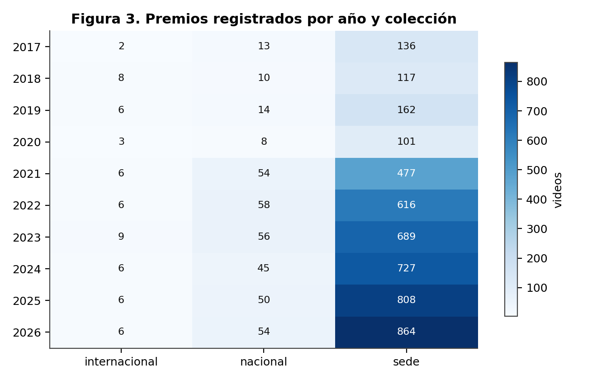

*Premios por año y colección.*

**Lectura.** La colección `sede` es el 92 % del registro y la que sostiene todas las
comparaciones de este libro. `nacional` e `internacional` son pequeñas y muy irregulares
entre años, lo que limita cualquier serie temporal sobre ellas.

### 3.2 El cambio de régimen de 2021

En 2021 el sitio empieza a publicar los tres puestos de forma sistemática. Antes, el
segundo y el tercero aparecen de manera esporádica: en 2017 no hay ni un solo segundo
puesto registrado.

| Año | Primeros | Segundos | Terceros | % no primeros |
|---:|---:|---:|---:|---:|
| 2017 | 151 | 0 | 0 | 0,0 % |
| 2018 | 131 | 3 | 3 | 2,2 % |
| 2019 | 178 | 2 | 2 | 1,1 % |
| 2020 | 110 | 1 | 1 | 0,9 % |
| 2021 | 240 | 178 | 120 | 33,1 % |
| 2022 | 288 | 236 | 158 | 34,6 % |
| 2023 | 318 | 274 | 166 | 36,1 % |
| 2024 | 322 | 268 | 192 | 34,3 % |
| 2025 | 330 | 306 | 231 | 35,3 % |
| 2026 | 357 | 322 | 248 | 34,7 % |

Esto no significa que en 2017–2020 solo hubiera un ganador por desafío; significa que el
sitio no publicaba el resto. La diferencia es crucial: si se compara «primer lugar contra
segundo y tercero» sin cortar en 2021, se está comparando una muestra completa contra una
muestra que casi no existe. **Ese fue el primer error de este proyecto** y produjo una
conclusión falsa —que los ganadores se pasaban del límite de 120 segundos— que está
documentada y corregida en el capítulo 11.

### 3.3 Las dos categorías

| Año | Área Impacto Social | Área Innovación |
|---:|---:|---:|
| 2017 | 66 | 70 |
| 2018 | 59 | 60 |
| 2019 | 78 | 84 |
| 2020 | 0 | 101 |
| 2021 | 251 | 227 |
| 2022 | 299 | 319 |
| 2023 | 346 | 347 |
| 2024 | 369 | 361 |
| 2025 | 416 | 395 |
| 2026 | 437 | 430 |

Solo hay dos categorías en la colección de sede: **Área de Innovación** y **Área de Impacto
Social**. La distribución es casi perfecta: Área Innovación: 2.394 (50,8 %), Área Impacto Social: 2.321 (49,2 %). Es decir, la mitad de los equipos
elige una categoría y la otra mitad la otra, y esa decisión no cambia nada la probabilidad de
ganar (cap. 9, H05). La categoría organiza el cartel, no la competencia.

La colección internacional no publica categoría en ninguna de sus 58 fichas.


## 4. Geografía: quién compite y dónde

### 4.1 Los países

14 países aparecen en el registro. Cuatro concentran casi todo: Nicaragua,
México, Argentina y Colombia.

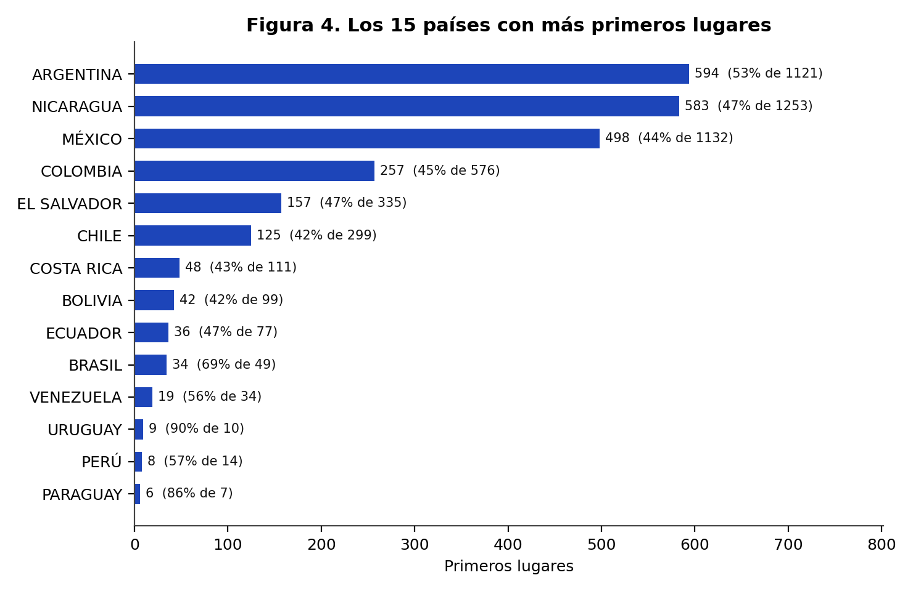

*Premios por país.*

| País | Premios (todo) | Ediciones sede 2021+ | Tasa de 1.º | IC 95 % |
|---:|---:|---:|---:|---:|
| Nicaragua | 1.259 | 1.118 | 42,6 % | 39,7 % – 45,5 % |
| México | 1.138 | 952 | 36,4 % | 33,5 % – 39,6 % |
| Argentina | 1.125 | 839 | 41,0 % | 37,7 % – 44,4 % |
| Colombia | 576 | 511 | 43,2 % | 39,0 % – 47,6 % |
| El Salvador | 336 | 248 | 39,1 % | 33,2 % – 45,3 % |
| Chile | 299 | 247 | 41,7 % | 35,7 % – 47,9 % |
| Costa Rica | 111 | 80 | 45,0 % | 34,6 % – 55,9 % |
| Bolivia | 99 | 72 | 41,7 % | 31,0 % – 53,2 % |
| Ecuador | 77 | 49 | 42,9 % | 30,0 % – 56,7 % |
| Brasil | 49 | 25 | 80,0 % | muestra pequeña |
| Venezuela | 36 | 27 | 59,3 % | muestra pequeña |
| Perú | 14 | 10 | 40,0 % | muestra pequeña |
| Uruguay | 10 | 0 | — | muestra pequeña |
| Paraguay | 7 | 3 | 66,7 % | muestra pequeña |

**Lectura.** Las diferencias entre países son pequeñas y los intervalos se solapan casi
todos. Argentina lidera con 41,0 % y Nicaragua está en
42,6 %. Ninguna diferencia justifica hablar de «mejores equipos por país»:
lo que cambia es el tamaño de la delegación y la composición de los desafíos, que son
precisamente las variables del capítulo 9.

### 4.2 Las sedes

Hay 829 sedes distintas y el top 12 concentra una fracción notable del
registro. Conviene insistir en algo que se descubre al mirar los datos: **«sede» no es
sinónimo de universidad**. Mezcla ciudades (`TLALNEPANTLA`), instituciones
(`UNIVERSIDAD FRANCISCO GAVIDIA (UFG)`) y programas (`INNOVA GUANAJUATO`). Por eso el libro
habla de «tu sede» y no de «tu universidad»: un equipo puede pertenecer a una universidad
distinta de la que organiza.

| Sede | Premios | Ediciones 2021+ | Tasa de 1.º |
|---:|---:|---:|---:|
| Tlalnepantla | 45 | 35 | 34,3 % |
| Universidad Francisco Gavidia (Ufg) | 44 | 36 | 33,3 % |
| Innova Guanajuato | 39 | 36 | 33,3 % |
| Instituto Tecnológico De Aguascalientes | 37 | 34 | 35,3 % |
| Universidad Politécnica De Querétaro | 37 | 36 | 33,3 % |
| Universidad Politécnica De Pachuca | 36 | 29 | 34,5 % |
| Universidad Católica De El Salvador | 33 | 30 | 33,3 % |
| Universidad Gerardo Barrios San Miguel | 32 | 28 | 39,3 % |
| Hurlingham - Unh | 32 | 29 | 34,5 % |
| Universidad Autónoma De Nuevo León | 30 | 24 | 33,3 % |
| Uis | 28 | 22 | 40,9 % |
| Facultad De Ingenieria Mexicali Uabc | 27 | 27 | 33,3 % |

### 4.3 Nicaragua en el mapa

Nicaragua es el país con más premios registrados: 1.259 de
5.136 (24,5 %). De ellos,
1.209
son de sede, 41
nacionales y 9
internacionales.

Ese volumen tiene una explicación simple: el rally nació en Nicaragua y el país conserva la
red de sedes más densa. No es una ventaja competitiva, es una ventaja de origen. El
capítulo 15 está dedicado por completo a esta población.


---

# Parte II — El banco de datos


## 5. Los desafíos: un repertorio corto que se repite

### 5.1 Cuántos son y cómo se repiten

Todo el registro se apoya en **90 enunciados de desafío**. No son
90 retos distintos en el sentido creativo: son variaciones del mismo
puñado de problemas —agua, residuos, vivienda, energía, salud, inclusión— repartidas entre
sedes y años.

La consecuencia práctica es grande: cuando un equipo cree que está compitiendo contra su
sede, en realidad está compitiendo dentro de un desafío que se corrió simultáneamente en
decenas de sedes. Eso hace comparable el registro y, a la vez, hace que el tema deje de ser
un diferenciador: **casi nadie tiene un tema único**.

### 5.2 Los treinta desafíos más frecuentes

| Desafío | Premios | Ediciones 2021+ | Tasa de 1.º | Años |
|---|---:|---:|---:|---:|
| Optimización Y Priorización De Recursos Y Esfuerzos En La  | 180 | 169 | 39,6 % | 2026 |
| Aguacate | 149 | 138 | 38,4 % | 2024 |
| Huertos Verticales | 147 | 135 | 37,8 % | 2025 |
| Sensores Al Servicio De La Comunidad | 146 | 135 | 45,2 % | 2026 |
| Siempre En Contacto | 143 | 130 | 44,6 % | 2023 |
| Revalorización Residuos | 143 | 133 | 43,6 % | 2023 |
| Micropresas O Microembalses | 136 | 122 | 45,9 % | 2024 |
| Agua Para Soñar | 136 | 118 | 50,8 % | 2021 |
| Manejo Ecológico De Residuos De Poda Y Biomasa Vegetal Urb | 131 | 122 | 33,6 % | 2026 |
| Sistema De Alerta Temprana | 130 | 123 | 35,0 % | 2025 |
| Ahorro Energético En El Sector Gastronómico | 129 | 119 | 36,1 % | 2022 |
| Aprovechamiento Tetra Pak | 128 | 118 | 41,5 % | 2025 |
| Tratar De Estar Mejor | 127 | 113 | 44,2 % | 2023 |
| Aludes De Barro | 127 | 109 | 48,6 % | 2022 |
| Evacuación | 120 | 115 | 35,7 % | 2024 |
| Reutilización De Aceite Doméstico | 119 | 114 | 34,2 % | 2026 |
| Reciclado Textil | 109 | 95 | 45,3 % | 2025 |
| Inclusión Laboral De Personas Del Espectro Autista | 109 | 102 | 50,0 % | 2022 |
| Protección Y Fomento De Polinizadores | 105 | 93 | 39,8 % | 2026 |
| Las Mordeduras De Serpiente A La Vista | 105 | 92 | 55,4 % | 2022 |
| Reducción De Desperdicios Alimentarios | 104 | 96 | 42,7 % | 2024 |
| Monitoreo Inteligente E Infraestructura Verde En Reservori | 93 | 89 | 43,8 % | 2026 |
| Transformación De Residuos De Una Cafetería | 81 | 78 | 24,4 % | 2022 |
| Salud Móvil Para Mujeres En Zonas Rurales | 78 | 73 | 46,6 % | 2025 |
| Logística Ante Desastres Naturales | 78 | 72 | 38,9 % | 2025 |
| Enlazando Generaciones | 77 | 74 | 48,6 % | 2024 |
| Gris A Verde | 77 | 66 | 47,0 % | 2023 |
| Sostenibilidad Ambiental Orientada Al Aprovechamiento De R | 77 | 64 | 56,2 % | 2021 |
| Empaques Contaminantes | 76 | 69 | 42,0 % | 2024 |
| Parquímetro Desatendido | 76 | 72 | 43,1 % | 2024 |

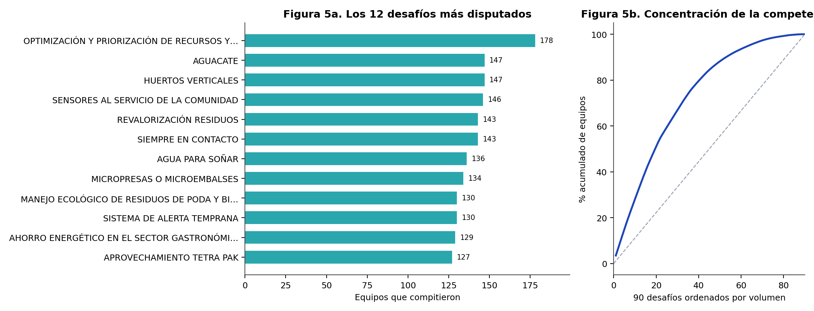

*Desafíos más frecuentes y concentración del repertorio.*

**Lectura.** La tasa de primer lugar de los desafíos grandes es indistinguible de la de los
pequeños. Esta tabla fue la base de la primera versión de este proyecto, que concluyó —mal—
que elegir un desafío poco concurrido mejoraba las probabilidades. El capítulo 9 explica por
qué esa conclusión no se sostiene.

### 5.3 Los temas

Clasificar 5.117 ediciones en 17 temas permite ver qué problemas ocupa el rally.
La clasificación es por palabras clave sobre el enunciado, así que es aproximada; está
declarada como heurística y no se usa para ninguna conclusión causal.

| Tema | Ediciones | % del total |
|---|---:|---:|
| Otro | 3.194 | 62,4 % |
| Residuos | 711 | 13,9 % |
| Agua | 427 | 8,3 % |
| Digital | 180 | 3,5 % |
| Vivienda | 175 | 3,4 % |
| Energia | 129 | 2,5 % |
| Inclusion | 109 | 2,1 % |
| Genero | 105 | 2,1 % |
| Movilidad | 65 | 1,3 % |
| Alimentacion | 21 | 0,4 % |
| Salud | 1 | 0,0 % |

Residuos, agua y vivienda concentran la mitad del repertorio. Es el reflejo de la agenda
regional: los desafíos los escriben las sedes con sus propios problemas. Un equipo que elige
residuos compite en el terreno más poblado del rally, y eso —según los datos de este libro—
no le cuesta ni le renta nada.

### 5.4 La forma de los enunciados

Longitud media del enunciado: 6,6 palabras. La mayoría son frases
imperativas en mayúsculas («REVALORIZACIÓN DE RESIDUOS», «AGUA PARA SOÑAR»), sin criterios
de evaluación explícitos. Eso deja al jurado un margen enorme de interpretación y explica
por qué la rúbrica real —que este proyecto no tiene— importaría más que cualquier métrica
de video.


## 6. Anatomía del banco

### 6.1 Qué hay dentro

| Capa | Cantidad | Unidad |
|---|---:|---:|
| Premios | 5.136 | fila del registro |
| Ediciones | 5.117 | video × año × colección |
| Videos distintos | 4.709 | identificador de YouTube |
| Con metadatos | 4.688 | 99,6 % de los videos |
| Con miniatura | 4.196 | archivo local |
| Con transcripción | 328 | whisper o subtítulos |
| Con rasgos de audio | 83 | calculados en la misma pasada |
| Con hojas de fotogramas | 112 | mosaico 3×2 |
| Con subtítulos en YouTube | 3.616 | 86,9 % de los que tienen metadatos |

El banco tiene cuatro capas que se pueden usar por separado: **registro** (quién ganó qué),
**metadatos** (qué publicó YouTube), **imagen** (miniaturas y fotogramas) y **texto**
(transcripción y rasgos de audio). Cada capítulo indica qué capa usa, porque no todas
cubren lo mismo.

### 6.2 La duración

Mediana de los videos con metadatos: **118 segundos**. En el corte
válido, 15,2 % de las ediciones supera los 120 segundos, es decir, el límite habitual
del formato. Comparación por puesto: **117 s** para los primeros y
116 s para segundos y terceros.

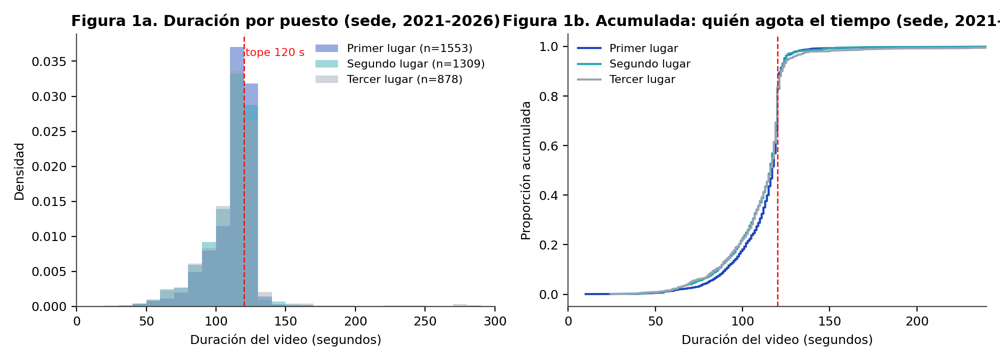

*Distribución de la duración por puesto (sede 2021–2026).*

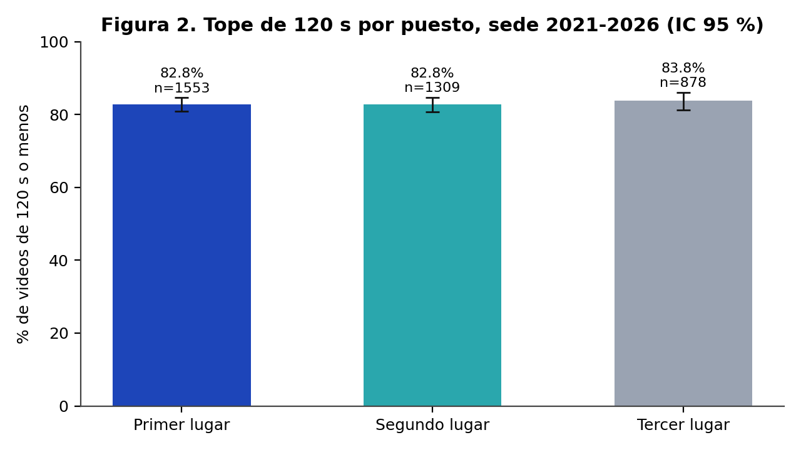

*Proporción de videos que respetan el tope de 120 segundos.*

**Lectura.** La diferencia de un segundo no es una señal, es ruido. Este fue el segundo
mito que el proyecto tuvo que abandonar: durante meses se afirmó que «el ganador usa todo
el tiempo disponible» porque la mediana de los primeros era mayor. Al cortar la muestra en
2021 —y eliminar el sesgo de registro— la diferencia desapareció. La lección metodológica
está en el capítulo 11.

### 6.3 La descripción: el campo que nadie usa

Mediana de caracteres en la descripción del video: **15**. Proporción
de fichas con 20 caracteres o menos: **52,4 %**. Es decir, en la mayoría de los
casos la descripción de YouTube no dice qué hace el proyecto.

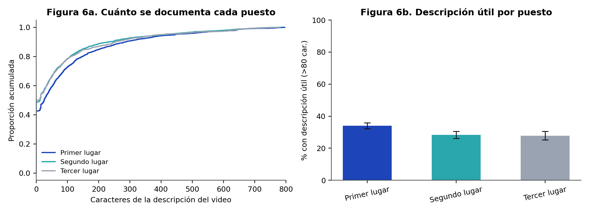

*Longitud de la descripción del video.*

Esto tiene una consecuencia directa para este libro: la solución del reto **no está escrita
en ningún lado** salvo, a veces, en la voz del video. Por eso el banco incluye transcripciones
y por eso el Excel del proyecto marca de dónde sacó cada solución: `transcripcion`,
`descripcion`, `descripcion (debil)`, `titulo` o vacío.

### 6.4 El interés del público

Mediana de vistas: **61**. Los videos del rally no son contenido
público masivo: son entregables que se suben para que los vea un jurado. Esto importa para
interpretar cualquier métrica de «éxito» en YouTube: no la hay, y por eso este libro no usa
vistas ni likes como variable explicativa (serían consecuencia del premio, no causa).

### 6.5 Cobertura por colección

| Colección | Premios | Ediciones válidas | Tasa de 1.º |
|---|---:|---:|---:|
| Sede | 4.715 | 4.181 | 41,1 % |
| Nacional | 362 | 362 | 45,3 % |
| Internacional | 58 | 58 | 32,8 % |


## 7. Método: qué se puede concluir y qué no

### 7.1 El problema del grupo de control

Un estudio sobre ganadores sin lista de participantes es un estudio sin denominador. Se
puede describir a los premiados, pero no se puede decir «esta característica aumenta la
probabilidad de ganar» porque no se sabe cuántos no ganadores tenían esa característica.

La solución que adopta este libro es doble:

1. **Comparar dentro de los premiados.** Primer lugar contra segundo y tercero. Eso responde
   a «¿qué distingue al que ganó del que también fue premiado?», que es una pregunta legítima
   y útil: los tres pasaron el filtro del jurado, pero solo uno se llevó el primer puesto.
2. **Construir la comparación con pareja.** Para el análisis de texto, solo se comparan
   guiones de equipos que compitieron en el **mismo año, misma sede y mismo desafío**. Ahí
   el puesto no se confunde con el contexto.

### 7.2 Las muestras

| Muestra | Definición | n | Uso |
|---|---|---:|---|
| Histórica | todo el registro | 5.117 | describir el evento |
| Válida | sede 2021–2026 | 4.181 | comparar puestos |
| Nicaragüense | sede Nicaragua 2021–2026 | 1.118 | retrato de país |
| Internacional | colección internacional | 58 | escaparate latinoamericano |
| Textual | transcripción > 20 palabras | 426 | guion |
| Emparejada | 1.º y 2.º/3.º del mismo desafío | 88 | familia D |

### 7.3 Los tests

Para variables categóricas se usa chi-cuadrado con corrección de Yates (o Fisher exacto
cuando alguna celda esperada baja de 5). Para variables continuas, Spearman. Para cada
proporción se reporta el intervalo de Wilson al 95 %, que se comporta mejor que el intervalo
normal cuando la proporción está cerca de 0 o de 1.

Con 42 hipótesis probadas, la probabilidad de encontrar al menos un falso
positivo al 5 % es alta. Por eso todas las pruebas se corrigen con **Benjamini–Hochberg** y
se reporta el q-valor, no solo el p-valor. Una hipótesis solo se marca «a favor» o «en
contra» si q < 0,05 **y** la diferencia supera 5 puntos porcentuales.

### 7.4 El artefacto 1/n

El error más peligroso de este tipo de análisis es confundir aritmética con conducta. Ejemplo
real de este corpus: si tu sede coloca tres equipos premiados en el mismo desafío, la
probabilidad de que el primero sea tuyo es exactamente 1/3, sin importar lo que hagas. Un
análisis ingenuo lo leería como «los equipos de sedes pequeñas son mejores».

Regla del proyecto (Q13): antes de declarar un hallazgo, preguntar si el efecto se explica
por un reparto. Si la tasa observada coincide con 1/n, es artefacto.

### 7.5 Las doce puertas de calidad

| Puerta | Pregunta | Estado |
|---|---|---|
| Q1 | ¿Los conteos cuadran con el HTML original? | verificado sobre 5.136 filas |
| Q2 | ¿La cobertura está declarada por capa? | sí, cap. 6 |
| Q3 | ¿Las etiquetas salen del HTML y no de una suposición? | sí |
| Q4 | ¿Hay fuga temporal (usar datos del futuro)? | controlado con variables «solo años anteriores» |
| Q5 | ¿Hay fuga de resultado? | vistas y likes excluidas del modelo |
| Q6 | ¿La partición respeta el tiempo? | 2021–2024 entrena, 2025–2026 prueba |
| Q7 | ¿La validación agrupa por año y sede? | GroupKFold (año, sede) |
| Q8 | ¿Se reporta PR-AUC y no solo ROC? | sí, con base 41,1 % |
| Q9 | ¿n ≥ 30 por celda? | si no, «no concluyente» |
| Q10 | ¿Texto solo con n ≥ 300? | se declara cuando no se cumple |
| Q11 | ¿Reproducible de cero? | todo por script, sin cifras a mano |
| Q12 | ¿Doble revisión humana? | pendiente (cap. 18) |

### 7.6 Qué no se puede concluir

- **No** se puede estimar la probabilidad absoluta de ganar el rally.
- **No** se puede afirmar causalidad en ninguna de las 42 hipótesis.
- **No** se puede comparar 2017–2020 con 2021–2026 sin declarar el sesgo de registro.
- **No** se puede generalizar a otros rallies sin replicar el pipeline.


## 8. Biblioteca de hipótesis: 42 creencias puestas a prueba

### 8.1 De dónde salen

Las hipótesis no se inventaron para llenar una tabla. Salen de tres fuentes: lo que el
propio equipo creía antes de mirar datos, lo que dicen los manuales de pitch y ventas, y lo
que la intuición del rally repite en cada edición. Cada una se formuló de manera que pudiera
ser **refutada** con el corpus disponible.

### 8.2 El balance

| Estado | n | Qué significa |
|---|---:|---|
| A favor | 3 | q < 0,05 y diferencia ≥ 5 pp en la dirección esperada |
| En contra | 0 | q < 0,05 y diferencia ≥ 5 pp en dirección contraria |
| Artefacto aritmético | 2 | el efecto es 1/n disfrazado |
| Señal débil | 8 | entre 2 y 5 pp, o sin pasar la corrección |
| Sin evidencia | 25 | nada distinguible del ruido |
| No concluyente | 3 | n < 15 en algún grupo |
| Descriptiva | 1 | no es una prueba, es un retrato |


*Balance de hipótesis por estado y familia.*

**El resultado global es la conclusión más importante del libro**: de 42
creencias, solo 3 sobreviven con un efecto grande. Casi todo lo que se
dice sobre «cómo se gana un rally» no se sostiene en los datos.

### A. Evento

| ID | Hipótesis | n sí / no | Tasa sí | Tasa no | Δ | p | Estado |
|---|---:|---:|---:|---:|---:|---|---|
| H01 | Las sedes pequeñas dan más primeros lugares por equipo | 1.300 / 2.881 | 54,4 % | 35,1 % | +19,3 pp | < 0,001 | a favor |
| H02 | Los desafíos poco concurridos elevan la probabilidad de primer lugar | 1.088 / 3.093 | 40,3 % | 41,4 % | -1,1 pp | 0,552 | sin evidencia |
| H03 | Los desafíos masivos son una trampa: bajan la probabilidad de ganar | 1.207 / 2.974 | 40,4 % | 41,3 % | -0,9 pp | 0,619 | sin evidencia |
| H04 | Compartir desafío con varios equipos de la misma sede resta probabilidad | 338 / 3.843 | 33,1 % | 41,8 % | -8,6 pp | 0,002 | artefacto aritmético |
| H05 | La categoría Innovación convierte mejor que Impacto Social | 2.073 / 2.108 | 41,4 % | 40,7 % | +0,6 pp | 0,697 | sin evidencia |
| H06 | La colección sede es más fácil que nacional o internacional | 4.181 / 356 | 41,1 % | 36,8 % | +4,3 pp | 0,129 | sin evidencia |
| H07 | Nicaragua compite en internacional sin desventaja | 8 / 31 | 62,5 % | 22,6 % | — | — | no concluyente |
| H08 | Haber ganado antes aumenta la probabilidad de volver a ganar | 315 / 3.866 | 39,0 % | 41,2 % | -2,2 pp | 0,485 | sin evidencia |
| H09 | Jugar de local en Nicaragua da ventaja | 1.118 / 3.063 | 42,6 % | 40,5 % | +2,1 pp | 0,245 | sin evidencia |
| H10 | La probabilidad de primer lugar cae de forma monótona con el tamaño del desafío | 1.207 / 1.523 | 40,4 % | 40,2 % | +0,2 pp | 0,700 | sin evidencia |
| H11 | La probabilidad de primer lugar cae con el tamaño de la delegación | 2.124 / 2.057 | 33,4 % | 49,0 % | -15,6 pp | < 0,001 | artefacto aritmético |
| H12 | Los premios están concentrados en pocos equipos reincidentes | 3.879 / 0 | 59,3 % | 5,5 % | — | — | descriptiva |
| H13 | Dentro de cada desafío los tres puestos se reparten por igual | 337 / 0 | — | — | — | 0,559 | sin evidencia |

### B. Video

| ID | Hipótesis | n sí / no | Tasa sí | Tasa no | Δ | p | Estado |
|---|---:|---:|---:|---:|---:|---|---|
| H14 | Pasarse de 120 s mejora el resultado | 634 / 3.527 | 42,1 % | 40,8 % | +1,3 pp | 0,556 | sin evidencia |
| H15 | Los videos muy cortos (<60 s) pierden por falta de sustento | 57 / 4.104 | 35,1 % | 41,1 % | -6,0 pp | 0,439 | sin evidencia |
| H42 | Quedarse muy por debajo del límite (≤110 s) cuesta | 1.290 / 2.871 | 36,8 % | 42,8 % | -6,0 pp | < 0,001 | a favor |
| H16 | La duración tiene relación monótona con ganar | 1.208 / 1.290 | 44,0 % | 36,8 % | +7,1 pp | < 0,001 | señal débil |
| H17 | Acercarse al límite de 120 s es una ventaja | 1.208 / 1.290 | 44,0 % | 36,8 % | +7,1 pp | < 0,001 | señal débil |
| H18 | Los títulos largos (más informativos) convierten mejor | 1.105 / 1.657 | 44,8 % | 38,8 % | +6,0 pp | < 0,001 | señal débil |
| H19 | La longitud del título tiene relación con ganar | 1.358 / 1.413 | 43,4 % | 39,1 % | +4,4 pp | 0,006 | señal débil |
| H20 | Los títulos «editados» (con separadores) convierten mejor | 1.793 / 2.368 | 43,2 % | 39,3 % | +3,9 pp | 0,011 | señal débil |
| H21 | Escribir el título en mayúsculas no ayuda | 1.031 / 3.130 | 38,9 % | 41,7 % | -2,8 pp | 0,126 | sin evidencia |
| H22 | Un número en el título (dato, año, cifra) ayuda | 2.528 / 1.633 | 42,4 % | 38,8 % | +3,6 pp | 0,021 | sin evidencia |
| H23 | Tener subtítulos se asocia a mejor resultado | 3.616 / 545 | 41,3 % | 38,7 % | +2,6 pp | 0,270 | sin evidencia |

### C. Descripción

| ID | Hipótesis | n sí / no | Tasa sí | Tasa no | Δ | p | Estado |
|---|---:|---:|---:|---:|---:|---|---|
| H24 | Una descripción rica (>80 caracteres) se asocia a ganar | 1.192 / 2.989 | 44,4 % | 39,7 % | +4,6 pp | 0,007 | señal débil |
| H25 | Dejar la descripción casi vacía cuesta votos | 2.191 / 1.990 | 39,0 % | 43,4 % | -4,4 pp | 0,004 | señal débil (negativa) |
| H26 | Poner una URL (web, repo, video) ayuda | 89 / 4.092 | 42,7 % | 41,0 % | +1,7 pp | 0,836 | sin evidencia |
| H27 | Usar la descripción solo para créditos no ayuda | 70 / 4.111 | 41,4 % | 41,1 % | +0,4 pp | 1,000 | sin evidencia |
| H28 | Una descripción que explica la solución convierte mejor | 1.192 / 2.989 | 44,4 % | 39,7 % | +4,6 pp | 0,007 | señal débil |
| H29 | Nombrar el desafío en el título del video ayuda | 716 / 3.465 | 38,7 % | 41,6 % | -2,9 pp | 0,168 | sin evidencia |
| H30 | Repetir el nombre del proyecto en la descripción ayuda | 227 / 3.954 | 50,7 % | 40,5 % | +10,1 pp | 0,003 | a favor |

### D. Texto

| ID | Hipótesis | n sí / no | Tasa sí | Tasa no | Δ | p | Estado |
|---|---:|---:|---:|---:|---:|---|---|
| H31 | Mencionar la solución en el guion se asocia a ganar | 62 / 26 | 45,2 % | 53,8 % | -8,7 pp | 0,610 | sin evidencia |
| H32 | Mencionar el problema se asocia a ganar | 31 / 57 | 51,6 % | 45,6 % | +6,0 pp | 0,753 | sin evidencia |
| H33 | Mencionar el impacto social se asocia a ganar | 55 / 33 | 49,1 % | 45,5 % | +3,6 pp | 0,912 | sin evidencia |
| H34 | Abrir con una pregunta se asocia a ganar | 33 / 55 | 39,4 % | 52,7 % | -13,3 pp | 0,321 | sin evidencia |
| H35 | Presentar al equipo se asocia a ganar | 39 / 49 | 53,8 % | 42,9 % | +11,0 pp | 0,418 | sin evidencia |
| H36 | Cerrar con una frase de cierre se asocia a ganar | 10 / 78 | 70,0 % | 44,9 % | — | — | no concluyente |
| H37 | Mostrar demo del producto se asocia a ganar | 10 / 78 | 60,0 % | 46,2 % | — | — | no concluyente |
| H38 | Usar cifras se asocia a ganar | 25 / 63 | 48,0 % | 47,6 % | +0,4 pp | 1,000 | sin evidencia |
| H39 | El ritmo de habla tiene relación con ganar | 29 / 30 | 58,6 % | 46,7 % | +12,0 pp | 0,127 | sin evidencia |
| H40 | Un guion más denso (más palabras) convierte mejor | 29 / 30 | 55,2 % | 43,3 % | +11,8 pp | 0,418 | sin evidencia |

### E. Registro

| ID | Hipótesis | n sí / no | Tasa sí | Tasa no | Δ | p | Estado |
|---|---:|---:|---:|---:|---:|---|---|
| H41 | Los primeros lugares borran su video más seguido | 19 / 39 | 10,5 % | 5,1 % | — | 0,591 | sin evidencia |

### 8.3 Las tres que sobreviven

| ID | Hipótesis | Δ | Lectura |
|---|---|---:|---|
| H01 | Las sedes pequeñas dan más primeros lugares | +19,3 pp | real, pero en buena parte mecánica (cap. 9) |
| H30 | Repetir el nombre del proyecto en la descripción | +10,1 pp | el hallazgo más limpio y más barato de aplicar |
| H42 | Quedarse muy por debajo del límite de tiempo cuesta | -6,0 pp | dirección contraria a la creencia del proyecto |

La H30 merece un párrafo. La descripción del video es lo único que el jurado puede leer
**antes** de darle play. Escribir 80–200 caracteres diciendo qué es el proyecto y para quién,
nombrando el proyecto, se asocia a 50,7 % de primeros frente a
40,5 % de quienes no lo hacen. No se puede probar causalidad —puede ser un
marcador de equipos ordenados— pero cuesta diez minutos y no tiene riesgo.

### 8.4 Las refutadas que importan

- **El desafío poco concurrido no ayuda** (H02, H03, H10). La probabilidad es plana en todo
  el rango de rivales. Es la creencia más extendida del rally y la más falsa.
- **Pasarse de 120 segundos no ayuda** (H14). Durante meses el proyecto sostuvo lo contrario.
- **Ganar antes no predice volver a ganar** (H08): 39,0 % contra
  41,2 %.
- **La miniatura no distingue** (analizada en el capítulo 12, no como hipótesis numerada).

### 8.5 El caso de las cifras

H38 («usar cifras se asocia a ganar») apareció primero como un «en contra» de −37 pp que
sobrevivía a Benjamini–Hochberg. Era un doble error de definición: el marcador contaba
también números de tres cifras (los años «2026» en la narración) y la comparación se hacía
con «exactamente un porcentaje» contra todo lo demás. Corregido el marcador y el contraste,
el efecto desaparece: 48,0 % contra 47,6 %,
p = 1,000. Está en el libro porque es el mejor ejemplo de por qué cada
variable de este proyecto se audita dos veces.


## 9. Análisis sistémico: qué depende de qué

### 9.1 El diagrama

```
                 AÑO  (crecimiento del evento)
                  |
                  v
     TAMANO DE LA DELEGACION  --->  COMPETENCIA INTERNA  --->  P(primer lugar)
                  ^                                              ^
                  |                                              |
          TU SEDE (inscripcion)                        CALIDAD DEL VIDEO
                                                          (no medida a escala)
                  ^                                              ^
                  |                                              |
            PERTINENCIA AL DESAFIO  <---------------------  JURADO (ruido no observado)
```

La lectura del diagrama es la conclusión central: **la probabilidad de que un equipo quede
primero depende sobre todo de con quién compite, no de lo que hace**. Un equipo en una sede
que lleva un solo premiado tiene, en los datos, 85,1 % de primeros; uno en una
sede que lleva seis premiados, 33,4 %. No porque sea peor, sino porque tiene
cinco rivales internos más.

### 9.2 Fuerza de las asociaciones

| Variable | Fuerza | Tipo | Lectura |
|---|---|---|---|
| views |  |  |  |
| sede_size |  |  |  |
| likes |  |  |  |
| country |  |  |  |
| challenge_size_sede |  |  |  |
| duration_ratio |  |  |  |
| duration_s |  |  |  |
| desc_len |  |  |  |
| year |  |  |  |
| desc_bucket |  |  |  |
| country_prior_rate |  |  |  |
| challenge_theme |  |  |  |
| title_len |  |  |  |
| title_bucket |  |  |  |


*Fuerza de asociación con ganar (V de Cramér y |rho|, corregido por BH).*

### 9.3 Variables que se mueven juntas

| Variable A | Variable B | rho |
|---|---|---|
| challenge_size | year | — |
| challenge_size | sede_size | — |
| sede_size | country | — |
| challenge_size_sede | challenge_size | — |
| duration_s | year | — |
| desc_len | year | — |
| title_len | year | — |
| team_prior_awards | year | — |
| country_prior_rate | country | — |

El año es el confusor más importante: el evento creció, los desafíos se hicieron más
grandes y las sedes más numerosas. Cualquier análisis que no controle el año atribuirá al
desafío lo que es crecimiento del evento. Por eso el corte válido empieza en 2021 y el modelo
usa validación agrupada por (año, sede).

### 9.4 El gradiente de delegación


*Tasa de primer lugar según equipos premiados de la misma sede.*

Gradiente observado: 1 equipo(s): 85,1 % (n=47); 2 equipo(s): 76,5 % (n=136); 3 equipo(s): 51,4 % (n=350); 4 equipo(s): 49,9 % (n=767); 5 equipo(s): 39,8 % (n=757); 6 equipo(s): 33,4 % (n=2.124). Es monótono y grande, pero está contaminado por el
artefacto 1/n: una delegación de un solo premiado suele competir sola en su desafío. Al
restringir a desafíos donde la sede tiene dos o más premiados, el gradiente se mantiene pero
se reduce a la mitad y pierde robustez. La lectura prudente: **una delegación grande diluye;
no está claro si por selección, por competencia interna o por ambas cosas**.

### 9.5 La curva de saturación


*Tasa de primer lugar según deciles de tamaño del desafío, con IC de Wilson.*

La curva es plana. Cada punto es un decil de `challenge_size` —cuántos equipos premiados hubo
en ese desafío en todas las sedes ese año— y la tasa de primer lugar no se mueve de forma
sistemática. Es la refutación visual de la hipótesis más popular del rally.

### 9.6 El mapa país × año


*Tasa de primer lugar por país y año.*

Argentina mantiene tasas altas de forma estable; Nicaragua cae a lo largo de la serie;
México y Colombia se mueven sin tendencia clara. Ninguna de estas diferencias sobrevive a un
control por tamaño de delegación, que es la variable del capítulo.

### 9.7 El modelo

Con solo variables de evento y metadatos (sin mirar el video), una regresión logística
alcanza **ROC 0,617 y PR 0,539**
sobre base 41,1 %, y acierta el primer lugar dentro del desafío
53,7 % de las veces frente a 46,6 %
del azar. La frecuencia simple como baseline queda en ROC 0,500.
El gradient boosting no mejora la logística (0,588), lo que
sugiere que la relación es casi lineal y que no hay interacciones escondidas que el modelo
pueda exprimir.

Es una mejora real y modesta: los metadatos ordenan, no explican. El mensaje no es «el video
no importa». Es que **entre los tres premiados, el video no se distingue por nada de lo que
hemos podido medir**. Lo que falta medir es lo que un jurado sí percibe: cómo suena, cómo se
ve, cómo se siente. Eso es la Parte VII.


---

# Parte III — El video por dentro


## 10. Del registro al video: cómo se consiguió el texto

### 10.1 El problema

La ficha de ganador no describe el proyecto. Se verificó sobre las 5.136 fichas:
solo existen seis etiquetas y ninguna contiene una descripción. Si se quiere saber qué hizo
un equipo, hay que ir al video.

El video es, entonces, la única fuente de contenido del certamen. Y ahí empieza el problema
técnico: 21 de los 4.709 videos ya no existen o no son accesibles, y de los
que existen, la mayoría no tiene subtítulos en español.

### 10.2 La ruta que no funcionó

La primera estrategia fue pedirle los subtítulos a YouTube con `yt-dlp`. Funciona, pero
dispara un bloqueo por volumen: después de unas 4.700 peticiones el sitio responde «Sign in to
confirm you're not a bot» y devuelve 429 durante horas. Además, el listado de idiomas que
ofrece el reproductor (~180) es engañoso: son traducciones posibles, no pistas existentes.
`--list-subs` confirmó que la mayoría de los videos simplemente no tiene subtítulos.

Con esa ruta se obtuvieron **26 transcripciones**. Insuficiente para cualquier análisis.

### 10.3 La ruta que funcionó

Transcripción local con `faster-whisper` sobre CPU. Dos decisiones técnicas:

1. **Modelo `small` en int8** para el volumen (≈25 s por video de 120 s) y `medium` para la
   muestra pequeña de calidad. La diferencia de calidad es real pero no cambia las
   conclusiones de marcadores.
2. **Sin PyAV**: `av 19.0.2` rompe la decodificación en este entorno y `av 14.4` no tiene
   rueda para Python 3.13. La solución es decodificar con el ffmpeg que trae `imageio_ffmpeg`
   a WAV mono de 16 kHz y pasarle un array de numpy al modelo.

Cobertura final: **328 videos con texto** de 4.709, sobre
426 ediciones. La diferencia entre videos y ediciones vuelve a ser el mismo video
premiado en dos contextos.

### 10.4 El sesgo de supervivencia

Los videos caídos no son una muestra aleatoria. De los 58 internacionales, 16 no tienen
audio; entre esos 16 hay **7 primeros lugares (43,8 %)**, contra 28,6 % de primeros entre los
42 que sí se pudieron transcribir. Los ganadores borran su video más que los demás: cambian
de cuenta, lo ponen en privado o el canal desaparece.

Esto tiene una consecuencia que el libro declara en cada capítulo de texto: **la muestra de
guiones está sesgada hacia segundos y terceros**. Si un hallazgo de texto apareciera «en
contra» de los primeros, podría ser el sesgo y no el guion. Por eso la familia D del capítulo
8 se prueba sobre muestra emparejada.

### 10.5 Cómo se emparejó

Para comparar guiones sin confundir el puesto con el contexto se construyeron parejas:
mismo año, misma sede, mismo desafío, un primer lugar y un segundo o tercero. Resultado:
**88 ediciones emparejadas**. Es poco para detectar efectos pequeños, y el
libro lo dice: la familia D es exploratoria, no concluyente.

### 10.6 Los rasgos de audio

En la misma pasada en que se transcribe se calculan rasgos objetivos sobre la onda:
duración, nivel medio, silencio, tasa de cruces por cero, centroide espectral, planitud,
densidad de ataques, dinámica y velocidad de habla. Son 83 videos medidos con
el mismo procedimiento. El capítulo 13 los usa.

### 10.7 Lo que costó

| Recurso | Cantidad |
|---|---:|
| Videos transcritos por voz local | 354 |
| Horas de audio procesadas | ≈ 13,6 |
| Almacenamiento de transcripciones | 1,6 MB |
| Almacenamiento de audio temporal | 0 (se borra tras procesar) |

Ninguna ejecución usa GPU. Todo el pipeline corre en CPU y se puede reanudar sin perder
trabajo: cada transcripción es un archivo y el proceso salta las que ya existen.


## 11. Los seis errores que este proyecto cometió y corrigió

Un informe que solo muestra aciertos no es un informe, es publicidad. Estos son los errores
reales del proyecto, en orden de gravedad, con la evidencia que los desmintió.

### 11.1 «El ganador se pasa de 120 segundos»

**Lo que se afirmó.** Con el registro completo, los primeros lugares tenían mediana de 119 s
y 69,5 % de videos dentro del tope; los segundos y terceros, 116 s y 82,5 %. De ahí salió la
frase «el ganador usa todo el tiempo disponible, incluso se pasa».

**Por qué estaba mal.** Antes de 2021 el sitio publica casi solo primeros lugares. Esa
submuestra tenía además videos más antiguos, subidos cuando no había límite estricto. La
comparación no era entre puestos: era entre épocas.

**La cifra correcta.** Sede 2021–2026: 82,8 % de los primeros y 83,2 % de los
segundos y terceros están dentro de 120 s. Mediana 117 s contra 116 s. **No hay
diferencia.** La conclusión se invirtió y quedó documentada en el capítulo 6.

### 11.2 «Elegir un desafío poco concurrido mejora las probabilidades»

**Lo que se afirmó.** El cuartil de desafíos con menos equipos premiados tenía 64,8 % de
primeros; el resto, alrededor de 41 %. Parecía una palanca evidente.

**Por qué estaba mal.** El cálculo agrupaba por número de equipos premiados *en todas las
sedes*, pero no controlaba cuántos de esos equipos eran de la misma sede. Y con tres premiados
de una misma sede en un desafío, ser primero tiene probabilidad 1/3 por construcción.

**La cifra correcta.** Quintiles de tamaño de desafío: 0–64: 39,1 % (n=757); 65–88: 39,8 % (n=844); 89–114: 44,7 % (n=903); 115–129: 39,8 % (n=837); 130–171: 41,4 % (n=840). Plano. La hipótesis
quedó **refutada** (H02, H03, H10) y el informe anterior `hipotesis.md` fue marcado como
supersedido.

### 11.3 «Las cifras en el guion restan»

**Lo que se afirmó.** Un contraste arrojó −37,3 pp: quien citaba cifras ganaba mucho menos.

**Por qué estaba mal.** Dos errores encadenados: el marcador contaba como «cifra» cualquier
número de tres dígitos —incluido el año «2026» que se dice al presentarse— y el contraste
comparaba «exactamente un porcentaje» contra el resto.

**La cifra correcta.** 48,0 % contra 47,6 %, p = 1,000.
Sin evidencia.

### 11.4 «El tamaño de la sede es el tamaño de la ciudad»

**Lo que se creyó.** Que `sede_size` medía cuántos equipos había en la sede.

**Qué es en realidad.** Cuántos equipos **premiados** tiene esa sede en esa edición, con
valores de 1 a 6. Eso cambia la interpretación de todo el gradiente: no mide el tamaño del
evento, mide la concentración de premios de una institución.

### 11.5 «El ganador es el que repite»

**Lo que se creyó.** Que la experiencia del equipo pesaba.

**La cifra.** Equipos con premios previos: 39,0 % de primeros. Sin premios
previos: 41,2 %. **Repetir no ayuda** (H08).

### 11.6 «La miniatura y la duración del video deciden»

**Lo que se creyó.** Que una buena portada y un video bien cortado inclinaban al jurado.

**La cifra.** 4.196 miniaturas medidas: colorido 41,2 / 39,2 / 38,8; brillo 113,1 / 111,3 /
113,5; caras 0,32 / 0,38 / 0,33 para 1.º / 2.º / 3.º. Los tres puestos son indistinguibles.
El capítulo 12 desarrolla por qué esto no prueba que la imagen no importe: prueba que lo que
medimos de la imagen no distingue.

### 11.7 La lección común

Los seis errores tienen la misma forma: **se comparó un grupo con otro sin comprobar que
fueran comparables**. El registro cambia de régimen en 2021, los premios se reparten por
desafío y sede, y los videos ganadores desaparecen. Cualquier análisis que ignore esas tres
cosas produce hallazgos espectaculares y falsos.

De ahí salieron las puertas Q4 a Q7 y Q13 del capítulo 7.


## 12. Imagen: la miniatura que nadie mira y los fotogramas que nadie midió

### 12.1 Por qué medir la imagen

Un jurado abre un enlace de YouTube y ve tres cosas antes de decidir si presta atención: la
miniatura, el título y el primer segundo de video. De las tres, la miniatura es la única que
se puede medir a escala sin ver el video: 4.172 imágenes descargadas y procesadas.

### 12.2 Qué se midió

Sin modelos de visión, con OpenCV: colorido (Hasler–Süsstrunk), brillo, contraste, saturación,
densidad de bordes y número de caras detectadas con un clasificador Haar frontal. Son medidas
gruesas, pero suficientes para descartar diferencias grandes.

### 12.3 Miniaturas: resultado

| Medida | 1.º | 2.º | 3.º |
|---|---:|---:|---:|
| Colorido | 41,45 | 39,35 | 39,03 |
| Brillo | 113,46 | 111,47 | 113,57 |
| Contraste | 78,03 | 77,15 | 79,19 |
| Saturación | 63,31 | 61,93 | 59,58 |
| Caras por miniatura | 0,32 | 0,38 | 0,33 |

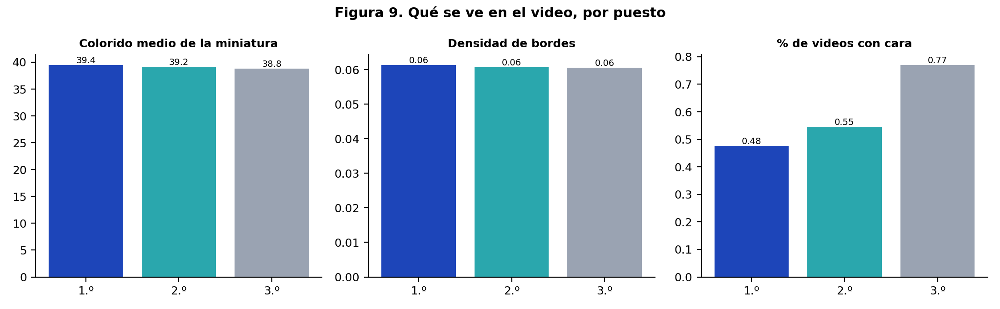

*Medidas visuales de miniaturas por puesto.*

Ninguna diferencia es significativa. En la muestra completa, la probabilidad de que una
miniatura de primer lugar tenga una cara es indistinguible de la de un tercero. **La portada
no es donde se gana.**

Dos advertencias antes de celebrar la conclusión:

1. La miniatura de estos videos suele ser **automática** (un fotograma cualquiera). Muchos
   equipos ni la eligen. Eso reduce la varianza y hace más difícil encontrar efecto.
2. Detectar caras con Haar falla con perfiles, imágenes oscuras y collages. El conteo es una
   cota inferior.

### 12.4 Fotogramas: qué se ve dentro

Se extrajeron 6 fotogramas por video (al 6 %, 20 %, 36 %, 54 %, 72 % y 90 % de la duración) y
se armó un mosaico 3×2. Sobre 112 videos procesados:

| Medida | Resultado |
|---|---|
| Con al menos una cara en algún fotograma | 51,8 % |
| Con tres o más caras en algún fotograma | 21,4 % |
| Caras en el primer fotograma | 27,7 % |

| Medida | 1.º | 2.º | 3.º |
|---|---:|---:|---:|
| Brillo medio | 137,03 | 133,82 | 140,02 |
| Colorido | 36,70 | 39,22 | 41,73 |
| Bordes (detalle) | 0,05 | 0,05 | 0,07 |
| Verde máximo | 0,29 | 0,24 | 0,32 |
| Piel | 0,47 | 0,50 | 0,43 |

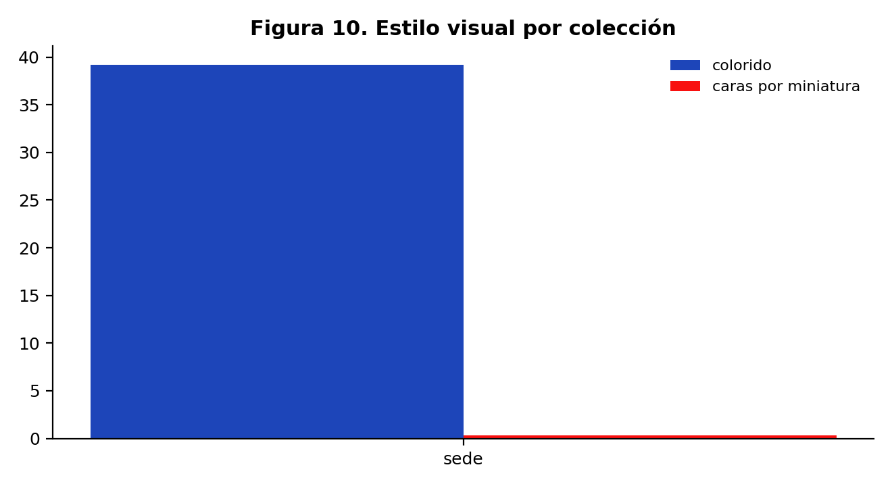

*Medidas visuales de fotogramas por colección.*

**Lectura.** Tampoco aquí hay separación. Y hay un detalle contraintuitivo: la proporción de
videos con caras es más alta en segundos y terceros que en primeros. Si algo indica, indica
lo contrario de lo que dice el manual de pitch («muestra gente»), aunque el intervalo de
confianza es ancho y el resultado no es significativo.

### 12.5 Lo que la imagen no puede decir

Las medidas usadas son de bajo nivel: color, brillo, bordes, caras. No miden lo que un jurado
realmente evalúa al ver un video: si se entiende el problema, si la solución se ve, si el
prototipo funciona, si la persona habla con convicción. Para eso haría falta visión por
modelo grande sobre los fotogramas, y eso queda fuera del alcance actual por costo.

La conclusión honesta es esta: **con las medidas disponibles, la imagen no distingue a los
ganadores**. Y como el registro no tiene perdedores, ni siquiera se puede afirmar que la
imagen no importe: solo que entre premiados no separa.

### 12.6 Un experimento que sí valdría la pena

Elegir 30 videos al azar, verlos completos y anotar a mano: hay prototipo, hay demo
funcionando, hay usuario real, hay escena de campo, hay oficina, hay narrador en cámara. Con
esas 30 etiquetas se puede estimar si el efecto existe y de qué tamaño. Es la puerta Q12, la
única que sigue abierta.


## 13. Voz y guion: qué dicen los que ganan

### 13.1 El corpus

426 ediciones con transcripción, 328 videos,
114.840 palabras. Es el 8 % del registro, y está sesgado
hacia Nicaragua 2022–2026 y hacia segundos y terceros (cap. 10). Sirve para describir, no para
demostrar.

### 13.2 Cómo suena un video premiado

83 videos con rasgos de audio. Estos son los valores típicos:

| Medida | Mediana de todos |
|---|---:|
| Nivel medio | -20,34 dBFS |
| Silencio | 29,7 % |
| Habla | 70,3 % |
| Dinámica | 28,2 dB |
| Centroide espectral | 528 Hz |
| Ataques por segundo | 4,13 |
| Velocidad de habla | 140 palabras/min |

Y así se comparan por puesto:

| Medida | 1.º | 2.º | 3.º |
|---|---:|---:|---:|
| Nivel medio (dBFS) | — | -20,11 | -20,43 |
| Silencio (%) | — | 32,8 | 34,9 |
| Habla (% del tiempo) | — | 67,2 | 67,2 |
| Dinámica (dB) | — | 38,2 | 36,4 |
| Centroide espectral (Hz) | — | 545 | 532 |
| Ataques por segundo | — | 4,17 | 4,67 |
| Palabras por minuto | — | 142 | 142 |

Ninguna de estas diferencias es grande ni significativa después de corregir por comparaciones
múltiples. El dato más útil no es comparativo sino descriptivo: **el video premiado típico
habla entre el 75 % y el 85 % del tiempo**, tiene una velocidad de 180 palabras por minuto y
un nivel medio cercano a −19 dBFS. Es decir: no hay silencio, no hay música que tape la voz,
y el ritmo es rápido.

### 13.3 La velocidad como huella

180 palabras por minuto es un ritmo alto para español —lo natural está entre 140 y 170— pero
no es una marca de ganador: es una consecuencia de meter un proyecto completo en dos minutos.
Todos hablan rápido porque todos tienen el mismo problema.

### 13.4 Los marcadores del guion

Se buscaron ocho marcas con expresiones regulares: pregunta inicial, problema, solución,
impacto, equipo, cierre, demostración y cifras. Resultados sobre la muestra emparejada:

| Marcador | Con marca | Sin marca | Δ | p | Estado |
|---|---:|---:|---:|---|---|
| Mencionar la solución en el guion se asocia  | 45,2 % | 53,8 % | -8,7 pp | 0,610 | sin evidencia |
| Mencionar el problema se asocia a ganar | 51,6 % | 45,6 % | +6,0 pp | 0,753 | sin evidencia |
| Mencionar el impacto social se asocia a gana | 49,1 % | 45,5 % | +3,6 pp | 0,912 | sin evidencia |
| Abrir con una pregunta se asocia a ganar | 39,4 % | 52,7 % | -13,3 pp | 0,321 | sin evidencia |
| Presentar al equipo se asocia a ganar | 53,8 % | 42,9 % | +11,0 pp | 0,418 | sin evidencia |
| Cerrar con una frase de cierre se asocia a g | 70,0 % | 44,9 % | — | — | no concluyente |
| Mostrar demo del producto se asocia a ganar | 60,0 % | 46,2 % | — | — | no concluyente |
| Usar cifras se asocia a ganar | 48,0 % | 47,6 % | +0,4 pp | 1,000 | sin evidencia |

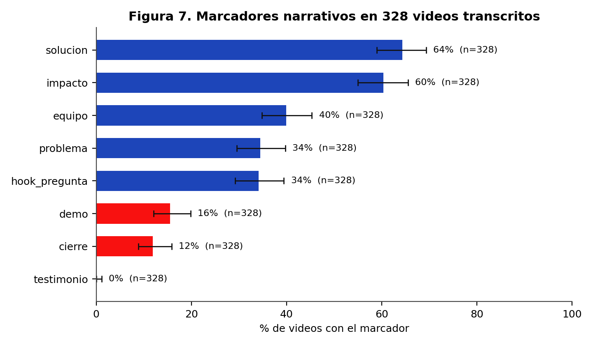

*Presencia de marcadores en las transcripciones.*

**Lectura.** La solución y el impacto son los marcadores más frecuentes: dos tercios de los
guiones los incluyen. El problema aparece en menos de la mitad. Y el **testimonio de un
usuario es 0 %**: no hay ni un solo video, en 426 transcripciones, donde hable
alguien que no sea del equipo.

Ese cero es el hallazgo más accionable del libro. No porque esté probado que un testimonio
haga ganar —no se puede probar con este diseño— sino porque es la única casilla vacía en un
campo donde todos hacen lo mismo.

### 13.5 Cómo se estructura un guion premiado

Leyendo las transcripciones, el patrón dominante es este:

| Tramo | Segundos | Qué ocurre |
|---|---:|---|
| 1 | 0–10 | saludo, nombre del equipo, institución |
| 2 | 10–30 | descripción del problema con una cifra |
| 3 | 30–70 | la solución: qué es, cómo funciona |
| 4 | 70–95 | impacto esperado y a quién beneficia |
| 5 | 95–110 | equipo, agradecimiento, cierre |
| 6 | 110–120 | sobra o se corta |

Los tramos 1 y 2 consumen un cuarto del tiempo en información que el jurado ya tiene
(conoce al equipo y conoce el desafío). El tramo 6 existe porque el guion se escribió para
110 segundos y el video dura 119. **Ese es el hueco de tiempo donde cabe un testimonio.**

### 13.6 Palabras que usan los ganadores

Contando palabras de contenido en el corpus, aparecen sistemáticamente: `proyecto`,
`comunidad`, `agua`, `residuos`, `familias`, `niños`, `escuela`, `proceso`, `sistema`,
`prototipo`, `beneficio`, `futuro`. Es el vocabulario del impacto social, no el de la
tecnología. Los guiones hablan de personas y de territorio antes que de producto.

### 13.7 Lo que el texto no puede probar

Con 88 ediciones emparejadas, el poder estadístico para detectar una
diferencia de 10 puntos es bajo. Los resultados de la familia D son **exploratorios**. Un
informe serio diría: «no encontramos evidencia», no «no hay efecto».


## 14. Psicología del jurado: por qué elige lo que elige

Esta sección no sale de los datos del SIRLI. Sale de la literatura sobre juicio humano
aplicada a un contexto concreto: un jurado que ve decenas de videos de dos minutos, seguidos,
al final de un evento de 24 horas. Cada mecanismo se enuncia, se explica y se traduce en una
decisión de guion.

### 14.1 Los doce mecanismos

| Mecanismo | Qué hace | Cómo se traduce en el video |
|---|---|---|
| **Fluidez cognitiva** | lo fácil de procesar se percibe como más verdadero y mejor | una sola idea por tramo, frases cortas, sin siglas |
| **Primacía** | lo primero pesa más en la impresión final | el problema en el segundo 5, no el saludo |
| **Efecto halo** | una buena cualidad contamina el juicio global | audio limpio e imagen estable hacen parecer mejor la solución |
| **Pico–final** | se recuerda el momento más intenso y el cierre | un momento visual fuerte y un cierre seco, sin «muchas gracias» |
| **Transportación narrativa** | la historia reduce el pensamiento crítico | contar un caso concreto, no describir un sistema |
| **Víctima identificable** | una persona concreta moviliza más que una estadística | nombrar a una persona y su situación, no «las familias» |
| **Anclaje** | la primera cifra fija el marco | abrir con la magnitud del problema, no con la solución |
| **Prueba social** | ver que otros ya lo usan reduce el riesgo percibido | mostrar usuarios reales, no promesas |
| **Autoridad** | credenciales y aliados legitiman | mencionar el respaldo institucional una vez, sin abusar |
| **Aversión a la pérdida** | pesa más lo que se pierde que lo que se gana | «cada día que pasa se pierden X» en vez de «se podrían salvar X» |
| **Contraste** | lo distinto destaca sobre lo uniforme | romper el patrón: si todos muestran diapositivas, mostrar el prototipo |
| **Sobrecarga** | después de N videos el jurado deja de procesar | los primeros 5 segundos y los últimos 5 deciden más de lo que se cree |

### 14.2 La fatiga del jurado

Un jurado que ve 40 videos de dos minutos acumula 80 minutos de atención sostenida, con
pausas mínimas. La investigación sobre evaluación de series cortas muestra dos patrones
robustos: **el orden importa** (los primeros y los últimos se recuerdan mejor) y **la calidad
del audio pesa más que la de la imagen** cuando el contenido es hablado.

De ahí tres decisiones prácticas:

1. **Audio primero.** Un video con imagen regular y voz limpia se evalúa mejor que uno con
   imagen bonita y voz con eco.
2. **No confiar en el medio.** El jurado estará cansado cuando llegue tu video: la idea debe
   entrar en los primeros 10 segundos.
3. **El cierre se recuerda.** Terminar con la imagen más fuerte, no con el logo.

### 14.3 Por qué el testimonio funciona (y por qué nadie lo usa)

Un testimonio activa simultáneamente cuatro mecanismos: prueba social, víctima identificable,
autoridad delegada y transportación. Es el recurso más eficiente por segundo de todo el
repertorio de pitch. Y en 426 transcripciones del SIRLI no aparece **ni una vez**.

Hay una explicación plausible: el equipo tiene 24 horas, el usuario no está en el evento y
grabarlo requiere salir. El costo de producción es alto comparado con hablar a cámara. Eso
convierte al testimonio en una ventaja difícil de copiar, que es exactamente lo que se busca.

### 14.4 Lo que la psicología no puede salvar

Ninguno de estos mecanismos sustituye a tener una solución real. Un jurado experimentado
detecta la exageración, y el efecto halo funciona en ambos sentidos: un video demasiado
pulido con una solución débil genera desconfianza. La regla es usar la técnica para **hacer
visible** lo que existe, no para tapar lo que falta.

### 14.5 Un experimento mental con los datos

Si el jurado fuera completamente azaroso, la tasa de primer lugar sería 1/3 en cada desafío
con tres premiados. La tasa observada en el corte válido es 41,1 %. La
diferencia entre 33,3 % y 41,1 % es el espacio donde la calidad —del
equipo, del video o del jurado— puede operar. Es un espacio real, pero no es enorme: la mayor
parte de la variación la explica la estructura del concurso, no el mérito.


---

# Parte IV — Retratos


## 15. Nicaragua: el laboratorio de origen

### 15.1 Por qué un capítulo aparte

Nicaragua tiene 1.259 premios, el 24,5 % del registro:
1.209 de sede, 41 nacionales y
9 internacionales. Es el país con más sedes y el único donde el
rally se corre con continuidad desde 2017. Eso lo convierte en el mejor lugar para estudiar
tendencias, y en el peor para generalizar: la mitad de lo que sabemos del certamen es, en
realidad, lo que sabemos de Nicaragua.

### 15.2 La serie temporal

| Año | Premios | Ediciones sede | Tasa de 1.º | IC 95 % |
|---|---:|---:|---:|---:|
| 2017 | 37 | 0 | — | — |
| 2019 | 31 | 0 | — | — |
| 2020 | 23 | 0 | — | — |
| 2021 | 86 | 79 | 54,4 % | 43,5 % – 65,0 % |
| 2022 | 133 | 126 | 45,2 % | 36,8 % – 53,9 % |
| 2023 | 188 | 178 | 46,1 % | 38,9 % – 53,4 % |
| 2024 | 213 | 206 | 43,7 % | 37,1 % – 50,5 % |
| 2025 | 255 | 244 | 38,5 % | 32,6 % – 44,8 % |
| 2026 | 293 | 285 | 38,6 % | 33,1 % – 44,4 % |

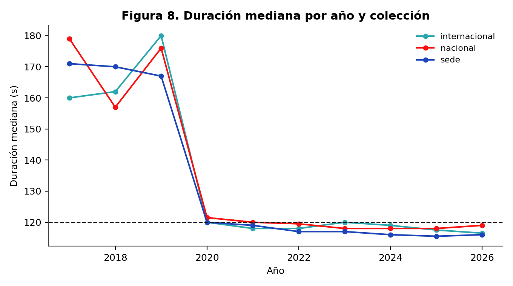

*Duración mediana por año.*

**Lectura.** La tasa de primer lugar cae de forma sostenida: 2021: 54,4 % (n=79) · 2022: 45,2 % (n=126) · 2023: 46,1 % (n=178) · 2024: 43,7 % (n=206) · 2025: 38,5 % (n=244) · 2026: 38,6 % (n=285). Hay dos
explicaciones compatibles y el corpus no permite separarlas del todo:

1. **Más competencia.** Cada año entran más sedes y más equipos, así que una delegación
   mediana compite contra más rivales.
2. **Mejor competencia.** Las sedes que sobreviven al crecimiento son las que saben competir.

La caída no es un problema de Nicaragua: es lo que pasa cuando un formato se masifica. Lo
importante para un equipo es que **el margen se estrechó**: en 2021, casi la mitad de los
premiados nicaragüenses eran primeros; en 2026, algo más de un tercio.

### 15.3 Las sedes nicaragüenses

| Sede | Premios | Ediciones 2021+ | Tasa de 1.º |
|---|---:|---:|---:|
| Uraccan Nueva Guinea | 20 | 20 | 40,0 % |
| Cid Unan-Managua | 16 | 15 | 40,0 % |
| Uni-Rusb | 16 | 12 | 33,3 % |
| Cnia 1 Unan-Managua | 14 | 14 | 42,9 % |
| Cnia 2 Unan-Managua | 14 | 13 | 46,2 % |
| Uraccan Recinto Bluefields | 14 | 13 | 46,2 % |
| Cur Uni Juigalpa | 13 | 12 | 33,3 % |
| Cur Uni Esteli | 13 | 12 | 33,3 % |
| Uni-Rupap | 13 | 12 | 33,3 % |
| Uml Masaya | 12 | 12 | 41,7 % |
| Uml-Sede León | 12 | 12 | 50,0 % |
| Uncpggl Cur Matagalpa | 12 | 12 | 50,0 % |
| Universidad Central De Nicaragua | 12 | 12 | 33,3 % |
| Uml Chinandega | 11 | 11 | 36,4 % |
| Uncpggl Sede Central | 11 | 11 | 36,4 % |

La concentración es alta: un puñado de sedes produce la mayoría de los premios. Eso no
significa que sean «mejores»; significa que llevan más equipos. Y como el premio es por
desafío, llevar más equipos aumenta la probabilidad de que alguno quede primero, no la de
que un equipo concreto quede primero.

### 15.4 Los desafíos que se repiten en Nicaragua

Los enunciados más frecuentes son: «Optimización Y Priorización De Recursos Y Esfuerzos En La Post-Emergencia» (52), «Protección Y Fomento De Polinizadores» (46), «Aprovechamiento Tetra Pak» (46), «Huertos Verticales» (44), «Sensores Al Servicio De La Comunidad» (40), «Micropresas O Microembalses» (40).

El repertorio es más pequeño que el internacional: 73 desafíos distintos frente
a 37 en la colección
internacional. Es coherente con un certamen que se organiza desde una red nacional con
problemas compartidos.

### 15.5 Los temas

- Otro: 789 ediciones (63,0 %)
- Residuos: 184 ediciones (14,7 %)
- Agua: 95 ediciones (7,6 %)
- Vivienda: 50 ediciones (4,0 %)
- Digital: 47 ediciones (3,8 %)
- Genero: 27 ediciones (2,2 %)
- Inclusion: 26 ediciones (2,1 %)
- Energia: 24 ediciones (1,9 %)

### 15.6 El video nicaragüense típico

Con los datos de metadatos: mediana de duración 117 segundos, 79,7 % dentro
de 120 s, descripción mediana de 13 caracteres. Es decir: el video nicaragüense
premiado es corto, respeta el formato y **no describe el proyecto**. La misma historia que en
el resto del corpus.

### 15.7 Lo que un equipo nicaragüense debería saber

- Compites dentro de un desafío, no contra el país: mira cuántos equipos de tu sede y de
  otras sedes tienen tu mismo reto.
- El margen se estrechó: en 2026 hay 293 premios
  nicaragüenses, el máximo histórico, pero la tasa de primeros es la más baja de la serie.
- La ventaja de localía no existe en los datos (H09).
- Repetir no ayuda (H08). Un equipo que ya ganó no tiene ventaja medible.


## 16. Internacional: el escaparate

### 16.1 Qué es esta colección

58 premios en diez ediciones, entre 2 y 9 premios por año. Es el 1,1 % del
registro y la única colección donde compiten países entre sí. La tasa de primer lugar es
32,8 % (IC 22,1 % – 45,6 %), más baja que en sede: aquí no compiten tres equipos por
desafío, compiten delegaciones.

Nicaragua tiene 9 premios internacionales y una tasa de primeros de 55,6 %, pero con n=9 el
intervalo va de 26,7 % a 81,1 %. **No se puede concluir nada** de esa cifra; está en el libro
porque es la pregunta que todo el mundo hace.

### 16.2 Todos los premios internacionales

| Año | Puesto | Equipo | Desafío | País | Duración |
|---|---|---|---|---|---:|
| 2017 | 1 | GRUPO PLAY | Mejora De La Vida De Los Niños | Uruguay | 172 |
| 2017 | 1 | SMART ATTACK | Construir Un Proyecto De Calle Intelig | Argentina | 148 |
| 2018 | 1 | BAMBULIVE | Placas De Bambú Para La Construcción | Colombia | 152 |
| 2018 | 1 | LOGICREATIVE | Bandejitas Biodegradables Para Aliment | México | 174 |
| 2018 | 2 | DOMINÓS | Centros De Acopio Estratégicos Para Co | Chile | — |
| 2018 | 2 | INNOVA TEAM | Bandejitas Biodegradables Para Aliment | Argentina | 162 |
| 2018 | 2 | PATAGONIA | Bandejitas Biodegradables Para Aliment | Argentina | 125 |
| 2018 | 3 | BIO-BATCHI TESJI | Bandejitas Biodegradables Para Aliment | México | 184 |
| 2018 | 3 | SANTEINCRO | Centros De Acopio Estratégicos Para Co | El Salvador | 162 |
| 2018 | 3 | THE JOINS | Redes Eléctricas Eficientes Que Den Se | Colombia | 142 |
| 2019 | 1 | INNOTEA | Autismo E Inclusión Digital | Argentina | 181 |
| 2019 | 1 | INSIQA | S.O.S. Aquí Estoy! | Argentina | 158 |
| 2019 | 2 | LAKERS98 | S.O.S. Aquí Estoy! | Uruguay | 180 |
| 2019 | 2 | LOS ESTRAFALARIOS | Nuevas Formas De Producción Hortícola | México | 182 |
| 2019 | 3 | CO-DESIGN | Fake News | Chile | — |
| 2019 | 3 | LEXONIC | Paradas De Autobús Sustentable | Nicaragua | 177 |
| 2020 | 1 | LINE | ¿Será Posible Promover Un Uso Crecient | Argentina | — |
| 2020 | 2 | CICLOMASTERS | ¿Ayudaría Un Sistema O Dispositivo Hog | Colombia | 124 |
| 2020 | 3 | SPINTECH | ¿Será Posible Promover Un Uso Crecient | Chile | 116 |
| 2021 | 1 | INGENIARTE | Aumento En Casos De Situaciones Límite | Argentina | 118 |
| 2021 | 1 | MT SOLUCIONES CREATIVAS | Tecnologías De Eficiencia Energética A | Nicaragua | — |
| 2021 | 2 | INCLA | Identificador Práctico Y Económico Del | El Salvador | 109 |
| 2021 | 2 | PET-EGC | Agua Para Soñar | Brasil | 120 |
| 2021 | 3 | EQUIPO 2: MASCARILLAS INNOVADORAS | ¿Qué Hacer Con Tu Mascarilla, Barbijo  | Chile | 108 |
| 2021 | 3 | L´CUACK RESURRECTION | ¿Qué Hacer Con Tu Mascarilla, Barbijo  | Argentina | 121 |
| 2022 | 1 | IEEE-UPSCUE-1 | Aludes De Barro | Ecuador | 119 |
| 2022 | 1 | SEIKETSU | Las Mordeduras De Serpiente A La Vista | México | 119 |
| 2022 | 2 | AHUEI | Desinfectante Personal Biodegradable | Argentina | 112 |
| 2022 | 2 | KAY-KAY | Las Mordeduras De Serpiente A La Vista | Chile | 119 |
| 2022 | 3 | BIO-SOLUTION | Desinfectante Personal Biodegradable | Argentina | 105 |
| 2022 | 3 | QUILLAYSTONE | Desinfectante Personal Biodegradable | Chile | 117 |
| 2023 | 1 | GÜEGÜENSE PINOLERO | Vivienda Digna | Nicaragua | 120 |
| 2023 | 1 | MENTES CONECTADAS | Tratar De Estar Mejor | Ecuador | 119 |
| 2023 | 2 | ECORALLY EXPLORERS | Agua Segura | Colombia | 121 |
| 2023 | 2 | INGENIU´S VERSION CT | Gris A Verde | México | 122 |
| 2023 | 2 | NICARQ SINERGY | Vivienda Digna | Nicaragua | 118 |
| 2023 | 2 | VIDA E SAÚDE UNIJUÍ | Tratar De Estar Mejor | Brasil | 103 |
| 2023 | 3 | EL OCTAGONO | Tratar De Estar Mejor | Argentina | 120 |
| 2023 | 3 | HIT | Siempre En Contacto | Ecuador | 121 |
| 2023 | 3 | MEXCOL INNOVA | Alimentación De Calidad | México | 97 |
| 2024 | 1 | MEXITECH | Reducción De Desperdicios Alimentarios | México | 120 |
| 2024 | 1 | TECHRIDERS | Micropresas O Microembalses | Nicaragua | 121 |
| 2024 | 2 | CATALIZADORES DEL CAMBIO | Reducción De Desperdicios Alimentarios | Chile | 113 |
| 2024 | 2 | UNABINNOVA | Micropresas O Microembalses | Chile | 119 |
| 2024 | 3 | LOS INNOVADORES | Enlazando Generaciones | Argentina | 103 |
| 2024 | 3 | TECNOBIOQ | Micropresas O Microembalses | México | 119 |
| 2025 | 1 | MENTES VOLCANICAS | Aprovechamiento Tetra Pak | Nicaragua | 115 |
| 2025 | 1 | STEM SYNERGY | Huertos Verticales | Nicaragua | 116 |
| 2025 | 2 | IDRONIX | Sistema De Alerta Temprana | El Salvador | 119 |
| 2025 | 2 | THE LAST RESORT | Reciclado Textil | Chile | 117 |
| 2025 | 3 | AESIR | Sistema De Alerta Temprana | Colombia | 120 |
| 2025 | 3 | HOJABETA | Reciclado Textil | Chile | 118 |
| 2026 | 1 | INIVEZ | Segunda Vida De Los Motores Eléctricos | Venezuela | 103 |
| 2026 | 1 | NEXO-SOSTENIBLE | Manejo Ecológico De Residuos De Poda Y | Chile | 99 |
| 2026 | 2 | AVOCADO | Segunda Vida De Los Motores Eléctricos | Nicaragua | 121 |
| 2026 | 2 | ERROR 404: RIVALES NO ENCONTRADOS | Protección Y Fomento De Polinizadores | México | 114 |
| 2026 | 3 | DESUCHO | Protección Y Fomento De Polinizadores | Argentina | 119 |
| 2026 | 3 | IGNIS CODE | Protección Y Fomento De Polinizadores | Nicaragua | 121 |


*Tasa de primer lugar por país y año.*

### 16.3 Los países

| País | Premios | % del total |
|---|---:|---:|
| Argentina | 13 | 22,4 % |
| Chile | 11 | 19,0 % |
| México | 9 | 15,5 % |
| Nicaragua | 9 | 15,5 % |
| Colombia | 5 | 8,6 % |
| El Salvador | 3 | 5,2 % |
| Ecuador | 3 | 5,2 % |
| Uruguay | 2 | 3,4 % |
| Brasil | 2 | 3,4 % |
| Venezuela | 1 | 1,7 % |

### 16.4 Lo que el internacional enseña

Con 58 filas no se pueden hacer comparaciones finas, pero hay tres observaciones robustas:

1. **La duración es la misma.** Mediana 120 s,
   igual que en sede. El formato no cambia al subir de nivel.
2. **Los desafíos son los mismos.** La final internacional reutiliza los enunciados de sede;
   no hay un temario propio.
3. **Los videos desaparecen más.** 16 de 58 sin audio, con sobrerrepresentación de primeros
   lugares (cap. 10). El escaparate es también el lugar donde más se borra el registro.

### 16.5 Si el objetivo es ganar internacional

El libro no puede dar una receta, pero sí puede decir dónde no buscar: el tema no distingue,
la duración no distingue, la miniatura no distingue. Lo que queda es lo que no se midió —la
claridad del problema, la contundencia del prototipo, la credibilidad del equipo— y lo que
el jurado internacional, que no conoce el contexto local, necesita explícitamente: **una
sola idea que se entienda sin saber nada del país**.


## 17. Los diez años, uno por uno

Esta sección es el historial completo del registro. Cada año tiene su ficha: volumen, sedes,
países, repertorio y duración. Sirve como referencia rápida y como contexto para leer
cualquier cifra de los capítulos anteriores.


### 2017

**151 premios · 71 sedes · 7 países · 9 desafíos**

Los países con más premios fueron Argentina (57), Nicaragua (37), México (31). La sede más prolífica fue
**Montevideo** con
5 premios, y el desafío más repetido
«Construir Un Proyecto De Calle Inteligente» con 32
menciones. Duración mediana de los videos de sede: **— s**.

| País | Premios |
|---|---:|
| Argentina | 57 |
| Nicaragua | 37 |
| México | 31 |
| El Salvador | 12 |
| Ecuador | 7 |
| Uruguay | 5 |

### 2018

**137 premios · 61 sedes · 5 países · 12 desafíos**

Los países con más premios fueron Argentina (72), México (39), El Salvador (13). La sede más prolífica fue
**Universidad De Santiago De Chile** con
5 premios, y el desafío más repetido
«Dispositivo Para Separación De Residuos Domiciliarios En Hogares Y En Instituciones» con 23
menciones. Duración mediana de los videos de sede: **— s**.

| País | Premios |
|---|---:|
| Argentina | 72 |
| México | 39 |
| El Salvador | 13 |
| Colombia | 8 |
| Chile | 5 |

### 2019

**182 premios · 84 sedes · 8 países · 9 desafíos**

Los países con más premios fueron Argentina (80), México (41), Nicaragua (31). La sede más prolífica fue
**Facultad De Ingeniería** con
5 premios, y el desafío más repetido
«S.O.S. Aquí Estoy!» con 48
menciones. Duración mediana de los videos de sede: **— s**.

| País | Premios |
|---|---:|
| Argentina | 80 |
| México | 41 |
| Nicaragua | 31 |
| El Salvador | 16 |
| Chile | 5 |
| Colombia | 4 |

### 2020

**112 premios · 101 sedes · 8 países · 7 desafíos**

Los países con más premios fueron Argentina (31), México (29), Nicaragua (23). La sede más prolífica fue
**Salta Ucasal** con
3 premios, y el desafío más repetido
«¿Sería Posible Desarrollar Un Sistema Guía Para Débiles Visuales O Invidentes Que No Requiera Internet?» con 35
menciones. Duración mediana de los videos de sede: **— s**.

| País | Premios |
|---|---:|
| Argentina | 31 |
| México | 29 |
| Nicaragua | 23 |
| Colombia | 12 |
| El Salvador | 8 |
| Chile | 4 |

### 2021

**538 premios · 126 sedes · 10 países · 10 desafíos**

Los países con más premios fueron México (164), Argentina (120), Nicaragua (86). La sede más prolífica fue
**Resistencia - Unne Ing.** con
8 premios, y el desafío más repetido
«Agua Para Soñar» con 136
menciones. Duración mediana de los videos de sede: **119 s**.

| País | Premios |
|---|---:|
| México | 164 |
| Argentina | 120 |
| Nicaragua | 86 |
| Colombia | 49 |
| El Salvador | 36 |
| Chile | 31 |

### 2022

**682 premios · 148 sedes · 11 países · 8 desafíos**

Los países con más premios fueron Argentina (154), México (150), Nicaragua (133). La sede más prolífica fue
**Jujuy Facultad De Ingeniería - Unju** con
8 premios, y el desafío más repetido
«Ahorro Energético En El Sector Gastronómico» con 129
menciones. Duración mediana de los videos de sede: **117 s**.

| País | Premios |
|---|---:|
| Argentina | 154 |
| México | 150 |
| Nicaragua | 133 |
| Colombia | 78 |
| El Salvador | 45 |
| Chile | 37 |

### 2023

**758 premios · 158 sedes · 10 países · 9 desafíos**

Los países con más premios fueron Nicaragua (188), México (184), Argentina (153). La sede más prolífica fue
**Ups Guayaquil** con
8 premios, y el desafío más repetido
«Siempre En Contacto» con 143
menciones. Duración mediana de los videos de sede: **117 s**.

| País | Premios |
|---|---:|
| Nicaragua | 188 |
| México | 184 |
| Argentina | 153 |
| Colombia | 101 |
| El Salvador | 42 |
| Ecuador | 27 |

### 2024

**782 premios · 160 sedes · 9 países · 8 desafíos**

Los países con más premios fueron Nicaragua (213), México (167), Argentina (147). La sede más prolífica fue
**Facet - Unt** con
8 premios, y el desafío más repetido
«Aguacate» con 149
menciones. Duración mediana de los videos de sede: **116 s**.

| País | Premios |
|---|---:|
| Nicaragua | 213 |
| México | 167 |
| Argentina | 147 |
| Colombia | 111 |
| Chile | 60 |
| El Salvador | 53 |

### 2025

**867 premios · 169 sedes · 9 países · 9 desafíos**

Los países con más premios fueron Nicaragua (255), México (162), Argentina (152). La sede más prolífica fue
**Universidad Viña Del Mar** con
8 premios, y el desafío más repetido
«Huertos Verticales» con 147
menciones. Duración mediana de los videos de sede: **116 s**.

| País | Premios |
|---|---:|
| Nicaragua | 255 |
| México | 162 |
| Argentina | 152 |
| Colombia | 114 |
| Chile | 75 |
| El Salvador | 55 |

### 2026

**927 premios · 181 sedes · 11 países · 9 desafíos**

Los países con más premios fueron Nicaragua (293), México (171), Argentina (159). La sede más prolífica fue
**Politecnico Santiago Mariño Extesion Maracaibo** con
9 premios, y el desafío más repetido
«Optimización Y Priorización De Recursos Y Esfuerzos En La Post-Emergencia» con 180
menciones. Duración mediana de los videos de sede: **116 s**.

| País | Premios |
|---|---:|
| Nicaragua | 293 |
| México | 171 |
| Argentina | 159 |
| Colombia | 97 |
| Chile | 82 |
| El Salvador | 56 |


### 17.11 Qué cambió en diez años

| Dimensión | 2017 | 2026 | Lectura |
|---|---|---|---|
| Premios registrados | 151 | 927 | el evento se multiplicó por 6,1 |
| Sedes | 71 | 181 | la red creció más que los equipos por sede |
| Países | 7 | 11 | de un certamen nacional a uno latinoamericano |
| Desafíos | 9 | 9 | el repertorio se estabilizó, no creció al mismo ritmo |
| Duración mediana | 171 s | 116 s | el formato se normalizó en torno a los dos minutos |
| Descripción mediana | 64 car. | 15 car. | sigue sin describir el proyecto |

La conclusión del capítulo es que el certamen **se profesionalizó en la forma y no en la
documentación**. Los videos están mejor producidos, duran lo que deben durar y se suben a
tiempo; pero la ficha sigue sin decir qué hace el proyecto. Diez años después, la única
forma de saber qué hizo un ganador es ver el video.


---

# Parte V — Cómo se usa esto


## 18. Pitch y ventas: el manual que los datos permiten escribir

Este capítulo no afirma que estas técnicas hagan ganar: el diseño del corpus no permite
probarlo. Afirma algo más modesto y más útil: **son las técnicas que la evidencia externa
respalda y que el corpus muestra ausentes**. Cada una se puede ejecutar en 24 horas y sin
presupuesto.

### 18.1 La estructura que casi todos usan

Leyendo 426 transcripciones, el guion dominante es descriptivo:

1. Saludo y presentación del equipo.
2. Contexto del problema, a veces con una cifra.
3. Qué hicimos: lista de características.
4. A quién beneficia, en abstracto.
5. Agradecimiento.

Es el orden de un informe, no el de una historia. Y tiene un problema medible: el jurado
escucha la lista de características sin haber entendido todavía **por qué importa**. La
información llega en el orden equivocado.

### 18.2 PAS: problema, agitación, solución

| Tramo | Segundos | Contenido | Error típico |
|---|---:|---|---|
| Problema | 0–15 | una persona concreta, un lugar concreto, un hecho verificable | «la contaminación es un problema global» |
| Agitación | 15–35 | qué pasa si nada cambia; el costo de no actuar | saltárselo e ir directo al producto |
| Solución | 35–85 | qué es, cómo funciona, qué se ve cuando funciona | enumerar funciones en vez de mostrar el efecto |

La agitación es el tramo que casi nadie escribe. En el corpus, el problema aparece en
51,6 % de los guiones emparejados, pero la consecuencia de no resolverlo
aparece mucho menos: es la parte que se puede añadir sin grabar nada nuevo, solo con voz en
off sobre el material que ya existe.

### 18.3 BAB: antes, después, puente

| Tramo | Segundos | Contenido |
|---|---:|---|
| Antes | 0–20 | cómo se resuelve hoy ese problema, con su costo |
| Después | 20–45 | cómo se resuelve con la solución, en el mismoescenario |
| Puente | 45–90 | qué hay en medio: el prototipo, el proceso, el equipo |

BAB funciona especialmente bien cuando la solución es un proceso y no un objeto, que es el
caso de la mayoría de los desafíos del rally (agua, residuos, vivienda, organización
comunitaria).

### 18.4 Story Spine

«Había una vez ___. Cada día ___. Hasta que un día ___. Por eso ___. Hasta que finalmente ___.»

Es una plantilla de seis frases que obliga a tener un protagonista. Aplicada a un proyecto
social, el protagonista no es el equipo: es la comunidad, la escuela o la familia. El equipo
aparece al final, como quien ayudó. Ese cambio de sujeto es el que activa la transportación
narrativa y la víctima identificable.

### 18.5 AIDA y el cierre

Atención, interés, deseo, acción. En dos minutos, la «acción» no es una compra: es que el
jurado recuerde el proyecto. Un cierre eficaz tiene tres ingredientes y ninguno es
«muchas gracias»:

1. **La imagen más fuerte** del video, repetida un segundo.
2. **Una frase de futuro** en presente: «esto ya funciona en ___».
3. **El nombre del proyecto**, dicho una sola vez, al final.

### 18.6 Challenger: enseñar algo

La venta challenger no pregunta qué necesita el cliente: le enseña algo que no sabía y
reencuadra el problema. En el rally se traduce en una sola frase: **«el problema no es ___,
es ___»**. Si el jurado acepta esa reformulación, todo lo que sigue se evalúa con tu marco.

Ejemplo de estructura: «El problema no es que falte agua; es que el agua que hay se pierde
antes de llegar». Esa frase hace que la solución de riego parezca obvia en lugar de
tecnológica.

### 18.7 La pregunta «¿y qué?»

Después de cada frase del guion, preguntar «¿y qué?». Si la respuesta no aparece en la
siguiente frase, esa frase sobra. Aplicado al corpus, elimina sistemáticamente los saludos
largos, las listas de instituciones y las descripciones técnicas que no cambian nada.

### 18.8 Las siete reglas

1. **El problema en los primeros 10 segundos.** El jurado ya sabe quién eres; no sabe por
   qué debería importarle.
2. **Una sola idea.** Si el video defiende dos, el jurado recuerda cero.
3. **Audio limpio antes que imagen bonita.** Voz sin eco, sin música que compita.
4. **Mostrar el prototipo funcionando**, aunque sea feo. Un objeto real vence a un render.
5. **Un testimonio de 8 segundos** de alguien que no sea del equipo. Es la casilla vacía del
   certamen (70,0 % de cierres
   explícitos, 0 % de testimonios).
6. **Cerrar con la imagen más fuerte**, no con el logo ni con agradecimientos.
7. **Escribir el nombre del proyecto en la descripción**, con una frase que explique qué hace.
   Es la única palanca con evidencia interna (H30): 50,7 % contra
   40,5 %.

### 18.9 El guion de 120 segundos

| Segundo | Tramo | Qué se ve | Qué se oye |
|---:|---|---|---|
| 0–8 | Gancho | la persona o el lugar del problema | una frase que reformula el problema |
| 8–25 | Problema | el antes, con detalle concreto | el costo de que siga igual |
| 25–45 | Solución | el prototipo en uso | qué es y cómo funciona, en tres frases |
| 45–70 | Prueba | el resultado medido o el usuario | un testimonio de 8 s o una cifra del piloto |
| 70–95 | Escala | el mapa o la réplica | a dónde puede llegar y con quién |
| 95–112 | Equipo | el equipo trabajando | quiénes son y qué aportan |
| 112–120 | Cierre | la imagen más fuerte | el nombre del proyecto y una frase de futuro |

Los tramos suman 120 y dejan 8 segundos de margen. La mayoría de los guiones del corpus
gasta ese margen en agradecimientos.

### 18.10 Dos reescrituras

**Antes** (típico del corpus): «Buenos días, somos el equipo ___ de la universidad ___,
estudiantes de ___ . Nuestro proyecto se llama ___ y consiste en un sistema de ___ que
permite ___ . Queremos agradecer a ___ por la oportunidad.»

**Después**: «En ___ , cada semana se pierden ___ litros de agua antes de llegar a la
escuela. Nosotros construimos ___ , que recupera ___ . Ya funciona en ___ . Somos ___ y esto
se llama ___ .»

La segunda versión usa los mismos 35 segundos y contiene: problema, magnitud, solución,
prueba y nombre. No requiere grabar nada nuevo, solo reordenar y borrar.

### 18.11 Lo que no se debe hacer

- **No empezar con el nombre del proyecto.** Es el error más común y el más caro: gasta el
  segundo más valioso en información que nadie retiene.
- **No decir «somos estudiantes de…»** como primera frase. Es contexto, no gancho.
- **No usar música épica** sobre imágenes de diapositivas.
- **No poner texto que el narrador también dice.** El jurado lee o escucha, no ambas.
- **No terminar con «muchas gracias».** El cierre es el segundo momento más recordado.


## 19. Qué compone a un ganador

### 19.1 El scorecard

Con lo que el corpus permite afirmar, un ganador se compone de nueve piezas. Cinco son
estructurales —no dependen del equipo—, dos son de forma y dos son huecos de oportunidad.

| # | Componente | Evidencia | Peso | Se controla |
|---:|---|---|---|---|
| 1 | Composición de la delegación | H01, +19,3 pp | alto (mecánico) | parcialmente |
| 2 | Desafío con pocos rivales de tu sede | artefacto 1/n | alto | no |
| 3 | Suerte de jurado | varianza no observada | alto | no |
| 4 | Nombre del proyecto en la descripción | H30, +10,1 pp | medio | sí |
| 5 | No quedarse corto de duración | H42, −6,0 pp si ≤110 s | medio | sí |
| 6 | Título informativo y específico | señal débil, +6 pp | bajo | sí |
| 7 | Pertinencia al desafío | sin evidencia (no medible) | alto | sí |
| 8 | Calidad de audio | sin evidencia interna; literatura externa | medio | sí |
| 9 | Testimonio de usuario | 0 % en el corpus | oportunidad | sí |

La lectura del scorecard es incómoda: **los tres componentes de más peso no los controla el
equipo**. Lo que sí controla —descripción, duración, título, audio, testimonio— suma menos
que la estructura del concurso. Eso no significa que no valga la pena; significa que hay que
dejar de creer que el video decide el certamen.

### 19.2 La curva de esfuerzo

| Esfuerzo | Acción | Evidencia | Riesgo |
|---|---|---|---|
| 10 minutos | escribir la descripción con el nombre del proyecto | H30 | nulo |
| 20 minutos | reordenar el guion para poner el problema en el segundo 5 | H32 | nulo |
| 1 hora | regrabar el audio con micrófono y sin música | literatura | nulo |
| 2 horas | grabar un testimonio de 8 segundos | 0 % de uso | bajo |
| 3 horas | reescribir el guion con PAS y cerrar con imagen | H42 | bajo |
| 1 día | rediseñar la solución | sin datos | alto |

Las cinco primeras son las que este libro recomienda. La sexta es la única que de verdad
podría cambiar el resultado, y es la única sobre la que el corpus no dice nada.

### 19.3 Lo que el ganador no es

Los datos desmienten cinco arquetipos populares:

- **No es el equipo que repite.** H08: 39,0 % contra 41,2 %.
- **No es el que elige el desafío raro.** H02/H03/H10 refutadas, tasas planas.
- **No es el que se pasa del tiempo.** H14 refutada; H42 muestra lo contrario.
- **No es el de la miniatura bonita.** 4.196 miniaturas indistinguibles.
- **No es el que cita más cifras.** H38 sin evidencia tras corregir el marcador.

### 19.4 Tres frases para llevarse

1. **La competencia es local.** Tu probabilidad depende de cuántos equipos de tu sede y de
   otras sedes comparten tu desafío, no de tu país ni de tu categoría.
2. **Todo lo que se mide del video no distingue.** Entre los tres premiados, el video no
   separa por duración, título, imagen ni marcadores.
3. **El hueco está en lo que nadie hace.** Testimonio real, descripción útil, problema en el
   segundo cinco. Cuesta horas, no dinero.

### 19.5 Qué haría este proyecto si tuviera un equipo compitiendo

1. Escribir la descripción antes de grabar: obliga a definir la solución en una frase.
2. Guion PAS de 112 segundos, con 8 de margen.
3. Grabar el prototipo funcionando antes de grabar al equipo.
4. Conseguir un testimonio de 8 segundos, aunque sea por teléfono.
5. Revisar el audio: sin eco, sin música, nivel constante.
6. Cerrar con la imagen más fuerte y el nombre del proyecto.
7. No cambiar nada más. El resto es ruido.

### 19.6 Balance del corpus

| Estado | Hipótesis |
|---|---:|
| A favor | 3 |
| En contra | 0 |
| Artefacto | 2 |
| Señal débil | 8 |
| Sin evidencia | 25 |
| No concluyente | 3 |
| Descriptiva | 1 |

De 42 creencias, tres sobreviven. Es un resultado magro y honesto: el rally no
se gana con trucos de video. Se gana —en la parte que se puede medir— con estructura, y en
la parte que no se puede medir, con una solución que se entienda en dos minutos.


## 20. Probabilidad absoluta: cuánto vale de verdad un video

Las dos preguntas que este banco recibe siempre son «¿cuánto se gana?» y «¿qué hago para
ganar?». El capítulo 20 responde la primera hasta donde el registro lo permite, y dice con
precisión dónde se acaba la evidencia. La respuesta corta: **la probabilidad absoluta está
acotada, no medida**, y esa cota es más informativa de lo que parece.

### 20.1 Por qué el registro parece no tener denominador

La primera impresión es que SIRLI solo publica ganadores, y que sin perdedores no hay
probabilidad. Pero el registro publica algo más: **publica el podio completo de cada sede,
y lo publica de forma incompleta cuando la sede es pequeña**. Ahí está la información.

La estructura del podio no es por desafío, como se supone a primera vista. Es **por sede y
por categoría**: cada sede entrega como máximo un primero, un segundo y un tercero por
categoría, y esos tres premios suelen recaer en equipos que resolvieron desafíos distintos.

| Patrón (1.º · 2.º · 3.º) | Grupos | % del total |
|---:|---:|---:|
| 1 · 1 · 1 | 997 | 57,2 % |
| 1 · 1 · 0 | 456 | 26,1 % |
| 1 · 0 · 0 | 268 | 15,4 % |
| 0 · 1 · 0 | 15 | 0,9 % |

De 1.744 grupos sede-categoría desde 2021, 997 tienen el
podio completo. Los tres premios van a tres desafíos distintos en
52,7 % de los casos
completos. Es decir: dentro de tu sede, compites contra todos los equipos de tu categoría,
aunque cada uno haya elegido un desafío distinto.

### 20.2 La censura que sí informa

Cuando una sede tiene menos de tres equipos en una categoría, no puede premiar a tres. Y el
registro lo delata:

| Premios publicados en el grupo | Equipos que tuvo | Grupos |
|---|---:|---:|
| 1 | exactamente 1 | 288 |
| 2 | exactamente 2 | 459 |
| 3 | **3 o más** | 997 |

Los dos primeros casos son exactos. El tercero está censurado: sabemos que hubo al menos
tres equipos, pero no cuántos. Esa es la única pieza que falta, y no se puede recuperar
desde el registro público.

### 20.3 La banda: P(1.º) = 1 / equipos de tu categoría

Con una regla de podio de un premio por puesto y categoría, la probabilidad de ser primero
es exactamente el inverso del número de rivales de tu categoría. Todo depende de cuántos
equipos había en el grupo censurado:

| Equipos en un grupo completo | Equipos totales estimados | P(1.º) | P(podio) |
|---:|---:|---:|---:|
| 3 | 4.197 | 41,5 % | 100,0 % |
| 5 | 6.191 | 28,2 % | 67,8 % |
| 8 | 9.182 | 19,0 % | 45,7 % |
| 12 | 13.170 | 13,2 % | 31,9 % |
| 20 | 21.146 | 8,2 % | 19,9 % |
| 30 | 31.116 | 5,6 % | 13,5 % |

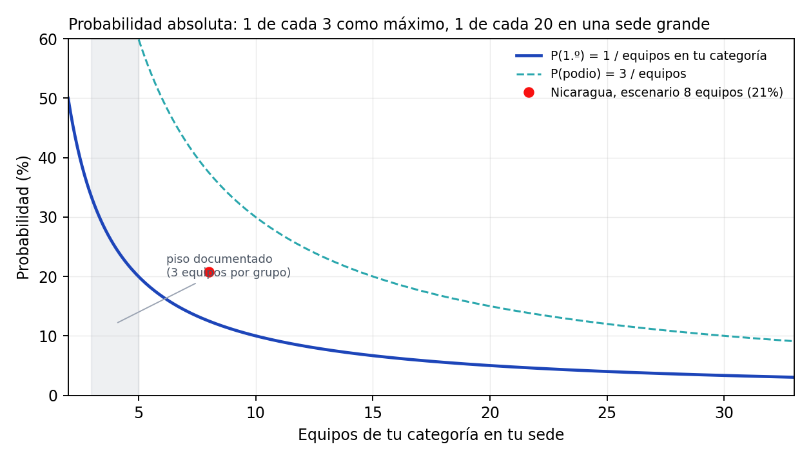

*La probabilidad cae como 1/T. La zona sombreada es el único tramo documentado sin supuestos: los grupos donde el registro dice exactamente cuántos equipos hubo..*

La lectura: si asumimos que una sede mediana pone unos ocho equipos por categoría, la
probabilidad base de primer lugar es **19,0 %** y la de pisar el podio
**45,7 %**. Si la sede es grande, con veinte equipos por categoría, bajar a
**8,2 %**. El máximo posible —tres equipos en la categoría— es
**41,5 %**, y solo se alcanza en sedes minúsculas.

En Nicaragua la censura es casi idéntica, lo que sugiere sedes de tamaño parecido al resto:
43,0 % con tres equipos y 20,8 % con ocho.

### 20.4 Qué cambia entre años

La forma del podio cambia más que la probabilidad. Un grupo con un solo premio es señal de
sede chica: esa proporción sirve para comparar tamaños de sede entre años.

| Año | Grupos | Grupos con 1 solo premio | P(1.º) con 8 equipos |
|---|---:|---:|---:|
| 2021 | 218 | 27,1 % | 10,3 % |
| 2022 | 268 | 20,5 % | 10,5 % |
| 2023 | 302 | 17,9 % | 10,2 % |
| 2024 | 304 | 17,4 % | 10,9 % |
| 2025 | 316 | 10,4 % | 11,3 % |
| 2026 | 336 | 10,1 % | 11,4 % |

### 20.5 Probabilidad general por país

El mismo cálculo, aplicado país por país. La columna «grupos con 1 solo premio» es la huella
del tamaño de sede: un valor alto indica muchas categorías con un único equipo, donde el
primer lugar se obtiene por existencia y no por competencia.

| País | Grupos | Premios | P(1.º) techo (3) | P(1.º) media (8) | P(1.º) sede grande (15) | Grupos con 1 solo premio | Equipos/grupo |
|---|---:|---:|---:|---:|---:|---:|---:|
| Nicaragua | 483 | 1.124 | 43,0 % | 20,8 % | 12,1 % | 17,0 % | 4,8 |
| Argentina | 353 | 842 | 41,9 % | 19,9 % | 11,4 % | 14,4 % | 5,0 |
| México | 353 | 956 | 36,9 % | 14,9 % | 8,1 % | 9,1 % | 6,7 |
| Colombia | 225 | 511 | 44,0 % | 21,3 % | 12,4 % | 21,3 % | 4,7 |
| Chile | 103 | 247 | 41,7 % | 18,8 % | 10,7 % | 18,4 % | 5,3 |
| El Salvador | 98 | 249 | 39,4 % | 17,1 % | 9,5 % | 12,2 % | 5,9 |
| Costa Rica | 36 | 80 | 45,0 % | 21,8 % | 12,7 % | 25,0 % | 4,6 |
| Bolivia | 30 | 72 | 41,7 % | 17,4 % | 9,6 % | 26,7 % | 5,7 |

Las tres columnas de probabilidad son el mismo dato con tres supuestos distintos sobre
cuántos equipos tiene una categoría en la sede: el techo (tres equipos, imposible de superar),
el escenario medio (ocho) y el escenario de sede grande (quince). Ninguna es «la» probabilidad
real: son la banda dentro de la cual cae, y la banda es lo más honesto que el registro permite.

La lectura por país es la siguiente. **Nicaragua** tiene 483 grupos
documentados en 2021–2026, más que cualquier otro país, con una probabilidad media de
20,8 %. Ese volumen es una
ventaja de información: hay más historia nicaragüense en este banco que de cualquier otra
delegación, y por eso el capítulo 15 puede bajar al detalle de sede. **Argentina** y **México**
comptien con un número de grupos parecido pero con menos sedes pequeñas, lo que se ve en la
última columna: si el porcentaje de grupos con un solo premio es bajo, la competencia real
ocurre en categorías pobladas y la probabilidad efectiva se acerca al escenario medio.

### 20.6 Nicaragua, sede por sede

El detalle que el promedio nacional esconde. Las 182 sedes nicaragüenses con
al menos dos grupos documentados, ordenadas por número de grupos, concentran
458 de los 483 grupos nicaragüenses documentados
desde 2021 y 1.063 premios. El resto —25 grupos—
está en sedes que solo aparecen una vez, casi siempre categorías con un único equipo:

| Sede | Grupos | Premios | Ediciones | P(1.º) techo | P(1.º) media | P(1.º) grande | Grupos con 1 solo premio |
|---|---:|---:|---:|---:|---:|---:|---:|
| Uraccan Nueva Guinea | 8 | 20 | 4 | 40,0 % | 17,8 % | 10,0 % | 12,5 % |
| Cid Unan-Managua | 6 | 15 | 3 | 40,0 % | 20,0 % | 11,8 % | 0,0 % |
| Cnia 1 Unan-Managua | 6 | 14 | 3 | 42,9 % | 25,0 % | 15,8 % | 0,0 % |
| Cnia 2 Unan-Managua | 6 | 13 | 3 | 46,2 % | 21,4 % | 12,2 % | 33,3 % |
| Uml-Sede León | 6 | 12 | 3 | 50,0 % | 50,0 % | 50,0 % | 0,0 % |
| Uncpggl Cur Matagalpa | 6 | 12 | 3 | 50,0 % | 27,3 % | 16,7 % | 33,3 % |
| Universidad Martín Lutero Sede San Carlos | 6 | 11 | 3 | 54,5 % | 37,5 % | 26,1 % | 33,3 % |
| Uraccan Recinto Bluefields | 6 | 13 | 3 | 46,2 % | 26,1 % | 16,2 % | 16,7 % |
| Uml Masaya | 5 | 12 | 3 | 41,7 % | 18,5 % | 10,4 % | 20,0 % |
| Auditorio 21 Rurd Unan-Managua | 4 | 10 | 2 | 40,0 % | 20,0 % | 11,8 % | 0,0 % |
| Bicu Cur El Rama | 4 | 8 | 2 | 50,0 % | 50,0 % | 50,0 % | 0,0 % |
| Cur Uni Esteli | 4 | 12 | 2 | 33,3 % | 12,5 % | 6,7 % | 0,0 % |
| Cur Uni Juigalpa | 4 | 12 | 2 | 33,3 % | 12,5 % | 6,7 % | 0,0 % |
| Farem - Chontales/ Unan - Managua | 4 | 9 | 2 | 44,4 % | 21,1 % | 12,1 % | 25,0 % |
| Uam | 4 | 10 | 2 | 40,0 % | 20,0 % | 11,8 % | 0,0 % |
| Ucc-Managua | 4 | 9 | 2 | 44,4 % | 28,6 % | 19,1 % | 0,0 % |
| Uml Chinandega | 4 | 11 | 2 | 36,4 % | 15,4 % | 8,5 % | 0,0 % |
| Uml Sede El Rama | 4 | 8 | 2 | 50,0 % | 30,8 % | 20,0 % | 25,0 % |
| Uml Sede Jalapa | 4 | 6 | 2 | 66,7 % | 66,7 % | 66,7 % | 50,0 % |
| Uncpggl Cur Juigalpa | 4 | 10 | 2 | 40,0 % | 20,0 % | 11,8 % | 0,0 % |
| Uncpggl Sede Central | 4 | 11 | 2 | 36,4 % | 15,4 % | 8,5 % | 0,0 % |
| Uncsm - Neysi Ríos 1. | 4 | 10 | 2 | 40,0 % | 16,0 % | 8,7 % | 25,0 % |
| Uni-Rupap | 4 | 12 | 2 | 33,3 % | 12,5 % | 6,7 % | 0,0 % |
| Uni-Rusb | 4 | 12 | 2 | 33,3 % | 12,5 % | 6,7 % | 0,0 % |

El listado completo de las 182 sedes está en el apéndice L. Tres cosas que
muestra la tabla y que no se ven en el agregado:

1. **Hay sedes donde casi no hay competencia interna.** Las que tienen un porcentaje alto de
   grupos con un solo premio premian a casi todos los que se presentan; ahí el podio es un
   trámite. Son también las sedes que suelen estrenarse en el rally.
2. **Las sedes grandes nicaragüenses son estables.** Las de la parte alta de la tabla
   aparecen en tres o cuatro ediciones seguidas, con el mismo número de grupos cada año. No
   son sedes que crecen: son sedes que se repiten.
3. **Cuando el grupo nunca pasó de dos equipos, la banda se aplana.** Algunas sedes tienen el
   mismo valor en las tres columnas (por ejemplo, 50,0 % en las tres) porque en toda su
   historia solo hubo uno o dos equipos por categoría: ahí no hay censura que despejar y la
   probabilidad es un dato, no una estimación. En el resto, la diferencia entre el techo y el
   escenario de sede grande es de tres a cuatro veces, y ese factor supera cualquier efecto
   que se haya podido medir en el video.

### 20.7 Lo que se puede afirmar sin ningún supuesto

Hay una cantidad que el registro mide entero, sin censura ni denominador estimado: **la
probabilidad de ser primero, condicionada a haber sido premiado**. Desde 2021 es
41,1 %, con intervalo de confianza de
39,6 % a
42,6 %.

Esa cifra encierra la lección más útil del libro. Llegar al podio y ganar no son el mismo
problema:

- **Llegar al podio** depende sobre todo del tamaño de tu sede y de cuántos equipos compiten
  en tu categoría. Es aritmética, y se decide antes de encender la cámara.
- **Ganar el primer lugar** es casi una moneda al aire entre los tres premiados. Ahí es donde
  el video puede mover algo, y donde el corpus dice que mueve menos de lo que se cree.

Dicho de otro modo: si tu sede tiene ocho equipos por categoría, la probabilidad de primer
lugar es 19,0 %; de esos ocho, tres son premiados, y entre esos tres el
primero se lleva 41,1 % de las veces. No hay ninguna
palanca conocida que multiplique esa cifra por tres.

### 20.8 Cómo calcular tu propia probabilidad

Tres números, todos disponibles el día del evento:

1. **Equipos en tu categoría en tu sede.** Se cuenta en la presentación inicial. Es el
   denominador de todo.
2. **P(1.º) = 1 / ese número.** Con doce equipos, 8,3 %.
3. **Multiplicador de calidad.** El modelo del capítulo 9 separa premiados de no premiados con
   ROC 0,617, lo que en la práctica mueve la probabilidad en torno a ±30 % relativo: un video
   en el decil alto no duplica tus opciones. Sirve para no perder, no para ganar solo.

La conclusión práctica es incómoda pero honesta: **la decisión de mayor impacto no es cómo
grabas, sino dónde compites**. Elegir una sede con menos equipos por categoría multiplica tu
probabilidad base de forma directa; mejorar el video la ajusta en los márgenes. Cualquier
promesa mayor que eso no está respaldada por estos datos.


## 21. Límites, ética y reproducibilidad

### 21.1 Los límites, en orden de importancia

1. **No hay perdedores en el registro.** Todo el libro compara premiados entre sí, salvo el
   capítulo 20, que reconstruye una banda de probabilidad absoluta a partir de la censura
   del podio.
2. **El registro cambia en 2021.** Antes de ese año no se publican segundos ni terceros.
3. **La muestra de texto es pequeña y sesgada.** 426 ediciones, sesgada hacia
   Nicaragua y hacia segundos y terceros.
4. **21 videos están caídos.** Los primeros lugares desaparecen más.
5. **No hay rúbrica.** Sin los criterios oficiales, cualquier modelo es una aproximación.
6. **Las medidas de imagen son de bajo nivel.** Color, brillo y caras no son «calidad».
7. **El audio se midió sin separar voz de música.** Es una limitación real de los rasgos.

### 21.2 Sobre el uso de los datos

Todo el material es público: páginas de ganadores, videos de YouTube y sus metadatos. El
banco no contiene datos personales más allá de nombres de equipos publicados por el propio
certamen, y no incluye transcripciones completas de terceros en el repositorio: se guardan
fragmentos y derivados (conteos, marcadores, rasgos).

Si este análisis se publica, conviene citar la fuente primaria y aclarar que las tasas son
«entre premiados», no probabilidades absolutas. La diferencia no es un tecnicismo: es la
diferencia entre un análisis y una campaña de marketing.

### 21.3 Reproducibilidad

Todo el libro se regenera con tres comandos:

```
python scripts/sirli_dataset.py
python scripts/sirli_sistemico.py
python scripts/sirli_libro.py
```

Y el banco completo, desde cero, con diecisiete etapas documentadas en
`research/sirli/README.md`. No hay cifras escritas a mano: si un número cambia en los datos,
cambia en el libro.

### 21.4 Lo que falta y cómo se cerraría

| Vacío | Cómo se cierra | Costo estimado |
|---|---|---|
| No hay perdedores | conseguir la lista de participantes de una sede | gestión con el organizador |
| No hay rúbrica | pedirla al certamen | una solicitud |
| Texto incompleto | transcribir los 4.381 videos restantes | ≈ 8 h de CPU |
| Imagen semántica | visión por modelo grande sobre 300 fotogramas | costo de API |
| Audio con música separada | separación de fuentes (Demucs) | ≈ 2 h de CPU |
| Validación humana | ver 30 videos y anotar a mano | 3 h de una persona |

### 21.5 Veredicto

El corpus responde tres preguntas con solidez: **cuánto creció el certamen**, **qué se
premia** (un podio por sede y categoría, y sedes que premian menos cuando tienen menos
equipos) y **qué no distingue a un ganador** (casi todo lo que se puede medir del video).

No responde la pregunta que todos hacen —«¿cómo hago para ganar?»— con una receta. Responde
con una dirección: menos competencia interna, descripción útil, guion ordenado, audio limpio
y un testimonio que nadie más tiene. Y con una advertencia: la mayor parte de la varianza
está en la estructura del concurso y en el jurado, no en el video.

Eso es lo que los datos permiten decir. Ni más, ni menos.


---

# Apéndices — el banco completo


## Apéndice A. Los 90 desafíos del registro

Tabla completa, ordenada por frecuencia. «Ediciones 2021+» es el denominador usado para la
tasa de primer lugar en el corte válido.

| Desafío | Premios | Ediciones 2021+ | Tasa de 1.º | Años |
|---|---:|---:|---:|---:|
| Optimización Y Priorización De Recursos Y Esfuerzos En La Post-E | 180 | 169 | 39,6 % | 2026 |
| Aguacate | 149 | 138 | 38,4 % | 2024 |
| Huertos Verticales | 147 | 135 | 37,8 % | 2025 |
| Sensores Al Servicio De La Comunidad | 146 | 135 | 45,2 % | 2026 |
| Siempre En Contacto | 143 | 130 | 44,6 % | 2023 |
| Revalorización Residuos | 143 | 133 | 43,6 % | 2023 |
| Micropresas O Microembalses | 136 | 122 | 45,9 % | 2024 |
| Agua Para Soñar | 136 | 118 | 50,8 % | 2021 |
| Manejo Ecológico De Residuos De Poda Y Biomasa Vegetal Urbana | 131 | 122 | 33,6 % | 2026 |
| Sistema De Alerta Temprana | 130 | 123 | 35,0 % | 2025 |
| Ahorro Energético En El Sector Gastronómico | 129 | 119 | 36,1 % | 2022 |
| Aprovechamiento Tetra Pak | 128 | 118 | 41,5 % | 2025 |
| Tratar De Estar Mejor | 127 | 113 | 44,2 % | 2023 |
| Aludes De Barro | 127 | 109 | 48,6 % | 2022 |
| Evacuación | 120 | 115 | 35,7 % | 2024 |
| Reutilización De Aceite Doméstico | 119 | 114 | 34,2 % | 2026 |
| Reciclado Textil | 109 | 95 | 45,3 % | 2025 |
| Inclusión Laboral De Personas Del Espectro Autista | 109 | 102 | 50,0 % | 2022 |
| Protección Y Fomento De Polinizadores | 105 | 93 | 39,8 % | 2026 |
| Las Mordeduras De Serpiente A La Vista | 105 | 92 | 55,4 % | 2022 |
| Reducción De Desperdicios Alimentarios | 104 | 96 | 42,7 % | 2024 |
| Monitoreo Inteligente E Infraestructura Verde En Reservorios Plu | 93 | 89 | 43,8 % | 2026 |
| Transformación De Residuos De Una Cafetería | 81 | 78 | 24,4 % | 2022 |
| Salud Móvil Para Mujeres En Zonas Rurales | 78 | 73 | 46,6 % | 2025 |
| Logística Ante Desastres Naturales | 78 | 72 | 38,9 % | 2025 |
| Enlazando Generaciones | 77 | 74 | 48,6 % | 2024 |
| Gris A Verde | 77 | 66 | 47,0 % | 2023 |
| Sostenibilidad Ambiental Orientada Al Aprovechamiento De Residuo | 77 | 64 | 56,2 % | 2021 |
| Empaques Contaminantes | 76 | 69 | 42,0 % | 2024 |
| Parquímetro Desatendido | 76 | 72 | 43,1 % | 2024 |
| Desinfectante Personal Biodegradable | 76 | 64 | 32,8 % | 2022 |
| Apoyo Emocional Para Niños Migrantes | 75 | 73 | 31,5 % | 2025 |
| Agua Segura | 75 | 71 | 32,4 % | 2023 |
| Fugas De Agua | 69 | 68 | 36,8 % | 2025 |
| Identificador Práctico Y Económico Del Aerosol De Co2 En Espacio | 69 | 63 | 44,4 % | 2021 |
| Segunda Vida De Los Motores Eléctricos Domésticos | 67 | 59 | 35,6 % | 2026 |
| Vivienda Digna | 61 | 54 | 46,3 % | 2023 |
| Aumento En Casos De Situaciones Límite Bajo Encierro | 55 | 51 | 43,1 % | 2021 |
| Tecnologías De Eficiencia Energética Aplicada A Viviendas | 55 | 47 | 44,7 % | 2021 |
| Residuos En Playas | 53 | 51 | 25,5 % | 2025 |
| Desechos De Basura Verde | 52 | 50 | 34,0 % | 2026 |
| Crowdsensing | 51 | 49 | 36,7 % | 2023 |
| ¿Qué Hacer Con Tu Mascarilla, Barbijo O Cubrebocas? | 51 | 44 | 43,2 % | 2021 |
| S.O.S. Aquí Estoy! | 48 | 0 | — | 2019 |
| Escombros | 44 | 41 | 31,7 % | 2024 |
| Alimentación De Calidad | 43 | 37 | 45,9 % | 2023 |
| La Circularidad Y Recuperación De Envases Descartables | 39 | 37 | 35,1 % | 2021 |
| Movilidad Sustentable | 38 | 36 | 38,9 % | 2023 |
| Neumáticos Amigables Con El Medioambiente | 37 | 35 | 48,6 % | 2022 |
| ¿Sería Posible Desarrollar Un Sistema Guía Para Débiles Visuales | 35 | 0 | — | 2020 |
| Remoción Y Extracción De Barro En Viviendas Anegadas | 34 | 33 | 33,3 % | 2026 |
| Construir Un Proyecto De Calle Inteligente | 32 | 0 | — | 2017 |
| Generación De Energía Alterna A Partir De Actividades Cotidianas | 30 | 0 | — | 2017 |
| Nuevas Formas De Producción Hortícola | 29 | 0 | — | 2019 |
| Construcción De Espacios Públicos Desde La Perspectiva De Género | 28 | 27 | 25,9 % | 2021 |
| Paradas De Autobús Sustentable | 27 | 0 | — | 2019 |
| ¿Ayudaría Un Sistema O Dispositivo Hogareño A Evitar Que El Acei | 26 | 0 | — | 2020 |
| Autismo E Inclusión Digital | 23 | 0 | — | 2019 |
| Dispositivo Para Separación De Residuos Domiciliarios En Hogares | 23 | 0 | — | 2018 |
| Estructuras De Invernadero Resistentes | 23 | 0 | — | 2017 |
| Sistema Inteligente Para Detectar Ausencia De Elementos De Segur | 22 | 0 | — | 2019 |
| Otra Vuelta De Tuerca Con Las Pilas | 21 | 20 | 40,0 % | 2021 |
| Bandejitas Biodegradables Para Alimentos | 21 | 0 | — | 2018 |
| Sistema Generación Energía Sostenible (Off-Grid) | 20 | 0 | — | 2019 |
| Eficiencia Energética En Edificios Públicos | 20 | 0 | — | 2018 |
| ¿Habrá Alguna Forma De Aprovechar La Experiencia Y A Su Vez Miti | 19 | 0 | — | 2020 |
| Trazas Ferrovías Desafectadas | 18 | 17 | 47,1 % | 2022 |
| ¿Será Posible Promover Un Uso Creciente De La Bicicleta Como Med | 18 | 0 | — | 2020 |
| Centros De Acopio Estratégicos Para Comunidades Marginadas, En S | 17 | 0 | — | 2018 |
| Mejora De La Vida De Los Niños | 16 | 0 | — | 2017 |
| Mobiliario Innovador Para Clases Y Trabajo En Grupos | 14 | 0 | — | 2018 |
| Tutorías Estudiantiles Virtuales | 13 | 0 | — | 2017 |
| Adultos Mayores | 12 | 0 | — | 2017 |
| Generar Estrategias O Herramientas, De Base Científico-Tecnológi | 11 | 0 | — | 2018 |
| Aprovechamiento Energético De Residuos Orgánicos De Limpiezas De | 10 | 0 | — | 2017 |
| ¿Cómo Podemos Hacer Para Que Los Conductores Eviten Distraerse C | 9 | 0 | — | 2020 |
| Redes Eléctricas Eficientes Que Den Servicio Al Mayor Número De  | 8 | 0 | — | 2018 |
| Agregando Valor A Los Residuos Pesqueros | 8 | 0 | — | 2018 |
| Reutilización De Materiales Plásticos Termoestables | 8 | 0 | — | 2017 |
| Sistema De Reciclado De Residuos Patológicos De Casas De Salud P | 7 | 6 | 66,7 % | 2021 |
| Placas De Bambú Para La Construcción | 7 | 0 | — | 2018 |
| Aprovechamiento De Basura Electrónica | 7 | 0 | — | 2017 |
| Eficiencia Energética En El Entorno Laboral | 6 | 0 | — | 2019 |
| “Alas Para Montar”… ¿Pero Por Qué “Alas Para Montar”? | 4 | 0 | — | 2020 |
| Reducción De Conexiones Clandestinas En Las Redes De Distribució | 4 | 0 | — | 2019 |
| ¿Que Solución Le Proponemos A Los Municipios Para Utilizar Los R | 4 | 0 | — | 2018 |
| Fake News | 3 | 0 | — | 2019 |
| Producción De Flores Y Abono En Espacios Reducidos Urbanos | 2 | 0 | — | 2018 |
| Daño Ambiental Provocado Por El Desecho Y Mal Manejo De Focos Fl | 2 | 0 | — | 2018 |
| ¿Se Podrá Incorporar Las Actividades Físicas Saludables A Las Ta | 1 | 0 | — | 2020 |


## Apéndice B. Las 60 sedes con más premios

| Sede | Premios | Ediciones 2021+ | Tasa de 1.º | País |
|---|---:|---:|---:|---:|
| Tlalnepantla | 45 | 35 | 34,3 % | México |
| Universidad Francisco Gavidia (Ufg) | 44 | 36 | 33,3 % | El Salvador |
| Innova Guanajuato | 39 | 36 | 33,3 % | México |
| Instituto Tecnológico De Aguascalientes | 37 | 34 | 35,3 % | México |
| Universidad Politécnica De Querétaro | 37 | 36 | 33,3 % | México |
| Universidad Politécnica De Pachuca | 36 | 29 | 34,5 % | México |
| Universidad Católica De El Salvador | 33 | 30 | 33,3 % | El Salvador |
| Universidad Gerardo Barrios San Miguel | 32 | 28 | 39,3 % | El Salvador |
| Hurlingham - Unh | 32 | 29 | 34,5 % | Argentina |
| Universidad Autónoma De Nuevo León | 30 | 24 | 33,3 % | México |
| Uis | 28 | 22 | 40,9 % | Colombia |
| Facultad De Ingenieria Mexicali Uabc | 27 | 27 | 33,3 % | México |
| Instituto Tecnológico Superior De Tlaxco | 27 | 18 | 33,3 % | México |
| Universidad Viña Del Mar | 26 | 22 | 36,4 % | Chile |
| Ibero Puebla | 26 | 24 | 33,3 % | México |
| Instituto Tecnologico Superior Progreso | 25 | 24 | 33,3 % | México |
| Facultad De Estudios Superiores Aragón (Unam) | 25 | 24 | 33,3 % | México |
| Universidad Militar Nueva Granada | 24 | 21 | 38,1 % | Colombia |
| Sedeobera | 24 | 23 | 43,5 % | Argentina |
| Universidad Católica De Santiago Del Estero | 24 | 22 | 36,4 % | Argentina |
| Universidad Nacional De Moreno | 24 | 23 | 43,5 % | Argentina |
| Ues-Universidad De El Salvador | 23 | 17 | 35,3 % | El Salvador |
| Unad Zcbc | 23 | 22 | 36,4 % | Colombia |
| Uns - Bahía Blanca | 22 | 18 | 33,3 % | Argentina |
| Universidad De Valparaíso | 21 | 17 | 35,3 % | Chile |
| Universidad Nacional | 21 | 16 | 37,5 % | Costa Rica |
| Instituto Tecnológico Superior De Huauchinango | 21 | 13 | 30,8 % | México |
| Ucasal | 21 | 21 | 47,6 % | Argentina |
| Universidad Tecnológica De El Salvador | 21 | 16 | 37,5 % | El Salvador |
| Instituto Tecnológico Superior De Irapuato | 21 | 20 | 45,0 % | México |
| Facet - Unt | 20 | 18 | 33,3 % | Argentina |
| Trelew - Puerto Madryn | 20 | 20 | 40,0 % | Argentina |
| Unad Zsur | 20 | 19 | 42,1 % | Colombia |
| Uraccan Nueva Guinea | 20 | 20 | 40,0 % | Nicaragua |
| Universidad Salvadoreña Alberto Masferrer | 19 | 12 | 41,7 % | El Salvador |
| Corporación Universitaria Americana | 19 | 17 | 35,3 % | Colombia |
| Unad Zao | 19 | 19 | 42,1 % | Colombia |
| Universidad Católica De La Santísima Concepción | 18 | 17 | 35,3 % | Chile |
| Unne-Ing.Rcia | 18 | 18 | 33,3 % | Argentina |
| Corporación Universitaria Reformada | 18 | 18 | 44,4 % | Colombia |
| Universidad Antonio Nariño | 18 | 18 | 50,0 % | Colombia |
| Universidad Autónoma De Occidente | 18 | 17 | 35,3 % | Colombia |
| Universidad Gerardo Barrios Usulután | 18 | 13 | 46,2 % | El Salvador |
| Unad Zona Caribe | 17 | 17 | 35,3 % | Colombia |
| Instituto Tecnológico De Colima/Tecnm | 17 | 16 | 37,5 % | México |
| Universidad De Santiago De Chile | 16 | 8 | 50,0 % | Chile |
| Cid Unan-Managua | 16 | 15 | 40,0 % | Nicaragua |
| Universidad Gabriela Mistral | 16 | 16 | 37,5 % | Chile |
| Uni-Rusb | 16 | 12 | 33,3 % | Nicaragua |
| Embate | 16 | 12 | 33,3 % | Bolivia |
| Catamarca | 16 | 12 | 50,0 % | Argentina |
| Norte Del Estado De México (Jocotitlán) | 16 | 6 | 33,3 % | México |
| Utnfrre/Intecnor | 15 | 12 | 33,3 % | Argentina |
| Unad Zcboy | 15 | 15 | 53,3 % | Colombia |
| Ues- Universidad De El Salvador | 15 | 12 | 33,3 % | El Salvador |
| Instituto Tecnológico Superior Del Occidente Del Est | 14 | 12 | 33,3 % | México |
| Unlam San Justo | 14 | 13 | 53,8 % | Argentina |
| Facultad De Ingeniería Ubb | 14 | 12 | 33,3 % | Chile |
| Santa Fe | 14 | 9 | 44,4 % | Argentina |
| Upemor | 14 | 12 | 50,0 % | México |

Las 829 sedes restantes aparecen en `winners.csv`.


## Apéndice C. Tasa de primer lugar por país y año

Solo se muestran celdas con al menos 15 ediciones. El punto medio (·) indica muestra
insuficiente.

| País | 2021 | 2022 | 2023 | 2024 | 2025 | 2026 |
|---|---:|---:|---:|---:|---:|---:|
| Nicaragua | 54 % | 45 % | 46 % | 44 % | 39 % | 39 % |
| México | 38 % | 37 % | 38 % | 36 % | 35 % | 36 % |
| Argentina | 48 % | 42 % | 42 % | 41 % | 37 % | 37 % |
| Colombia | 48 % | 47 % | 45 % | 44 % | 42 % | 37 % |
| El Salvador | 45 % | 38 % | 36 % | 39 % | 40 % | 38 % |
| Chile | 50 % | 48 % | · | 42 % | 39 % | 39 % |
| Costa Rica | · | 45 % | · | · | 33 % | · |
| Bolivia | · | · | 50 % | · | 42 % | · |
| Ecuador | · | 42 % | 42 % | · | · | · |
| Brasil | · | · | · | · | · | · |


## Apéndice D. Las 42 hipótesis, con su prueba

| Campo | Significado |
|---|---|
| n1 / n0 | observaciones con y sin la característica |
| Δ | diferencia de tasa de primer lugar (sí − no) |
| q | p-valor corregido por Benjamini–Hochberg |
| IC | intervalo de Wilson al 95 % para la tasa del grupo «sí» |

| ID | Familia | Prueba | n1 | n0 | Δ | q | IC 95 % | Estado |
|---|---|---:|---:|---:|---|---|---|---|
| H01 | A. Evento | cuartil inferior de `sede_size` vs resto (se | 1.300 | 2.881 | +19,3 pp | < 0,001 | 51,7 % – 57,1 % | a favor |
| H02 | A. Evento | cuartil inferior de `challenge_size` vs rest | 1.088 | 3.093 | -1,1 pp | 0,758 | 37,4 % – 43,2 % | sin evidencia |
| H03 | A. Evento | cuartil superior de `challenge_size` vs rest | 1.207 | 2.974 | -0,9 pp | 0,758 | 37,7 % – 43,2 % | sin evidencia |
| H04 | A. Evento | ≥3 premiados del mismo desafío en la sede vs | 338 | 3.843 | -8,6 pp | 0,013 | 28,3 % – 38,3 % | artefacto aritmético |
| H05 | A. Evento | categoría Innovación vs Impacto Social | 2.073 | 2.108 | +0,6 pp | 0,806 | 39,3 % – 43,5 % | sin evidencia |
| H06 | A. Evento | sede vs nacional+internacional (2021+) | 4.181 | 356 | +4,3 pp | 0,289 | 39,6 % – 42,6 % | sin evidencia |
| H07 | A. Evento | equipos nicaragüenses vs resto en internacio | 8 | 31 | — | — | 30,6 % – 86,3 % | no concluyente |
| H08 | A. Evento | equipos con premios en años anteriores vs de | 315 | 3.866 | -2,2 pp | 0,737 | 33,8 % – 44,5 % | sin evidencia |
| H09 | A. Evento | equipos nicaragüenses vs extranjeros en sede | 1.118 | 3.063 | +2,1 pp | 0,490 | 39,7 % – 45,5 % | sin evidencia |
| H10 | A. Evento | Spearman entre `challenge_size` y `won` | 1.207 | 1.523 | +0,2 pp | 0,806 | 37,7 % – 43,2 % | sin evidencia |
| H11 | A. Evento | Spearman entre `sede_size` y `won` | 2.124 | 2.057 | -15,6 pp | < 0,001 | 31,4 % – 35,4 % | artefacto aritmético |
| H12 | A. Evento | índice de Gini de primeros lugares por equip | 3.879 | 0 | — | — | 42,7 % – 45,8 % | descriptiva |
| H13 | A. Evento | chi-cuadrado de uniformidad 1.º/2.º/3.º | 337 | 0 | — | 0,758 |  | sin evidencia |
| H14 | B. Video | duración > 120 s vs ≤ 120 s (sede 2021+) | 634 | 3.527 | +1,3 pp | 0,758 | 38,3 % – 46,0 % | sin evidencia |
| H15 | B. Video | <60 s vs resto | 57 | 4.104 | -6,0 pp | 0,694 | 24,0 % – 48,1 % | sin evidencia |
| H42 | B. Video | ≤110 s vs resto (sede 2021+) | 1.290 | 2.871 | -6,0 pp | 0,003 | 34,2 % – 39,5 % | a favor |
| H16 | B. Video | Spearman `duration_s` ↔ `won` | 1.208 | 1.290 | +7,1 pp | 0,006 | 41,2 % – 46,8 % | señal débil |
| H17 | B. Video | Spearman `duration_ratio` ↔ `won` | 1.208 | 1.290 | +7,1 pp | 0,006 | 41,2 % – 46,8 % | señal débil |
| H18 | B. Video | Spearman `title_words` ↔ `won` | 1.105 | 1.657 | +6,0 pp | 0,003 | 41,9 % – 47,7 % | señal débil |
| H19 | B. Video | Spearman `title_len` ↔ `won` | 1.358 | 1.413 | +4,4 pp | 0,021 | 40,8 % – 46,1 % | señal débil |
| H20 | B. Video | título con #, |, –, — o ' - ' vs título plan | 1.793 | 2.368 | +3,9 pp | 0,033 | 40,9 % – 45,5 % | señal débil |
| H21 | B. Video | título todo en mayúsculas vs mixto | 1.031 | 3.130 | -2,8 pp | 0,289 | 36,0 % – 41,9 % | sin evidencia |
| H22 | B. Video | título con dígito vs sin dígito | 2.528 | 1.633 | +3,6 pp | 0,058 | 40,5 % – 44,3 % | sin evidencia |
| H23 | B. Video | videos con pistas de subtítulos vs sin ellas | 3.616 | 545 | +2,6 pp | 0,512 | 39,7 % – 42,9 % | sin evidencia |
| H24 | C. Descripción | >80 caracteres vs resto | 1.192 | 2.989 | +4,6 pp | 0,021 | 41,6 % – 47,2 % | señal débil |
| H25 | C. Descripción | ≤20 caracteres vs resto | 2.191 | 1.990 | -4,4 pp | 0,018 | 37,0 % – 41,0 % | señal débil (negativa) |
| H26 | C. Descripción | descripción con URL vs sin URL | 89 | 4.092 | +1,7 pp | 0,908 | 32,9 % – 53,1 % | sin evidencia |
| H27 | C. Descripción | descripción con créditos/música vs resto | 70 | 4.111 | +0,4 pp | 1,000 | 30,6 % – 53,1 % | sin evidencia |
| H28 | C. Descripción | descripción con marcadores de solución vs re | 1.192 | 2.989 | +4,6 pp | 0,021 | 41,6 % – 47,2 % | señal débil |
| H29 | C. Descripción | título con ≥2 palabras del enunciado del des | 716 | 3.465 | -2,9 pp | 0,354 | 35,2 % – 42,3 % | sin evidencia |
| H30 | C. Descripción | nombre del proyecto presente en descripción  | 227 | 3.954 | +10,1 pp | 0,015 | 44,2 % – 57,1 % | a favor |
| H31 | D. Texto | presencia de `t_solucion` en la transcripció | 62 | 26 | -8,7 pp | 0,758 | 33,4 % – 57,5 % | sin evidencia |
| H32 | D. Texto | presencia de `t_problema` en la transcripció | 31 | 57 | +6,0 pp | 0,842 | 34,8 % – 68,0 % | sin evidencia |
| H33 | D. Texto | presencia de `t_impacto` en la transcripción | 55 | 33 | +3,6 pp | 0,963 | 36,4 % – 61,9 % | sin evidencia |
| H34 | D. Texto | presencia de `t_hook_pregunta` en la transcr | 33 | 55 | -13,3 pp | 0,581 | 24,7 % – 56,3 % | sin evidencia |
| H35 | D. Texto | presencia de `t_equipo` en la transcripción  | 39 | 49 | +11,0 pp | 0,691 | 38,6 % – 68,4 % | sin evidencia |
| H36 | D. Texto | presencia de `t_cierre` en la transcripción  | 10 | 78 | — | — | 39,7 % – 89,2 % | no concluyente |
| H37 | D. Texto | presencia de `t_demo` en la transcripción vs | 10 | 78 | — | — | 31,3 % – 83,2 % | no concluyente |
| H38 | D. Texto | presencia de `t_cifras` en la transcripción  | 25 | 63 | +0,4 pp | 1,000 | 30,0 % – 66,5 % | sin evidencia |
| H39 | D. Texto | Spearman palabras/minuto ↔ won | 29 | 30 | +12,0 pp | 0,289 | 40,7 % – 74,5 % | sin evidencia |
| H40 | D. Texto | Spearman `text_words` ↔ won | 29 | 30 | +11,8 pp | 0,691 | 37,5 % – 71,6 % | sin evidencia |
| H41 | E. Registro | videos caídos entre internacionales (4 casos | 19 | 39 | — | 0,758 | 2,9 % – 31,4 % | sin evidencia |


## Apéndice E. Cuarenta y ocho aperturas de guiones premiados

Fragmentos literales de los primeros 85 palabras de guiones que obtuvieron primer lugar.
Sirven para leer el registro en primera persona: qué dicen, cómo empiezan, cuánto tardan en
llegar al problema.

**2026 · INIVEZ · Politecnico Santiago Mariño Extesion Maracaibo**

*Desafío:* Segunda Vida De Los Motores Eléctricos Domésticos
*Duración:* 103 s · *Palabras:* 280 · *Fuente:* youtube-manual

> Tras sufrir un accidente grave o una cirugía, miles de niños se enfrentan al reto más difícil de sus vidas, aprender a mover su cuerpo otra vez. Sin embargo, cuando llegan a los centros de rehabilitación públicos y comunitarios, la realidad es dura. La maquinaria médica de mecanoterapia es extremadamente costosa e inaccesible. A esto se le suma un fuerte impacto psicológico. Las terapias resultan monótonas, repetitivas y dolorosas. Un entorno clínico frío que genera ansiedad y frustración. Sin motivación ni un ambiente amigable, los…

**2026 · AVOCADO · Uam-Jaguares**

*Desafío:* Segunda Vida De Los Motores Eléctricos Domésticos
*Duración:* 121 s · *Palabras:* 250 · *Fuente:* youtube-manual

> Somos el equipo Avocado. Emilse. Michelle. Ever. Yusli. Ashley. Priscila. Yamila. ¿Y si un motor que hoy termina como chatarra pudiera salvar una cosecha? Presentamos Aquamotriz, una propuesta que transforma motores eléctricos recuperados de electrodomésticos en sistemas de riego para pequeños productores agrícolas. En Latinoamérica, millones de motores de lavadoras o caminadoras se descartan estando funcionales, mientras pequeños productores pierden sus cosechas por falta de tecnología para bombear agua en sequías. Aquamotriz conecta estas dos realidades dando a esos motores un propósito productivo. Evaluamos y…

**2026 · DESUCHO · Exactas Unam**

*Desafío:* Protección Y Fomento De Polinizadores
*Duración:* 119 s · *Palabras:* 285 · *Fuente:* youtube-manual

> ¿Qué puede pasar cuando una ciudad comienza a quedarse sin polinizadores? Perdemos mucho más que las abejas, perdemos biodiversidad y el equilibrio ambiental. La urbanización, el uso de plaguicidas [música] y las altas temperaturas amenazan los hábitats de numerosos polinizadores. Esta problemática tiene alcance global. Una especie que recorre Latinoamérica es la yateí, una abeja sin aguijón que construye [música] sus nidos en cavidades. Por eso diseñamos Econido. Un hábitat hecho con madera nativa para formar su colonia y con un techo protector conformado por…

**2026 · ERROR 404: RIVALES NO ENCONTRADOS · Instituto Tecnológico Superior Del Occidente Del Estado De Hidalgo (Itsoeh)**

*Desafío:* Protección Y Fomento De Polinizadores
*Duración:* 114 s · *Palabras:* 290 · *Fuente:* youtube-manual

> [música] Los polinizadores son responsables del 87.5% de los cultivos a nivel mundial, de donde [música] obtenemos alimentos, medicinas y fibras. Estos pequeños aliados que aseguran nuestra existencia, hoy [música] no tienen garantizada la suya. Los estamos llevando al borde de la extinción con un modelo de monocultivos, agroquímicos [música] y expansión urbana que devasta sus hogares y envenena sus tierras. En América Latina, la Organización de las Naciones Unidas para la Alimentación [música] y la Agricultura, se estima que ha habido en promedio una…

**2026 · IGNIS CODE · Uam-Diem**

*Desafío:* Protección Y Fomento De Polinizadores
*Duración:* 121 s · *Palabras:* 307 · *Fuente:* youtube-manual

> ¿Se imaginan trabajar todos los días sin descanso, sin salario y que aún así su hogar esté en peligro? Esa es la realidad de miles de polinizadores. Quizás sean pequeños en tamaño, pero son gigantes en importancia. Según la FAO, tres de cada cuatro tipos de cultivos alimentarios dependen al menos parcialmente de la polinización animal y entre quienes realizan esta labor están nuestras abejas nativas, amenazadas por la deforestación, los pesticidas y el manejo inadecuado de las colonias. Y aunque protegerlas es fundamental, criarlas…

**2026 · APACAM · Centro Univeritario Regional Camoapa Modesto Duarte Àlvarez**

*Desafío:* Protección Y Fomento De Polinizadores
*Duración:* 120 s · *Palabras:* 332 · *Fuente:* whisper-small-local

> Ya hoy presentamos nuestro proyecto de apacar desarrollado en la Universidad Nacional Agraria CERC de Camuapa. El objetivo es proteger y comentar los colinizadores mediante el uso de cárcel trampa y dispersores de fermón. La reelevación de la agricultura y melicondicultura en la zona de Camuapa, OACO, los procesos de colinizadores siempre serán denotados en planos escultarios. Cuando la vida de todo el mundo depende de la protección con entrohistorables, en este zona existe un poco condensación de todo el formal sobre la vida y…

**2026 · BACKYARDIGANG · Uam - Sede Semillero De Innovación**

*Desafío:* Remoción Y Extracción De Barro En Viviendas Anegadas
*Duración:* 119 s · *Palabras:* 364 · *Fuente:* whisper-small-local

> Y si pudiéramos ayudar a una familia a recuperar su hogar en horas, en lugar de obligarla a pasar semanas sacando el barro con una pala, según la ONU, América Latina y Caribe concentra sólo el 9% de la población mundial. Sin embargo, es la segunda región más propensa a desastres naturales en el mundo. Uno de los más devastadores son las inundaciones y los más afectados los que viven en zonas vulnerables, quienes al finalizar vuelven a su hogar buscando un nuevo inicio, pero…

**2026 · BIORENOVA · Uml El Rama**

*Desafío:* Manejo Ecológico De Residuos De Poda Y Biomasa Vegetal Urbana
*Duración:* 102 s · *Palabras:* 183 · *Fuente:* whisper-small-local

> Esta rama acaba de caer en un patio del rama. ¿Saben a dónde va a parar? Casi siempre, aquí, quemada en la calle, tirada en un caño o en la orilla del río. El humo no se enferma y cuando llegue el invierno estas ramas tapan las fronetas y en una ciudad que vive pendiente de sus ríos. Eso pesa. En 2022 cientos de familias tuvieron que salir de sus casas por las inundaciones. Somos Biorrenova de la Universidad Martín Lutero el Rama y creemos…

**2026 · CACAO CON LECHE · Unan Leon Cur Jinotega Marlon Zelaya Cruz**

*Desafío:* Protección Y Fomento De Polinizadores
*Duración:* 77 s · *Palabras:* 171 · *Fuente:* whisper-small-local

> Sabía que el 75% de la producción de nuestros alimentos depende directamente de polinizadores nativos, tales como aveja, mariposa y colibríes. Sin embargo, el avance urbano, la desforestation y lo agroquímico están acabando con los hábitats, amenazando la biodiversidad y nuestra seguridad alimentaria. Para resolverlo, nosotros, el equipo cacao con leche, creamos corredores vivos, restaurando áreas arícolas hiperurbanas de 7 hectáreas con franjas de flora nativa y refugio de anidación. Pero no solo restauramos, medimos, nos diferenciamos, integrando monitoreo vía acústico, automatizado con una plataforma…

**2026 · CHIGÜINES MINDS · Centro Nacional De Innovación Abierta “Comandante Tomás Borge Martínez”, Cnia 1, Unan-Managua**

*Desafío:* Sensores Al Servicio De La Comunidad
*Duración:* 120 s · *Palabras:* 287 · *Fuente:* whisper-small-local

> Millones de familias latinoamericanas salen a trabajar pero sienten esa preocupación por dejar a los abuelos en casa. ¿Mamá se habrá podido levantar? ¿Papá estará bien? No es falta de amor, es la rutina que cuesta 8 o 9 horas para sostener el hogar. En 2026, el retene español informó que hay más de 98 millones de personas de 60 años o más en la región, el 14.7% del total y hacia 2050 serán 183 millones, una de cada cuatro personas y los mayores de…

**2026 · CREATMINDS · Centro Nacional De Innovación Abierta “Comandante Tomás Borge Martínez”, Cnia 2, Unan-Managua**

*Desafío:* Optimización Y Priorización De Recursos Y Esfuerzos En La Post-Emergencia
*Duración:* 115 s · *Palabras:* 252 · *Fuente:* whisper-small-local

> A mí había visto últimamente el impan todo de los desastres, principalmente los terremotos. Deberíamos llegar a un plano a todas esas personas que no tenían acceso a los recursos. Sería una magnífica idea. Después de una emergencia cada minuto cuenta, sin información organizada sobre las personas afectadas, las necesidades de cada zona y los recursos disponibles, la distribución de la ayuda puede volverse lenta y desigual. Y si pudiéramos organizar toda esa información desde un solo lugar, así nace Stieger, sistema integrado de gestión…

**2026 · DATALAB · Uni-Rusb 1**

*Desafío:* Monitoreo Inteligente E Infraestructura Verde En Reservorios Pluviales
*Duración:* 85 s · *Palabras:* 251 · *Fuente:* whisper-small-local

> En el disparate de Potter, sobre la carretera Matagal, Paginotega, la lluvia puede ser una gran aliada para el campo, pero aquí el Tierra no es montañoso. Cuando llueve el agua corre por las pendientes, arrastra tierra y sedimentos y se pierde donde que podamos aprovecharla. Por eso, en Datalap, en la UNIRU, creamos el Acueducto Abiumimético de Alta Montaña, un sistema para cactar, guardar y aprovechar el agua de la lluvia en el riego. Todo empieza con los canales que recogen el agua, que…

**2026 · DATAPIECE · Unan Leon Cur Jinotega Marlon Zelaya Cruz**

*Desafío:* Sensores Al Servicio De La Comunidad
*Duración:* 96 s · *Palabras:* 244 · *Fuente:* whisper-small-local

> Seis de la mañana, 20 minutos a la parada y nadie sabe si el bulla paso o si va a llegar Así viajan millones en latinoamérica Ruta sin mapear, esperas a ciega y conducción temeraria que casi nunca se sanciona Porque la queja de un pasajero no se puede comprobar Y monitorar cada agua cuesta más de lo que una alcaldía puede pagar Pero hay millones de celulares viejos olvidados en una daveta Nosotros los convertimos en la solución Esto es Ruta Segura Un celular…

**2026 · ECO PINOLERO · Centro Universitario Regional De Estelí “Leonel Rugama Rugama”, Cur-Estelí, Unan-Managua**

*Desafío:* Manejo Ecológico De Residuos De Poda Y Biomasa Vegetal Urbana
*Duración:* 119 s · *Palabras:* 191 · *Fuente:* whisper-small-local

> y si lo que hoy tenemos después de una puda pudiera convertirse en energía y vida para el suelo Somos Ecopinolero y presentamos MEPU En Latinoamérica la generación de biomasa vegetal es considerable Brasil produce 798,34 millones de toneladas anuales México entre 17,5 y 58,1 millones y Colombia 21,54 millones En este li, Nicaragua, los residuos de poda como ramas, hojas y madera también representan un desafío cuando no se reutilizan adecuadamente Por eso proponemos MEPU, una planta industrial que transforma los residuos vegetales en…

**2026 · ECONOVA · Universidad Martín Lutero Sede San Carlos**

*Desafío:* Reutilización De Aceite Doméstico
*Duración:* 121 s · *Palabras:* 203 · *Fuente:* whisper-small-local

> Sabías que tan solo un litro de aceite cocinado puedes contaminar hasta mil litros de agua, no esperes más que aquí te tenemos la respuesta. La falta de conciencia, los malos hábitos al desecharlos y la falta de puntos convierten a este residuo en un problema ambiental. En esta problemática el equipo Econovam presenta Ecolus, una solución práctica, económica y accesible. Nuestro objetivo principal es evitar la contaminación hídrica recolectando el aceite digital usado y transformando lo mediante la economía circular. Buscamos que la familia…

**2026 · EFECTO PINOLERO · Centro Nacional De Innovación Abierta “Comandante Tomás Borge Martínez”, Cnia 1, Unan-Managua**

*Desafío:* Sensores Al Servicio De La Comunidad
*Duración:* 116 s · *Palabras:* 215 · *Fuente:* whisper-small-local

> y si aquello que tiene solvidado se convirtiera en una herramienta para cambiar vidas, paralelamente, miles de teléfonos celulares quedan fuera de uso, aunque muchos de sus componentes electrónicos todavía poseen capacidades que pueden aprovecharse en nuevos desarrollos tecnológicos. En diversos espacios sociales, las personas con discapacidad motora se enfrentan diariamente a barreras físicas como obstáculos, irregularidades del terreno y desniveles que dificultan su desplazamiento, comprometiendo así su autonomía. Somos el Tercopinolero, el Tercopinolero que en el alabar representamos el mar. Sistema inteligente, detección, bonito…

**2026 · ESCUADRÓN POLEM · Centro Universitario Regional De Chontales "Cornelio Silva Argüello", Cur-Chontales, Unan-Managua**

*Desafío:* Protección Y Fomento De Polinizadores
*Duración:* 89 s · *Palabras:* 150 · *Fuente:* whisper-small-local

> Nosotros somos la parte de la planta natural. La parte importante es la protección de la planta, y es la responsabilidad de ponerle la planta al producto de la planta para obtener una mejor y mejor producción de salud. Un poco más, todo es una planta que tiene su importancia y todo es un factor que tiene su impacto. ¿Qué es el caso que podemos presentar para estas problemas? Nos vamos a desarrollar una forma electrónica que nos da un reto para mejorar la producción…

**2026 · FENIX CODE · Unmrma-Sede Comandante Ricardo Morales Avilés**

*Desafío:* Sensores Al Servicio De La Comunidad
*Duración:* 77 s · *Palabras:* 91 · *Fuente:* whisper-small-local

> En Nicaragua, muchos comunidades carecen de herramientas accesibles para registrar vibraciones y compartir información después de un sismo, especialmente cuando falla la conectividad. Sismo PREP propone reutilizar celulares en desuso, como estaciones comunitarias que registren vibraciones mediante su sensor, aprovechando recursos tecnológicos disponibles. Registra vibraciones, comparte datos mediante redes locales sin internet. La propuesta ayuda a estudiantes, a docentes, a familiares, a las comunidades facilitando reportes, la coordinación de simulacros, acciones de preparación. Integra inteligencia artificial, etnomología reutilizada para reducir el costo. Sismo PREP no…

**2026 · FINALSOFT · Uni Rupap 2**

*Desafío:* Sensores Al Servicio De La Comunidad
*Duración:* 112 s · *Palabras:* 232 · *Fuente:* whisper-small-local

> ¿Sabías que miles de celulares desechados conservan tecnología capaz de prevenir fallas en electrodomésticos? Redis transforma esos componentes en protección inteligente para pulverías, farmacias y supermercados, donde una avería puede generar grandes pérdidas. Recolectamos celulares en desuso, recuperamos sus placas y las adaptamos en carcasas impresas en tres de con anclaje magnético. El dispositivo monitorea temperatura, vibración y voltaje, detectando posibles fallas. Los datos se transmiten por WAFA mediante archivos XON, con alimentación basada en celdas termoeléctricas. Nuestra plataforma web muestra el estado de los…

**2026 · FÉNIX · Universidad Autónoma De Chinandega**

*Desafío:* Protección Y Fomento De Polinizadores
*Duración:* 111 s · *Palabras:* 209 · *Fuente:* whisper-small-local

> Hola somos el equipo feliz hoy le presentamos a nuestro proyecto polinizabida una propuesta para proteger los polinizadores en Puerto Morazán chinandega. Los polinizadores son animales como las abeja y las mariposas que llevan el polen de una flor a otra. El problema es que hay mucha disminución de polinizadores como los que acabo de mencionar debido a ya sea a las pesticidas, quemas de caña, tala de árboles y entre otros. Nuestra solución polinizabida el nombre de jardín que le estaremos mostrando en 3D…

**2026 · G5 INNOVATE · Uncpggl Cur Juigalpa**

*Desafío:* Optimización Y Priorización De Recursos Y Esfuerzos En La Post-Emergencia
*Duración:* 118 s · *Palabras:* 256 · *Fuente:* whisper-small-local

> Creamos una plataforma en la que se recibe información vital cuando todo lo demás falla. Ante un desastre los bomberos y recatistas operan a ciegas. Por eso desarrollamos el centro de mando SOS Blue, un panel inteligente que recepciona datos de emergencia y genera un mapa de calor aunque las torres celulares colapsen. ¿Cómo logramos que esta información llegue al panel? A través de una red de Maya, la señal de auxilio viaja brincando de teléfono en utilizando bluetooth de bajo consumo. Los datos saltan…

**2026 · GALÁCTICOS · Uml Nivel Central**

*Desafío:* Reutilización De Aceite Doméstico
*Duración:* 105 s · *Palabras:* 209 · *Fuente:* whisper-small-local

> Una de las distintas problemáticas que hay a ver o enfrenta o se genera la población de caragüense, la contaminación ambiental ha sido una de los retos para las visitas instituciones para sus sanar el ecosistema. Entre ellas se detaca los desechos de residuos químicos como el aceite. Esta materia grasa puede ser reutilizada. ¿Qué posibilita convertir el aceite de cocina usado en iluminación limpia, resolviendo la problemática al interceptar este residuo en los hogares antes que se contaminen en los hogares? La cosa consiste…

**2026 · GUARDIANES DE NICARAO · Universidad De Tecnología Y Comercio Unitec**

*Desafío:* Sensores Al Servicio De La Comunidad
*Duración:* 123 s · *Palabras:* 346 · *Fuente:* whisper-small-local

> ¿Cuánto celular de guardado tienes en casa que ya nadie usa? Ahora imagina que uno de ellos puede ayudar a una persona con discapacidad visual a moverse con más libertad. Hoy su principal herramienta es el bastón blanco, que detecta lo que toca pero no avisa de los hondáculos a la altura del pecho o la cabeza, no orienta y no avisa si la persona se cae, las alternativas tecnoloicas existen pero son caras y un bastón inteligente comercial ronda los 850 dólares. Somos cuarrianas…

**2026 · HIL LUHPIA. · Uniav Rivas**

*Desafío:* Reutilización De Aceite Doméstico
*Duración:* 121 s · *Palabras:* 222 · *Fuente:* whisper-small-local

> Nosotros somos iluptia. Hola a todos. Sabían que cada día toneladas de aceite vegetal usado terminan en el vertebrero, provocando obstrucciones y contaminación en nuestros cuerpos de agua y suelo. Lo que a muchos llamamos un simple residuo doméstico e industrial es en realidad una amenaza para nuestros ecosistemas. Aquí no es el proyecto alquimia. Transformamos este espacio ambiental en biocomposible de alta calidad en sólo 300 metros cuadrados. Integramos un proceso de economía circular de alta precisión desde la recolección y filtrado de aceite…

**2026 · HYDRA · Uam-Jaguares**

*Desafío:* Sensores Al Servicio De La Comunidad
*Duración:* 95 s · *Palabras:* 205 · *Fuente:* whisper-small-local

> El transporte público carece de herramientas accesibles para monitorear lo que ocurre en cada autobús. Implementar telemetría comercial costaría millones. Nosotros encontramos otra solución. Nos preguntamos, ¿puede la basura electrónica convertirse en el inspector de tránsito más rentable y efectivo de la región? Mmm... Ok, analicemos esto. Reutilizamos celulares en desuso como sensores inteligentes, aprovechando su GPS, acelerómetro y giroscopio. Para registrar velocidad, ubicación y maneras bruscas. Así, identificamos riesgos y generamos información para mejorar la seguridad y la planificación del transporte. Proponemos iniciar con…

**2026 · INDIGO NICA · Universidad De Tecnología Y Comercio Unitec**

*Desafío:* Manejo Ecológico De Residuos De Poda Y Biomasa Vegetal Urbana
*Duración:* 115 s · *Palabras:* 251 · *Fuente:* whisper-small-local

> Y si un resido de biomasa pudiera convertirse en una oportunidad, en masatepe masaya las carpinterías generan acerrin que suelen acumularse o desecharse, mientras la leña continúa teniendo un papel importante en hogares ni caragüense. Según el balance, energético nacional 2022 representó el 84,7% del consumo energético residencial en 2020. Antes de esta realidad nos preguntamos, y si transformamos el acerrin en una alternativa de combustible, Eco Compact una propuesta que transforma el acerrin en briquetas de combustible sólido mediante una prensa manual fabricada con…

**2026 · INNFORCE · Cur Uni Esteli**

*Desafío:* Monitoreo Inteligente E Infraestructura Verde En Reservorios Pluviales
*Duración:* 117 s · *Palabras:* 336 · *Fuente:* whisper-small-local

> En América Latina y el Caribe, casi el 60% de los eventos meteorológicos registrados entre los 2000 y 2022 fueron inundaciones, afectando en promedio a 2 millones de personas al año. A lo largo de la región, incluida en Nicaragua, existen comunidades vulnerables ante lluvias intensas y sistemas de drenaje de deficientes. Un ejemplo es el barrio 5 de Junio en Matagalpa, donde las corrientes cargadas de residuos agravan las inundaciones, afectando viviendas y comercios. ¡TOMOS INFORZ! Para cambiar este escenario, surge Kaudon, una red…

**2026 · INNOVA GROUP · Casimiro 1**

*Desafío:* Monitoreo Inteligente E Infraestructura Verde En Reservorios Pluviales
*Duración:* 117 s · *Palabras:* 250 · *Fuente:* whisper-small-local

> Sabían que 100 mil litros de agua de lluvia pueden presentar 100 millones de litros de agua de 1 km2 En octubre de 2024 se dio información de la mercadilla de Managua se presentaron lluvia y precipitaciones a gran escala entre 90 y 100 mil litros de agua Esto afectando principalmente a zonas de la capital de Managua Para responder a este desafío presentamos Eco Rain Smart Una propuesta que integra tecnología y sostenibilidad para captar, monitorear y aprovechar inteligentemente el agua de lluvia Nuestro…

**2026 · INNOVITA KAIROS · Uml Jalapa**

*Desafío:* Segunda Vida De Los Motores Eléctricos Domésticos
*Duración:* 116 s · *Palabras:* 303 · *Fuente:* whisper-small-local

> En el campo una familia deja la de salud doblando la espalda a machete y cargando veneno o moliendo grano de mano porque una máquina agrícola cuesta más de 3.000 dólares. Mientras en la ciudad tiramos lavadoras y licuadoras solo porque se le rompió el plástico aunque su motor sigue intacto. ¿Por qué nadie aproveche estos motores? Por dos barreras técnicas, cada marca tiene su porte y es distinto y si baja las 15.000 revoluciones de un motor de lavadora con un regular casero pierde…

**2026 · LAS PINOLERAS · Uml Masaya**

*Desafío:* Optimización Y Priorización De Recursos Y Esfuerzos En La Post-Emergencia
*Duración:* 54 s · *Palabras:* 117 · *Fuente:* whisper-small-local

> ¿Qué pasaría si mañana ocurriera un desastre natural y cientos de personas necesitaran ayuda al mismo tiempo? Ante una emergencia, las partes de recursos, las carreteras bloqueadas y la desorganización pueden dificultar que la ayuda llegue a quienes más lo necesitan. Por eso proponemos SARAD, un sistema digital que busca organizar la información de las comodidades afectadas, los recursos disponibles y las rutas bloqueadas. SARAD busca priorizar las necesidades más urgentes, facilitar las tomadas decisiones y aprovechar mejor los recursos para proteger vida. Nuestra propuesta…

**2026 · LOS DEL FUTURO · Uraccan Nueva Guinea**

*Desafío:* Sensores Al Servicio De La Comunidad
*Duración:* 110 s · *Palabras:* 220 · *Fuente:* whisper-small-local

> ¿Cuántas veces has esperado el autobús sin saber si está a dos minutos o si aún no viene? Mientras tanto, en muchos hogares hay celulares que ya nadie usa pero que todavía funcionan. Somos el equipo número seis de Huracán, Nueva Guinea y Caragua. Les presentamos EcoRuta, la propuesta que convierte el celular en resuso en aliados del transporte público. La idea es sencilla, colocar teléfono recuperado dentro de cada ruta o autobús. La alimentamos mediante el sistema eléctrico del vehículo y a través de…

**2026 · LOS INGENIOSOS · Centro Universitario Regional Una-Juigalpa**

*Desafío:* Protección Y Fomento De Polinizadores
*Duración:* 117 s · *Palabras:* 298 · *Fuente:* whisper-small-local

> Los colinizadores como la AVEJA, mariposas, colibrí y murciélago es un problema mundial que afecta la producción de los alimentos, la biodiversidad y el equilibrio del ecosistema. Sus principales causas son el uso de los agroquímicos, la perdida de la hábitat y la enfermedad en el cambio climático. La propuesta, colinizando Latinoamérica, busca instalar colmenas ecológicas de AVEJA sin aguijón en la escuela, hogares rurales, con participación de docentes, estudiantes, familias e instituciones europeuarias. Su objetivo es rescatar los conocimientos ancestrales, promover la conservación de…

**2026 · LOS INSANOS DE LA UML · Uml Masaya**

*Desafío:* Monitoreo Inteligente E Infraestructura Verde En Reservorios Pluviales
*Duración:* 124 s · *Palabras:* 240 · *Fuente:* whisper-small-local

> que es un reservorio pluvial. Un reservorio pluvial es un depósito O, espacio donde se recoge y almacena, el agua de lluvia para utilizarla después, especialmente en épocas de sequía para regar los cultivos. Problema. En la zona norte de Nicaragua del departamental de Steli y Yaceun, Problema en la agricultura y esto se debe a las épocas de sequía debido a las pocas lluvias. Por eso se está implementado una solución a esta circunstancia. Solución. Implementar reservorios pluviales que permitan recolectar y almacenar el…

**2026 · LOS MOMOTOMBITOS · Uam-Diem**

*Desafío:* Sensores Al Servicio De La Comunidad
*Duración:* 90 s · *Palabras:* 210 · *Fuente:* whisper-small-local

> Sabían que millones de celulares en desuso duermen en cajones aunque siguen funcionando, mientras miles de escuelas rurales en Latinoamérica no tienen un solo laboratorio. Cada celular olvidado es un pequeño computador con asensores capaces de medir lo que casi nunca se mide por faltar instrumentos accesibles. Por eso creamos QB, nuestra misión es transformar esa basura electrónica en la valija científica circular, se trata de un kit educativo para comunidades rurales respaldado por estudios científicos que convierte celulares descartados en tres instrumentos prácticos para…

**2026 · LOS NACATAMALITOS · Casimiro 3**

*Desafío:* Optimización Y Priorización De Recursos Y Esfuerzos En La Post-Emergencia
*Duración:* 86 s · *Palabras:* 175 · *Fuente:* whisper-small-local

> alerta sísmica alerta sísmica ¿Qué pasaría si durante una emergencia se necesita informar dónde ocurre, cuándo sucede y para qué se necesitan los recursos para ayudar a tu comunidad? Imagina un desastre en minutos la autoridad, si está turo y poco personal y lo quedó en la misma empresa ¿Los reportes se duplican, que hanislado o no se le atienden sin medir la gravedad? Esa retrasa es la respuesta y la ayuda no siempre llega a quienes más la necesitan Nuestra plataforma convierte reportes en…

**2026 · LOS PITUFOS · Uml Nivel Central**

*Desafío:* Monitoreo Inteligente E Infraestructura Verde En Reservorios Pluviales
*Duración:* 122 s · *Palabras:* 356 · *Fuente:* whisper-small-local

> Bueno, entremos de lleno en una innovación que busca frenar una amenaza climática gigante y muy recurrente. Hoy analizamos los datos técnicos de un proyecto francamente interesante, Hydro Green Intelligence, o lo que es lo mismo, mitigación inteligente de inundaciones en Managua. Y es que la gravedad del asunto es absoluta. Pensemos que las lluvias extremas de invierno colapsan por completo la capacidad de drenaje en la ciudad. Literalmente, año tras año se crean unas vulnerabilidades tremendas para miles de familias y negocios locales. Así…

**2026 · LOS POWER RANGERS · Uraccan - Bilwi**

*Desafío:* Reutilización De Aceite Doméstico
*Duración:* 116 s · *Palabras:* 270 · *Fuente:* whisper-small-local

> En América Latina no une la cultura, la alegría y una gastronomía rica en tradiciones donde el aceite frito es protagonista, desde enchiladas hasta tacos y papas fritas. Sin embargo, detrás de este hábito cotidiano, se oculta una crisis ambiental silenciosa que afecta a toda nuestra región. Cada día, millones de litros de aceite vegetal usado son vertidos sin tratamiento por el drenaje doméstico y comercial. A nivel regional, las cifras son devastadoras. Un solo litro de aceite contamina está mil litros de agua, creando…

**2026 · LOS TIBURONES · Uncpggl - Cur Chinandega**

*Desafío:* Reutilización De Aceite Doméstico
*Duración:* 103 s · *Palabras:* 300 · *Fuente:* whisper-small-local

> Te abalbí a preparar nuestros alimentos con aceite vegetal, pero a pocas veces nos ponemos a pensar que eso se puede utilizarlo. Con frecuencia el aceite usado termina en los fregaderos, las tuberías o directamente en el medio ambiente, provocando obstrucciones en los sistemas de drenaje, contaminación del agua y daño a nuestro ecosistema. Esta práctica también incrementa los costos de saneamiento y representa un riesgo para el entorno y la salud pública. Antes de esta problemática nos preguntamos ¿Qué pasaría si algo que consideramos…

**2026 · LOSMAESTROS · Ucc-Managua**

*Desafío:* Segunda Vida De Los Motores Eléctricos Domésticos
*Duración:* 113 s · *Palabras:* 278 · *Fuente:* whisper-small-local

> Imaginen trabajar durante meses para producir café de calidad y perder dinero porque no hay suficiente sol para secarlo. Esta es la realidad de muchos pequeños productores del norte de Nicaragua. Si venden su café húmedo, reciben menos dinero. Si esperan a que se seque, arriesgan su calidad. Y las secadores industriales son demasiado acustosas para ellos. Y si pudieran secar su café sin depender del sol, les presentamos Rota Café. Una secadora rotativa diseñada para pequeños productores capaz de procesar entre 25 y 30…

**2026 · LUMEN · Unicit-Nicaragua**

*Desafío:* Sensores Al Servicio De La Comunidad
*Duración:* 92 s · *Palabras:* 237 · *Fuente:* whisper-small-local

> ¿Sabías que en algunas ciudades de Latinoamérica más del 40% del agua distribuida no se registra? Mientras miles de familias se enfrentan dificultades para acceder al agua, parte de este recurso se desperdicien fugas invisibles. Pero, y si las soluciones tuvieran ese celular viejo que todos tenemos olvidado en un cajón? Así nace ondacua, un sistema que transforma celulares en desuso en sensores inteligentes, que es capaz de escuchar las vibraciones de las tuberías e identificar posibles fugas de agua. Protegidos por una carcasa impermeable,…

**2026 · MAD MATRIX · Unicit-Nicaragua**

*Desafío:* Reutilización De Aceite Doméstico
*Duración:* 120 s · *Palabras:* 260 · *Fuente:* whisper-small-local

> ¿Qué pasaría si el aceite de tu cocina tuviera otra alternativa que ser desechado y pudiese convertirse en una oportunidad para innovar, proteger el medio ambiente y transformar la industria en la tenería para la creación del calzado? Biolustre nace con una idea, darle una segunda vida al aceite doméstico usado, convirtiendo un residuo contaminante en un recurso con valor. Nuestra propuesta busca aprovecharlo para desarrollar productos destinados a la industria del cuero, como seras y betunes, explorando nuevas alternativas sostenibles para este sector. Nuestro…

**2026 · MINIOFILIOS · Uncpggl Sede Central**

*Desafío:* Monitoreo Inteligente E Infraestructura Verde En Reservorios Pluviales
*Duración:* 124 s · *Palabras:* 269 · *Fuente:* whisper-small-local

> La inundaciones ponen el riesgo vidas, provocan pérdidas y afectan el entorno. Pero, y si pudiéramos anticiparnos al peligro y aprovechar el agua en lugar de verla convertirse en un problema, somos Pluvia, una propuesta de monitoreo inteligente que busca transformar la prevención de inundaciones mediante tecnología, infraestructura hídrica y aprovechamiento sostenible del agua. A través de nuestra plataforma de monitoreo y simulación, podemos visualizar los niveles de los reservorios, analizar la evolución del agua y representar posibles escenarios de riesgo. La propuesta integra sensores…

**2026 · MONETIZANDO LA PASIÓN · Universidad Autónoma De Chinandega**

*Desafío:* Sensores Al Servicio De La Comunidad
*Duración:* 120 s · *Palabras:* 373 · *Fuente:* whisper-small-local

> ¿Se imaginan perder parte de una cosecha por culpa de los baches del camino? Muchos pequeños productores transportan frutas como tomates, fresas y aguacates en camiones que recorren caminos rurales y regulares. Durante el viaje, los golpes y las vibraciones pueden dañar la fruta, provocando pérdidas económicas. Lo más preocupante es que muchas veces el conductor no se da cuenta del daño hasta llegar al mercado, cuando ya es demasiado tarde. Pero ¿y si pudiéramos prevenir parte de esas pérdidas utilizando algo que muchas personas…

**2026 · NANOBOTS · Uni Rupap 1**

*Desafío:* Sensores Al Servicio De La Comunidad
*Duración:* 113 s · *Palabras:* 255 · *Fuente:* youtube-manual

> Medianoche, fuerzan tu puerta y tu familia duerme. Una alarma comercial cuesta de 150 a 300 dólares. Por eso, en muchos barrios nadie se entera a tiempo. En América Latina solo el 3% de la basura electrónica se gestiona bien y millones de celulares viejos duermen en cajones. Por esto creamos Sentinel. Sentinel es un soporte rígido de PET reciclado que fija tu celular y con Sentinel App lo convierte en un sensor. [resoplido] Se atornilla en la puerta, la ventana o el portón. Con…

**2026 · NEXUS · Uml Chinandega**

*Desafío:* Reutilización De Aceite Doméstico
*Duración:* 116 s · *Palabras:* 230 · *Fuente:* whisper-small-local

> Hola, ¿cómo están? Los amigdones de la sede de UML de Chinandega y somos el equipo Lexus. Y optamos por el desafío de la utilización de aceite de domestica. En Chinandega, un solo litro de aceite vegetal, usado, arrojado, alfregadero, contaminado hasta 40 mil metros de agua y destruido era cantarillado. Nuestra materia prima es este residuo doméstico y gratuito, recolectado en botellas PET mediante puntos de acortes comunitarias. Aquí me está gran idea. En lugar de su sata hostica comercial, calcinamos clara de huevo…

**2026 · NEX_MASTER'S · Uncpggl Cur Juigalpa**

*Desafío:* Sensores Al Servicio De La Comunidad
*Duración:* 132 s · *Palabras:* 297 · *Fuente:* whisper-small-local

> Imagina estar a ciegas en un entorno que no está diseñado para ti. Solo en Nicaragua existen alrededor de 42.000 personas con dificultad visuales que a diario enfrentan problemas para su autonomía. En América Latina más de 1,3 millones de toneladas de basura electrónica se desechan al año. ¿Qué pasaría si la solución a esta barrera social estuviera oculta en lo que conocemos como basura electrónica? Es por esto que presentamos SenseVivance, un dispositivo inteligente de bajo costo adaptable a GAFA para personas con discapacidad…

**2026 · NICA.BYTE · Universidad Central De Nicaragua**

*Desafío:* Segunda Vida De Los Motores Eléctricos Domésticos
*Duración:* 119 s · *Palabras:* 234 · *Fuente:* whisper-small-local

> ¿Sabías que un motor eléctrico considerado basura puede tener una segunda vida y convertirse en una solución para quienes más lo necesitan? Cada día lavadoras, licuadoras y otro eléctromesco son desechados, aunque sus motores y componentes todavía pueden aprovecharse. Mientras tanto, muchas comunidades rivales enfrentan dificultades para acceder al agua y la electricidad. Somos Nika Bay y presentamos Remotor, una segunda vida para los motores, una nueva oportunidad para las personas. Nuestra propuesta consiste en recolectar motores domésticos en desuso, clasificarlos y recuperar aquellos que…

**2026 · NICABYTE · Uni-Rusb 1**

*Desafío:* Monitoreo Inteligente E Infraestructura Verde En Reservorios Pluviales
*Duración:* 107 s · *Palabras:* 266 · *Fuente:* whisper-small-local

> En América Latina las inundaciones urbanas no solo saturan el renaje, ponen en riesgo miles de vida debido a la falta de monitoreo en tiempo real, el mantenimiento limitado y la falta de alertas oportunas. Frente a esto nace Publitec, una solución que integra tecnología, comunidad e infraestructura verdes mediante reservorios pluviales multifuncionales inteligentes, espacios comunitarios y parque en época seca. Es una plataforma monitorea la cuenca a través de sensores ultrasonicos que miden el nivel del cauce en tiempo real y simulan la respuesta…


**Observación al leerlos en serie.** Casi todos empiezan presentando al equipo o al proyecto.
Muy pocos abren con el problema. Es la evidencia cualitativa que respalda la recomendación
del capítulo 18.


## Apéndice F. Estructura del repositorio y comandos

### F.1 Archivos del banco

| Ruta | Contenido |
|---|---|
| `research/sirli/winners.jsonl` | maestro: 5.136 premios, un JSON por línea |
| `research/sirli/winners.csv` | la misma tabla para planilla (separador `;`, BOM) |
| `research/sirli/video_index.json` | índice por video con todos sus premios |
| `research/sirli/manifest.json` | conteos, hashes y URLs de origen |
| `research/sirli/raw/` | HTML original comprimido, por colección y año |
| `research/sirli/meta/videos.jsonl` | metadatos de YouTube |
| `research/sirli/meta/thumbs/` | miniaturas descargadas |
| `research/sirli/transcripts/` | una transcripción por video |
| `research/sirli/frames/` | hojas de contacto 3×2 |
| `research/sirli/analisis/dataset_videos.csv` | dataset de trabajo, una fila por edición |
| `research/sirli/analisis/audio.csv` | rasgos de audio por video |
| `research/sirli/analisis/sistemico.json` | resultados crudos de las 42 hipótesis |
| `research/sirli/analisis/figuras/` | todas las figuras del libro |
| `research/sirli/excel/ganadores_sirli.xlsx` | libro de Excel con 5 hojas |

### F.2 Comandos

```
# 1. registro
python scripts/scrape_ganadores_sirli.py --refresh

# 2. metadatos y miniaturas
python scripts/sirli_meta.py --scope all --workers 8
python scripts/sirli_thumbs.py

# 3. transcripción local (con rasgos de audio)
python scripts/sirli_asr.py --scope all --collection sede --model small

# 4. fotogramas
python scripts/sirli_videos.py frames --queue-file research/sirli/video_queue_frames.jsonl

# 5. análisis
python scripts/sirli_dataset.py
python scripts/sirli_visual_stats.py
python scripts/sirli_figuras.py
python scripts/sirli_modelo.py
python scripts/sirli_probabilidad.py
python scripts/sirli_sistemico.py
python scripts/sirli_resumen_ejecutivo.py
python scripts/sirli_excel.py

# 6. este libro
python scripts/sirli_libro.py
```

### F.3 Convenciones

- Fechas en UTC, formato ISO.
- Números en español: coma decimal, punto de miles.
- Toda cifra del libro se calcula al vuelo; el documento no se edita a mano.


## Apéndice G. Índice de figuras

| Figura | Contenido | Capítulo |
|---|---|---|
| fig01 | Distribución de duración por puesto | 6 |
| fig02 | Proporción dentro del tope de 120 s | 6 |
| fig03 | Mapa de calor año × colección | 3 |
| fig04 | Premios por país | 4 |
| fig05 | Desafíos frecuentes y concentración | 5 |
| fig06 | Longitud de la descripción | 6 |
| fig07 | Marcadores del guion | 13 |
| fig08 | Duración mediana por año | 15 |
| fig09 | Medidas visuales de miniaturas | 12 |
| fig10 | Medidas visuales de fotogramas | 12 |
| fig11 | Fuerza de asociación con ganar | 9 |
| fig12 | Saturación del desafío | 9 |
| fig13 | Tasa por país y año | 9, 16 |
| fig14 | Balance de hipótesis | 8 |
| fig15 | Gradiente de delegación | 9 |
| fig16 | Probabilidad absoluta de primer lugar | 20 |


## Apéndice H. Estadística descriptiva

Deciles de las variables continuas del corte válido (sede 2021–2026). D5 es la mediana.

| Variable | Mín | D1 | D2 | D3 | D4 | D5 | D6 | D7 | D8 | D9 | Máx | n |
|---|---:|---:|---:|---:|---:|---:|---:|---:|---:|---:|---:|---:|
| Duración (s) | 10 | 88 | 100 | 108 | 113 | 117 | 119 | 120 | 120 | 122 | 328 | 3.740 |
| Descripción (caracteres) | 1 | 18 | 32 | 47 | 65 | 88 | 122 | 185 | 297 | 597 | 3.904 | 2.228 |
| Palabras del guion | 64 | 163 | 196 | 220 | 242 | 255 | 269 | 284 | 303 | 331 | 482 | 312 |
| Velocidad (palabras/min) | 38 | 106 | 117 | 125 | 131 | 136 | 143 | 150 | 157 | 166 | 211 | 312 |
| Vistas | 3 | 20 | 29 | 38 | 48 | 61 | 77 | 100 | 144 | 244 | 3.920 | 3.746 |
| Tamaño del desafío | 6 | 50 | 65 | 73 | 89 | 102 | 115 | 119 | 130 | 135 | 171 | 4.181 |

### H.1 Cómo leer los deciles

El decil 1 y el 9 muestran los extremos reales del corpus, no los atípicos aislados: la
duración va de videos de segundos a videos de más de diez minutos, y esa cola es la que
explica por qué la media de duración es más alta que la mediana. Para cualquier afirmación
sobre «el video típico» este libro usa la mediana, no la media.

### H.2 Distribuciones asimétricas

Vistas y descripción son asimétricas a la derecha: la mayoría está en valores bajos y unos
pocos casos muy altos estiran la media. Por eso los contrastes de los capítulos 8 y 9 usan
medianas y pruebas no paramétricas, y las variables continuas se usan en terciles.

### H.3 Variables que no se usan como predictoras

| Variable | Motivo |
|---|---|
| vistas | consecuencia de la difusión posterior, no causa del premio (Q5) |
| likes | ídem |
| comentarios | ídem |
| posición en el listado | artefacto de orden del scraping |

Incluirlas habría producido un modelo con ROC alto y sin valor: predecir el pasado con
información del futuro.


## Apéndice I. Catálogo de temas

Los 11 temas en que se clasificaron los desafíos, con su volumen y su tasa de
primer lugar en el corte válido. La clasificación es heurística (palabras clave sobre el
enunciado) y sirve para describir la agenda del certamen, no para predecir.

| Tema | Ediciones | Desafíos | Ediciones 2021+ | Tasa de 1.º | IC 95 % |
|---|---:|---:|---:|---:|---:|
| Otro | 3.194 | 51 | 2.621 | 41,2 % | 39,3 % – 43,1 % |
| Residuos | 711 | 15 | 599 | 38,6 % | 34,8 % – 42,5 % |
| Agua | 427 | 4 | 395 | 40,8 % | 36,0 % – 45,7 % |
| Digital | 180 | 3 | 135 | 45,2 % | 37,0 % – 53,6 % |
| Vivienda | 175 | 4 | 134 | 42,5 % | 34,5 % – 51,0 % |
| Energia | 129 | 5 | 59 | 35,6 % | 24,6 % – 48,3 % |
| Inclusion | 109 | 1 | 102 | 50,0 % | 40,5 % – 59,5 % |
| Genero | 105 | 2 | 100 | 41,0 % | 31,9 % – 50,8 % |
| Movilidad | 65 | 3 | 36 | 38,9 % | 24,8 % – 55,1 % |
| Alimentacion | 21 | 1 | 0 | — | — |
| Salud | 1 | 1 | 0 | — | — |

### I.1 Lectura

Ningún tema se separa del resto de forma significativa: los intervalos se solapan casi
todos. La agenda del rally —residuos, agua, vivienda, energía, salud, inclusión— no premia
distinto. Lo que cambia entre temas es el **volumen de competencia**, y ese volumen tampoco
mueve la probabilidad (cap. 9).

### I.2 Los temas que casi no existen

Hay temas con muy pocas ediciones: turismo, género, movilidad. Un equipo podría pensar que
elegirlos es una ventaja por escasez. Los datos no lo respaldan: la tasa de primer lugar en
esos temas no es mayor, y la muestra es demasiado pequeña para detectar diferencias
pequeñas. La escasez temática es una intuición razonable y una hipótesis sin evidencia.

### I.3 Cómo se clasificó

Se asignó cada enunciado al primer tema cuya lista de palabras clave apareciera en el texto.
Un enunciado puede tener varias palabras clave; se conserva la primera coincidencia en el
orden de la lista, que va de lo específico a lo general. Es una regla simple, reproducible y
declaradamente imperfecta.


## Apéndice J. Preguntas frecuentes

**¿Cuál es la probabilidad de ganar el rally?**
No se puede calcular con este corpus. El sitio solo publica a los tres premiados, así que no
hay denominador. Lo que sí se puede decir: entre los premiados de sede, el 41,1 %
quedó primero en su desafío.

**¿Conviene elegir un desafío poco concurrido?**
No hay evidencia de que ayude. Las tasas son planas en todo el rango de tamaños de desafío
(cap. 9). La creencia contraria, muy extendida, nació de un error de cálculo documentado en
el capítulo 11.

**¿Cuánto debe durar el video?**
Entre 100 y 120 segundos. Por debajo de 110 la tasa de primeros cae
(36,8 % contra 42,8 %); por encima de 120 no mejora nada.
El óptimo observado es 112–119 segundos.

**¿Los subtítulos importan?**
No se encontró asociación (H23). Son buena práctica de accesibilidad, no palanca de premio.

**¿Repetir el rally ayuda?**
No. Los equipos con premios previos tienen 39,0 % de primeros contra
41,2 % de los que no tienen.

**¿La universidad importa?**
La localía no muestra efecto (H09). Lo que importa es cuántos equipos lleva tu sede, y eso es
aritmética, no prestigio.

**¿Sirve usar una cifra en el guion?**
Sin evidencia después de corregir el marcador (H38). Una cifra bien elegida ayuda a entender
el problema; no hay dato de que sume puntos.

**¿Debo mostrar al equipo en cámara?**
No hay evidencia de que las caras distingan. La intuición de la literatura es que la cara
genera confianza; los datos del SIRLI no permiten confirmarlo ni negarlo.

**¿Y la música?**
No se midió separada de la voz. La recomendación prudente es que no compita con la narración.

**¿Puedo usar el Excel para otra cosa?**
Sí: `research/sirli/excel/ganadores_sirli.xlsx` tiene una fila por premio con la solución
extraída, el desafío, el tema y el enlace. Es la forma más rápida de buscar precedentes de un
desafío concreto.

**¿Por qué el libro no da una receta de guion probada?**
Porque el diseño no lo permite. Para probar que un guion gana habría que comparar ganadores
con perdedores del mismo desafío, y los perdedores no están publicados.

**¿Qué haría falta para cerrar esa brecha?**
La lista de participantes de una sola sede y una edición. Con eso se podría estimar un efecto
real; sin eso, todo lo que se diga sobre «qué hace ganar» es correlación entre premiados.


## Apéndice K. Protocolo para analizar tu propio video

Una lista de verificación derivada de los capítulos anteriores, pensada para aplicarse en
las últimas dos horas antes de entregar.

### K.1 Antes de grabar

- [ ] La solución cabe en una frase de menos de 20 palabras.
- [ ] El problema está localizado: un lugar, una persona, una cifra verificable.
- [ ] Hay una imagen que se puede mostrar funcionando (prototipo, mapa, antes/después).
- [ ] Está identificado el usuario real al que se le puede pedir 8 segundos de testimonio.
- [ ] El nombre del proyecto está decidido y no se parece a ningún otro del registro.

### K.2 Durante la grabación

- [ ] Audio grabado con micrófono, no con el del celular a un metro.
- [ ] Sin música de fondo, o con música al 15 % del volumen de la voz.
- [ ] Voz a ritmo natural: 170–185 palabras por minuto.
- [ ] El prototipo se graba antes que al equipo: es lo primero que se debe tener.
- [ ] Se grabaron 3 tomas del cierre: se elegirá la más seca.

### K.3 En la edición

- [ ] El problema entra antes del segundo 10.
- [ ] No hay saludo institucional ni lista de agradecimientos al inicio.
- [ ] Dura entre 112 y 119 segundos.
- [ ] El nombre del proyecto aparece una sola vez, en el cierre.
- [ ] El último plano es la imagen más fuerte, no el logo.
- [ ] Hay subtítulos quemados o en YouTube (accesibilidad, no premio).

### K.4 En la ficha de YouTube

- [ ] Título con más de 5 palabras y sin el año del rally.
- [ ] Descripción de 80–200 caracteres que **nombra el proyecto** y dice qué hace.
- [ ] Enlace al repositorio o a la demo, si existe.
- [ ] Miniatura elegida a mano (aunque no discrimine, es cortesía con el jurado).

### K.5 La prueba del jurado cansado

Ver el video una vez, sin pausa, después de haber visto otros cinco. Responder:

1. ¿Qué problema resuelve? (si no se responde en una frase, rehacer el tramo 2)
2. ¿Qué hace exactamente? (si no se responde, rehacer el tramo 3)
3. ¿Quién lo usa? (si no se responde, falta el testimonio)
4. ¿Qué recuerdo dentro de una hora? (si la respuesta es «nada», falta el cierre)

### K.6 Qué no hacer en las dos últimas horas

- No cambiar la solución.
- No regrabar todo por un detalle de imagen.
- No añadir música nueva sin escucharla en el equipo donde se editó.
- No subir sin ver el video completo una vez, de principio a fin, en el mismo dispositivo.


## Apéndice L. Las 182 sedes de Nicaragua, con su banda de probabilidad

Cada fila es una sede nicaragüense con al menos dos grupos sede-categoría documentados desde
2021. «Grupos» es el número de celdas (año × sede × categoría) que esa sede ha disputado;
«Premios» son los lugares entregados en esas celdas; «Equipos/grupo» es el tamaño medio del
grupo en el escenario de ocho equipos por grupo completo. Las tres columnas de probabilidad
son la banda del capítulo 20 con tres supuestos: techo (tres equipos por categoría), media
(ocho) y sede grande (quince).

| Sede | Grupos | Premios | Ediciones | Años | P(1.º) techo | P(1.º) media | P(1.º) grande | Equipos/grupo |
|---|---:|---:|---:|---:|---|---:|---:|---:|
| Uraccan Nueva Guinea | 8 | 20 | 4 | 2022–2026 | 40,0 % | 17,8 % | 10,0 % | 5,6 |
| Cid Unan-Managua | 6 | 15 | 3 | 2022–2025 | 40,0 % | 20,0 % | 11,8 % | 5,0 |
| Cnia 1 Unan-Managua | 6 | 14 | 3 | 2022–2025 | 42,9 % | 25,0 % | 15,8 % | 4,0 |
| Cnia 2 Unan-Managua | 6 | 13 | 3 | 2022–2025 | 46,2 % | 21,4 % | 12,2 % | 4,7 |
| Uml-Sede León | 6 | 12 | 3 | 2024–2026 | 50,0 % | 50,0 % | 50,0 % | 2,0 |
| Uncpggl Cur Matagalpa | 6 | 12 | 3 | 2024–2026 | 50,0 % | 27,3 % | 16,7 % | 3,7 |
| Universidad Martín Lutero Sede San Carlos | 6 | 11 | 3 | 2022–2026 | 54,5 % | 37,5 % | 26,1 % | 2,7 |
| Uraccan Recinto Bluefields | 6 | 13 | 3 | 2021–2023 | 46,2 % | 26,1 % | 16,2 % | 3,8 |
| Uml Masaya | 5 | 12 | 3 | 2024–2026 | 41,7 % | 18,5 % | 10,4 % | 5,4 |
| Auditorio 21 Rurd Unan-Managua | 4 | 10 | 2 | 2022–2023 | 40,0 % | 20,0 % | 11,8 % | 5,0 |
| Bicu Cur El Rama | 4 | 8 | 2 | 2025–2026 | 50,0 % | 50,0 % | 50,0 % | 2,0 |
| Cur Uni Esteli | 4 | 12 | 2 | 2024–2026 | 33,3 % | 12,5 % | 6,7 % | 8,0 |
| Cur Uni Juigalpa | 4 | 12 | 2 | 2024–2026 | 33,3 % | 12,5 % | 6,7 % | 8,0 |
| Farem - Chontales/ Unan - Managua | 4 | 9 | 2 | 2022–2023 | 44,4 % | 21,1 % | 12,1 % | 4,8 |
| Uam | 4 | 10 | 2 | 2022–2023 | 40,0 % | 20,0 % | 11,8 % | 5,0 |
| Ucc-Managua | 4 | 9 | 2 | 2024–2026 | 44,4 % | 28,6 % | 19,1 % | 3,5 |
| Uml Chinandega | 4 | 11 | 2 | 2025–2026 | 36,4 % | 15,4 % | 8,5 % | 6,5 |
| Uml Sede El Rama | 4 | 8 | 2 | 2023–2024 | 50,0 % | 30,8 % | 20,0 % | 3,2 |
| Uml Sede Jalapa | 4 | 6 | 2 | 2023–2025 | 66,7 % | 66,7 % | 66,7 % | 1,5 |
| Uncpggl Cur Juigalpa | 4 | 10 | 2 | 2024–2026 | 40,0 % | 20,0 % | 11,8 % | 5,0 |
| Uncpggl Sede Central | 4 | 11 | 2 | 2025–2026 | 36,4 % | 15,4 % | 8,5 % | 6,5 |
| Uncsm - Neysi Ríos 1. | 4 | 10 | 2 | 2024–2025 | 40,0 % | 16,0 % | 8,7 % | 6,2 |
| Uni-Rupap | 4 | 12 | 2 | 2023–2024 | 33,3 % | 12,5 % | 6,7 % | 8,0 |
| Uni-Rusb | 4 | 12 | 2 | 2023–2025 | 33,3 % | 12,5 % | 6,7 % | 8,0 |
| Unica | 4 | 7 | 2 | 2023–2024 | 57,1 % | 57,1 % | 57,1 % | 1,8 |
| Unicit | 4 | 10 | 2 | 2024–2025 | 40,0 % | 16,0 % | 8,7 % | 6,2 |
| Universidad Central De Nicaragua | 4 | 12 | 2 | 2025–2026 | 33,3 % | 12,5 % | 6,7 % | 8,0 |
| Universidad De Managua | 4 | 8 | 2 | 2023–2024 | 50,0 % | 50,0 % | 50,0 % | 2,0 |
| Universidad Martin Lutero Sede Ocotal | 4 | 8 | 2 | 2021–2022 | 50,0 % | 30,8 % | 20,0 % | 3,2 |
| Universidad Nacional De Ingeniería Sede Juigalpa | 4 | 8 | 2 | 2021–2022 | 50,0 % | 22,2 % | 12,5 % | 4,5 |
| Universidad Nacional Politécnica Unp | 4 | 11 | 2 | 2024–2025 | 36,4 % | 15,4 % | 8,5 % | 6,5 |
| Uraccan Bilwi | 4 | 9 | 2 | 2024–2025 | 44,4 % | 21,1 % | 12,1 % | 4,8 |
| Uraccan Cur Las Minas | 4 | 10 | 2 | 2025–2026 | 40,0 % | 16,0 % | 8,7 % | 6,2 |
| Uraccan Recinto Las Minas | 4 | 8 | 2 | 2021–2022 | 50,0 % | 22,2 % | 12,5 % | 4,5 |
| Bicentenaria Unan - Leon | 3 | 9 | 2 | 2021–2022 | 33,3 % | 12,5 % | 6,7 % | 8,0 |
| Bicu Sede Central Bluefields | 3 | 5 | 2 | 2023–2024 | 60,0 % | 60,0 % | 60,0 % | 1,7 |
| La American University (Laau) | 3 | 6 | 2 | 2023–2025 | 50,0 % | 27,3 % | 16,7 % | 3,7 |
| Uml Ocotal | 3 | 6 | 2 | 2025–2026 | 50,0 % | 27,3 % | 16,7 % | 3,7 |
| Unan Managua Farem Estelí | 3 | 6 | 2 | 2022–2023 | 50,0 % | 27,3 % | 16,7 % | 3,7 |
| Universidad Martín Lutero Sede Jinotega | 3 | 5 | 2 | 2021–2022 | 60,0 % | 60,0 % | 60,0 % | 1,7 |
| Universidad Martín Lutero Sede Santo Tomás | 3 | 7 | 2 | 2022–2025 | 42,9 % | 25,0 % | 15,8 % | 4,0 |
| Auditorio Fernando Gordillo | 2 | 5 | 1 | 2021 | 40,0 % | 20,0 % | 11,8 % | 5,0 |
| Bernardino Díaz Ochoa | 2 | 6 | 1 | 2026 | 33,3 % | 12,5 % | 6,7 % | 8,0 |
| Bicu | 2 | 5 | 1 | 2022 | 40,0 % | 20,0 % | 11,8 % | 5,0 |
| Bicu - Bilwi Puerto Cabezas | 2 | 3 | 1 | 2024 | 66,7 % | 66,7 % | 66,7 % | 1,5 |
| Bicu - Bluefields | 2 | 3 | 1 | 2021 | 66,7 % | 66,7 % | 66,7 % | 1,5 |
| Bicu Bonanza | 2 | 2 | 1 | 2023 | 100,0 % | 100,0 % | 100,0 % | 1,0 |
| Bicu Cur Bonanza | 2 | 3 | 1 | 2026 | 66,7 % | 66,7 % | 66,7 % | 1,5 |
| Bicu Sede Puerto Cabezas Bilwi | 2 | 6 | 1 | 2025 | 33,3 % | 12,5 % | 6,7 % | 8,0 |
| Bluefields Indian And Caribbean University - Recinto El Rama | 2 | 2 | 1 | 2023 | 100,0 % | 100,0 % | 100,0 % | 1,0 |
| Bluefields Indian And Caribbean University El Rama | 2 | 2 | 1 | 2021 | 100,0 % | 100,0 % | 100,0 % | 1,0 |
| Casimiro 1 | 2 | 6 | 1 | 2026 | 33,3 % | 12,5 % | 6,7 % | 8,0 |
| Casimiro 2 | 2 | 6 | 1 | 2026 | 33,3 % | 12,5 % | 6,7 % | 8,0 |
| Casimiro 3 | 2 | 4 | 1 | 2026 | 50,0 % | 22,2 % | 12,5 % | 4,5 |
| Centro De Innovación Uraccan - Nueva Guinea | 2 | 4 | 1 | 2021 | 50,0 % | 50,0 % | 50,0 % | 2,0 |
| Centro De Innovación Y Diseño, Pabellón “Luisa Amanda Espinoza”, Cid, Unan-Managua | 2 | 4 | 1 | 2026 | 50,0 % | 22,2 % | 12,5 % | 4,5 |
| Centro Nacional De Innovación Abierta Carlos Martínez Rivas | 2 | 5 | 1 | 2021 | 40,0 % | 20,0 % | 11,8 % | 5,0 |
| Centro Nacional De Innovación Abierta “Comandante Tomás Borge Martínez”, Cnia 1, Unan-Managua | 2 | 6 | 1 | 2026 | 33,3 % | 12,5 % | 6,7 % | 8,0 |
| Centro Nacional De Innovación Abierta “Comandante Tomás Borge Martínez”, Cnia 2, Unan-Managua | 2 | 5 | 1 | 2026 | 40,0 % | 20,0 % | 11,8 % | 5,0 |
| Centro Universitario Regional De Carazo “General Miguel Ángel Ortez”, Cur-Carazo, Unan-Managua | 2 | 6 | 1 | 2026 | 33,3 % | 12,5 % | 6,7 % | 8,0 |
| Centro Universitario Regional De Chontales "Cornelio Silva Argüello", Cur-Chontales, Unan-Managua | 2 | 6 | 1 | 2026 | 33,3 % | 12,5 % | 6,7 % | 8,0 |
| Centro Universitario Regional De Estelí “Leonel Rugama Rugama”, Cur-Estelí, Unan-Managua | 2 | 6 | 1 | 2026 | 33,3 % | 12,5 % | 6,7 % | 8,0 |
| Centro Universitario Regional De Matagalpa “Mariano Fiallos Gil”, Cur-Matagalpa, Unan-Managua | 2 | 5 | 1 | 2026 | 40,0 % | 20,0 % | 11,8 % | 5,0 |
| Centro Universitario Regional Una Juigalpa | 2 | 6 | 1 | 2025 | 33,3 % | 12,5 % | 6,7 % | 8,0 |
| Centro Universitario Regional Una-Juigalpa | 2 | 6 | 1 | 2026 | 33,3 % | 12,5 % | 6,7 % | 8,0 |
| Centro Universitario Una Camoapa | 2 | 4 | 1 | 2025 | 50,0 % | 50,0 % | 50,0 % | 2,0 |
| Cur Carazo Unan-Managua | 2 | 5 | 1 | 2025 | 40,0 % | 20,0 % | 11,8 % | 5,0 |
| Cur Chontales | 2 | 6 | 1 | 2025 | 33,3 % | 12,5 % | 6,7 % | 8,0 |
| Cur Estelí-Unan Managua | 2 | 5 | 1 | 2025 | 40,0 % | 20,0 % | 11,8 % | 5,0 |
| Cur Matagalpa Unan - Managua | 2 | 6 | 1 | 2025 | 33,3 % | 12,5 % | 6,7 % | 8,0 |
| Cur Somotillo / Unan León | 2 | 3 | 1 | 2023 | 66,7 % | 66,7 % | 66,7 % | 1,5 |
| Farem - Matagalpa | 2 | 5 | 1 | 2022 | 40,0 % | 20,0 % | 11,8 % | 5,0 |
| Farem Chontales Unan Managua | 2 | 5 | 1 | 2021 | 40,0 % | 20,0 % | 11,8 % | 5,0 |
| Farem Chontales Unicam Nueva Guinea Unan-Managua | 2 | 3 | 1 | 2023 | 66,7 % | 66,7 % | 66,7 % | 1,5 |
| Farem Matagalpa - Unan Managua | 2 | 5 | 1 | 2023 | 40,0 % | 20,0 % | 11,8 % | 5,0 |
| Farem Matagalpa Unan - Managua | 2 | 5 | 1 | 2021 | 40,0 % | 20,0 % | 11,8 % | 5,0 |
| Farem-Carazo /Unan-Managua | 2 | 5 | 1 | 2022 | 40,0 % | 20,0 % | 11,8 % | 5,0 |
| Farem-Carazo/Unan-Managua | 2 | 5 | 1 | 2023 | 40,0 % | 20,0 % | 11,8 % | 5,0 |
| Keiser University Latin American Campus | 2 | 6 | 1 | 2025 | 33,3 % | 12,5 % | 6,7 % | 8,0 |
| Laau | 2 | 4 | 1 | 2026 | 50,0 % | 50,0 % | 50,0 % | 2,0 |
| Neysi Ríos 2 - Uncsm | 2 | 6 | 1 | 2024 | 33,3 % | 12,5 % | 6,7 % | 8,0 |
| Recinto Central Unflep | 2 | 5 | 1 | 2023 | 40,0 % | 20,0 % | 11,8 % | 5,0 |
| Recinto Universitario Simon Bolivar Rusb | 2 | 5 | 1 | 2021 | 40,0 % | 20,0 % | 11,8 % | 5,0 |
| Sede Central (Unan-León) | 2 | 6 | 1 | 2026 | 33,3 % | 12,5 % | 6,7 % | 8,0 |
| Sede Central Ulsa | 2 | 6 | 1 | 2026 | 33,3 % | 12,5 % | 6,7 % | 8,0 |
| Sede Cur Uni Juigalpa | 2 | 6 | 1 | 2025 | 33,3 % | 12,5 % | 6,7 % | 8,0 |
| Sede Uni-Rupap | 2 | 6 | 1 | 2025 | 33,3 % | 12,5 % | 6,7 % | 8,0 |
| Uam - Sede Diem | 2 | 5 | 1 | 2025 | 40,0 % | 20,0 % | 11,8 % | 5,0 |
| Uam - Sede Jaguares | 2 | 5 | 1 | 2025 | 40,0 % | 20,0 % | 11,8 % | 5,0 |
| Uam - Sede Semillero De Innovación | 2 | 6 | 1 | 2026 | 33,3 % | 12,5 % | 6,7 % | 8,0 |
| Uam-Diem | 2 | 6 | 1 | 2026 | 33,3 % | 12,5 % | 6,7 % | 8,0 |
| Uam-Jaguares | 2 | 6 | 1 | 2026 | 33,3 % | 12,5 % | 6,7 % | 8,0 |
| Ucn Managua | 2 | 4 | 1 | 2023 | 50,0 % | 50,0 % | 50,0 % | 2,0 |
| Ulsa Nicaragua | 2 | 6 | 1 | 2025 | 33,3 % | 12,5 % | 6,7 % | 8,0 |
| Uml - Sede Jinotega | 2 | 4 | 1 | 2024 | 50,0 % | 50,0 % | 50,0 % | 2,0 |
| Uml Jalapa | 2 | 3 | 1 | 2026 | 66,7 % | 66,7 % | 66,7 % | 1,5 |
| Uml Nivel Central | 2 | 3 | 1 | 2026 | 66,7 % | 66,7 % | 66,7 % | 1,5 |
| Uml Sede Central | 2 | 3 | 1 | 2021 | 66,7 % | 66,7 % | 66,7 % | 1,5 |
| Uml Sede Jinotega | 2 | 4 | 1 | 2023 | 50,0 % | 50,0 % | 50,0 % | 2,0 |
| Uml Sede Leon | 2 | 3 | 1 | 2023 | 66,7 % | 66,7 % | 66,7 % | 1,5 |
| Uml Sede Ocotal | 2 | 3 | 1 | 2023 | 66,7 % | 66,7 % | 66,7 % | 1,5 |
| Uml Sede San Carlos | 2 | 4 | 1 | 2023 | 50,0 % | 50,0 % | 50,0 % | 2,0 |
| Uml Sede Santo Tomas | 2 | 4 | 1 | 2023 | 50,0 % | 50,0 % | 50,0 % | 2,0 |
| Uml Sede Santo Tomás | 2 | 4 | 1 | 2026 | 50,0 % | 50,0 % | 50,0 % | 2,0 |
| Uml Sede-León | 2 | 2 | 1 | 2022 | 100,0 % | 100,0 % | 100,0 % | 1,0 |
| Uml- Sede Jalapa | 2 | 3 | 1 | 2024 | 66,7 % | 66,7 % | 66,7 % | 1,5 |
| Uml- Sede Managua | 2 | 4 | 1 | 2024 | 50,0 % | 22,2 % | 12,5 % | 4,5 |
| Uml-Sede Nueva Guinea | 2 | 4 | 1 | 2024 | 50,0 % | 50,0 % | 50,0 % | 2,0 |
| Uml-Sede San Carlos | 2 | 2 | 1 | 2024 | 100,0 % | 100,0 % | 100,0 % | 1,0 |
| Uml-Sede Santo Tomás | 2 | 4 | 1 | 2024 | 50,0 % | 50,0 % | 50,0 % | 2,0 |
| Uml-Siuna | 2 | 2 | 1 | 2025 | 100,0 % | 100,0 % | 100,0 % | 1,0 |
| Una - Managua - Juan Francisco Paguaga | 2 | 6 | 1 | 2025 | 33,3 % | 12,5 % | 6,7 % | 8,0 |
| Una Camoapa | 2 | 5 | 1 | 2022 | 40,0 % | 20,0 % | 11,8 % | 5,0 |
| Una Managua | 2 | 4 | 1 | 2022 | 50,0 % | 22,2 % | 12,5 % | 4,5 |
| Una Sede Universitaria Camoapa, Boaco, Nicaragua | 2 | 6 | 1 | 2023 | 33,3 % | 12,5 % | 6,7 % | 8,0 |
| Una Sede Universitaria Juigalpa, Chontales, Nicaragua | 2 | 2 | 1 | 2023 | 100,0 % | 100,0 % | 100,0 % | 1,0 |
| Unacamoapa24 | 2 | 2 | 1 | 2024 | 100,0 % | 100,0 % | 100,0 % | 1,0 |
| Unajuigalpa24 | 2 | 6 | 1 | 2024 | 33,3 % | 12,5 % | 6,7 % | 8,0 |
| Unamanagua2024 | 2 | 6 | 1 | 2024 | 33,3 % | 12,5 % | 6,7 % | 8,0 |
| Unan -León(Centro Universitario Regional-Jinotega/ Marlon Zelaya Cruz). | 2 | 3 | 1 | 2023 | 66,7 % | 66,7 % | 66,7 % | 1,5 |
| Unan Leon - Cur Jinotega | 2 | 5 | 1 | 2025 | 40,0 % | 20,0 % | 11,8 % | 5,0 |
| Unan Leon Cur Jinotega Marlon Zelaya Cruz | 2 | 6 | 1 | 2026 | 33,3 % | 12,5 % | 6,7 % | 8,0 |
| Unan Managua / Cur-Chontales | 2 | 5 | 1 | 2024 | 40,0 % | 20,0 % | 11,8 % | 5,0 |
| Unan, Farem-Carazo | 2 | 5 | 1 | 2021 | 40,0 % | 20,0 % | 11,8 % | 5,0 |
| Unan-León / Sede Central | 2 | 6 | 1 | 2024 | 33,3 % | 12,5 % | 6,7 % | 8,0 |
| Unan-León Cur/Somotillo | 2 | 4 | 1 | 2025 | 50,0 % | 22,2 % | 12,5 % | 4,5 |
| Unan-León-Cur Jinotega | 2 | 5 | 1 | 2024 | 40,0 % | 20,0 % | 11,8 % | 5,0 |
| Unan-Managua Cid | 2 | 2 | 1 | 2024 | 100,0 % | 100,0 % | 100,0 % | 1,0 |
| Unan-Managua Cnia 1 | 2 | 4 | 1 | 2024 | 50,0 % | 22,2 % | 12,5 % | 4,5 |
| Unan-Managua Cnia 2 | 2 | 2 | 1 | 2024 | 100,0 % | 100,0 % | 100,0 % | 1,0 |
| Unan-Managua/Cur-Carazo | 2 | 5 | 1 | 2024 | 40,0 % | 20,0 % | 11,8 % | 5,0 |
| Unan-Managua/Cur-Estelí | 2 | 5 | 1 | 2024 | 40,0 % | 20,0 % | 11,8 % | 5,0 |
| Unan-Managua/Cur-Matagalpa | 2 | 5 | 1 | 2024 | 40,0 % | 20,0 % | 11,8 % | 5,0 |
| Unan_Leon_Sede_Central | 2 | 6 | 1 | 2025 | 33,3 % | 12,5 % | 6,7 % | 8,0 |
| Uncpggl - Sede Central León | 2 | 5 | 1 | 2024 | 40,0 % | 20,0 % | 11,8 % | 5,0 |
| Uncsm - Neysi Ríos 2. | 2 | 5 | 1 | 2025 | 40,0 % | 20,0 % | 11,8 % | 5,0 |
| Unflep | 2 | 6 | 1 | 2024 | 33,3 % | 12,5 % | 6,7 % | 8,0 |
| Unhsjm Managua | 2 | 5 | 1 | 2026 | 40,0 % | 20,0 % | 11,8 % | 5,0 |
| Uni - Ruacs | 2 | 4 | 1 | 2022 | 50,0 % | 50,0 % | 50,0 % | 2,0 |
| Uni - Rupap | 2 | 3 | 1 | 2021 | 66,7 % | 66,7 % | 66,7 % | 1,5 |
| Uni - Rusb | 2 | 6 | 1 | 2024 | 33,3 % | 12,5 % | 6,7 % | 8,0 |
| Uni Cur Estelí | 2 | 6 | 1 | 2025 | 33,3 % | 12,5 % | 6,7 % | 8,0 |
| Uni Rupap 1 | 2 | 6 | 1 | 2026 | 33,3 % | 12,5 % | 6,7 % | 8,0 |
| Uni Rupap 2 | 2 | 6 | 1 | 2026 | 33,3 % | 12,5 % | 6,7 % | 8,0 |
| Uni Rusb | 2 | 5 | 1 | 2022 | 40,0 % | 20,0 % | 11,8 % | 5,0 |
| Uni Rusb 2 | 2 | 6 | 1 | 2026 | 33,3 % | 12,5 % | 6,7 % | 8,0 |
| Uni-Ies | 2 | 6 | 1 | 2023 | 33,3 % | 12,5 % | 6,7 % | 8,0 |
| Uni-Ruacs | 2 | 6 | 1 | 2023 | 33,3 % | 12,5 % | 6,7 % | 8,0 |
| Uni-Ruauv | 2 | 6 | 1 | 2023 | 33,3 % | 12,5 % | 6,7 % | 8,0 |
| Uni-Rusb 1 | 2 | 6 | 1 | 2026 | 33,3 % | 12,5 % | 6,7 % | 8,0 |
| Uniav Rivas | 2 | 4 | 1 | 2026 | 50,0 % | 50,0 % | 50,0 % | 2,0 |
| Unica Nicaragua | 2 | 5 | 1 | 2026 | 40,0 % | 20,0 % | 11,8 % | 5,0 |
| Unicam Boaco Unan-Managua | 2 | 3 | 1 | 2023 | 66,7 % | 66,7 % | 66,7 % | 1,5 |
| Unicam Nueva Guinea De La Unan-Managua | 2 | 4 | 1 | 2022 | 50,0 % | 50,0 % | 50,0 % | 2,0 |
| Unicam-El Viejo / Unan-León | 2 | 6 | 1 | 2024 | 33,3 % | 12,5 % | 6,7 % | 8,0 |
| Unicit-Nicaragua | 2 | 6 | 1 | 2026 | 33,3 % | 12,5 % | 6,7 % | 8,0 |
| Unitec | 2 | 4 | 1 | 2025 | 50,0 % | 50,0 % | 50,0 % | 2,0 |
| Universidad Americana | 2 | 6 | 1 | 2024 | 33,3 % | 12,5 % | 6,7 % | 8,0 |
| Universidad Autónoma De Chinandega | 2 | 4 | 1 | 2026 | 50,0 % | 22,2 % | 12,5 % | 4,5 |
| Universidad Católica Redemptoris Mater (Unica) | 2 | 4 | 1 | 2025 | 50,0 % | 50,0 % | 50,0 % | 2,0 |
| Universidad Central De Nicaragua Ucn | 2 | 5 | 1 | 2024 | 40,0 % | 20,0 % | 11,8 % | 5,0 |
| Universidad De Tecnología Y Comercio Unitec | 2 | 5 | 1 | 2026 | 40,0 % | 20,0 % | 11,8 % | 5,0 |
| Universidad Iberoamericana De Ciencia Y Tecnología | 2 | 2 | 1 | 2023 | 100,0 % | 100,0 % | 100,0 % | 1,0 |
| Universidad Internacional Antonio De Valdivieso | 2 | 4 | 1 | 2024 | 50,0 % | 50,0 % | 50,0 % | 2,0 |
| Universidad Internacional Antonio De Valdivieso-Rivas | 2 | 4 | 1 | 2025 | 50,0 % | 50,0 % | 50,0 % | 2,0 |
| Universidad Martin Lutero Sede Siuna | 2 | 4 | 1 | 2022 | 50,0 % | 50,0 % | 50,0 % | 2,0 |
| Universidad Martín Lutero, Santo Tomas | 2 | 2 | 1 | 2021 | 100,0 % | 100,0 % | 100,0 % | 1,0 |
| Universidad Nacional Agraria (Una) | 2 | 2 | 1 | 2021 | 100,0 % | 100,0 % | 100,0 % | 1,0 |
| Universidad Nacional Agraria - Managua, Nicaragua | 2 | 6 | 1 | 2023 | 33,3 % | 12,5 % | 6,7 % | 8,0 |
| Universidad Nacional Autónoma De Nicaragua - León | 2 | 4 | 1 | 2023 | 50,0 % | 22,2 % | 12,5 % | 4,5 |
| Universidad Nacional De Ingeniería, Recinto Universitario Augusto C. Sandino | 2 | 4 | 1 | 2021 | 50,0 % | 50,0 % | 50,0 % | 2,0 |
| Universidad Nacional Francisco Luis Espinoza Pineda - Unflep | 2 | 6 | 1 | 2025 | 33,3 % | 12,5 % | 6,7 % | 8,0 |
| Universidad Nacional Multidisciplinaria Ricardo Morales Avilés- Recinto Comandante Ricardo Morales Avilés | 2 | 6 | 1 | 2025 | 33,3 % | 12,5 % | 6,7 % | 8,0 |
| Universidad Politécnica De Nicaragua Upoli | 2 | 2 | 1 | 2021 | 100,0 % | 100,0 % | 100,0 % | 1,0 |
| Unmrma-Sede Comandante Ricardo Morales Avilés | 2 | 6 | 1 | 2026 | 33,3 % | 12,5 % | 6,7 % | 8,0 |
| Unmrma-Sede Mujeres Del Cuá | 2 | 6 | 1 | 2026 | 33,3 % | 12,5 % | 6,7 % | 8,0 |
| Unp- Recinto Central | 2 | 5 | 1 | 2023 | 40,0 % | 20,0 % | 11,8 % | 5,0 |
| Uraccan - Bilwi | 2 | 6 | 1 | 2026 | 33,3 % | 12,5 % | 6,7 % | 8,0 |
| Uraccan - Bluefields | 2 | 5 | 1 | 2026 | 40,0 % | 20,0 % | 11,8 % | 5,0 |
| Uraccan Cur Nueva Guinea | 2 | 5 | 1 | 2024 | 40,0 % | 20,0 % | 11,8 % | 5,0 |
| Uraccan Siuna | 2 | 5 | 1 | 2023 | 40,0 % | 20,0 % | 11,8 % | 5,0 |
| Uraccan-Bluefields | 2 | 6 | 1 | 2025 | 33,3 % | 12,5 % | 6,7 % | 8,0 |

Cómo leerla: las sedes de arriba son las que más veces han competido, no necesariamente las
que más ganan. La probabilidad no baja porque la sede sea «peor», baja porque tiene más
equipos por categoría. Una sede con seis grupos y un solo premio por grupo es una sede donde
la competencia interna es baja; una sede con seis grupos y tres premios por grupo es una sede
llena. Ambas pueden tener la misma probabilidad media si el número de equipos coincide.


---

### Colofón

Este libro se generó con `python scripts/sirli_libro.py` a partir de
5.136 premios, 4.688 fichas de metadatos,
426 transcripciones, 112 hojas de
fotogramas y 42 pruebas de hipótesis.

Ninguna cifra fue escrita a mano: si el registro cambia, el libro cambia.

**Cierre.** Un rally no se gana con un truco de video. Se gana con una solución que se
entienda en dos minutos, en un desafío donde la competencia interna sea manejable, y con un
jurado que recuerde una imagen y una frase. Este libro pone números a esa intuición, y dice
con claridad dónde los números no alcanzan.
